# Where the Patch Ends — Reading Enterprise Security in the AI Era from the World’s Proposals

> **"The race to prevent intrusion is being lost to the attackers on speed. The only things a company can decide for itself are three: what to hold, when to notice and how to tell. And these three are the thinnest part of the world's proposals."**

 

---

# Introduction: The Question — What Remained After the Notices Were Lined Up

## After the 71 notices

In the autumn of 2026, a string of personal data leaks was announced in Japan. 
I lined them up in a registry, one notice at a time and in the original wording of each notice, and published it as *The Japan Breach Registry 2026*. 
With the third edition, it reached 71 notices.

What I learned from lining them up, I wrote in the registry: that half of the notices did not state the intrusion route; that the unit used for the count differed from company to company; and that the time from intrusion to discovery ranged from two and a half hours to more than a year. 
That is a record of facts, and this book does not repeat it. 
The registry is in the repository [the-japan-breach-registry-2026](https://github.com/Leading-AI-IO/the-japan-breach-registry-2026).

After I closed the registry, one question remained.

**So what does a company decide?**

All 71 organisations that wrote the notices had measures in place. 
Multi-factor authentication, patches, management of vendors. 
They were doing what the world's proposals say. 
Even so, data leaked. 
After it leaked, what the companies could write was “we suffered unauthorised access” and “we cannot rule out the possibility of a leak”. 
What would they have had to decide for the notice to read differently?

## What this book did

To answer the question, I collected the world's proposals. 
Eight kinds of issuer — government and public bodies, standards bodies, AI companies, security companies, insurers, academia, individual experts and regulators — wrote proposals between 2025 and 2026. I put into a ledger only those whose primary-source URL I opened and whose text I checked. 
In the first edition, there are 211 (Appendix A).

I read the collected proposals with three questions. 
Where do they agree (Chapter 4)? 
Where do they diverge (Chapter 5)? 
Where are the gaps (Chapter 6)?

The answer was in the gaps. 
The proposals are thick on the side that prevents attacks: remediating vulnerabilities, multi-factor authentication, detection products. 
They are thin on the side that matters after an attack has succeeded: what you hold, what you record, and whom you tell and how many. 
A company can decide these three by itself, without anyone else's cooperation. 
And among the world's proposals, they are the thinnest.

This book's claim comes down to this one sentence.

> The race to prevent intrusion is being lost to the attackers on speed. The only things a company can decide for itself are three: what to hold, when to notice and how to tell. And these three are the thinnest part of the world's proposals.

## How this book is organised

The book consists of four parts and 12 chapters, a conclusion and appendices.

**Part 1: Why It Cannot Be Prevented (Chapters 1–3).** 
That attackers move in minutes and defenders move in days (Chapter 1). 
That the issuers of the world's proposals themselves write that the content of their proposals is the same as before AI (Chapter 2). 
That provision for the period when remediation is not in time became institutionalised without any evidence of its effect (Chapter 3). 
These three are facts that are not in the registry.

**Part 2: A Map of the World's Proposals (Chapters 4–6).** 
The consensus, conflict and gaps across 211 proposals. 
Up to the end of Part 2, the book does not assert. 
It separates what the primary sources say from what they do not say.

**Part 3: The Three Things a Company Can Decide (Chapters 7–9).** 
From here on, these are the author's claims. 
What to hold, when to notice, how to tell. 
The three are not independent. 
They form a chain: if you hold less, the ceiling comes down; if you have records, you can narrow; if you can narrow, you can choose speed and scope. 
Each chapter is written to the same pattern. 
It states the proposal in one sentence, shows the grounds, shows its position among the world's proposals, sets out objections and limits, describes implementation in Japanese companies, and finally states what that chapter does not assert.

**Part 4: Getting It Through the Company (Chapters 10–12).** 
How the decisions made before an incident are used during it and after it. 
The decision to stop, contracts with vendors, ringi, insurance and the board. 
Part 4 adds no new decisions.

**Conclusion.** 
It rebuilds the book's claim using only the facts confirmed in Parts 1 to 4. It makes no forecasts. 
It sets out indicators to count again in the next edition.

**Appendix A** is the method; **Appendix B** holds the numbers we could not confirm and every row of the classification used in the main text.

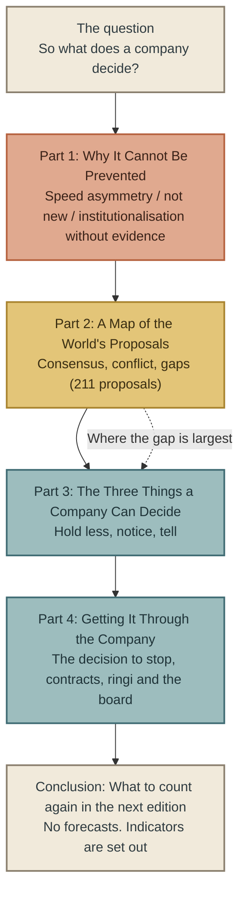

## What this book does not assert

At the end of each chapter, this book sets out “What this chapter does not assert”. 
What applies to the whole book is written here first.

- **This book does not say which measures prevent attacks.** There are no sources that measured this (Chapters 3 and 6). The book's three proposals were chosen only from things that can be decided without asking whether they work (opening of Chapter 7).
- **This book does not place “during the period when you cannot remediate, alternative defences can prevent attacks” as a premise of any of its proposals.** Chapter 3 deals with how this premise was institutionalised without evidence.
- **It does not say that AI is the cause of the leaks.** It writes separately that a Japanese public body confirmed attackers' use of AI (Chapter 1) and that the content of the proposals is the same as before AI (Chapter 2).
- **It does not say that Japan is behind the rest of the world.** Among proposals from Japan, there are some that, within the scope of this book's collection, have no counterpart elsewhere in the world (Chapter 10).
- **It does not assess the organisations that wrote the notices.** As with the registry, it records what the notices said and what they did not say.

## This book will be updated

The speed of attacks, the number of proposals and the number of notices all change within a year. 
The book's numbers are set out at the start of each chapter as “As of edition 1” and are updated with each edition. 
Updates are limited to three places: the proposal ledger `data/proposals.csv`, the verification record in Appendix B, and the indicator table in the Conclusion. 
When updating, “(Added on D Month YYYY / Corrected on D Month YYYY)” is placed immediately before the changed passage. 
This is the same discipline as in the companion book.

This book is written on the premise that it will be updated. 
So anything the first edition cannot state firmly, it does not state firmly.

## About me

I am not a security specialist. 
I am an AI strategist who has written about how AI changes businesses and organisations. 
Why I wrote this book, and the weakness and the meaning of not being a specialist, are set out at the opening of Chapter 1.

 

---

### References

1. The author, “The Japan Breach Registry 2026, 3rd edition” (2026-10-26) https://github.com/Leading-AI-IO/the-japan-breach-registry-2026
2. The author, “The proposal ledger `data/proposals.csv`, 1st edition” (2026-10-30) — This repository

 

---

# Part 1: Why It Cannot Be Prevented

---

# Chapter 1: The Speed Asymmetry — 29 Minutes and 43 Days

## Why I am writing this now

I am not a security specialist. 
I am someone who, as an AI strategist, has written about how AI changes businesses and organisations. 
The reason I am writing this book is that, in the autumn of 2026, three things happened at once.

The first was that a string of personal data leaks was announced in Japan. 
I lined them up in a registry, one notice at a time and in their original wording, and published it as *The Japan Breach Registry 2026*. 
What I found from lining them up was that many of the notices did not say “where the attackers got in”, and that not a single notice mentioned AI on the attackers' side. 
The registry is a book that records facts, and I did not write beyond that.

The second was that on 15 October, the JPCERT Coordination Center (JPCERT/CC) wrote in a primary source that it had “confirmed” (author's translation) attackers' use of AI. 
Until then, “Is AI being misused?” was a guess. 
With a public body's confirmation, the question moved from “Was AI used?” to “So what does a company decide?”

The third was that, in trying to answer that question, I collected the world's proposals. 
On 11 October, I had once decided not to write this book. 
I had decided for myself that I would not write it unless I could verify the grounds for the proposals in primary sources. 
After that, I collected 250 proposals from governments, standards bodies, AI companies, security companies, insurers, academia, individuals and regulators, tracing each back to its primary source. 
What I found was that the content of the proposals uniformly predated AI; that not a single proposal had measured its effect; and that the issue of which personal data a company holds and how much — in other words, the most upstream issue, reducing the very thing to be protected — was the thinnest.

On an executive's desk pile up news headlines, vendors' sales proposals and alerts from supervisory authorities. 
Among them, there was nothing that put into one book “what the world proposes, how far it is grounded, and where the gaps are”. 
My not being a security specialist is a weakness of this book. 
At the same time, it is the reason I can write what specialists cannot write from inside their own speciality. 
This is not a book about technology. 
It is a book about management decisions.

So I am writing it now. 
The speed of attacks has changed by an order of magnitude in a year (shown in this chapter), and by next autumn the book's numbers and the map of proposals should have changed too. 
That is why I made this an updated, living book.

---

On 15 October 2026, JPCERT/CC (JPCERT Coordination Center) published a study of the attack methods used in a series of unauthorised-access incidents in Japan, and wrote the following sentence.

“In the process, we confirmed that the attackers had used AI to carry out scanning for known vulnerabilities, attacks via APIs and other activities.”

Within the scope this book has checked, this is the first time a Japanese public body has written in a primary source that it had “confirmed” attackers' use of AI. 
The list of leaks announced in Japan this autumn, and what each notice did and did not say, are recorded in the companion book *The Japan Breach Registry 2026* ([the-japan-breach-registry-2026](https://github.com/Leading-AI-IO/the-japan-breach-registry-2026)). 
This book does not repeat that record.

What this chapter deals with is not whether AI caused the leaks. 
It is the unit of the clock by which attackers and defenders each move.

## The numbers this chapter stands on

This book is an updated book. 
Because each company re-measures the speed of attacks and the speed of remediation every year, the numbers written in the text will be replaced by the next year's reports. 
So at the start of each chapter, the numbers that support that chapter's argument are set out in a table, together with when and in which primary source they were checked. 
What the text discusses is not the numbers themselves but the units and the direction the numbers show. 
When the numbers are updated, this table is replaced, and the text is corrected, with “(Added)”, only where the argument of the text changes.

**As of edition 1 (checked against primary sources on 30 October 2026)**

| Number | Issuer and source | Period covered | Next update |
|---|---|---|---|
| Average of 29 minutes from intrusion to lateral movement; fastest 27 seconds | CrowdStrike 2026 Global Threat Report | 2025 | 2027 edition |
| The fastest 25% reached exfiltration in 72 minutes (285 minutes the previous year) | Unit 42 Global Incident Response Report 2026 | October 2024 – September 2025 | 2027 edition |
| Full remediation of critical vulnerabilities 26% (previous year 38%); median time to full resolution 43 days (previous year 32 days) | Verizon 2026 Data Breach Investigations Report | November 2024 – October 2025 | 2027 edition |
| Average time to exploitation estimated at 7 days before patch release | Mandiant M-Trends 2026 | 2025 | 2027 edition |

“Next update” in the table refers to the issuer's next annual report.

## The attackers' clock ticks in minutes

In its annual report published on 24 February 2026, CrowdStrike wrote of attackers in 2025:

“The average eCrime breakout time fell to just 29 minutes in 2025”

Breakout time is the time from an attacker's intrusion into the first machine until they begin to spread to other devices on the same network. 
The fastest case was “27 seconds”.

What about the time after the intrusion until personal data is taken out? 
Palo Alto Networks' Unit 42 tallied more than 750 cases it responded to between 1 October 2024 and 30 September 2025, and wrote:

“The fastest 25% of intrusions reached exfiltration in 72 minutes, down from 285 minutes the calendar year prior.”

In the fastest quarter of attacks, data was outside the organisation little more than an hour after the intrusion. 
And that time shrank to about a quarter in one year.

The attackers' clock ticks in minutes.

## The defenders' clock ticks in days

It was Verizon that measured the defenders' clock. 
The 2026 edition of the Data Breach Investigations Report tallies more than 31,000 incidents in 145 countries, and more than 22,000 confirmed breaches among them (the period covered is 1 November 2024 to 31 October 2025).

The report first wrote that the entry point for intrusions had changed.

“Exploitation of vulnerabilities is now the most common initial access vector for breaches.”

Its share was 31%, above credential abuse (13%), which had been top until the previous year. 
If vulnerabilities have become the largest entry point, the defenders' question becomes “how quickly can we fix vulnerabilities?” 
The answer is in the same report too.

“Only 26% of critical vulnerabilities” “were fully remediated by organizations in 2025, a drop from the previous year's 38%.”

“The median time for full resolution went up to 43 days, almost two weeks more than the previous year's 32 days.”

The share that could be remediated fell, and the number of days needed to remediate grew. 
In a report dated 25 April 2026, the Cloud Security Alliance cites a figure on an even longer timescale: “Approximately 45% of enterprise vulnerabilities remain unpatched after twelve months”. 
This is third-party data quoted in that report.

The defenders' clock ticks in days. 
And part of it has stopped on a scale of years.

## Attacks that come before the fix

The comparison so far assumed the order “a vulnerability is disclosed, a fix is released, the organisation applies it”. 
Three sources show, each with a different yardstick, that this premise itself is breaking down.

| Issuer | Figure as written | Reference date | What was counted |
|---|---|---|---|
| Mandiant M-Trends 2026 (announced 23 March 2026) | Average time to exploitation “an estimated -7 days” | Patch release date | Exploitations Mandiant investigated in 2025 |
| CrowdStrike 2026 Global Threat Report | “42% of vulnerabilities were exploited before public disclosure” | Vulnerability disclosure date | Exploited vulnerabilities |
| VulnCheck (cited in the Cloud Security Alliance report) | “32.1% of newly tracked exploits appeared on or before the CVE's public disclosure date” | Public disclosure date of the CVE (the common identifier number for vulnerabilities) | Newly tracked exploits |

The three figures differ in their reference date and in what they counted. 
Minus 7 days is an estimate based on the patch release date, and it is not on the same scale as 42% or 32.1%, which are based on the disclosure date. 
This book does not add these three together or average them.

Even so, the three point in the same direction. 
A considerable part of exploitation begins before a fix is out in the world, or before the vulnerability is disclosed. 
Mandiant put this as “exploitation is routinely occurring before a patch is even released”.

Defence that competes on the speed of remediation has no answer for the time when a fix does not yet exist. 
What the world's proposals say about what organisations should do in that time, and how far they are grounded, is dealt with in Chapter 3.

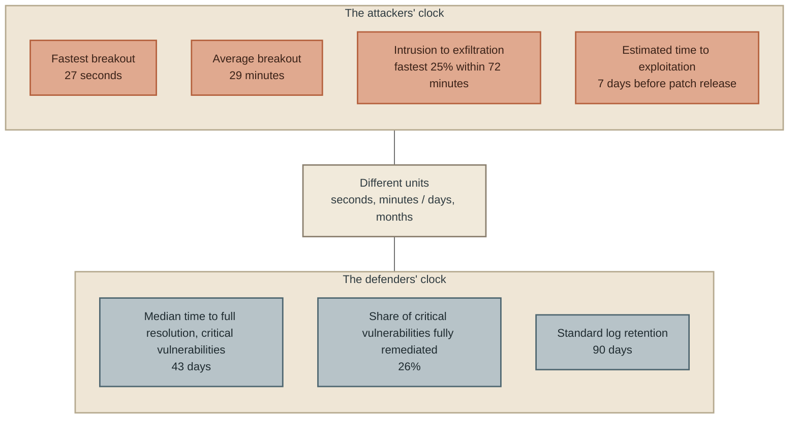

## Why 29 minutes and 43 days may be set side by side, and why they may not

The “29 minutes” and “43 days” in the chapter title are not numbers measured with the same yardstick. 
29 minutes is attacker behaviour observed by CrowdStrike; 43 days is organisations' remediation tallied by Verizon. 
The populations covered and the periods tallied are also different. 
A calculation such as “how many 29-minute attacks could happen within 43 days” has no meaning.

There are still two reasons to set them side by side.

The first is units. 
The main figures on the attackers' side are written in minutes (29 minutes, 72 minutes, 27 seconds), and the main figures on the defenders' side in days (43 days, 32 days) or years (12 months). 
The sources on each side write in the units of their own clock. 
Those units differ by two to three orders of magnitude.

The second is direction.

| Side | Indicator | Previous year | This year | Direction |
|---|---|---|---|---|
| Attack | Time to exfiltration for the fastest 25% (Unit 42) | 285 minutes | 72 minutes | Faster |
| Defence | Full remediation rate for critical vulnerabilities (Verizon) | 38% | 26% | Down |
| Defence | Median time to full resolution (Verizon) | 32 days | 43 days | Slower |

The attackers' times shrank, and the defenders' times grew. 
Even across sources with different populations, one can read that the directions are opposite. 
What this book calls the “speed asymmetry” is this difference in units and this difference in direction.

## What did AI widen?

This asymmetry was not created by AI. 
The structure in which it takes days from a vulnerability's disclosure to its remediation, and attacks come in the meantime, existed before AI. 
So what did AI change in this structure? 
There are three things that can be confirmed in primary sources.

**The volume of attack activity grew.** 
CrowdStrike wrote that “AI-enabled adversaries increased operations by 89% year-over-year”. 
JPCERT/CC, cited at the start of this chapter, confirmed that attackers used AI to scan for known vulnerabilities and attacked APIs they had found by analysing apps for Android. 
Both show AI doing, in large volumes and quickly, work that human attackers used to do by hand, one task at a time.

**The speed of finding vulnerabilities overtook the speed of fixing them.** 
This is not only about attackers. 
In Anthropic's Project Glasswing, which uses AI to look for vulnerabilities for defence, about 50 partners found “more than ten thousand” vulnerabilities of high or critical severity. 
Meanwhile, of the 530 high- or critical-severity vulnerabilities Anthropic reported, 75 have been fixed (the company's update report, published on 22 May 2026 and updated on 28 September). 
The Cloud Security Alliance tallied that, as of 22 May 2026, of 1,596 vulnerabilities disclosed to open-source maintainers, 97 had been confirmed as fixed, and described this gap as “the discovery-to-remediation gap as a primary — and previously underappreciated — systemic security risk”.

AI has made the finding side faster. 
The fixing side still moves at human speed. 
This gap has arisen inside the defending side too.

**However, there is no source that names AI as the direct cause of a breach.** 
Mandiant wrote of 2025 that “we do not consider 2025 to be the year where breaches were the direct result of AI”. 
Unit 42 stated that in more than 90% of cases, misconfigurations or gaps in defences “materially enabled” the intrusion, and wrote that in almost 90% of investigations, weaknesses in identity (accounts and authentication) played a significant role. 
Most intrusions still come in through holes on the side of people and organisations.

What AI widened is the volume of attack activity and the speed of finding vulnerabilities. 
Of the widening, over this past year, of the time gap between attack and defence, no source within the scope this book has checked separates out how much is due to AI.

## What this chapter does not assert

- **It does not say that Japan's autumn 2026 leaks were caused by attacks using AI.** JPCERT/CC does not say which companies' incidents were caused by those attacks either. What each notice said about AI on the attackers' side is recorded, in its original wording, in the companion book's registry.
- **It does not say that fixing faster would prevent them.** Part of exploitation comes before the fix (see “Attacks that come before the fix”).
- **Nor does it say that the period when you cannot remediate can be filled with other defences.** This book has not found an effect measurement that shows this (Chapter 3).
- **It does not compare 29 minutes and 43 days arithmetically.** It compares only units and direction (see “Why 29 minutes and 43 days may be set side by side, and why they may not”).

## To the next chapter

Attacks move in minutes; fixes move in days. 
Some attacks come before a fix is out. 
Faced with this asymmetry, what did the world's governments, standards bodies, AI companies, security companies and insurers propose?

The next chapter opens up the content of those proposals. 
What comes into view there is the fact that the issuers of the proposals themselves had written that they were “not new”.

 

---

### References

1. JPCERT/CC, “JPCERT/CC Eyes “A study of the attack methods in the series of unauthorised-access incidents”” (2026-10-15) — Main text https://blogs.jpcert.or.jp/ja/2026/10/web_api_attacks.html
2. CrowdStrike, “2026 CrowdStrike Global Threat Report (press release)” (2026-02-24) — Press release text (the report itself not opened) https://www.crowdstrike.com/en-us/press-releases/2026-crowdstrike-global-threat-report/
3. Palo Alto Networks Unit 42, “Global Incident Response Report 2026” (2026) — Report PDF https://start.paloaltonetworks.com/rs/531-OCS-018/images/Unit42-Global-Incident-Response-Report.pdf
4. Verizon, “2026 Data Breach Investigations Report” (2026) — Report PDF (relevant passages) https://www.verizon.com/business/resources/T343/reports/2026-dbir-data-breach-investigations-report.pdf
5. Google Cloud / Mandiant, “Announcing M-Trends 2026” (2026-03-23) — Announcement article (report PDF not opened) https://security.googlecloudcommunity.com/google-threat-intelligence-3/announcing-m-trends-2026-data-insights-and-strategies-from-the-frontlines-7123
6. Cloud Security Alliance, “The Collapsing Exploit Window” (2026-04-25) — Main text https://labs.cloudsecurityalliance.org/research/csa-whitepaper-collapsing-exploit-window-ai-speed-vulnerabil/
7. Cloud Security Alliance, “Project Glasswing: AI Discovery Outpaces Open-Source Patching Capacity” (2026-06-07) — Main text https://cloudsecurityalliance.org/artifacts/project-glasswing-ai-discovery-outpaces-open-source-patching-capacity
8. Anthropic, “Project Glasswing: An initial update” (2026-05-22 (updated 2026-09-28)) — Main text https://www.anthropic.com/news/glasswing-initial-update

 

---

# Chapter 2: Three Primary Sources That Wrote “Not New” — What AI Did Not Change

## The sources this chapter stands on

Chapter 1 was a chapter of numbers; this chapter is a chapter of sentences. 
What it stands on are the following three sentences, written by the issuers of proposals about their own proposals. 
All three were checked against the originals on 30 October 2026.

**As of edition 1 (checked against primary sources on 30 October 2026)**

| Issuer | Source | Date | Sentence written about its own proposals |
|---|---|---|---|
| The cybersecurity agencies of the five Five Eyes countries (the US Cybersecurity and Infrastructure Security Agency (CISA) and National Security Agency (NSA), the UK National Cyber Security Centre (NCSC), the Australian Signals Directorate (ASD), the Canadian Centre for Cyber Security (CCCS), New Zealand's National Cyber Security Centre (NCSC)) | Joint statement “The AI shift in cyber risk: why leaders must act now” | 2026-06-22 | "These actions are not new, but are now urgent" |
| Anthropic | “Project Glasswing: An initial update” | 2026-05-22 (updated 09-28) | "The advice below is not new" |
| Verizon | 2026 Data Breach Investigations Report | 2026 | "Refinement, not revolution." |

On top of these, this chapter lays two Japanese public documents: the study by the JPCERT Coordination Center (JPCERT/CC) (15 October 2026) and the alert from the National Cybersecurity Office, Cabinet Secretariat (NCO) (9 October 2026). 
Both are documents premised on attackers' use of AI, yet the content of their countermeasures is conventional.

---

## Three “not new”s

On 22 June 2026, six heads of the cybersecurity agencies of the United States, the United Kingdom, Australia, Canada and New Zealand issued a joint statement. 
Its title was “The AI shift in cyber risk: why leaders must act now”. 
The statement wrote “The timeline is not years, it is months.” and called for five actions.

1. “Reduce your attack surface” — limit unnecessary system access and external connections
2. “Accelerate patching processes” — AI is shortening the time from discovering a vulnerability to exploiting it
3. “Address legacy systems” — out-of-support systems are easy targets
4. “Review and strengthen identity and access controls” — limit who can touch critical systems
5. “Prepare for incidents before they happen” — test response plans, and assume that compromise will happen

Then, straight after listing the five, it wrote this:

“These actions are not new, but are now urgent”

The government agencies of five countries stated in writing that their own proposals were “not new”.

A month earlier, on 22 May 2026, Anthropic published an update report on Project Glasswing, an effort that uses AI models to find vulnerabilities and disclose them to open-source maintainers. 
The second half of the report sets out advice to software developers and defenders: shorten patch cycles; shorten the time for testing and deploying fixes; keep urging users who go on running software with known vulnerabilities to update. 
Before that advice, Anthropic placed one sentence:

“The advice below is not new”

In the same year, Verizon, in the conclusion of its annual report tallying more than 31,000 incidents in 145 countries, put up a three-word heading:

“Refinement, not revolution.”

On vulnerability exploitation becoming the top intrusion route, the same report wrote that it “underlines the ongoing importance of getting the basics right”.

Government agencies, an AI developer, and a telecoms company's annual report. 
Three parties in different positions wrote the same thing, in their own words, in the same year. 
This book takes these three sentences as its starting point for reading enterprise security in the AI era. 
If the issuers of the proposals say they are “not new”, we need to check, from their own documents, what has changed and what has not.

## Japanese documents have the same structure

The JPCERT/CC study (15 October 2026) cited at the start of Chapter 1 is a document that confirmed that attackers used AI to scan for known vulnerabilities and attacked APIs they had found by analysing Android apps. 
The document gives four headings for its countermeasures.

- “Protecting secret information” (author's translation) — do not embed in applications the secret keys used for API authentication, or long-lived credentials
- “Authentication and authorisation on the server side” — do not rely only on signing or obfuscation on the app side; authenticate and authorise users on the server side
- “Countermeasures against misuse of APIs” — apply rate limits and monitor abnormal requests, and assume access from sources other than the legitimate app
- “Countermeasures against server-side request forgery (SSRF)” — for APIs that fetch the content of external URLs, restrict the destinations, and also verify the destination after redirects

All four have been written as design principles for web applications since before AI. 
A document that confirmed that attackers used AI does not list a single AI-specific item among its countermeasures.

Six days before that, on 9 October 2026, the NCO published “On responses in light of leakage and other incidents caused by unauthorised access”. 
It is a document addressed to senior management, and it closes: “As cyberattack methods, including the misuse of AI, become more advanced and sophisticated, we ask senior management to position cybersecurity as a management issue and to strengthen measures, including the necessary investment and the development of human resources and structures.” 
The measures are in three parts, and under “appropriate management of web systems and the like”, “measures against compromise through the supply chain” and “appropriate management of data” there are close to 50 items in total: prompt application of patches, not using end-of-support products, multi-factor authentication, disabling unnecessary accounts, collecting and storing logs, continuous checking of vendors, minimising the information held, encrypting stored data.

In this document, the word AI appears only in the closing sentence quoted above. 
None of the 50 measures assumes AI.

This book is not writing this as criticism. 
The two Japanese public bodies are making the same judgement as the three parties elsewhere in the world: having confirmed that AI was used in attacks, that the conventional measures will do. 
What should be asked is the basis of that judgement.

## Why “not new”? — The entry points have not changed

The reason the measures do not change is that the entry points for intrusion have not changed.

In Verizon's 2026 report, the top initial access vector was exploitation of vulnerabilities (31%), followed by credential abuse (13%). 
Unit 42 stated that of the more than 750 cases it responded to in 2025, in more than 90% “misconfigurations or lapses in security coverage materially enabled the intrusion”, and wrote that in almost 90%, weaknesses in identity played a significant role. 
The routes JPCERT/CC confirmed in Japan were credentials embedded in apps, and APIs without authorisation.

Vulnerabilities, credentials, misconfigurations, missing authorisation. 
Even when attackers use AI, the holes they come in through are the same. 
AI did not create new holes. 
It increased the speed of finding holes that already exist, and the number of holes that can be hit at the same time. 
If the holes are the same, the measures that close them are the same too. 
The three parties that wrote “not new” know this from their own observation data.

The request issued to financial institutions by the Financial Services Agency (FSA) and the Bank of Japan on 22 May 2026 goes one step further on this point. 
Citing a report by the UK AI Security Institute (AISI), the request stated that “it is reported that, at present, frontier AI cannot be said to be able to achieve attacks against sufficiently defended IT systems”. 
What AI changed is the time until undefended systems are found and attacked. 
It is not how defended systems are protected.

## So what did change?

The documents that wrote “not new” also wrote “now urgent”. 
Let us pick out what changed from the same set of documents.

**First, time.** 
The Five Eyes wrote “AI is shortening the time between vulnerability discovery and exploitation.” and stated that “cyber risk assumptions can become outdated in months, not years”. 
The numbers seen in Chapter 1 are the substance of these sentences.

**Second, volume.** 
Of the nine short-term actions in the request from the FSA and the Bank of Japan, two are devoted not to time but to volume: “(4) Add human resources for patch application” and “(5) Check the content of maintenance contracts with vendors”. 
The request anticipates that AI will increase the number of vulnerabilities found and that fixes will be released in large numbers at once, and asks institutions to secure in advance the people on the applying side and the response capacity of vendors. 
The content of the measure is still “apply patches”, but the scale of the set-up that carries it out has changed.

**Third, the premise of running out of time.** 
The same request set out three items for cases where patches will not be in time: “(3) Resolve in advance the technical debt of the identified assets”, “(7) Also strengthen measures other than patch application” and “(8) Prepare for stopping priority services / IT systems”. 
And of these it wrote: “However, these are strictly emergency stop-gap measures, and in the medium to long term it is necessary to work on a transition to the automation of vulnerability handling and the like.” 
No public document before AI had set as its premise that remediation would not be in time. 
The “institutionalisation without evidence” dealt with in Chapter 3 starts here.

What changed is not the content of the measures but the speed and scale at which they are run, and the premise that “we will not be in time”.

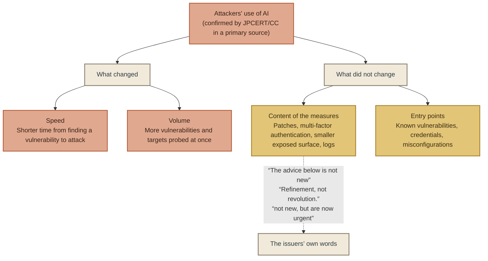

## What “not new” means

To sum up so far: what the primary sources of 2026 say together about enterprise security in the AI era comes down to the following two points.

1. The content of the measures is the same as before AI. The issuers themselves say so.
2. The time to carry out the measures has become shorter, and the scale needed has become larger. Provisions for when “we will not be in time” have begun to be written into public documents.

From these two, one implication for executives follows. 
Looking for “new measures for the AI era” is the wrong way to frame the question. 
What to look for is not new measures, but how far existing measures are being carried out within the shorter time and the larger scale. 
The original wording of the Five Eyes statement is “not new, but are now urgent”, which can be read not as “do something new” but as “do the old things, right now”.

And one more question remains. 
When the “old things” will not be in time, what does an organisation do? 
The FSA and the Bank of Japan listed alternative defences and stopping as “emergency stop-gap measures”. 
The next chapter checks how far that is grounded.

## What this chapter does not assert

- **It does not say that AI has not changed the threat.** What changed is time and volume (see “So what did change?”). What did not change is the content of the measures (see “Three “not new”s” to “Why “not new”? — The entry points have not changed”). This chapter does not mix the two.
- **It does not say that conventional measures are sufficient.** The three parties that wrote “not new” also wrote “urgent”. Whether they are sufficient is decided by the speed and scale of implementation, and this book has no source that measured that.
- **Nor does it say that the measures of Japanese public bodies are insufficient.** The measures of JPCERT/CC and the NCO rest on the same judgement as the three parties elsewhere in the world.
- **It does not say that AI-specific measures do not exist.** Proposals that protect AI systems themselves, such as permission management for AI agents and measures against prompt injection, exist separately. What this chapter dealt with is proposals that protect enterprise systems holding personal information. The former are touched on in Chapter 4.

## To the next chapter

The measures are not new. 
But time is short. 
On what to do in that short time, the US federal government and Japan's financial authorities wrote the same answer into their rules in 2026: “While you cannot remediate, you may prevent attacks by other means.”

The next chapter examines what grounds that answer stands on. 
To give the conclusion first: within the scope this book searched, there was not a single effect measurement to serve as grounds.

 

---

### References

1. Six agencies of the five Five Eyes countries, “The AI shift in cyber risk: why leaders must act now (published on the UK NCSC site)” (2026-06-22) — Main text https://www.ncsc.gov.uk/news/the-ai-shift-in-cyber-risk-why-leaders-must-act-now
2. Anthropic, “Project Glasswing: An initial update” (2026-05-22 (updated 2026-09-28)) — Main text https://www.anthropic.com/news/glasswing-initial-update
3. Verizon, “2026 Data Breach Investigations Report” (2026) — Report PDF (relevant passages) https://www.verizon.com/business/resources/T343/reports/2026-dbir-data-breach-investigations-report.pdf
4. Palo Alto Networks Unit 42, “Global Incident Response Report 2026” (2026) — Report PDF https://start.paloaltonetworks.com/rs/531-OCS-018/images/Unit42-Global-Incident-Response-Report.pdf
5. JPCERT/CC, “JPCERT/CC Eyes “A study of the attack methods in the series of unauthorised-access incidents”” (2026-10-15) — Main text https://blogs.jpcert.or.jp/ja/2026/10/web_api_attacks.html
6. National Cybersecurity Office, Cabinet Secretariat, “On responses in light of leakage and other incidents caused by unauthorised access” (2026-10-09) — Main text https://www.cyber.go.jp/pdf/press/taiou.pdf
7. Financial Services Agency / Bank of Japan, “Request concerning “Short-term responses by financial institutions and others in light of changes in threats posed by frontier AI”” (2026-05-22) — Main text (including attachments and footnotes) https://www.fsa.go.jp/news/r7/sonota/20260522-5/01.pdf

 

---

# Chapter 3: Institutionalisation Without Evidence — How “Mitigation May Substitute” Became Rule

## The sources this chapter stands on

At the end of the previous chapter, we saw that the request from the Financial Services Agency (FSA) and the Bank of Japan set out measures for cases where “patches cannot be applied in time”. 
This chapter follows one idea that public documents in the United States and Japan wrote down in the same year, 2026. The idea is this: **while a patch cannot be applied, another defence may substitute for it.** 
This book calls this “substitute defence”.

This chapter looks at two things. 
Which documents wrote this idea down, and how. 
And whether any source anywhere has measured that substitute defence actually prevents attacks.

**As of edition 1 (checked against primary sources on 30 October 2026)**

| Type | Issuer and source | Date | Scope checked |
|---|---|---|---|
| Rule | US Cybersecurity and Infrastructure Security Agency (CISA), Binding Operational Directive (BOD) 26-04 “Prioritizing Security Updates Based on Risk” | 2026-06-10 | CISA's official announcement (the directive text could not be opened on cisa.gov and was not opened. Details of the text rely on third-party commentary, and this is stated) |
| Rule | US Federal Risk and Authorization Management Program (FedRAMP), “FedRAMP Response to CISA BOD 26-04” (NTC-0014) | 2026-06-16 | Full text |
| Rule | Financial Services Agency (FSA) and Bank of Japan, “Short-term responses by financial institutions and others in light of changes in threats posed by frontier AI”, Request 7 and footnote 6 | 2026-05-22 | Full text and footnotes |
| Evidence (for) | Pizzi et al., “VirtualPatch”, Computers & Security vol.157 | 2025 | Abstract |
| Evidence (for) | At-Bay, “2026 InsurSec Report” | 2026-04-22 | Press release |
| Evidence (against) | Akhavani et al., “WAFFLED”, Annual Computer Security Applications Conference (ACSAC) 2025 | 2025 (v4 in 2026-03) | Abstract |
| Evidence (against) | US CISA, red team assessment report AA24-326A | 2024-11 | Full text |
| Evidence (gap) | Huff et al., “I Can't Patch My OT Systems!”, arXiv 2510.06951 | 2025-10-08 | Abstract |

---

## The United States — the definition of “remediation” changed

On 10 June 2026, the US Cybersecurity and Infrastructure Security Agency (CISA) issued Binding Operational Directive BOD 26-04, “Prioritizing Security Updates Based on Risk”, which binds federal agencies. 
CISA's own announcement describes the directive as follows. 
For each vulnerability, priority is set by four factors: “asset exposure, KEV status, exploit automation, and post-exploitation technical impact” (KEV is CISA's Known Exploited Vulnerabilities catalogue). 
High-risk vulnerabilities get deadlines, and the directive allows “deferring action for lower-risk vulnerabilities”. 
CISA says the directive is “Harmonizing and improving” the earlier directives BOD 19-02 (2019, remediation deadlines for internet-facing systems) and BOD 22-01 (2021, the Known Exploited Vulnerabilities catalogue).

This book could not open the text of the directive on cisa.gov. 
The details below rely on CISA's own announcement and on commentary by third parties (the security company Qualys, the law firm Covington, and the Cloud Security Alliance). 
According to them, deadlines come in stages: 3 days at the shortest, then 14 days, 60 days, and “deferred until the next system refresh”. 
And “remediation” in the directive does not mean only applying a patch. 
Qualys wrote: “BOD 26-04 explicitly defines remediation as any action that eliminates the vulnerability, including asset isolation, mitigation, or uninstall”. 
The Cloud Security Alliance's research note (20 August 2026) also summarises the directive as one that treats complementary mitigations, such as firewall rules that remove exposure and isolation, as equal to patches for meeting the deadlines.

Since we have not read the text of the directive, this book does not quote this definition as the directive's own words. 
However, a primary source on the receiving side of the directive writes the same thing in its own words.

FedRAMP, the federal programme that authorises cloud services for government procurement, published its response to the directive on 16 June 2026. It wrote this about cloud providers:

“cloud service providers may mitigate a vulnerability until it no longer is automatable or internet-reachable”

It then said that a vulnerability in that state does not require full remediation. 
The deadline is “By August 7, 2026, agency policies must support ongoing vulnerability remediation.”

In the US federal government, in the summer of 2026, “mitigation” entered the definition of “remediation”.

## Japan — “emergency stop-gap measures” and the “risk-acceptance procedure”

In Japan, financial regulators wrote the same idea three weeks before the United States. 
Request 7, “Strengthen measures other than patching”, in the request issued by the FSA and the Bank of Japan on 22 May 2026, begins as follows.

“For the services/IT systems to be prioritised that were identified in item 2, where applying the patch itself is difficult, or where shortening the time needed to apply the patch is difficult, it is necessary to strengthen defence in depth, for example by applying virtual patches using cloud-based web application protection functions (WAF: Web Application Firewall) and the like, which can be expected to take effect early, or by introducing bot countermeasures.” 
(author's translation)

It goes on to list network segmentation, multi-factor authentication (MFA) for privileged IDs, endpoint detection and response (EDR), and measures against lateral movement after an internal intrusion. 
Where the US directive widened the definition of “remediation”, the Japanese request built a separate shelf called “measures other than patching” and put the same contents on it.

What deserves attention here are the three notes the request attached to this shelf.

First, footnote 6 defines a virtual patch as “a temporary solution for cases where it is difficult to apply quickly to servers and other systems the original security patch provided by the software vendor”, and then writes:

“It should be noted that this is not a permanent response, for reasons such as that it can only defend against attacks coming through the network path where it is installed, and that there is a risk that the virtual patch cannot keep up when variants of the attack code appear.”

Second, the main text says: “Note that, since these measures are only risk-reduction measures, it is necessary to assess the residual risk from not being able to apply the patch, and to carry out an appropriate risk-acceptance procedure that takes into account the time needed to apply the patch.” 
This is an instruction: substitute defence reduces risk rather than removing it, and management must go through a procedure to accept the risk that remains.

Third, it closes the whole request with: “However, these are only emergency stop-gap measures, and in the medium to long term it is necessary to work on moving to, for example, automating vulnerability response.”

The Japanese request accepts substitute defence and, in the same document, writes that it may not work, that its effect is limited, and that the remaining risk is taken on by management decision. 
The US directive put “mitigation” inside “remediation”. 
The Japanese request attached the notes “not permanent” and “a risk-reduction measure” to “mitigation”. 
The way they are written differs. 
But neither gives a number for how far substitute defence prevents attacks.

## Looking for evidence — sources on the supporting side

This book looked for sources that measured how far substitute defence prevents attacks. 
We set out what we found, starting with the supporting side.

**VirtualPatch (Computers & Security, 2025).** 
A research team at the University of Padua built, for each of 25 Android vulnerabilities (Common Vulnerabilities and Exposures, CVEs), an attack exploit and a “virtual security patch”, and confirmed by experiment that the latter blocks the former. 
The abstract states that they “successfully implemented security patches for all the 25 Android CVEs”, and it also measures a median of 35 days before Samsung integrated the original patch. 
It is the only controlled experiment this book found that directly answers the question “can another mechanism fill the period before the original patch arrives?” 
However, its subject is the virtualisation of Android apps, and it cannot be applied as it is to WAFs or segmentation in a corporate network.

**At-Bay 2026 InsurSec Report (22 April 2026).** 
The cyber insurer At-Bay wrote, from claims data covering more than 100,000 policy-years, that 60% of the companies hit by the ransomware group Akira had deployed a major EDR product, and that “The only businesses that avoided full ransomware encryption had their EDR backed by 24/7 monitoring via Managed Detection & Response (MDR)”. 
This shows with real data that, after an intrusion, another control can stop the harm from spreading. 
However, it is not a study that compared assets with the same unpatched vulnerability, with and without MDR. 
Companies that bought MDR and companies that did not also differ in other ways. 
And At-Bay itself sells MDR.

**Marsh McLennan, “Cybersecurity signals” (27 August 2025).** 
The insurance broker Marsh McLennan published correlations between how widely controls were deployed and the outcomes of insurance claims. 
The figures are these: every 25% rise in EDR deployment lowers the probability of a breach by 10%; phishing-resistant multi-factor authentication lowers it by 9%; running tabletop exercises lowers it by 13%. 
It is a source that shows, with large-scale data, that controls are linked to outcomes. 
But it is correlation, not causation, and it is not an analysis focused on “the period before remediation”. 
The main report requires registration, and this book has checked only the published summary.

These three show that “substitute controls can, under specific conditions, stop attacks or stop harm from spreading”. 
They do not go as far as showing that “substitute defence can generally protect the period in which remediation is not possible”.

## Looking for evidence — sources on the opposing side

There are also sources pointing the other way.

**WAFFLED (ACSAC 2025).** 
A research team at Northeastern University in the United States and elsewhere, using a method that exploits differences in how WAFs interpret traffic (parsing discrepancies), “identified and confirmed 1207 bypasses across 5 well-known WAFs, AWS, Azure, Cloud Armor, Cloudflare, and ModSecurity”. 
It has been shown that cloud-based WAFs, the first thing the FSA and Bank of Japan request named, can be bypassed systematically in a research setting.

**CISA red team assessment (AA24-326A, November 2024).** 
CISA's report on a simulated attack against a US critical infrastructure organisation records that, although the organisation had deployed a WAF as a compensating control, a known vulnerability was not mitigated because “they configured the WAF to be only in monitoring mode”. 
Substitute defence does not work just by being put in place. 
Configuration and operation decide the result.

These two are cases showing that substitute defence “may not work”. 
What footnote 6 of the FSA and Bank of Japan request wrote, “the virtual patch cannot keep up when variants of the attack code appear”, is the same thing WAFFLED showed.

## The gap — the substitute itself is not written down

Between the supporting and the opposing sides, there is one more fact. 
Before the effect of substitute defence can even be measured, many vulnerabilities have no information on “what to substitute with”.

The study by Huff et al. (arXiv, 8 October 2025) examined every entry in CISA's Known Exploited Vulnerabilities catalogue up to July 2025. For those affecting industrial control systems (operational technology, OT), it found that, among vendor advisories, “only 13% include vendor workarounds or mitigations as alternatives to patching”. 
The paper's title is “I Can't Patch My OT Systems!”. 
Even when sites that cannot patch look for a substitute, nearly 90% of the advisories do not contain one.

## Summary — the rules moved first

Here is what we have seen so far, side by side.

| | US BOD 26-04 / FedRAMP | Japan FSA and Bank of Japan Request 7 |
|---|---|---|
| What was written | “Remediation” includes isolation and mitigation. Mitigating until the vulnerability is no longer automatable or reachable is enough | If patching is difficult, strengthen defence in depth with virtual patches, segmentation, MFA and EDR |
| Notes attached | Within what this book has checked, there is no note on the limits of the effect | Not a permanent response. A risk-reduction measure. Residual risk goes through a risk-acceptance procedure. An emergency stop-gap measure |
| Numbers on effect | None | None |

And the evidence side that this book searched looks like this.

- No study was found, for corporate environments, that “split unpatched assets by whether substitute defence was present and compared whether attacks succeeded”
- There is supporting evidence under narrow conditions (25 Android cases, zero claims among MDR customers, correlation between controls and claims)
- There is also opposing evidence under narrow conditions (1,207 WAF bypasses, a WAF in monitoring mode)
- The information on substitutes itself is missing for about 90% of OT vulnerabilities

Whether substitute defence works is not known. 
While it is still not known, in 2026 the United States changed the definition of “remediation” and Japan accepted it as an “emergency stop-gap measure”. 
This book calls this “institutionalisation without evidence”.

This is not written as criticism. 
As we saw in Chapter 1, remediation is not keeping up, and some exploitation comes before remediation. 
The rules cannot say “do nothing during the period when you cannot remediate”. 
Even without knowing the effect, they had to write something. 
When the FSA and Bank of Japan request noted “not a permanent response” and “it is necessary to carry out a risk-acceptance procedure”, that was an honest way of writing a rule about something that is not known, while it is still not known.

The problem arises not on the side of the rules but on the side of those who read them. 
When the rules say “mitigation may substitute”, organisations tend to read it as “if we mitigate, we are protected”. 
What the rules say is “mitigation meets the deadline”, not “mitigation prevents attacks”. 
Not mixing these two up is the premise when we set out the three proposals in Part 3.

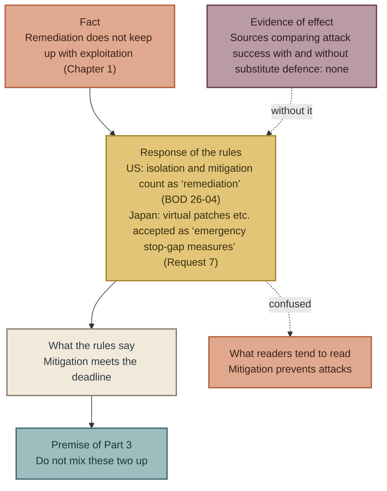

## What this chapter does not assert

- **We do not write that substitute defence does not work.** Cases where it works and cases where it does not both exist, under conditions (the section “Looking for evidence — sources on the supporting side”, the section “Looking for evidence — sources on the opposing side”).
- **Nor do we write that substitute defence works.** No source has measured its effect as a general proposition (see “Summary — the rules moved first”).
- **We do not quote the wording of the BOD 26-04 text.** This book has not been able to open the text of the directive. On the definition of “remediation”, we have stated that we rely on CISA's announcement, FedRAMP's primary source and third-party commentary (see “The United States — the definition of “remediation” changed”). We will revise this chapter once the text has been checked.
- **We do not rank the US and Japanese rules as better or worse.** We have only set out the differences in how they are written (see “Summary — the rules moved first”).

## To the next chapter

What Part 1 has shown is that attacks move in minutes and remediation moves in days (Chapter 1); that the proposers themselves write that the contents of the countermeasures are the same as before AI (Chapter 2); and that the measures for the period that cannot be covered in time were institutionalised without evidence of their effect (Chapter 3).

Part 2 opens the world's proposals that this book collected. 
Eight kinds of issuers — governments, standards bodies, AI companies, security companies, insurers, academia, individuals and regulators — made proposals between 2025 and 2026. We set out what they proposed, where they agree, where they conflict and where there are gaps, within the range we confirmed in primary sources.

If no one has measured whether it works, what can be decided without asking whether it works? 
Part 3 is the answer to that question.

 

---

### References

1. US CISA, “CISA Releases Binding Operational Directive 26-04 on Prioritizing Security Updates Based on Risk (official announcement)” (2026-06-10) — Text of the announcement. The directive text (cisa.gov) was not opened https://content.govdelivery.com/accounts/USDHSCISA/bulletins/41b445a
2. US FedRAMP, “FedRAMP Response to CISA BOD 26-04 (NTC-0014)” (2026-06-16) — Full text https://www.fedramp.gov/notices/0014/
3. Qualys, “CISA BOD 26-04: 3-Day Remediation SLA (blog)” (2026-07-09) — Full text (cited as commentary on the directive) https://blog.qualys.com/product-tech/2026/07/09/cisa-bod-26-04-3-day-remediation-sla
4. Cloud Security Alliance, “CSA Research Note: CISA's BOD 26-04” (2026-08-20) — Full text (cited as commentary on the directive) https://labs.cloudsecurityalliance.org/research/csa-research-note-cisa-bod-26-04-risk-based-vulnerability-re/
5. Covington & Burling, “CISA Releases Binding Operational Directive on Prioritizing Security Updates Based on Risk” (2026-06-17) — Full text (cited as commentary on the directive) https://www.insideprivacy.com/cybersecurity-2/cisa-releases-binding-operational-directive-on-prioritizing-security-updates-based-on-risk/
6. Financial Services Agency and Bank of Japan, “On the request concerning “Short-term responses by financial institutions and others in light of changes in threats posed by frontier AI” (in Japanese)” (2026-05-22) — Full text (Request 7 and footnote 6) https://www.fsa.go.jp/news/r7/sonota/20260522-5/01.pdf
7. Pizzi, Doria, Miazzo, Losiouk, “VirtualPatch: Distributing Android security patches through Android virtualization, Computers & Security vol.157” (2025) — Abstract https://doi.org/10.1016/j.cose.2025.104615
8. At-Bay, “2026 InsurSec Report (press release)” (2026-04-22) — Text of the press release (full report not opened) https://www.at-bay.com/press_releases/2026-insursec-report-ransomware-vpn-sonicwall-attacks/
9. Marsh McLennan, “Cybersecurity signals: Connecting controls and incident outcomes” (2025-08-27) — Published summary (full report requires registration; not opened) https://www.marsh.com/en/corp/about/news/marsh-mclennan-cyber-risk-intelligence-center-report.html
10. Akhavani, Jabiyev, Kallus, Topcuoglu, Bratus, Kirda, “WAFFLED: Exploiting Parsing Discrepancies to Bypass Web Application Firewalls, ACSAC 2025” (2025 (v4 2026-03-13)) — Abstract https://arxiv.org/abs/2503.10846
11. US CISA, “Enhancing Cyber Resilience: Insights from CISA Red Team Assessment of a US Critical Infrastructure Sector Organization (AA24-326A)” (2024-11) — Full text https://www.cisa.gov/news-events/cybersecurity-advisories/aa24-326a
12. Huff, Gandu, Novák, “I Can't Patch My OT Systems! A Look at CISA's KEVC Workarounds & Mitigations for OT” (2025-10-08) — Abstract https://arxiv.org/abs/2510.06951

 

---

# Part 2: A Map of the World's Proposals

---

# Chapter 4: Consensus — Every Proposal Eight Kinds of Issuers Agree On Predates AI

## How to read Part 2

Part 1 took three facts from the sources this book collected and wrote about them. 
Part 2 opens the collected sources themselves.

This book collected proposals on preventing and responding to personal data breaches published between January 2025 and 30 October 2026, tracing each back to its primary source. 
We divided the issuers into eight types.

| Code | Issuer type | Examples |
|---|---|---|
| A | Government and public bodies | US Cybersecurity and Infrastructure Security Agency (CISA), UK National Cyber Security Centre (NCSC), EU Agency for Cybersecurity (ENISA); in Japan, the Personal Information Protection Commission (PPC), the National Cybersecurity Office, Cabinet Secretariat (NCO), the JPCERT Coordination Center (JPCERT/CC) and the Financial Services Agency (FSA) |
| B | Standards and framework bodies | US National Institute of Standards and Technology (NIST), International Organization for Standardization / International Electrotechnical Commission (ISO/IEC), Center for Internet Security (CIS), Open Worldwide Application Security Project (OWASP), Cloud Security Alliance |
| C | AI companies | OpenAI, Anthropic, Google, Microsoft |
| D | Security companies | CrowdStrike, Mandiant, Palo Alto Networks Unit 42, Verizon |
| E | Insurers, finance and audit | At-Bay, Coalition, Marsh McLennan |
| F | Academia | Peer-reviewed papers, arXiv |
| G | Individual experts | Articles and talks in their own name |
| H | Policy, regulation and business bodies | EU NIS2 Directive, US Securities and Exchange Commission (SEC), the UK Cyber Security and Resilience Bill, World Economic Forum |

Each proposal was recorded one by one, with a quotation from the original, the issuer and date, where the primary source is, whether evidence is given, and how it maps to the intrusion routes in Japan's breach registry. 
The full record is in `data/proposals.csv` in the repository, and the main text refers to proposals by their new IDs (in the form A-001). 
The full list is not printed in the main text.

The tiers of evidence have three levels. 
**T1** means we opened the primary source and could check not only the proposal but also its evidence (the source of the data, the sample size and the method). 
**T2** means we opened the primary source but either no evidence was given or we could reach only an excerpt. 
**T3** means we could check it only through news reports or commentary. 
The counts in Part 2 use only T1 and T2; T3 is not counted.

**Entries as of edition 1 (30 October 2026)**

| Category | Count |
|---|---|
| Total candidate entries | 250 |
| Of which T1 and T2 (counted in Part 2) | 211 |
| Of which T3 (not counted) | 39 |

These numbers change with each edition. 
Every “N items” from this chapter on is a count out of these 211. While writing edition 1 (30 October 2026), we opened the originals of the FSA request of 9 October 2026 (A-063) and the directive of India's Computer Emergency Response Team (CERT-In) (H-004) and upgraded them from T3 to T1. 
As a result, the count rose by 2 from 209 that morning.

---

## The definition of “consensus”

What this book calls “consensus” is the case where **three or more types of issuers each write a proposal pointing in the same direction, in their own primary sources**. 
However many items there are within the same issuer type, it counts as one type. 
Even if government bodies in ten countries write the same thing, that does not equal one item each from three parties: a government, a standards body and a company. 
That is the way we count.

If parties in different positions write the same thing, the proposal is likely not to come from a particular interest. 
An insurer writing “introduce MFA” may be driven by underwriting needs, but if a government, a standards body and academia write the same thing, interest alone cannot explain it. 
That is why this book gives weight to consensus.

We classified the 211 items by the content of the proposal. 
The author did the classification, and proposals on the boundary of a judgement were counted in more than one group. 
As a result, there were seven groups in which three or more types of issuers agreed.

## Seven points of consensus

| Group | Content | Items | Issuer types | Representative proposals |
|---|---|---|---|---|
| Consensus 1 | Reducing the externally exposed surface | 9 | A, B, D, E | Five Eyes “Reduce your attack surface” (A-091), NCO “Disable unnecessary ports, protocols, services and the like” (author's translation) (A-041), Coalition “Admin panels and RDP should not be accessible from the open internet” (E-008) |
| Consensus 2 | Fast, risk-based remediation | 31 | A, B, C, D, E, F, G | FSA and Bank of Japan Request 6 (A-084), NCO “Do not put off applying patches … respond in a planned and prompt manner” (A-040), Anthropic “Software developers should shorten their patch cycles” (C-001), Cloud Security Alliance “the traditional patch window assumption that justified 30-day critical remediation cycles is no longer defensible” (B-012) |
| Consensus 3 | Strong authentication and multi-factor authentication | 12 | A, B, C, D, E, G | NCO “Introduce multi-factor authentication (MFA)” (A-042), CIS Controls “Require MFA for Externally-Exposed Applications” (B-005), Mandiant “Enforce FIDO2-compliant multi-factor authentication” (D-016) |
| Consensus 4 | Human-monitored detection and logs | 25 | A, B, D, E, F, G, H | PPC “Set a retention period for logs and analyse them regularly” (A-030), Mandiant “Treat log health like a vital sign” (D-018), At-Bay (E-011) |
| Consensus 5 | Direct involvement of management | 8 | A, B, C, G, H | FSA and Bank of Japan Request 1 (A-082), NIST Cybersecurity Framework (CSF) 2.0 Govern (B-013), OpenAI-led open letter “Make cyber defense an immediate leadership priority” (C-013), EU NIS2 “accountability of the top management” (H-026) |
| Consensus 6 | Managing vendors and the supply chain | 15 | A, B, D, E, F, H | NCO “Understand the state of management, including sub-contractors” (A-044), NIST CSF 2.0 “Incorporate requirements into contracts” (B-014), Verizon (D-007), NIS2 Article 21 (H-020) |
| Consensus 7 | Issue a first notice even without full information, and add to it later | 38 | A, C, E, F, G, H | European Data Protection Board (EDPB) “If only limited information is available, an initial notification should be performed” (A-012), UK Information Commissioner's Office (ICO) (A-073), France's Commission nationale de l'informatique et des libertés (CNIL) (A-075), NIS2 24 hours / 72 hours (H-019), Japan's guidance for sharing and disclosing cyber incidents “disclose information in stages” (A-005) |

Of the seven groups, the widest range of issuer types is in Consensus 2 (remediation) and Consensus 4 (detection): seven of the eight types write them. 
Even the narrowest, Consensus 1, has four types.

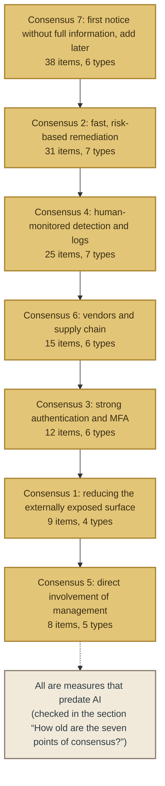

## How old are the seven points of consensus?

For each of the seven, we checked when its content was first written into a standard or a rule. 
This is not the publication date of the proposals this book collected, but the origin of what those proposals say.

| Group | Origin of the content (the earliest this book has confirmed) | Year |
|---|---|---|
| Consensus 1 Reducing the externally exposed surface | US CISA Binding Operational Directive (BOD) 19-02 (remediation deadlines for vulnerabilities in internet-facing systems), BOD 23-02 (ban on exposing management interfaces) | 2019 / 2023 |
| Consensus 2 Fast, risk-based remediation | US CISA BOD 22-01 (deadlines based on the Known Exploited Vulnerabilities catalogue) | 2021 |
| Consensus 3 Multi-factor authentication | CIS Controls (a system of basic controls including multi-factor authentication), NIST SP 800-63 (electronic authentication guideline) | 2000s onwards |
| Consensus 4 Detection and logs | NIST SP 800-61 (first edition of the incident handling guide); its Rev.3 came in 2025 | 2004 onwards |
| Consensus 5 Management involvement | NIST Cybersecurity Framework 1.0; 2.0 added the “Govern” function | 2014 / 2024 |
| Consensus 6 Vendor management | ISO/IEC 27036 (information security for supplier relationships), NIST SP 800-161 (supply chain risk management) | 2013 onwards / 2015 onwards |
| Consensus 7 First notice and follow-up notices | The 72-hour notification in Article 33 of the EU General Data Protection Regulation (GDPR) | Adopted 2016, in force 2018 |

All seven existed as standards or rules before generative AI came to be used in attacks on corporate systems. 
Even the newest, BOD 23-02 (June 2023) for Consensus 1, is not a document that assumes attackers use AI.

The “not new” of the three issuers we saw in Chapter 2 is the content of this table. 
The five actions about which Five Eyes wrote “These actions are not new” correspond to Consensus 1, 2, 3 and 4, and to the incident preparedness included in Consensus 7. Anthropic's “The advice below is not new” is Consensus 2. Verizon's “Refinement, not revolution” corresponds to Consensus 2, 3 and 6.

## Proposals within the consensus that mention AI

Even within the seven groups of consensus, there are proposals that contain the word AI. 
Looking at how AI is included, they fall into two patterns.

**The first pattern is AI as the reason.** 
Five Eyes' “Accelerate patching processes: AI is shortening the time between vulnerability discovery and exploitation.” keeps the measure as patching and names AI as the reason to hurry. 
The FSA and Bank of Japan request as a whole is “in light of changes in threats posed by frontier AI”, but its nine measures are patching, segmentation, MFA, endpoint detection and response (EDR), vendor contracts and management involvement. 
In the NCO document, AI appears only in the closing sentence (Chapter 2).

**The second pattern is AI as scale.** 
The FSA and Bank of Japan Request 4, “Add human resources for patching”, and Request 5, “Check the content of maintenance contracts with vendors”, are proposals to secure, in advance, the people who apply patches and the capacity of vendors, in anticipation that AI will increase the discovery of vulnerabilities and that patches will come out in large numbers at once. 
The content of the measures does not change, but the scale needed has changed.

In both patterns, AI bears on “why” and “how much”, not on “what”. 
The “what” of the agreed measures remains as it was before AI.

## AI-specific proposals outside the consensus

Among the 211 items this book collected, there are also proposals specific to AI itself. 
Examples are giving AI agents IDs and least privilege in the same way as humans (Microsoft, OWASP, the Cyber Security Agency of Singapore); including prompt injection in threat models (the UK's AI Cyber Security Code of Practice, OWASP); making access to AI models with high cyber capability subject to vetting (OpenAI, Anthropic); and procedures for developers to handle large volumes of AI-generated vulnerability reports (Anthropic Glasswing).

Some of these do have agreement among three or more types of issuers (permission management for AI agents has three types: standards bodies, AI companies and governments). 
But what they protect is different. 
Consensus 1 to 7 are proposals that protect “corporate systems that hold personal data”, while these are proposals that protect “AI systems that companies use”. 
The subject of this book is the former, so the latter is only touched on in Chapter 6, when we draw the outline of the gaps.

On enterprise security in the AI era, new proposals are certainly emerging. 
But they are proposals to protect AI, not proposals to protect against AI. 
As of October 2026, the proposals for protecting personal data from AI-driven attacks are a restatement of measures from before AI.

## What this chapter does not assert

- **We do not write that the agreed measures are correct.** Consensus shows that they are “old” and that they are “hard to explain by interest”, but it does not show that they work. Measurement of effect is dealt with in Chapter 6.
- **Nor do we write that the agreed measures are enough.** As we saw in Chapter 1, Consensus 2 (fast remediation) has no answer for the time when no patch exists.
- **The classification is the author's.** It was the author who divided the 211 items into seven groups, and judgements at the boundaries involve discretion. The classification criteria and the assignment of each proposal can be checked in `data/proposals.csv`. If the number of entries changes, the counts per group change too.
- **We do not make light of AI-specific proposals.** The proposals in the section “AI-specific proposals outside the consensus” are needed if a company introduces AI. They simply fall outside the subject of this book.

## To the next chapter

The seven points of consensus are strong, in the sense that parties in different positions wrote the same thing. 
But not all 211 items agree. 
Inside Consensus 2, “fix it fast”, proposals pointing in different directions sit side by side: “fix it in three days” and “act on the premise that you cannot fix it”.

The next chapter picks out the issues on which proposals disagree with each other. 
Not in order to judge which side is right. 
It is to confirm the fact that neither side has measurements comparing effects.

 

---

### References

The counts in this chapter are based on `data/proposals.csv` (edition 1, as of 30 October 2026). 
The proposal IDs in the tables are the new IDs in that file. 
The primary-source URL and the scope checked for each proposal are recorded in that file and are not repeated in this chapter.

The standards and rules named as the origin of the content (see “How old are the seven points of consensus?”) are as follows.

| Standard or rule | Issuer | First published |
|---|---|---|
| BOD 19-02 Vulnerability Remediation Requirements for Internet-Accessible Systems | US CISA | 2019 |
| BOD 22-01 Reducing the Significant Risk of Known Exploited Vulnerabilities | US CISA | 2021 |
| BOD 23-02 Mitigating the Risk from Internet-Exposed Management Interfaces | US CISA | 2023 |
| CIS Critical Security Controls | Center for Internet Security | 2008 (including predecessors) |
| NIST SP 800-63 Digital Identity Guidelines | US NIST | 2004 (first edition) |
| NIST SP 800-61 Computer Security Incident Handling Guide | US NIST | 2004 (first edition), Rev.3 2025 |
| NIST Cybersecurity Framework | US NIST | 1.0 2014, 2.0 2024 |
| ISO/IEC 27036 Information security for supplier relationships | ISO/IEC | 2013 onwards |
| NIST SP 800-161 Cybersecurity Supply Chain Risk Management | US NIST | 2015, Rev.1 2022 |
| General Data Protection Regulation (GDPR) Article 33 | EU | Adopted 2016, in force 2018 |

 

---

# Chapter 5: Conflict — Fix Faster vs. Act on the Premise That You Cannot Fix

## The sources this chapter stands on

The seven consensuses of the previous chapter cover about seven in ten of the 211 proposals. 
In the rest, there are issues on which proposals point in different directions. 
This chapter draws them out.

The purpose of drawing out conflicts is not to decide which side is right. 
It is to set out the grounds on both sides, and to check which side has a measurement that compares effects. 
To state the conclusion first: in none of the four conflicts this chapter deals with is there a measurement that compares both sides under the same conditions.

**As of edition 1 (checked against primary sources on 30 October 2026)**

| Conflict | One side | The other side |
|---|---|---|
| 1 Remediation deadlines | US Cybersecurity and Infrastructure Security Agency (CISA) Binding Operational Directive (BOD) 26-04 (as short as 3 days), Action1 “the 72-hour patching window may be too long”, Schneier “immediately” | Schneier “can find, but can't reliably patch”, Financial Services Agency (FSA) and Bank of Japan “emergency stop-gap measure” (author's translation), Federal Risk and Authorization Management Program (FedRAMP) “may mitigate” |
| 2 Speed of remediation vs. stability | FSA and Bank of Japan Request 6 “a reasonable reduction of the testing carried out” | The same, Request 8 “the frequency of IT system failures due to insufficient testing and the like may increase”; Schneier “patching often requires more holistic testing” |
| 3 Do detection products work? | Marsh McLennan: each 25% rise in endpoint detection and response (EDR) deployment, a 10% fall in breach likelihood | At-Bay: 60% of Akira victims had EDR in place |
| 4 Can vendors be supervised? | Japan's Personal Information Protection Commission (PPC), the National Cybersecurity Office, Cabinet Secretariat (NCO), the EU's Network and Information Security Directive (NIS2), the US National Institute of Standards and Technology (NIST) Cybersecurity Framework (CSF) 2.0 | World Economic Forum: over 40% of organisations cannot verify tier-2 and tier-3 suppliers |

---

## Conflict 1 — Shorten the deadline and fix, or act on the premise that you cannot fix

This is the proposal-side face of the institutionalisation we saw in Chapter 3.

**The “shorten and fix” side.** 
CISA's BOD 26-04 set a deadline as short as 3 days for the highest-risk vulnerabilities (Chapter 3). 
Action1, which sells patch-management products, wrote in an article on 26 August 2026, citing its own research, that “28.3% of vulnerabilities with publicly available exploits were attacked within 24 hours of disclosure”, and that a 72-hour deadline leaves systems unprotected for “up to two full days”. 
On 14 September 2026, Bruce Schneier cited a report that Microsoft had fixed about 972 vulnerabilities in September, and wrote: “And Microsoft is right: The window to patch has shrunk to ‘immediately.’”

**The “act on the premise that you cannot fix” side.** 
Five months earlier, on 7 April 2026, the same Schneier wrote this in a piece for CSO magazine.

“I'm not as confident that AI systems will be able to patch vulnerabilities as easily as they can find them”

He went on: “If the defense can find, but can't reliably patch, flaws in legacy software”, attackers will concentrate there. 
And he wrote: “Any solutions here are the realm of policy, not tech.” 
The same person has written both “fix immediately” and “assume there are things you cannot fix”. 
This is not a contradiction. 
It can be read as: fix immediately what can be fixed, and accept that there are things that cannot be fixed.

On the institutional side, the FSA and Bank of Japan's Request 7 and footnote 6 (Chapter 3), and US FedRAMP's “may mitigate”, stand on this side.

**Comparing the grounds.** 
The grounds for “shorten and fix” are observations that the time to exploitation has become shorter (the figures in Chapter 1, Action1's 28.3%). 
However, there is no material comparing breach rates between organisations that set a 3-day deadline and organisations with 30 days. 
The grounds for “the premise that you cannot fix” are observations that remediation is not keeping up (Verizon's 26% and 43 days), and cases where alternative defences stopped harm from progressing (At-Bay). 
However, as we saw in Chapter 3, there is no material measuring the general effect of alternative defences.

Neither side compares the results of adopting its own proposal with the results of not adopting it.

## Conflict 2 — Cut testing to fix faster, or protect stability

This conflict sits inside a single document: the request from the FSA and Bank of Japan (22 May 2026).

Request 6, “make the patching process risk-based”, wrote that “there are cases in which even vulnerabilities whose Common Vulnerability Scoring System (CVSS) score is not high are actually used in real attacks”. 
It then said of testing before patching that “it is desirable also to consider responses such as a reasonable reduction of the testing carried out”. 
It allows room to reduce the testing done before a patch is applied, in order to apply it faster.

Request 8 of the same request, “prepare for the stoppage of priority services / IT systems”, wrote: “the frequency of IT system failures due to insufficient testing and the like may increase”. 
If testing is reduced, accidents in which the patch itself stops a system will increase. 
So prepare for the case where systems stop. 
That is how it is structured.

Schneier's April 2026 piece also wrote about the same tension from another angle: “patching often requires more holistic testing and understanding”. 
Testing is one of the reasons we cannot fix vulnerabilities as fast as AI finds them.

**Comparing the grounds.** 
Neither side has material measuring how much failures increase, and how much breaches decrease, when testing is reduced. 
The FSA and Bank of Japan's request did not resolve this conflict. 
It wrote both sides into one document and left the judgement to the management of each financial institution. 
Request 1, “treat the response to frontier AI as a management issue”, means that management should take on this judgement.

## Conflict 3 — Do detection products work?

Inside Consensus 4 (detection and logs watched by people), there is a conflict over whether they work. 
Data from two insurance companies appear to point in opposite directions.

**The “they work” side.** 
On 27 August 2025, Marsh McLennan published an analysis that matched the state of control deployment against the outcomes of insurance claims, and wrote: “each jump of 25% in EDR deployment across workstations and laptops was correlated with an additional 10% decrease in breach likelihood”. 
For phishing-resistant multi-factor authentication the figure is a 9% decrease in breach likelihood, and for running tabletop exercises a 13% decrease.

**The “they do not work” side.** 
On 22 April 2026, At-Bay wrote, from its 2025 claims data: “More than half (60%) of Akira's victims had a leading Endpoint Detection & Response (EDR) solution in place and were still compromised.”

**Resolving the conflict.** 
The two figures actually say the same thing. 
At-Bay went on to write that the companies that escaped encryption had all backed their EDR with “24/7 monitoring via Managed Detection & Response (MDR)”, and that “Having endpoint security isn't enough.” 
Marsh's correlation is about the “deployment rate”, that is, how widely the product was installed. 
At-Bay's counter-examples are companies that “installed it but did not monitor it”. 
The two companies agree on one point: what separates the outcomes is not whether the product is present, but how widely it is deployed and whether it is operated. 
CISA's red-team report recording “a web application firewall (WAF) in monitoring mode only” (Chapter 3) follows the same pattern.

**Comparing the grounds.** 
Marsh's figure is a correlation, not causation, and the main report requires registration; this book has checked only the summary. 
At-Bay's figure comes from its own claims data, the number of MDR customers is not disclosed, and At-Bay itself sells MDR. 
Neither removes the other differences between companies that “deployed” and companies that “did not”.

## Conflict 4 — Can the client organisation supervise its vendors?

Six kinds of issuers agreed on Consensus 6 (vendor management). 
But there is material that writes “it cannot be done” against that consensus.

**The “supervise” side.** 
In its report of 2 September 2026 on the exercise of its monitoring and supervisory powers, Japan's PPC cited cases where there was no contract with the vendor at all, where the division of responsibility for handling vulnerabilities was unclear, and where the organisation did not know how the data was being handled. 
The NCO wrote “understand the state of management, including sub-contractors” and “check continuously, not only at the time the contract is concluded”. 
Article 21 of the EU's NIS2 places the security of supplier relationships among its obligations, and NIST CSF 2.0 writes: “Incorporate requirements into contracts.”

**The “cannot” side.** 
The World Economic Forum's Global Cybersecurity Outlook 2026 reported, from a survey of executives, that more than 40% of organisations cannot verify the cyber resilience of their tier-2 and tier-3 suppliers. 
The insurer At-Bay's 2025 report treats losses that originate at vendors as a concentration risk that a company's own controls alone cannot prevent.

**Resolving the conflict.** 
This, too, is not a head-on conflict. 
The “supervise” side mainly has direct vendors (tier 1) in mind. 
The “cannot” side is concerned with multi-tier sub-contracting (tier 2 and below). 
What the Japanese supervisory cases show is the reality that some organisations do not even have a tier-1 contract. 
Whether tier 2 and below can be verified is a problem that lies beyond that. 
Consensus 6 holds within the scope of “tier 1 can be supervised, so supervise it”. 
It does not hold within the scope of “the whole supply chain can be supervised”.

**Comparing the grounds.** 
The World Economic Forum's figure comes from an attitude survey. 
It does not compare breach rates between organisations that answered that they cannot verify and organisations that answered that they can. 
On the “supervise” side, too, there is no material comparing the results of organisations that put requirements into contracts with those that did not.

## What the four conflicts have in common

Set the four conflicts side by side, and three things become visible.

**First, most of the conflicts can be resolved.** 
Conflict 3 disappears if you separate “whether the product is present” from “whether it is operated”. 
Conflict 4 disappears if you separate “tier 1” from “tier 2 and below”. 
Conflict 1 becomes compatible if, as Schneier himself showed, you separate “what can be fixed” from “what cannot be fixed”. 
Only Conflict 2 remains. 
It is a trade-off between speed and stability, and a matter of choice, not of resolution.

**Second, the questions left after resolution are all about “how far to go”.** 
How fast to fix, how far to cut testing, how many people to put on monitoring, how far down the sub-contracting chain to look. 
“What to do” is agreed (Chapter 4). 
What is in conflict is degree, and degree can only be decided by each organisation.

**Third, none of the conflicts has the measurement needed to decide degree.** 
Of the eight sides of the four conflicts, not one had material comparing the results of organisations that adopted its proposal with those that did not. 
The closest are Marsh's correlation and At-Bay's descriptive statistics. 
Both are insurance claims data, and neither shows causation.

Degree must be decided without the material to decide it. 
This is the position in which executives who read the proposals find themselves.

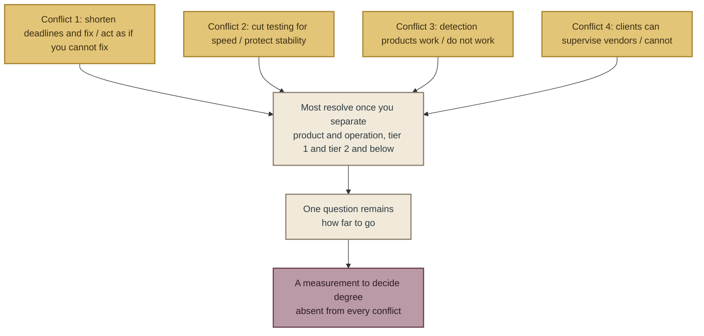

## What this chapter does not assert

- **It does not say which side is right.** None of the four conflicts has a measurement that compares both sides under the same conditions (see “What the four conflicts have in common”).
- **Writing that the conflicts “can be resolved” does not mean “either will do”.** The question of “how far” that remains after separating them has no answer yet.
- **It does not read the two insurers' figures as causal.** Marsh's is a correlation; At-Bay's is descriptive statistics (see “Conflict 3 — Do detection products work?”).
- **It does not read the World Economic Forum's 40% as an actual measurement.** It comes from an attitude survey (see “Conflict 4 — Can the client organisation supervise its vendors?”).

## To the next chapter

The absence of measurement on both sides is not limited to the conflicts. 
The next chapter counts, across all 211 proposals, “how many proposals measured their effect”. 
It then lines up the counts for each category of proposal, and looks at where they are thick and where they are thin. 
Part 3 of this book stands on the thinnest place.

 

---

### References

1. Bruce Schneier, “Cybersecurity in the Age of Instant Software (first published in CSO)” (2026-04-07) — Full text https://www.schneier.com/blog/archives/2026/04/cybersecurity-in-the-age-of-instant-software.html
2. Bruce Schneier, “Microsoft's Patching” (2026-09-14) — Full text (the vulnerability count is quoted from Ars Technica) https://www.schneier.com/blog/archives/2026/09/microsofts-patching.html
3. Action1, “CISA BOD 26-04: Why the 72-Hour Patching Window May Be Too Long” (2026-08-26) — Full text (the 28.3% is from the company's own research; method not disclosed) https://www.action1.com/blog/cisa-bod-26-04-why-the-72-hour-patching-window-may-be-too-long/
4. Financial Services Agency / Bank of Japan, “Request concerning “Short-term responses by financial institutions and others in light of changes in threats posed by frontier AI”” (2026-05-22) — Full text (Requests 1, 6, 7 and 8; footnote 6) https://www.fsa.go.jp/news/r7/sonota/20260522-5/01.pdf
5. Marsh McLennan, “Cybersecurity signals: Connecting controls and incident outcomes” (2025-08-27) — Published summary (the main report requires registration; not opened) https://www.marsh.com/en/corp/about/news/marsh-mclennan-cyber-risk-intelligence-center-report.html
6. At-Bay, “2026 InsurSec Report (press release)” (2026-04-22) — Press release text https://www.at-bay.com/press_releases/2026-insursec-report-ransomware-vpn-sonicwall-attacks/
7. At-Bay, “2025 InsurSec Report” (2025-04) — Full text https://www.at-bay.com/wp-content/uploads/2025/04/At-Bay-2025-InsurSec-Report.pdf
8. Personal Information Protection Commission, “Status of the exercise of monitoring and supervisory powers in the first quarter of fiscal year 2026” (2026-09-02) — Full text https://www.ppc.go.jp/files/pdf/260902_shiryou-3-1.pdf
9. National Cybersecurity Office, Cabinet Secretariat, “Responses in light of leakage and other incidents caused by unauthorised access” (2026-10-09) — Full text https://www.cyber.go.jp/pdf/press/taiou.pdf
10. EU, “NIS2 Directive (2022/2555), Article 21” (2022) — Article text https://eur-lex.europa.eu/
11. US NIST, “Cybersecurity Framework 2.0 Quick Start Guide (SP 1299)” (2024) — Full text https://nvlpubs.nist.gov/nistpubs/SpecialPublications/NIST.SP.1299.pdf
12. World Economic Forum, “Global Cybersecurity Outlook 2026” (2026-01) — Summary https://www.weforum.org/publications/global-cybersecurity-outlook-2026/
13. US CISA, “Red Team Assessment AA24-326A” (2024-11) — Full text https://www.cisa.gov/news-events/cybersecurity-advisories/aa24-326a

 

---

# Chapter 6: Gaps — No Measured Effects, Thirteen on Data Minimisation

## The numbers this chapter stands on

Chapter 4 looked at where proposals overlap, and Chapter 5 at where they diverge. 
This chapter looks at where there are **no** proposals. 
We measure the gaps on three axes: how thick each category of proposal is, whether there is evidence, and how the proposals correspond to the intrusion routes in Japan's breach registry (*The Japan Breach Registry 2026*).

This book recorded proposals in nine categories.

| Code | Category of proposal | Includes |
|---|---|---|
| K1 | Vulnerability discovery and remediation | Patch deadlines, prioritisation, vulnerability discovery by AI |
| K2 | Defence while unpatched | Virtual patches, web application firewalls (WAF), isolation, reducing the exposed surface, multi-factor authentication (MFA), endpoint detection and response (EDR) |
| K3 | Anticipation and detection | Threat intelligence, attack-surface monitoring, managed detection and response (MDR), logs |
| K4 | Vendors and supply chain | Contracts, audits, multi-tier sub-contracting |
| K5 | Data minimisation and structure | Not holding data, retention periods, deletion, encryption, separation of privileges |
| K6 | Governance and management | Management responsibility, the board, risk acceptance |
| K7 | AI-model-specific | Permissions of AI agents, prompt injection, access control to models |
| K8 | Institutions, regulation and international coordination | Disclosure obligations, penalties, insurance, information sharing |
| K9 | Incident response, disclosure and recovery | Containment, reports to authorities, notification of affected individuals, public notices, recovery |

**As of edition 1 (30 October 2026; 211 proposals at T1 and T2. On the same day, the originals of the Financial Services Agency (FSA) request of 2026-10-09 (A-063) and the Indian Computer Emergency Response Team (CERT-In) directive (H-004) were opened and upgraded from T3 to T1, so the count is 2 higher than the 209 tallied that morning)**

| Category | Count as primary category | Count including secondary category |
|---|---|---|
| K9 Response, disclosure and recovery | 47 | 66 |
| K1 Discovery and remediation | 37 | 40 |
| K2 Defence while unpatched | 32 | 43 |
| K3 Anticipation and detection | 23 | 37 |
| K7 AI-model-specific | 20 | 37 |
| K6 Management | 16 | 26 |
| K4 Vendors | 14 | 25 |
| K8 Institutions | 13 | 34 |
| **K5 Data minimisation and structure** | **9** | **13** |

---

## Gap 1 — Proposals whose effect was measured: 0

This book recorded the “implementation status” of each proposal, in four classes: proposal only, institutionalised, adoption cases exist, and effect measured. 
“Effect measured” was limited to cases where real data or experiments measured the difference in results with and without the measure. 
Numbers of adoptions, expert estimates and statements that something “should work” are not included.

Of the 211, 14 were recorded as “effect measured”. 
Dividing those 14 by what they measured gives the following.

| What was measured | Count | Examples |
|---|---|---|
| The behaviour of a specific defence in an experimental environment | 4 | VirtualPatch (25 Android Common Vulnerabilities and Exposures (CVE) entries), detection accuracy of a machine-learning WAF (F1 score 93.13%), a prompt-injection defence (StruQ), autonomous remediation by AI (PatchWeaver) |
| Correlation or descriptive statistics on control deployment and outcomes in real environments | 3 | Marsh McLennan (correlation between EDR deployment rate and breach likelihood), At-Bay 2026 (zero Akira claims among MDR customers), At-Bay 2025 |
| Something other than the effect of a defence | 5 | Predictive performance of the Exploit Prediction Scoring System (EPSS), the relationship between regulatory deadlines and patch speed, the rate at which alternatives are offered for operational technology (OT) (13%), early reporting and fund-recovery rates, the share of unauthorised access attempts that MFA prevents (the company's own telemetry; method not confirmed) |
| Failures of defence | 2 | Adaptive attacks broke 12 defences with success rates above 90% (The Attacker Moves Second), 1,207 WAF bypasses |

From these, if we count the measurements that meet the standard this book set at the outset — that is, “**in real corporate environments, dividing assets under the same conditions by whether the measure was in place, and comparing breach outcomes**” — the count is **0**.

The 4 experimental cases have narrow conditions: virtualisation of Android apps, experimental data on injection attacks, prompt injection in a laboratory. 
They cannot be generalised to corporate systems. 
The 3 real-environment cases are insurance claims data, and are correlations or descriptive statistics. 
Companies that bought MDR and companies that did not also differ in other ways. 
Marsh's analysis is about the relationship between the EDR “deployment rate” and breach likelihood, and is not narrowed to the period while systems are unpatched.

This 0 is a figure limited to the range of material this book collected. 
Results that companies measure internally are often not published, and this book counts only published primary sources. 
Even so, of the 211 proposals issued over two years by the eight kinds of issuers — government, standards bodies, AI companies, security companies, insurers, academia, individual experts and regulators — not one compared effects in a real environment. 
Those who read proposals should know this fact.

## Gap 2 — Data minimisation: 13

Of the nine categories, the one with the fewest proposals is K5, “data minimisation and structure”: 9 as primary category, 13 including secondary category. 
That is one-fifth of the largest, K9 (66), and less than one-third of K2 (43).

Broken down by issuer type, the 13 are skewed.

| Issuer type | K5 count | Content |
|---|---|---|
| A Government and public bodies | 12 | National Cybersecurity Office, Cabinet Secretariat (NCO) (6: minimising information held, retention periods, inventory, minimising what is provided to vendors, separation of privileges, prohibiting plaintext storage), Personal Information Protection Commission (PPC) (deleting unnecessary data), Information-technology Promotion Agency, Japan (IPA) (“the basic principle of not holding unnecessary information” (author's translation)), FSA (“a response as prompt as possible” towards methods that do not receive images of identity documents), Office of the Australian Information Commissioner (OAIC) (collecting and retaining only the minimum necessary), Korea's Personal Information Protection Commission (PIPC) (minimising personal information), European Data Protection Board (EDPB), France's Commission nationale de l'informatique et des libertés (CNIL) |
| E Insurers | 1 | At-Bay 2025 |
| B Standards bodies, C AI companies, D Security companies, F Academia, G Individual experts, H Policy, regulation and business bodies | 0 | ── |

K5 consists of 12 proposals from government bodies and 1 from an insurer; it is written almost only by government bodies. 
Within the range this book collected, standards bodies, AI companies, security companies, academia and individual experts have not written a single one. 
K5 does not reach the definition of “consensus” in Chapter 4 (three or more kinds of issuers).

Why is it thin? 
This book cannot establish the reason, but it can point to one structure. 
The proposals from K1 to K3 (discovery, remediation, defence, detection) have markets for products and services. 
Patch management, WAF, EDR and MDR are things that are sold. 
K5 cannot be sold. 
Reducing data is not buying something; it is stopping doing something. 
Many of those who issue proposals are sellers, or those who gather information from sellers.

Of K5's 13, 0 measured their effect. 
This is included in the 0 of the section “Gap 1 — Proposals whose effect was measured: 0”. 
“If the information held is small, it is possible to contain the spread of harm” (NCO) is close to self-evident as logic, but no material has measured it.

Part 3 of this book sets its first proposal in this thinnest place. 
It does so knowing that no material has measured it.

## Gap 3 — The intrusion routes in Japan's registry, and how proposals correspond to them

The companion book *The Japan Breach Registry 2026* classifies the intrusion routes written in Japanese public notices into vulnerabilities, virtual private networks (VPN), vendors, unauthorised login, misconfiguration, and “route not disclosed”. 
This book tagged each of the 211 proposals with the route it corresponds to.

| Intrusion route in the registry | Number of corresponding proposals | Observations |
|---|---|---|
| Vulnerabilities | 52 | The thickest. Most of K1 and K2 |
| Prescriptions for undisclosed routes | 38 | Proposals aimed at organisations that do not write the route in their public notices. Systems for reporting to authorities and notifying individuals make up the majority; public disclosure, and proposals on logs and investigation, make up the rest (dealt with in Chapter 9; the breakdown is in Chapter 9, “Position among the world's proposals — agreed procedures, and a scope no one has decided”) |
| Unauthorised login | 35 | Multi-factor authentication, protection of credentials |
| Misconfiguration | 29 | Access control for application programming interfaces (API), checking public-exposure settings. The four measures of the JPCERT Coordination Center (JPCERT/CC) sit here |
| Vendors | 26 | Chapter 5, Conflict 4 |
| VPN | 16 | Exposure of perimeter devices. At-Bay: 73% of ransomware in 2025 came through VPNs |
| Insider wrongdoing | 2 | Almost a gap |
| Cross-cutting (not tied to a particular route) | 50 | Management, institutions, information sharing |

“Vendors”, a route with many cases in the registry, has 26 proposals. 
But, as we saw in Chapter 5, proposals that address the earlier problem of whether a tier-1 contract even exists are limited to those of Japanese public bodies. 
“Insider wrongdoing” has 2, almost a gap. 
In the registry, few public notices give insider wrongdoing as the route. 
But cases such as Korea's Coupang incident (misuse of an authentication key by a former employee) show that proposals for this route are thin.

There is one more gap, and it is on the registry's side. 
VPN is treated in overseas insurance data as the largest intrusion route (At-Bay: 73% of ransomware in 2025), yet only one Japanese public notice records it. 
Business email compromise, the largest loss route overseas (Coalition: 58% of claims), falls outside what must be reported under the Act on the Protection of Personal Information, so it does not appear in the registry's classification. 
The proposals are written on the premise of the overseas distribution of routes, and Japanese public notices show a different distribution. 
Which is closer to reality cannot be known unless public notices write the route.

## Gap 4 — Primary sources from individual experts in Japan

Issuer type G is “individual experts”. 
Its primary sources are pieces, lecture transcripts and parliamentary testimony in the expert's own name. 
Of the 211 proposals this book collected, 11 are G. Of those, the only primary source in a Japanese expert's own name that this book could reach was a blog post (11 October 2026) by piyokango, an investigator of security incidents.

Japan has experts who have long spoken in this field, including Hiroshi Tokumaru, Nobuhiro Tsuji, Toshio Nawa and Tetsutaro Uehara. 
In three rounds of research, this book looked for their statements from 2025 onward. 
What it could confirm were only summaries in news reports and announcements of talks. 
It did not reach originals they wrote themselves or transcripts of their talks. 
This is a limit of this book's research method (primary sources published on the open web). 
It does not mean that their statements do not exist.

The thinness of Japanese-language primary sources means that what Japanese executives can read on this subject is limited to translations of overseas reports, alerts from domestic public bodies, and news reports. 
This book does not fill this gap. 
It records that the gap exists.

## Gap 5 — Regions and industries

This book's collection centred on English, Japanese, Korean and French. 
As a result, government proposals (A) are skewed towards the US, the UK, Australia, New Zealand, the EU, France, Japan, Korea and Singapore. 
There are no primary sources from Germany, the Netherlands, the Nordic countries, Taiwan, India, Israel or the Middle East, apart from India's CERT-In directive (T1).

By industry, proposals concentrate on finance (the request from the FSA and Bank of Japan, the EU's Digital Operational Resilience Act (DORA)) and critical infrastructure. 
Retail and e-commerce, logistics, education, local government and healthcare have many cases in Japan's registry. 
Dedicated proposals aimed at them were not found, apart from CNIL's guide for the education sector (headings only checked) and the OAIC's counts of notifications from the healthcare sector.

## Next to the gaps — numbers that are wrong

Separate from the gaps, there is one more thing that should be written onto the map of proposals. 
It is not a proposal itself. 
It is the numbers that circulate as grounds for proposals but have been denied by the issuers they are attributed to.

Among the insurance-data proposals (E) this book collected, one of the most widely cited numbers is: “82% of cases in which insurance payment was refused had not implemented multi-factor authentication (MFA).” 
As grounds for a proposal to implement multi-factor authentication, this number is convenient, because it ties directly to profit and loss: if you do not implement it, the insurance will not pay out.

On 31 August 2026, Daniel Woods, head of research at the insurer Coalition, wrote an article on the company's blog titled “Dispelling the Myth: Cyber Insurance Doesn't Pay Claims”. 
The article says this about the 82%:

> This statistic is not only factually incorrect, but also we've never published data on claims denials.

The article also writes: “This is attributed directly to Coalition across multiple third-party blogs.” 
A number Coalition had not published was circulating under Coalition's name. 
The article does not identify who first wrote it. 
This book does not identify them either. 
What it records is only the number and the primary source that denied it.

The same article deals with three other numbers. 
Each is wrong in a different way.

| Circulating number | Attributed to | What Coalition's article says | Type of error |
|---|---|---|---|
| “82% of denied claims had no MFA” | Coalition | Factually incorrect. Coalition has never published data on denials | Fabrication or hallucination |
| “44% of claims are denied” | The research firm Advisen | Advisen and its parent company Zywave have never published a report on claim denials (the article says this was confirmed with the company's editors) | Misattribution |
| “More than 40% of claims are denied” | The ratings agency Fitch Ratings | Fitch's 2024 and 2025 reports do not contain this number (the article says this was confirmed with a senior figure at the company) | Misattribution |
| “Insurance covered only 32%” | The research firm NetDiligence | The number exists. But in the original report 11% of claims were unresolved, and the figure is “out of context” | Loss of context |

For the 44% and the 40%, it was not Advisen or Fitch themselves that denied the numbers. 
It is Coalition that writes that it “confirmed” this. 
This book keeps that distinction, and records them as “not published by the attributed source (according to Coalition's confirmation)”.

These four matter to executives because all of them are numbers used directly in management decisions: whether to invest in multi-factor authentication, and whether to take out cyber insurance. 
If “44% are denied”, the reason to buy insurance becomes weaker. 
If “82% had no MFA”, investment in multi-factor authentication is justified for the sake of insurance as well. 
Numbers used as material for decisions have been denied by their issuers.

What follows is an observation of structure, not an assertion. 
As we saw in Chapter 4, multi-factor authentication is a consensus proposal on which five or more kinds of issuers point in the same direction. 
Numbers offered as grounds for a consensus proposal fit what readers already believe, so they are less likely to be checked. 
The 82% circulated not because it was hard to believe, but because it was easy to believe. 
“Proposals whose effect was measured: 0”, seen in the section “Gap 1 — Proposals whose effect was measured: 0”, and this section's “denied grounds are in circulation” are two sides of the same thing. 
Where there are no measured numbers, unmeasured numbers move in.

Coalition's article gives its own readers three checks: when citing a statistic, check its source, its method and its context. 
The numbers this book uses in Parts 1 and 3 have all passed these three checks, and are limited to those whose primary-source URL the author opened. 
How the numbers that did not pass were handled is written in the verification record in the appendix.

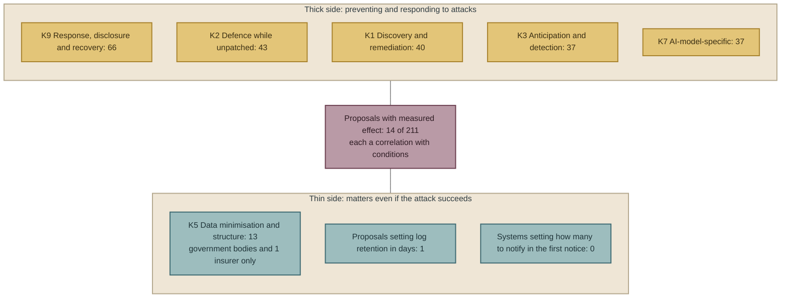

## What the five gaps show

Here are the five gaps side by side.

1. Proposals whose effect was measured: 0 (see “Gap 1 — Proposals whose effect was measured: 0”)
2. Data minimisation: 13, from government bodies and 1 insurer (see “Gap 2 — Data minimisation: 13”)
3. Proposals on insider wrongdoing: 2; the distribution of intrusion routes differs between overseas and Japan (see “Gap 3 — The intrusion routes in Japan's registry, and how proposals correspond to them”)
4. Primary sources from Japanese experts: 1 (see “Gap 4 — Primary sources from individual experts in Japan”)
5. Large skews by region and industry (see “Gap 5 — Regions and industries”)

Of these, 1 and 2 shape Part 3 of this book. 
If no proposal has had its effect measured, executives cannot make the judgement “adopt it because we know it works”. 
What they can do is choose “what the company can decide today by its own will alone, whether or not an attack succeeds”. 
Data minimisation is one of the few proposals that meets that condition, and it is also the thinnest.

3 is a premise for Chapters 8 and 9. That Japanese public notices do not write the route means, seen from the side of the proposals, that “we cannot learn from Japanese cases which proposals worked and which did not”.

4 and 5 are this book's limits. 
One of the reasons for making it an updated (living) book is to fill these two over successive editions.

## What this chapter does not assert

- **It does not say that no proposal in the world has had its effect measured.** The count is 0 within the published primary sources this book collected (see “Gap 1 — Proposals whose effect was measured: 0”).
- **It does not say that data minimisation works best.** It says only that it is the thinnest. Claims about whether it works are made in Chapter 7, as the author's claims (see “Gap 2 — Data minimisation: 13”).
- **It does not say that Japanese experts have not spoken.** What it says is that this book could not reach primary sources in their own names (see “Gap 4 — Primary sources from individual experts in Japan”).
- **It does not assert that the reason K5 is thin is the interests of those who issue proposals.** It points to this as one structure (see “Gap 2 — Data minimisation: 13”).
- **It does not identify who first wrote the “82%”.** Coalition's article does not identify them either (see “Next to the gaps — numbers that are wrong”).
- **It does not say that Advisen and Fitch denied the numbers.** It is Coalition that writes that it confirmed the denial, and this book records this as “according to Coalition's confirmation” (see “Next to the gaps — numbers that are wrong”).

## To the next chapter

Part 1 looked at how attacks are faster than remediation, and how the advice in response is “not new”. 
Part 2 looked at where the world's proposals overlap, where they diverge, and where they are absent.

So far, the situation executives are in can be summarised like this. 
The race to prevent is being lost on speed. 
The advice is all out there, but which of it works has not been measured. 
The thinnest proposal is not holding data. 
And some of the numbers used as material for decisions have been denied by their issuers.

Part 3 sets out three things that a company can decide by its own will alone in this situation: what to hold, when to notice, how to tell. 
From here on, these are the author's claims.

 

---

### References

The figures in this chapter are based on `data/proposals.csv` (edition 1, as of 30 October 2026, 211 proposals at T1 and T2). 
The 14 “effect measured”, the 13 in K5 and the counts by intrusion route were tallied from the `status`, `k` and `route` columns of that file. 
The primary source of each proposal is recorded in that file. 
Of the documents named in this chapter, those that first appear in the main text are as follows.

1. Australia's OAIC, “Large-scale data breaches on the rise, latest OAIC statistics reveal” (2026-10-26) https://www.oaic.gov.au/news/media-centre/large-scale-data-breaches-on-the-rise%2C-latest-oaic-statistics-reveal
2. Korea's Personal Information Protection Commission, “Recommendation on preventing large-scale leaks via APIs” (2026-07-09) — pipc.go.kr (`data/proposals.csv` A-105)
3. IPA, “Measures to be implemented promptly in light of leakage and other incidents caused by unauthorised access” (2026-10-09) https://www.ipa.go.jp/security/security-alert/2026/alert20261009.html
4. Personal Information Protection Commission, “Alert on the proper handling of personal data” (2026-10-07) https://www.ppc.go.jp/files/pdf/261007_houdou.pdf
5. piyokango, “piyolog (a summary of the unauthorised-access incidents of October 2026)” (2026-10-11) https://piyolog.hatenadiary.jp/entry/2026/10/11/004353
6. Coalition, “Cyber Threat Index 2025” (2025-03) https://www.coalitioninc.com/announcements/cyber-threat-index-2025
7. At-Bay, “2026 InsurSec Report (press release)” (2026-04-22) https://www.at-bay.com/press_releases/2026-insursec-report-ransomware-vpn-sonicwall-attacks/
8. Coalition (Daniel Woods), “Dispelling the Myth: Cyber Insurance Doesn't Pay Claims (the section “Next to the gaps — numbers that are wrong”. The author checked the full text on 30 October 2026. On the basis of this check, E-002 and E-003 in the proposal ledger were changed from T2 to T1)” (2026-08-31) https://www.coalitioninc.com/blog/cyber-insurance/dispelling-myth-cyber-insurance-doesnt-pay-claims

 

---

# Part 3: The Three Things a Company Can Decide

---

# Chapter 7: Hold Less — The Only Way to Reduce Harm Whether or Not the Intrusion Succeeds

## How to read Part 3

Parts 1 and 2 separated what the primary sources say from what they do not say. 
They avoided assertions and stopped at pointing out structure. 
Part 3 is different. 
From here on, these are the author's claims.

The grounds for the claims are limited to facts confirmed in Parts 1 and 2. No new facts are brought in. 
Each chapter follows the same pattern. 
It states the proposal in one sentence, shows the grounds, uses the counts from Chapters 4 to 6 to show where that proposal sits among the world's proposals, sets out objections and limits, describes how Japanese companies can implement it, and finally states what the chapter does not assert.

The subjects of the three chapters are the answer to the question posed at the start of Chapter 1. Attacks are faster than remediation. 
The advice is all out there, but whether it works has not been measured. 
In that situation, what can a company decide by its own will alone? 
This book has three answers. 
What to hold (Chapter 7), when to notice (Chapter 8) and how to tell (Chapter 9).

The three were not chosen because they work. 
As Chapter 3 showed, no one has measured which measures prevent attacks. 
This book cannot measure it either. 
So this book chose only the kinds of decision that can be made without waiting for proof of effect. 
There are two conditions for the choice. 
The decision must matter even if an attack succeeds. 
And the company must be able to make it alone, without the cooperation of others. 
What to hold sets the maximum when an intrusion happens. 
When to notice sets the range that can be confirmed after an intrusion. 
How to tell sets whom, and how many, to inform of what was confirmed. 
None of the three depends on whether the attack was prevented. 
The criticism in Chapter 3 and the proposals in Part 3 do not contradict each other. 
This book proposes only decisions that do not depend on whether they work.

---

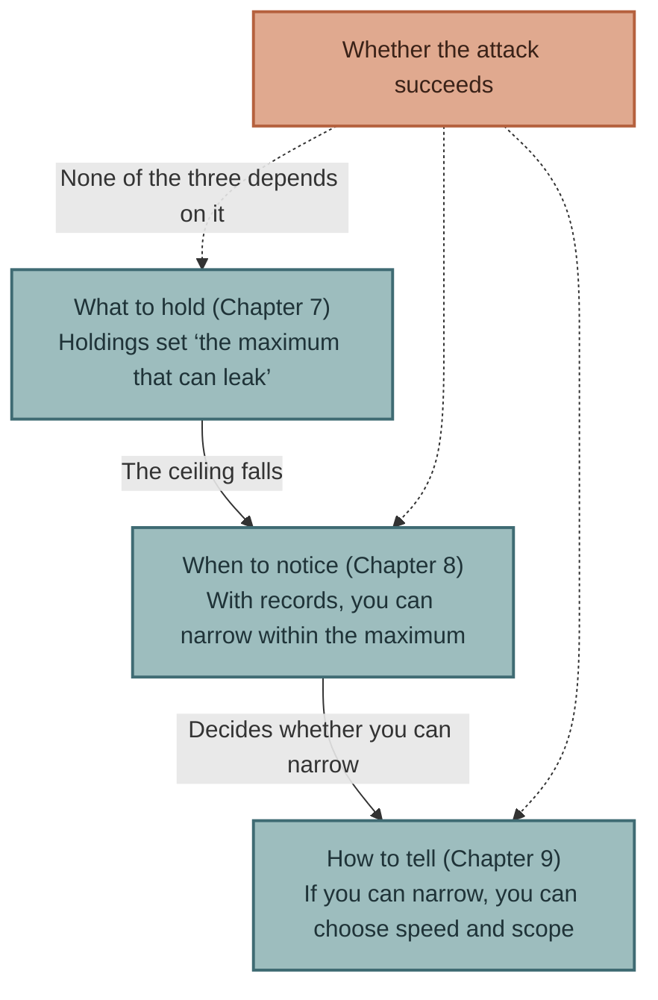

## This chapter's proposal

**Put the inventory and deletion of the personal data you hold as the first item of security investment. 
It is the only means that reduces harm regardless of whether an intrusion succeeds.**

“Hold less” consists of three actions.

1. **Count.** List which personal data the company holds, how many records, on what basis, and until when.
2. **Delete.** Delete data that is no longer needed for use, and data past its statutory retention period.
3. **Do not hand over.** Keep the fields and the number of records given to vendors to the minimum necessary, and have vendors delete them too when the work is finished.

These three come before updating firewalls or applying patches. 
The next section gives the reasons.

---

## Why first? — Three reasons

### Reason 1: It works regardless of whether the attack succeeds

As Chapter 1 showed, attackers move in minutes, and defenders' remediation moves in days. 
Mandiant estimates that the time until a vulnerability is exploited is minus 7 days relative to the patch release date. 
Time in which no remediation exists arises as a matter of structure.

During that time, whether a company can prevent an intrusion is a question of probability. 
Multi-factor authentication lowers the probability. 
Endpoint detection and response (EDR) lowers it. 
But it does not reach 0, and as Chapter 6 showed, the number of documents that measured in real environments how far it falls is 0 within the scope of what this book collected.

The amount of data held is not a probability. 
It is a fixed value. 
If you hold 1 million records, the most that can leak is 1 million records. 
If you hold only 100,000, however clever the attack, the most that can leak is 100,000. 
This is not the effect of defence. 
It is arithmetic.

Australia's Privacy Commissioner, Carly Kind, said this in one sentence in an announcement on 26 October 2026.

> Organisations can't lose personal information they don't hold.

Japan's National Cybersecurity Office, Cabinet Secretariat (NCO), wrote the same thing in a document dated 9 October 2026.

> Even in the unlikely event that an information leak occurs, if the information held is small, it is possible to limit the spread of harm. (author's translation)

“The unlikely event” means the case where the intrusion could not be prevented. 
This sentence is written on the premise that defence fails. 
The reason this book puts “hold less” as the first item lies in this premise. 
The situation seen in Part 1 was that time in which defence fails exists as a matter of structure. 
What works during that time is not defence but the amount of what is being protected.

### Reason 2: It is not affected by the fact that effects cannot be measured

Chapter 6 showed that, of 211 proposals, 0 measured their effect. 
For executives, this means “allocating budget without knowing which measures work”.

“Hold less” sits outside this problem. 
As Chapter 6 showed, there are no documents that measured the effect of deletion. 
But the effect of “hold less” is known without measuring it. 
The number of records leaked cannot exceed the number of records held. 
This is not a result of measurement. 
It is a definition.

Within the scope of what this book collected, this is the only measure that an executive can adopt on the judgement that “we adopt it because we know it works”.

### Reason 3: The company can decide it alone

Introducing multi-factor authentication needs employees' cooperation. 
Applying a patch needs the vendor to release a fix and time to stop operations. 
Managing vendors needs the vendors' cooperation. 
Detecting an attack needs the attacker to leave traces.

What to hold can be decided by one company. 
If the board decides “this data will be deleted by next fiscal year”, it disappears. 
There is no need to wait for another company's fix, or to watch what the attacker does.

The condition shared by the three proposals in Part 3 is “something that can be decided today by the company's will alone”. 
“Hold less” meets that condition most purely.

---

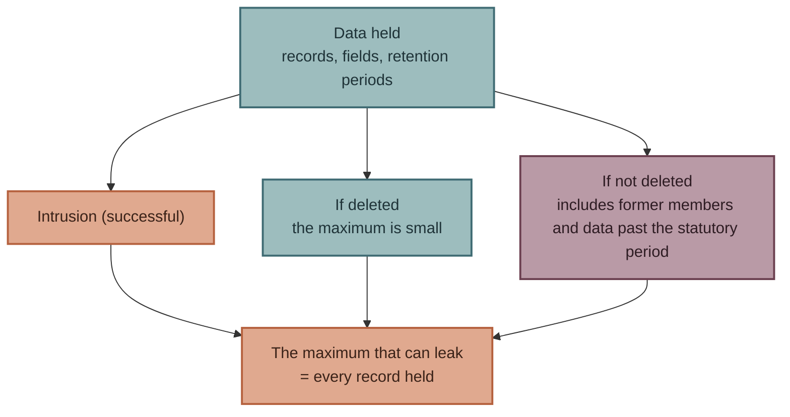

## The grounds — what the world's proposals wrote

Below are the proposals in this book's ledger classified under K5 data minimisation and structure whose text was opened and checked against the original.

| Issuer | Date | Proposal (as written) | Tier |
|---|---|---|---|
| National Cybersecurity Office, Cabinet Secretariat | 2026-10-09 | “Even in the unlikely event that an information leak occurs, if the information held is small, it is possible to limit the spread of harm.” “Carry out an inventory of information assets regularly.” “Make the purpose of use and the retention period clear.” “Dispose of information appropriately once its statutory retention period has passed.” | T2 |
| Same | Same | “Keep the personal information and business information provided to vendors to the minimum necessary.” “Make sure data is deleted at the vendor after the work is finished.” | T2 |
| Personal Information Protection Commission (PPC) | 2026-10-07 | Citing Article 22 of the Act: “When it is no longer necessary to use the personal data, efforts must be made to delete it without delay.” and “We once again call for attention, including properly checking the need for the personal data being stored, together with its legal basis.” | T2 |
| Same | Same | “We have also encountered cases in which such measures were not thoroughly taken and leakage incidents became more serious,” | T2 |
| Information-technology Promotion Agency, Japan (IPA) | 2026-10-09 | “The basic principle of not holding unnecessary information” | T2 |
| Office of the Australian Information Commissioner (OAIC) (Carly Kind) | 2026-10-26 | “only collecting and retaining the minimum personal information necessary” “Organisations can't lose personal information they don't hold.” | T1 |
| Korea's Personal Information Protection Commission (PIPC) | 2026-07-09 | “개인정보 최소화” (minimisation of personal information); do not provide unnecessary personal information via APIs; minimise access rights | T1 |
| Financial Services Agency (FSA) | 2026-10-09 | On the amended rules that abolish receiving images of identity documents, under which verification “will in principle be unified into reading IC chip information”: “Respond as quickly as possible, without waiting for the date of enforcement.” | T1 |

Of the 8 rows, 2 come with data as their grounds. 
The OAIC set this proposal on its own national statistics: 667 notifications in the first half of 2026, and a rise from 4 to 11 in incidents affecting more than 1 million people. 
Korea's PIPC set its proposal on 447 breach reports in 2025 and 432 in the first half of 2026. The other 6 rows are proposals only.

The PPC's “we have also encountered cases in which leakage incidents became more serious” is, within what this book has confirmed, the first case of a Japanese public body writing in a primary source that “there are incidents in which holding unnecessary data made the harm larger”. 
However, it does not say which incidents.

The last row, the FSA's request, is different in nature from the other 7 rows. 
It does not say “delete”. 
It says “change to a system that does not receive the data in the first place”. 
If a company receives an image of a driving licence for identity verification, the company then holds that image. 
If verification is unified into reading the IC chip, no image remains with the company. 
This is an example of achieving “hold less” through the design of the business, not through operation. 
The FSA asked companies to respond without waiting for the date of enforcement of the amended rules (1 April 2027). 
This book does not write that this request is directly linked to the breach incidents of October. 
The FSA's document says only that it is “in light of the current situation”.

---

## What the Japanese registry showed

From the breach registry in the companion book (edition 3, 71 rows), this section takes only three rows where “having held the data” determined the size of the harm. 
It does not repeat the registry's contents. 
It takes only what this chapter's claim needs.

**Helpfeel (Gyazo), 16 September 2026.** The public notice wrote that, of the “about 23.62 million records” of data that leaked, about 18.01 million (about 76%) belonged to anonymous users with no registered email address. 
Then, in the second notice, it added that “metadata of about 174 million deleted images” had leaked. 
Information about images that users had deleted remained on the company's side.

**Times Mobility, 25 September – 23 October 2026.** In the fifth notice, it was confirmed that, of “6,628,007” accounts, “1,464,800” had traces of external transmission of identity-document images. 
Images such as driving licences, received for identity verification for car sharing, were stored on the company's side: about 1.46 million of them. 
9 October, when the FSA pressed for unification into IC chips, was 10 days after the third notice of this incident (29 September).

**Daiki Suisan, 5 October 2026.** The public notice wrote that the “174,933 people” affected were “registrants from 2024-11-01 to 2026-09-15, including those who have withdrawn”. 
The data of people who had withdrawn was still held after they withdrew.

What the three rows share is not the intrusion route or the attack method. 
It is that the leaked records included data that was “no longer necessary to use”. 
Information about deleted images, images kept after identity verification was complete, and the registration details of people who had withdrawn. 
Whether the PPC's “cases in which … became more serious” refers to rows like these is not known. 
This book writes it as a structure shown by three rows of the registry.

---

## Position among the world's proposals

Here again is the count from Chapter 6. Of the 211 proposals at T1 and T2, K5 “data minimisation and structure” has 13 including secondary categories, and 9 as a primary category, the fewest of the nine categories. 
Of the 13, 12 are from government bodies (A) and 1 from an insurer (E). 
There is not one from standards bodies, AI companies, security companies, academia, individuals or regulators.

In Chapter 6, this book did not assert the reason for this thinness. 
Here it is written as the author's claim.

“Hold less” is nobody's product. 
Vulnerability discovery and remediation (K1), defence during the period when you cannot remediate (K2), and anticipation and detection of attacks (K3) have markets for products and services. 
Among the issuers of proposals, security companies and insurers are sellers in those markets. 
AI companies issue proposals to use their own AI for defence. 
Among the eight types of issuer this book collected, apart from government bodies, there is no issuer that gains anything by proposing “delete the data”.

Few proposals do not mean little effect. 
How many proposals there are reflects how the interests of those who propose are distributed. 
That the “consensus” seen in Chapter 4 gathered around measures with little interest at stake, and that the “gaps” seen in Chapter 6 arose around measures with no interest at stake, are two sides of the same structure.

This book puts “hold less” first in Part 3 because the thinnest place on the map in Part 2 overlaps with the place that works best in the structure of Part 1.

---

## Objections and limits

Here are five objections to the author's claim that hold up.

**Objection 1: Data with a retention period set by law cannot be deleted.** 
That is right. 
The PPC's alert also writes: “This does not apply where a retention period or the like is set by laws and regulations.” 
Account books, transaction records and employment documents have statutory retention periods. 
This chapter's proposal covers data held beyond the statutory period, and data held without a legal basis. 
The NCO's “Dispose of information appropriately once its statutory retention period has passed”, cited in the section “The grounds — what the world's proposals wrote”, stands on this distinction.

**Objection 2: Data has business value.** 
That is right. 
Data on former members can be used to analyse re-enrolment. 
Past purchase histories can be used to train AI. 
This chapter does not deny this value. 
What this chapter asks is that this value be compared, on the same table, with the maximum harm that holding the data adds. 
Data that you decide to hold after comparing may be held. 
The problem is data held without comparing. 
In none of the three rows in the section “What the Japanese registry showed” does the public notice show any trace of such a comparison.

**Objection 3: There are no documents that measured the effect of deletion.** 
That is right. 
Chapter 6 confirmed this. 
However, as written in the section “Why first? — Three reasons”, the effect of “hold less” is set by definition, not by measurement. 
What needs measuring is “which is larger, the cost of deletion or the expected value of the harm that deletion reduces”, and that differs from company to company. 
This book shows the form of a table in the section “Implementation in Japanese companies” so that companies can make that comparison themselves.

**Objection 4: Even when you think you have deleted it, it remains.** 
This is the heaviest objection. 
Helpfeel's “metadata of about 174 million deleted images” shows that information remained on the company's side even after users deleted it. 
The PPC's alert (December 2024 edition, revised October 2026) writes that “personal data not managed by the organisation sometimes includes old data and the like that should have been deleted, and the scope of leakage harm became larger”. 
Backups, logs, employees' personal storage areas, vendors' servers. 
Deletion does not end with deleting from the production database. 
“Count” comes before “delete” in this chapter because you cannot delete without knowing where everything is.

**Objection 5: Data handed to vendors cannot be deleted by the company itself.** 
That is right. 
The vendor chain seen in Chapters 5 and 6 (the structure in which a breach at one vendor leads several client organisations to issue notices) happened because data that the client organisations “thought they did not hold” was at the vendor. 
This chapter's “do not hand over” is the response to this limit. 
Reduce the fields handed over, and write deletion after handover into the contract. 
However, even if it is written in the contract, the client organisation cannot see whether the vendor complies. 
This limit is dealt with in Chapter 11.

---

## Implementation in Japanese companies

This section turns this chapter's proposal into management tools for Japanese companies. 
It shows three tools.

### Tool 1: Make the list of data held a board document

Security reports usually write “what was done”. 
Patches applied, drills held, audits passed. 
The report this chapter asks for is “what is held”.

| Column | Content | Example |
|---|---|---|
| Type of data | A bundle of fields | Members' names, addresses and phone numbers |
| Number of records | Number of records currently held | 1,250,000 records |
| Basis for holding | Article of law, or business reason | “For re-enrolment analysis” |
| Statutory retention period | If any | None |
| Last used | The date the data was last used in business | 2024-03 |
| Storage location | Production, backups, logs, vendors | Production, backups, Vendor A |
| Planned deletion | When, and on whose decision | 2027-03, board resolution |

The value of this table is that board members, not security staff, can read it. 
A row with “unknown” in the “Basis for holding” column becomes a board agenda item as it stands. 
So does a row where “Last used” is more than 2 years ago and “Statutory retention period” is “None”.

The total number of records is the company's “maximum that can leak”. 
Report this number every quarter and see whether it has fallen since the previous quarter. 
Within what this book has confirmed, among security indicators, this is the only number that can be compared with the previous quarter as a fixed value. 
The number of intrusions and the time to detection both depend on what attackers do. 
The number of records held moves by the company's will alone.

### Tool 2: Set the default retention period to the “statutory period”

At many companies, the default retention period for data is “indefinite”. 
To delete it, someone has to decide to delete it. 
This chapter asks that this default be reversed.

Data with a statutory retention period is deleted at the end of that period. 
Data with no statutory retention period is deleted when its purpose of use ends. 
To keep holding it, someone must decide “we will hold it” and write the reason in the table in Tool 1.

This is not technology. 
It is a change of internal rules. 
Before modifying information systems, rewrite the defaults in the personal information protection rules and the document management rules.

### Tool 3: List in the contract the fields of data given to vendors

Many outsourcing contracts write “manage personal information appropriately”. 
They do not write what is handed over. 
This chapter asks that the fields handed over, the upper limit on the number of records, the deadline for deletion after the work ends, and the method of proving deletion be written in the body of the contract.

The NCO's “Keep the personal information and business information provided to vendors to the minimum necessary” and “Make sure data is deleted at the vendor after the work is finished” are the grounds for these contract clauses. 
If the contract puts the vendor under a duty to report that it “has deleted” the data, then among the chains seen in Chapter 6, the type where “data that the client organisation thought it did not hold was at the vendor” becomes visible, at least on paper in the contract.

### What the three tools have in common

None of them buys a new product. 
All of them are work for corporate planning, legal and general affairs, not for the security department. 
All of them can be decided at this period's board meeting. 
This chapter wrote “the first item of security investment” not because the amount is the largest. 
It is because it comes first in order. 
You cannot decide what to protect without knowing what you hold.

---

## What this chapter does not assert

- **It does not write that “if you do not hold it, it will not leak”.** Data that is held can leak. What this chapter says is that the number of records leaked does not exceed the number of records held.
- **It does not write that data minimisation works better than other measures.** As long as the effects of other measures are not measured, no comparison is possible. What this chapter says is that only the effect of minimisation is known without measurement.
- **It does not write that holding unnecessary data was the cause in the three rows of the section “What the Japanese registry showed”.** The intrusion routes of the three rows are a vulnerability in 1 row and route not disclosed in 2 rows. Holding the data was a factor that set the size of the harm, not the cause of the intrusion.
- **It does not write that the FSA's request to unify into IC chips was a response to a specific breach incident.** The FSA's document says “in light of the current situation”. The press has linked it to the incidents, but this book keeps to what the document says.
- **This chapter did assert that the reason K5 proposals are thin is the issuers' interests.** This is an assertion avoided in Part 2, made in Part 3 as the author's claim. If there is evidence against it, it will be revised in a later edition.

---

## To the next chapter

“Hold less” sets the ceiling on the number of records leaked. 
But how many actually leak within that ceiling depends on how soon after the intrusion it is noticed. 
The 29 minutes seen in Chapter 1 is the time it takes an attacker to move from intrusion to lateral movement. 
If it is noticed within that time, the harm stops at the one machine that was breached.

The next chapter deals with “when to notice”. 
Proposals on detection number 37 in the Chapter 6 count; they are not thin. 
The problem is that almost all of those 37 are proposals for products and services for noticing, and almost none describe the internal design of the company: “who raises what has been noticed to management, and when”.

 

---

### References

1. National Cybersecurity Office, Cabinet Secretariat, “Response in light of incidents of leakage and the like caused by unauthorised access” (2026-10-09) https://www.cyber.go.jp/pdf/press/taiou.pdf
2. Personal Information Protection Commission, “Response in light of large-scale incidents of leakage and the like (alert)” (2026-10-07) https://www.ppc.go.jp/files/pdf/261007_houdou.pdf
3. Personal Information Protection Commission, “Alert on preventing leakage of personal data through unauthorised access (2024-12-11, revised 2026-10-07; the source of “old data that should have been deleted” in the section “Objections and limits”)” (2026-10-07) https://www.ppc.go.jp/files/pdf/261007_warning.pdf
4. IPA, “Measures to be taken promptly in light of incidents of leakage and the like caused by unauthorised access” (2026-10-09) https://www.ipa.go.jp/security/security-alert/2026/alert20261009.html
5. OAIC (Australia), “Large-scale data breaches on the rise, latest OAIC statistics reveal” (2026-10-26) https://www.oaic.gov.au/news/media-centre/large-scale-data-breaches-on-the-rise%2C-latest-oaic-statistics-reveal
6. Korea's Personal Information Protection Commission, “Recommendation on preventing mass leaks via APIs (`data/proposals.csv` A-105)” (2026-07-09) — pipc.go.kr
7. Financial Services Agency, “Strengthening cybersecurity measures in light of the current situation, and responses in various transaction applications” (2026-10-09) https://www.fsa.go.jp/news/r8/sonota/20261009/20261009.html
8. The author, “*The Japan Breach Registry 2026*, edition 3 (rows 005, 007, 020)” (2026-10-26) https://github.com/Leading-AI-IO/the-japan-breach-registry-2026

**Update to the proposal ledger.** 
The FSA's request (`data/proposals.csv` A-063) was T3, via press reports, when edition 1 was prepared. 
Because the FSA's original was opened and checked on 30 October 2026, it is upgraded to T1. 
The proposal text is also replaced from a summary with the original wording (“Respond as quickly as possible, without waiting for the date of enforcement”).

 

---

# Chapter 8: Notice — Who Decides How Long Logs Are Kept?

## This chapter's proposal

**Have management, not the information systems department, decide the log retention period and the review cycle in numbers. 
If no retention period is decided, the intrusion route stays “under investigation” forever, and the scope of the leak stays stuck at the maximum as a “risk”.**

“Notice” has two meanings.

1. **Notice the intrusion.** Learn as early as possible that an attacker has got in.
2. **Notice what happened.** Confirm afterwards where they got in, what they took and how far it spread.

Almost all security proposals deal with 1. This chapter's proposal puts its weight on 2. The reason lies in the facts seen in Parts 1 and 2. Half of Japan's breach notices do not state the intrusion route (Chapter 6), and one of the reasons is that the records needed to confirm it have not been kept.

---

## Why should management decide? — Three reasons

### Reason 1: A retention period is not technology; it states how much the company wants to know

How many days logs are kept has been decided by the information systems department as a question of disk capacity. 
This book asks that this be moved to a management decision.

The reason is that what a retention period decides is not capacity but “within how many days of an intrusion you must notice to be able to confirm what happened”. 
Mandiant wrote this in its announcement of M-Trends 2026 in March 2026.

> standard 90-day log retention policies leave organizations completely blind to the initial access vector

The same announcement wrote, about BRICKSTORM, the activity of an attack group said to be China-linked, of “dwell times of nearly 400 days”. 
The intrusion route of an attacker who stayed 400 days cannot be confirmed with 90 days of logs.

This is not a limit of technology. 
It is the result of a company having decided that “we do not need to know about anything before 90 days ago”. 
Many companies have this decided without being aware that they decided it. 
That is this chapter's starting point.

### Reason 2: Without logs, the scope of a leak becomes the maximum

Chapter 7 wrote that the amount of data held sets “the maximum that can leak”. 
This chapter continues from there. 
Where the number actually leaked falls within that maximum depends on whether what happened can be confirmed.

If it cannot be confirmed, the company writes that it “cannot rule out the possibility of a leak” and notifies on the basis of every record held. 
In the breach registry in the companion book, the rows where the public notice wrote “risk” or “possibility” are records of what could not be confirmed. 
Based on interviews in September 2026 with organisations harmed by ransomware, the Information-technology Promotion Agency, Japan (IPA) wrote that “proving ‘no leak’ is difficult” (author's translation), and listed ensuring the consistency of logs and backups as a countermeasure.

At a company without logs, the actual number of records leaked sticks to the ceiling that “hold less” in Chapter 7 lowered. 
Holding less and noticing are connected at this point.

### Reason 3: A Japanese public body wrote it down as a cause

In Case 3 (a case of unauthorised login) of the alert it revised on 7 October 2026, the Personal Information Protection Commission (PPC) wrote one of the causes as follows.

> Because there were no rules on storing and monitoring logs, detection of the unauthorised access was delayed.

The example countermeasure is “Set a retention period for logs and analyse them regularly.”

Within what this book has confirmed, this document is where a Japanese public body wrote in a primary source that “having no rules on logs” was a cause of a breach incident. 
What deserves attention is that the cause is written not as “there were no logs” but as “there were no rules”. 
In many systems, logs are produced automatically. 
What was missing was a person who decided how many days to keep them and who looks at them when.

---

## The grounds — what the world's proposals wrote

Below are the proposals on logs whose text was opened and checked against the original. 
Those that include numbers are placed at the top.

| Issuer | Date | Proposal (as written) | Figure | Tier |
|---|---|---|---|---|
| Indian Computer Emergency Response Team (CERT-In) | 2022-04-28 | “shall mandatorily enable logs of all their ICT systems and maintain them securely for a rolling period of 180 days” “the same shall be maintained within the Indian jurisdiction” | **180 days** | T1 |
| Mandiant (Google Cloud) | 2026-03-23 | “standard 90-day log retention policies leave organizations completely blind to the initial access vector” | **Blind at 90 days**. Dwell time about 400 days | T2 |
| Mandiant Consulting | 2026-01-24 | “Treat log health like a vital sign: Regularly check ingestion”. A case where, when investigators needed VPN logs, the connection to the SIEM had broken several months earlier | Median ransomware dwell time **6 days** (M-Trends 2025) | T1 |
| IPA | 2026-10-09 | “Check by widening the scope in stages, for example the most recent 1 month, then 3 months.” | Review range **1 month → 3 months** | T2 |
| IPA | Same | “Log retention periods are expected to differ by service, so they also need to be sorted out.” | — | T2 |
| PPC | 2026-10-07 | “Set a retention period for logs and analyse them regularly.” As a cause: “Because there were no rules on storing and monitoring logs, detection of the unauthorised access was delayed.” | **No number of days stated** | T2 |
| Same (annex) | Same | “Store logs and the like (for example, authentication logs, access logs, operation logs, communication logs) for a certain period.” “Through regular analysis of such logs, detect the occurrence or signs of unauthorised access and the like early.” | “A certain period” | T2 |
| National Cybersecurity Office, Cabinet Secretariat (NCO) | 2026-10-09 | Ask vendors “to carry out access rights management and log management” | — | T2 |
| IPA | 2026-09-08 | “Proving ‘no leak’ is difficult”. Consistency of logs and backups | — | T1 |
| piyokango | 2026-10-11 | “Recommended measure (1): start reviewing from the most recent 1 month of logs” (a summary of alerts from 9 bodies) | 1 month | T2 |

Lining up the 10 rows shows a structure. 
**Within the scope of what this book collected, the only proposal that sets a retention period in days is India's.** 
Japanese public bodies write “a certain period” and “set a retention period”, and do not write a number of days. 
Mandiant writes that “90 days is not enough”, but does not write how many days would be enough. 
The IPA's “1 month, then 3 months” is not a retention period; it is how far back to go when reviewing.

There is a reason for not writing a number of days. 
It is that the right period differs by system and by company. 
This book does not deny that reason. 
But at a company that receives a proposal with no number of days, unless someone decides the number, it runs on the default. 
In many products, the default is 90 days, which Mandiant described as “completely blind”, or shorter.

### The times in Japan's registry

In the breach registry in the companion book (edition 3, 71 rows), in the 15 rows where the public notice stated both the intrusion date and the discovery date, the time from intrusion to discovery ranges from 2 hours 30 minutes (and ST HD) to more than 1 year (Digital Arts, which found traces from around July 2025 in a full review in October 2026). 
Green Monster could not detect an acquisition at the end of April until 17 October: about five and a half months.

These 15 rows are the rows where the intrusion date is known. 
The remaining 56 of the 71 rows either do not state the intrusion date or state only the discovery date. 
The public notices do not give the reason the intrusion date cannot be stated, but without records going back to the time of intrusion, the intrusion date cannot be stated. 
This book does not assert that the absence of logs is why the 56 rows do not state the intrusion date. 
But this table shows what it means to leave a 90-day retention period at the default in a country where dwell times of five and a half months and more than 1 year have actually happened.

---

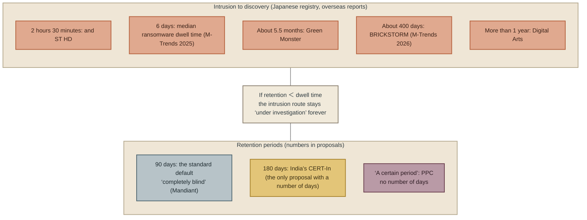

## Position among the world's proposals

In the Chapter 6 count, K3 anticipation and detection of attacks has 37 proposals including secondary categories, the fourth most of the nine categories. 
It is not thin. 
In Chapter 4, log retention and monitoring is among the consensus proposals (Consensus 4), where five or more issuer types, government bodies, standards bodies, security companies, insurers and individuals, point in the same direction.

Within these plentiful proposals lies the gap this chapter looks at. 
Almost all of the 37 write about “what” to detect and “how”. 
They are proposals for products (endpoint detection and response (EDR), security information and event management (SIEM), managed detection and response (MDR)) and methods (correlation analysis of logs, matching against threat intelligence). 
One writes in numbers “how many days to keep”. 
None writes “who decides, who looks when, and to whom it is raised”, apart from the PPC's description of the cause as “there were no rules”.

This bias has the same structure as the one seen in Chapter 7. Detection products and services have a market, and among the issuers of proposals, security companies and insurers are its sellers. 
At-Bay wrote in its April 2026 report that “The only businesses that avoided full ransomware encryption had their EDR backed by 24/7 monitoring via Managed Detection & Response (MDR)”, but At-Bay itself sells MDR and has not disclosed the size of its MDR customer base. 
Proposals written by sellers become proposals about things to buy. 
Deciding a retention period and assigning someone to review are not things you buy. 
That is why the proposals are thin.

This book puts “notice” second in Part 3 because, within the area with the most proposals, there is a variable that a company can decide by its own will alone and that no one proposes.

---

## Objections and limits

**Objection 1: Keeping logs costs money.** 
That is right. 
Extending the retention period from 90 days to 180 days roughly doubles the storage capacity. 
However, what this chapter asks is not “extend it” but “decide it”. 
A company that decided on 90 days is a company that decided not to confirm intrusion routes from before 90 days ago. 
If management made that judgement knowingly, this chapter's proposal is met. 
Shortening it for reasons of cost and leaving it at the default without thinking about cost are different things.

**Objection 2: Logs are themselves personal data.** 
That is right. 
Access logs record who looked at what and when, and that can be personal data. 
Chapter 7's “hold less” and this chapter's “keep” seem to clash at this point. 
It is not a clash. 
What Chapter 7 asked was to “compare and decide” about the data held, not to “hold without comparing”. 
Logs are the same. 
Decide the retention period, write the basis in Chapter 7's table (the list of data held), and delete them when the period ends. 
Logs held by decision are inside Chapter 7's principle.

**Objection 3: Even with logs, you cannot notice if no one looks.** 
This is the heaviest objection. 
At-Bay's point that EDR alone is not enough and monitoring is needed is, even after discounting it as a seller's figure, right as a structure. 
Logs are records, and records that are not read are only records. 
This is why this chapter's proposal includes a “review cycle”. 
Unless you decide who looks at what and every how many days, deciding only the retention period does not shorten the time to notice. 
However, even at a company where no one looks, if the logs are kept, what happened can be confirmed afterwards. 
This is another reason this chapter put its weight on the second of the two meanings.

**Objection 4: Logs stop.** 
Mandiant Consulting gave the case where, when VPN logs were needed in an investigation, the connection to the system that collects logs (SIEM) had broken several months earlier, and wrote “Treat log health like a vital sign”. 
Even if a retention period is decided, it means nothing if logs are not being produced. 
This chapter's implementation (Tool 4 in the section “Implementation in Japanese companies”) is the response to this objection.

**Objection 5: Even if you notice, it does not stop unless someone has the authority to stop it.** 
That is right. and ST HD, which detected the intrusion in 2 hours 30 minutes, cut it off the same day and issued a notice the next day. 
The speed of detection stopped the harm because the person who detected it could make the decision to stop. 
Who stops it after it is noticed is beyond the scope of this chapter. 
It is dealt with in Chapter 10.

---

## Implementation in Japanese companies

### Tool 1: Have the board sign off the retention periods for four types of log

For the four types listed in the PPC's annex, authentication logs, access logs, operation logs and communication logs, decide each retention period in numbers and sign it off.

| Log type | What it shows | Current retention period | Retention period to sign off | Basis |
|---|---|---|---|---|
| Authentication log | Who logged in when, and who failed | (default) | | |
| Access log | Who looked at which data | | | |
| Operation log | Who changed or retrieved what | | | |
| Communication log | What it communicated with | | | |

Filling in the “Current retention period” column is the first step. 
At many companies, this column ends up blank or “unknown”. 
That in itself is something to report to the board.

This book does not write how many days is right. 
It writes two numbers. 
The 90 days that Mandiant described as “completely blind”, and the 180 days that India set by law. 
If you do not place your own number between these two, management answers for the reason. 
In a year when 400-day dwell times were observed and dwell times of five and a half months and more than 1 year were published in Japan's registry, a decision to stay at 90 days is possible. 
But it is a decision “to not know”.

### Tool 2: Decide the review cycle and who is responsible, and report to the board

The number that pairs with the retention period is the review cycle. 
Every how many days, who looks at which logs, and to whom they raise anything abnormal. 
The IPA's “most recent 1 month, then 3 months” is the range to go back over after an incident, but it can also serve as a guide for the review cycle in normal times.

The form of the report is the same as Chapter 7's list of data held: not “what was done” but “what was looked at”. 
A report such as “This period, authentication logs were reviewed once a week; 3 anomaly candidates, of which 3 were false positives” is one that board members can read.

### Tool 3: Confirm retention periods by contract for each vendor and SaaS

The IPA wrote that “log retention periods differ by service”. 
Even if you keep your own servers' logs for 180 days, if a software as a service (SaaS) product you use keeps them for only 30 days, an intrusion through that SaaS becomes invisible after 30 days. 
The vendor chain seen in Chapters 5 and 6 is also a structure in which identifying the cause was delayed because the client organisation could not see the vendor's logs.

On the grounds that the NCO wrote that vendors should be asked “to carry out log management”, confirm in outsourcing contracts and SaaS terms of use the log retention period and whether the client organisation can receive the logs when an incident occurs. 
Put this item in the same contract as Chapter 7's Tool 3 (listing fields in the outsourcing contract).

### Tool 4: Monitor that logs are being produced

Adopt Mandiant Consulting's “vital sign” proposal as it is. 
Confirm that log collection has not stopped, by automatic reports rather than by human eyes. 
Once a month, have a report in numbers of “how many entries of each of the four types of log were collected”. 
If there is a month with 0, intrusions in that month cannot be confirmed.

### What the four tools have in common

All of them can be decided before buying a detection product. 
All of them can be written in numbers. 
All of them become board documents. 
This chapter wrote “management decides” not because management reads logs. 
How many days back you want to know, every how many days you look, and who looks, are statements of how much the company takes on knowing, and that is a management decision.

---

## What this chapter does not assert

- **It does not assert how many days is right.** It lined up 90 days (the number Mandiant described as “blind”), 180 days (India's law), 400 days (observed dwell time) and 6 days (median ransomware dwell time), and presented them as a variable for each company to decide.
- **It does not assert that the absence of logs is why Japanese public notices cannot state the intrusion date.** The public notices do not give the reason. This book wrote the structure: without records up to the time of intrusion, the intrusion date cannot be stated.
- **It does not write that keeping logs speeds up detection.** If the logs kept are not read, the time to detection does not change. What kept logs change is whether what happened can be confirmed afterwards.
- **It does not use At-Bay's claim that only companies with MDR monitoring avoided encryption as evidence of effect.** It is a seller's figure, and the base number is not disclosed. It was used only to point out a structure.

---

## To the next chapter

Holding less sets the maximum that can leak. 
Noticing shows where within that maximum the actual leak falls. 
What remains is to whom, when and how to tell what has been found.

The numbers in public notices are that answer. 
Of Japan's 71 breach notices, 18 wrote “maximum” or “all records held” and informed people before confirming. 
24 narrowed the scope using records before informing. 
There is no law that decides which to choose. 
The next chapter deals with the third thing a company can decide by its own will, “how to tell”, as the decision of how many individuals to notify.

 

---

### References

1. CERT-In (India), “Directions under sub-section (6) of section 70B of the IT Act, 2000 (opened and checked against the original on 30 October 2026; ledger H-004 upgraded from T3 to T1)” (2022-04-28) https://www.cert-in.org.in/PDF/CERT-In_Directions_70B_28.04.2022.pdf
2. Mandiant (Google Cloud), “Announcing M-Trends 2026: Data, Insights, and Strategies from the Frontlines” (2026-03-23) https://security.googlecloudcommunity.com/google-threat-intelligence-3/announcing-m-trends-2026-data-insights-and-strategies-from-the-frontlines-7123
3. Mandiant Consulting (Ryan Fried, José Toledo), “5 critical gaps in incident response planning and how to fix them” (2026-01-24) https://cloud.google.com/transform/5-critical-gaps-incident-response-planning-and-how-to-fix-them
4. IPA, “Measures to be taken promptly in light of incidents of leakage and the like caused by unauthorised access” (2026-10-09) https://www.ipa.go.jp/security/security-alert/2026/alert20261009.html
5. IPA, “Lessons learned from interviews with organisations harmed by ransomware” (2026-09-08 (updated 10-16)) https://www.ipa.go.jp/security/todokede/crack-virus/ransomware_lessons_learned.html
6. Personal Information Protection Commission, “Alert on preventing leakage of personal data through unauthorised access (Case 3) and annex” (Revised 2026-10-07) https://www.ppc.go.jp/files/pdf/261007_warning.pdf
7. National Cybersecurity Office, Cabinet Secretariat, “Response in light of incidents of leakage and the like caused by unauthorised access” (2026-10-09) https://www.cyber.go.jp/pdf/press/taiou.pdf
8. At-Bay, “2026 InsurSec Report (press release)” (2026-04-22) https://www.at-bay.com/press_releases/2026-insursec-report-ransomware-vpn-sonicwall-attacks/
9. piyokango, “piyolog” (2026-10-11) https://piyolog.hatenadiary.jp/entry/2026/10/11/004353
10. The author, “*The Japan Breach Registry 2026*, edition 3 (Chapter 2, “The structure of time”)” (2026-10-26) https://github.com/Leading-AI-IO/the-japan-breach-registry-2026

**Update to the proposal ledger.** 
The Indian CERT-In directions (`data/proposals.csv` H-004) were T3, based on fragments of search results, when edition 1 was prepared. 
Because the original PDF was opened and checked on 30 October 2026, they are upgraded to T1. 
The proposal text is replaced from a summary with the original wording.

 

---

# Chapter 9: Tell — Who Decides How Many People to Notify?

## This chapter's proposal

**How many affected individuals to notify is decided by the company, not by the law. 
Without records, the only option is to notify quickly, covering every record held. 
With records, the scope can be narrowed in exchange for speed. 
Management decides, before the incident, whether to take speed or scope first.**

Chapter 7 wrote that the volume of data held sets “the maximum that can leak”. 
Chapter 8 wrote that, without records, the actual leak sticks to that maximum. 
This chapter looks at how that maximum appears as a number in public notices.

The number in a public notice is the result of the company's decision on “how many affected individuals to notify”. 
Reading the 71 notices in edition 3 of the companion book, *The Japan Breach Registry 2026*, one by one, this decision falls into four shapes.

| Shape | Notices | How the notice was worded |
|---|---|---|
| A Disclosed at the ceiling | 18 | “maximum”, “all records held as of [date]”, “handled on the assumption that it was obtained” (author's translation) |
| B Narrowed by records | 24 | Wrote confirmed and at-risk separately. Fixed the count. Showed how many of the total contained what |
| C Could not state a count | 14 | “not stated”, “under investigation”, “under detailed review” |
| D “Possible” plus a count | 15 | “about [N]0,000 records may have leaked”. Whether that number is a ceiling or a narrowed count cannot be read from the notice |

This classification is the author's judgement. 
Rows on the boundary are discussed below.

What this chapter asks is where the difference between A and B comes from, and when a company decides whether to choose A or B.

---

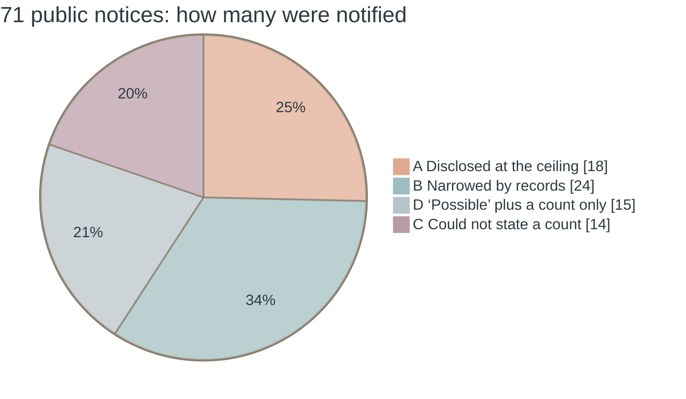

## Why management decides in advance — three reasons

### Reason 1: Numbers disclosed at the ceiling move later. Up as well as down

Of the 18 notices in A, here are the cases where the number moved in a follow-up notice.

| Organisation | First notice | Follow-up notice | Days | Direction |
|---|---|---|---|---|
| GMO Research & AI | “a maximum of 948,498 records” (all records held as of 5 October) | Fixed at “894,082 records”. 45,348 records “that had not been taken outside” | 9 days | Down |
| Crypton Future Media | “a maximum of about 420,000 records” | Member registration information, “362,137 records”, and others | 3 days | Down |
| JR East | Eki-net “about 1.67 million records”, Otona no Kyujitsu Club “about 390,000 records” (both maximums) | “a report from the vendor that it had judged there was no leak” | 6 days | Zero |
| Viewcard | “about 4.03 million records” | Same as above | 6 days | Zero |
| JR Kyushu | “about 1.3 million records” (maximum) | Same as above: “no fact of a leak was confirmed” | 6 days | Zero |
| Helpfeel (Gyazo) | Data related to users, “about 23.62 million items” | In the final report, images found to have been viewed or obtained: “432 items” (owned by “133 people”) | 35 days | Down |
| Charm | “about 230,000 records” | Third notice: confirmed “about 370,000 records” plus at risk “about 20,000 records” | 19 days | Up |

The numbers move both up and down. 
What this table shows is not that numbers disclosed at the ceiling are wrong. 
To disclose at the ceiling is to have decided to “notify before checking”. 
That decision comes with a consequence: the number will move later.

The three notices from JR East, Viewcard and JR Kyushu form a chain from an incident at the same vendor (IDC Frontier). 
Together they told the individuals behind about 7.39 million records that “the possibility of a leak cannot be ruled out”. 
Six days later the vendor judged that there had been “no leak”. 
This book does not write that the three companies' judgement was wrong. 
It was the result of deciding to notify without waiting for the vendor's investigation. 
Had they waited, the scope of notification would have been zero. 
Not waiting made them six days earlier. 
**Which of these two to take was decided by each of the three companies, not by the law.**

### Reason 2: The companies in B could narrow because they had records

Some of the 24 notices in B state why they could narrow.

- Treasure Factory wrote in a single notice that the unauthorised access was “confirmed by an access log investigation on the same day”, and that, of the “746,277 records” in scope, “11 records” were “those including name and address”.
- eplus gave the time of the unauthorised access to the minute, “2026-09-11 19:58 to 09-12 2:44”, and broke down the count of “1,463 records” by payment method.
- Lindt & Sprüngli Japan wrote what it counted: “members at the time of the intrusion, excluding those who had already left”.
- Sansan separated confirmed “1325 people” from possible “8687 people”.

Conversely, on the A side, there are notices that wrote why they could not narrow.

> Since no log exists that recorded the content of the transmitted communications themselves, it is not possible to directly confirm the items or the number of records of the data sent externally (Helpfeel, final report)

> For some data for which the records that can be checked are limited, we cannot confirm whether a leak occurred, and we are therefore treating it as data at risk of having leaked (Charm, fourth notice)

The claim of Chapter 8 is written inside the public notices. 
With records, you can narrow. 
Without them, there is no choice but to notify at the ceiling. 
**A or B is not something you can choose after the incident. 
What you were recording before the incident has already set how much room you have to choose.**

### Reason 3: The ceiling includes data that was never deleted

The ceilings in A include individuals who need not have been there in the first place.

- Of the difference between GMO Research & AI's first and fixed figures, “9,068 records” were “records of members who had left more than two months earlier and whose personal information had already been deleted under the privacy statement”. They were taken out, but contain no personal information.
- Daiki Suisan's “174,933 people” are “including registrants and those who have left”.
- Bookoff Group Holdings' second notice includes “212,371 former members” (based on press reports).
- Charm's fourth notice added “about 25,000 records of information on customers who have left” to the scope.

Chapter 7's “hold less” connects directly, here, to the number of people notified. 
You notify individuals who have left because you kept their data after they left.

---

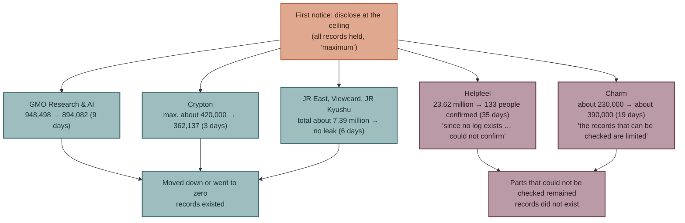

## The grounds — the rules set deadlines, not scope

### Japan's rules

The Personal Information Protection Commission (PPC) sets out the deadlines for reporting to the authority.

> Preliminary report (new): within 3–5 days of the date of discovery
> Final report (follow-up): within 30 days of the date of discovery
> Where there is a risk that it was done for a wrongful purpose: within 60 days of the date of discovery

Notification of affected individuals is mandatory for incidents that must be reported. 
But the timing is “promptly, according to the circumstances”. 
The legal Q&A of the National Cybersecurity Office, Cabinet Secretariat (NCO) presents an interpretation under which, where almost nothing about the incident is yet known and notification would cause confusion, notification need not be made at that point. 
Public disclosure, under the guidelines to the Act on the Protection of Personal Information (General Rules, 3-5-2(5)), is something that “it is desirable to publish promptly”. 
It is not mandatory.

In other words, **there are deadlines for the authority, but there is no standard for how many affected individuals to notify.** 
Notifying at the ceiling and notifying after narrowing both comply with the rules. 
The company decides the scope.

### The world's rules

| Issuer | Content (original) | What it sets | Tier |
|---|---|---|---|
| European Data Protection Board (EDPB) | “If only limited information is available, an initial notification should be performed within this timeframe” | Deadline (72 hours). Notify even if information is incomplete | T2 |
| EDPB | “the organisation may delay informing affected individuals … if it could interfere with an investigation” | Conditions under which notification of affected individuals may be delayed | T2 |
| UK Information Commissioner's Office (ICO) | “notify the ICO … within 72 hours”. “give specific and clear advice” | The deadline, and the content of notification of affected individuals | T2 |
| France's Commission nationale de l'informatique et des libertés (CNIL) | “une initiale, dans les 72h, puis une complémentaire” [an initial one within 72 hours, then a supplementary one] | The deadline and a two-stage approach | T2 |
| EU NIS2 Directive, recital 102 | “an early warning … within 24 hours” “an incident notification … within 72 hours” “A final report … not later than one month” | A three-stage set of deadlines | T2 |
| Singapore Personal Data Protection Commission (PDPC) | Items to include in notification of affected individuals: “Specific facts on the data breach • Actions individuals can take • Organisation's contact details” | The content of notification of affected individuals | T2 |
| US Securities and Exchange Commission (SEC) Form 8-K, Item 1.05 | “material aspects of the nature, scope, and timing of the incident”. Four business days after the materiality determination | The content and deadline of disclosure to investors | T1 |
| Japan, Guidance on Sharing and Disclosing Cyber Incidents | “It is also effective to disclose information in stages, divided at appropriate timings, such as a first notice, a second notice and so on.” | A two-stage approach | T2 |

The world's rules set deadlines, what to tell, and a two-stage approach. 
As seen in Chapter 4, the two-stage approach is a consensus. 
But **no rule within the range this book opened sets how many to notify in the first notice, or whether to disclose at the ceiling or narrow.** 
Two-stage rules allow the first notice to be fast and broad and the final report to narrow. 
They allow it, but they do not require it. 
The company chooses.

---

## Position among the world's proposals — agreed procedures, and a scope no one has decided

Between Chapter 4's consensus (two-stage disclosure) and Chapter 6's gap (public disclosure of the route), there is one more gap: the scope of notification of affected individuals.

The world's proposals ask for speed of notification. 
The EDPB writes within 72 hours even if information is incomplete, and NIS2 asks for an early warning within 24 hours. 
Proposals on speed are plentiful. 
But there is no proposal in this book's collection that deals with what happens when the scope of a fast first notice is too broad, that is, when many of the individuals notified were not actually affected. 
The about 7.39 million records of JR East and the two other companies are such a case.

Among Japanese proposals, there is one that touches on scope. 
The Information-technology Promotion Agency, Japan (IPA) wrote that “proving ‘no leak’ is difficult”, and listed ensuring the integrity of logs and backups as a measure (Chapter 8). 
This sets out a precondition for narrowing the scope. 
It is not a way of deciding the scope itself.

### Who the “prescriptions for undisclosed routes” are addressed to (a correction to Chapters 6 and 8)

the section “Gap 3 — The intrusion routes in Japan's registry, and how proposals correspond to them” of Chapter 6 and the section “To the next chapter” of Chapter 8 wrote that, of the proposals classified as “prescriptions for undisclosed routes”, “almost all are rules on reporting to authorities and notifying affected individuals”. 
In writing this chapter, the rows of the ledger were re-read one by one, and this statement was found to be inaccurate. 
Splitting the 38 T1 and T2 rows in the current version of the ledger by addressee gives 22 rows on reporting and notification to authorities and individuals, 8 rows on the content and timing of public disclosure (6 rows from Japan's guidance on sharing and disclosure and the legal Q&A, 2 rows from the US SEC), and 8 rows on logs, investigation and other matters (the author's classification). 
The relevant passages in Chapters 6 and 8 have been revised to match this classification.

---

## Objections and limits

### Objection 1: Notifying quickly and broadly is better for the individuals

If individuals know early, they can change passwords and be ready for suspicious contacts. 
This book does not deny this. 
Both the EDPB and the ICO require notification within the deadline even if information is incomplete.

However, the benefit of speed arises when the individuals notified were actually affected. 
The individuals behind the about 4.03 million records Viewcard notified were judged six days later to have “not leaked”. 
This book has not been able to measure the benefit and the burden these about 4.03 million people received. 
Because it has not measured them, it writes neither that fast and broad is right nor that it is wrong. 
**All it writes is the difference between making this choice for the first time in the middle of an incident and deciding it before the incident.**

### Objection 2: Narrowing before notifying causes delay

That is true. 
Crypton Future Media's 3 days and GMO Research & AI's 9 days are the time it took to narrow. 
But both companies issued the first notice at the ceiling and narrowed in a follow-up. 
The two-stage approach can be used as a procedure that takes both speed and scope. 
The question is whether the first notice says that it is a ceiling. 
GMO Research & AI wrote “all records held as of 5 October”. 
Companies that wrote this and companies that did not are read differently when the number falls in a follow-up. 
This is the author's judgement, not a measurement.

### Objection 3: Shouldn't the 15 notices in D go into A?

They may. 
Dai-ichi Life Insurance's “about 120,000 people” is the total of about 50,000 employees and about 70,000 former employees, and reads as all records in the HR system. 
The “about 2.5 million records” of and ST HD were disclosed one day after the intrusion, so presumably there was no time to narrow. 
But the notices say neither “maximum” nor “all records”, so this book put them in D. **That there are 15 notices in D is itself part of this chapter's point.** 
The notices do not say whether the number is a ceiling or a narrowed value.

### Objection 4: The classification is the author's judgement, and other splits are possible

That is true. 
Capcom's “11,774,247 records (worldwide total)” fixes a count, so it was put in B, but it may be all accounts and can also be read as A. White Essence writes that “it was found that it had been taken out”, but the scope was everyone “registered as of 5 August”, so it was put in A. Helpfeel gave all records in the first notice and showed the confirmed part in the final report, so it has the character of both A (first notice) and B (final report). 
This book classified by the shape of the first notice. 
All rows of the classification are in Appendix B, “Chapter 9's classification — the scope of notification (the 71 rows of the registry, 30 October 2026)”.

### Objection 5: This book does not show the loss from notifying many people

It does not. 
The registry does not record the actual cost of notification, the scale of the inquiry desk, or the impact on trust. 
All this book can show is the number of people notified and the number that moved later.

---

## Implementation in Japanese companies — tools

### Tool 1: Decide the default for speed and scope before the incident

So that the question is not debated for the first time in the middle of an incident, decide one of the following as the default and put it in writing.

| Default | Content | Precondition |
|---|---|---|
| Fast, at the ceiling | First notice within [N] days of discovery, covering all records held. The first notice states “that it is a ceiling”, “what was counted” and “the date of the next update” | Applies whether or not records exist |
| Narrow first | First notice after fixing the scope from records. If there is no prospect of fixing it, switch to the ceiling after [N] days | The records from Chapter 8 remain for the necessary period |

This book does not write which is right. 
A company that has not decided will decide in the middle of the incident, pushed by the PPC's deadline for the preliminary report (3–5 days).

### Tool 2: State the type of number in the first notice

Always attach one of the following three to the number in the first notice.

- “Ceiling”: all records held as of [date]. Not the actual number of people.
- “Confirmed”: the number confirmed from records.
- “Confirmed” plus “at risk”: write both separately (the form used in Charm's third notice and by Sansan).

GMO Research & AI's “all records held as of 5 October” and Bookoff Group Holdings' “this is the number of membership numbers, not the actual number of people affected” are examples of this way of writing.

### Tool 3: When you could not narrow, write why

Write why you could not narrow, as in “the records that can be checked are limited” (Charm) and “no log exists that recorded the content of the communications” (Helpfeel). 
Writing the reason makes the record-keeping decision of Chapter 8 verifiable in the public notice. 
For the individuals, it tells them whether they are on the “confirmed” side or the “could not be confirmed” side.

### Tool 4: Keep data on former members and data due for deletion in a state where it can be excluded from the ceiling

Chapter 7's tools, the inventory of data held and the default retention periods, take effect here. 
If you deleted the data after the member left, that individual is not included in the ceiling. 
If you did not delete it, they are among the people you notify. 
GMO Research & AI's 9,068 records could be separated out as “containing no personal information” because they had already been deleted.

---

## What this chapter does not assert

- **It does not write that notifying quickly at the ceiling is wrong.** This book does not evaluate the judgement of JR East and the two other companies. It does not have the material to evaluate it (the benefit and the burden the individuals received).
- **Nor does it write that narrowing before notifying is right.** This book has not measured the disadvantage individuals suffer during the time it takes to narrow.
- **It does not write that the 15 notices in D are ceilings.** The notices do not say so.
- **It does not write that the classification is the only one.** The boundary rows are shown in the section “Objections and limits”.
- **It does not write the amount of loss from notifying many people.** It is not in the registry.
- **It does not call for public disclosure of the route.** Within the range this book covered, no rule was found that mandates public disclosure of the route. Whether to disclose it is one of the things to decide before the incident.

---

## To the next chapter

Part 3 has looked at three things a company can decide on its own: what to hold (the ceiling), when to notice (whether you can narrow), and how to tell (speed and scope). 
The three are not separate decisions. 
Each earlier decision sets the options for the next. 
Hold less, and the ceiling falls. 
Keep records, and you can narrow. 
If you can narrow, you can choose between speed and scope.

These three can be decided before the incident. 
Part 4 deals with what is decided during the incident: to stop, or not to stop. 
In item 8 of their joint request of 22 May 2026, “Short-term responses by financial institutions and others in light of changes in threats posed by frontier AI”, the Financial Services Agency (FSA) and the Bank of Japan wrote that “top management should also consider in advance, as an option, cases where active shutdown becomes unavoidable”. 
The next chapter is a proposal to carry this Request 8 over to every industry outside finance.

 

---

### References

1. The author, “The Japan Breach Registry 2026, edition 3 (71 rows. This chapter's classification is based on the scale, status and notes columns of `data/registry.csv`)” (2026-10-26) https://github.com/Leading-AI-IO/the-japan-breach-registry-2026
2. GMO Research & AI, “First and second notices” (2026-10-05, 2026-10-14) https://gmo-research.ai/pressroom/notice/notice-20261014
3. Crypton Future Media, “Notice of unauthorised access to SONICWIRE / D2R” (2026-10-20 (updated 10-22)) https://www.crypton.co.jp/cfm/news/2026/10/20info
4. JR East, “Eki-net / Otona no Kyujitsu Club (updated 15 October)” (2026-10-09) — Primary URL in registry row 027
5. Viewcard, “VIEW's NET (version updated 15 October)” (2026-10-09) https://www.jreast.co.jp/card/news/pdf/20261015.pdf
6. JR Kyushu, “JR Kyushu Web members (follow-up notice)” (2026-10-15) https://www.jrkyushu.co.jp/common/inc/news/newtopics/__icsFiles/afieldfile/2026/10/15/202691015_mail_address_access.pdf
7. Helpfeel, “Third notice / final report” (2026-10-21) https://corp.helpfeel.com/news/news-20261021
8. Charm, “Third and fourth notices” (2026-09-01, 2026-10-07) https://www.charm.co.jp/honten/info/notice/20260901.html 、 https://www.charm.co.jp/honten/info/notice/20261007.html
9. Treasure Factory, “Notice” (2026-10-23) — Primary URL in registry row 068
10. Personal Information Protection Commission, “Responding to leaks, and useful materials (checked on the original page on 30 October 2026)” (Date not confirmed) https://www.ppc.go.jp/personalinfo/legal/leakAction/
11. National Cybersecurity Office, Cabinet Secretariat, “Legal Q&A (quoting the General Rules guidelines, 3-5-2(5); checked on 30 October 2026)” https://security-portal.cyber.go.jp/guidance/law-handbook/v2-03.html
12. The study group on the guidance for sharing and disclosing cyber incidents (secretariat: National Police Agency, Ministry of Internal Affairs and Communications, Ministry of Economy, Trade and Industry, National center of Incident readiness and Strategy for Cybersecurity (NISC), JPCERT Coordination Center (JPCERT/CC)), “Guidance on Promoting Information Sharing on Cyber Incidents and on Their Disclosure” (2023-03-08) https://www.soumu.go.jp/main_content/000867112.pdf
13. European Data Protection Board (EDPB), “Guidelines at a glance: data breaches” (2026-10) https://www.edpb.europa.eu/system/files/2026-10/edpb_guidelines-at-a-glance_data_breaches_en_1.pdf
14. UK ICO, “Personal data breaches: a guide” (Current) https://ico.org.uk/for-organisations/report-a-breach/personal-data-breach/personal-data-breaches-a-guide/
15. France CNIL, “Sécurité : gérer les incidents et les violations” (Current) https://www.cnil.fr/fr/securite-gerer-les-incidents-et-les-violations
16. EU, “Directive (EU) 2022/2555 (NIS2), recital 102 (checked on EUR-Lex)” (2022-12-14) https://eur-lex.europa.eu/legal-content/EN/TXT/HTML/?uri=CELEX:32022L2555
17. Singapore PDPC, “Guide to managing data breaches” https://www.pdpc.gov.sg/-/media/files/pdpc/pdf-files/other-guides/data-breach-management/
18. US SEC, “Form 8-K, Item 1.05 (checked on 30 October 2026)” https://www.sec.gov/files/form8-k.pdf
19. FSA / Bank of Japan, “Short-term responses by financial institutions and others in light of changes in threats posed by frontier AI (Request 8)” (2026-05-22) https://www.fsa.go.jp/news/r7/sonota/20260522-5/01.pdf

**How this was verified.** 
The follow-up notices in the registry (GMO Research & AI's second notice, Crypton's update of 22 October, the 15 October updates of the three companies in the IDC Frontier chain, Helpfeel's final report and Charm's fourth notice) are primary sources the author opened when adding to edition 3 of the companion book (26 October 2026). 
The author could not reach Bookoff Group Holdings' second notice, and the text states that its value is based on press reports. 
For NIS2, only recital 102 was checked on EUR-Lex; the text of Article 23 is not used in this chapter.

 

---

# Part 4: Getting It Through the Company

---

# Chapter 10: The Decision to Stop — Who Decides, and When?

## How to read Part 4

Part 3 dealt with three things a company can decide on its own before an incident. 
Part 4 deals with how the things decided before an incident are used during and after it. 
What was decided passes through three places inside the company: the decision to stop during an incident (this chapter), contracts with vendors (Chapter 11), and insurance, ringi and the board (Chapter 12). 
Part 4 adds no new decisions. 
It looks at whether the three decisions of Part 3 are in a form that gets through these three places.

Part 4, too, is the author's claim. 
But unlike Part 3, this chapter's proposal was not devised by the author. 
It was written by Japan's financial authorities for financial institutions. 
What this chapter does is read that proposal in the original, place it among the world's proposals, and examine whether it can be carried over to companies outside finance.

## This chapter's thesis

**“Top management holds, before an incident, the decision criteria and procedures for actively stopping its own services when the risk of cyber attack has increased.” 
This is a proposal that the Financial Services Agency (FSA) and the Bank of Japan requested of financial institutions in May 2026. Within this book's collection it exists only in Japan, and it can be carried over to every industry outside finance.**

---

## What is Request 8? — the original text

On 22 May 2026, the FSA and the Bank of Japan jointly requested “Short-term responses by financial institutions and others in light of changes in threats posed by frontier AI” (author's translation) of the businesses concerned. 
Behind it lies the recognition that “vulnerabilities that were previously difficult to find may be found in large numbers in a short period” and that “the period from the discovery of a vulnerability to an attack may be greatly shortened”. 
The speed asymmetry seen in Chapter 1 is set down as a premise of a public document.

The request has eight items. 
Chapters 2 and 5 dealt with Requests 1–7. 
Request 8, “Prepare for shutting down priority services/IT systems”, which this chapter deals with, consists of four sentences.

> On the premise that it may not be possible to defend against cyber attacks even if all kinds of measures are thoroughly implemented, top management should assume cases in which IT systems stop because of a cyber attack, and should also consider in advance, as an option, cases where active shutdown of the services/IT systems to be handled with priority, identified in (2), becomes unavoidable.

> In preparation for such situations, it is important to review the effectiveness of the business continuity plan (BCP), the adequacy of procedures for responding to customers and other stakeholders, emergency communication arrangements and the like, and also to make clear within one's own organisation the decision criteria and procedures for actively shutting down services/IT systems when the risk of cyber attack has increased.

> In addition, top management should also be aware that, where the time required to apply patches is shortened, for example by reducing the scope of testing as described in (6), IT system failures due to insufficient testing and similar causes may become more frequent.

> Furthermore, preparations should also be made for the possibility that, not only for IT systems that one's own organisation develops, maintains and supports, but also where a serious vulnerability is found in software or services provided by a third party, use of that software may be suspended or the services may stop.

The four sentences say four different things.

| Sentence | What it says | Who stops |
|---|---|---|
| Sentence 1 | On the premise that defence may fail, top management holds **stopping by its own decision** as an option | The company itself (active) |
| Sentence 2 | Make clear in advance **the decision criteria and procedures for stopping**, so that they can be used when the risk has increased | The company itself (active) |
| Sentence 3 | Top management recognises that rushing patches increases the incidents in which **the patch stops** things | The patch (passive) |
| Sentence 4 | Prepare for cases where **a third party stops**, or makes you stop | Another company (passive) |

This chapter's subject is sentences 1 and 2. The company is not stopped by an attacker, nor stopped by a patch. 
It stops by its own decision. 
And it holds that decision in advance, as criteria for “when the risk has increased”, not in the middle of an incident.

Note that the request as a whole says of itself that it is “strictly an emergency stop-gap measure, and in the medium to long term it is necessary to work on shifting to the automation of vulnerability response and the like”. 
Request 8 is also one of these emergency stop-gap measures. 
This chapter does not change that positioning.

---

## How it differs from the world's proposals — many say “stop”, none say “decide”

Proposals that mention “stop”, “isolate” or “cut off” were gathered from the ledger.

| Issuer | Proposal (original) | When to stop | Who stops | Tier |
|---|---|---|---|---|
| Singapore Personal Data Protection Commission (PDPC) | “Act swiftly to contain the breach” | After a breach has occurred | Frontline staff | T2 |
| Office of the Australian Information Commissioner (OAIC) | “contain, assess, notify and review” | After a breach has occurred | Frontline staff | T2 |
| Google Cloud (ransomware response guide) | “Quarantining infected systems.” | After an infection is known | Frontline staff | T2 |
| Palo Alto Networks Unit 42 | “detect and contain threats at machine speed” | At the same time as detection | Automated | T1 |
| Personal Information Protection Commission (PPC) (Japan) | “a mechanism to minimise the damage (cutting off the network, etc.)” | At the time of a breach | A mechanism | T2 |
| Coalition Security Labs | “putting the system behind a firewall or disabling affected services” | Before a patch is available | Technical department | T1 |
| US Cybersecurity and Infrastructure Security Agency (CISA) Binding Operational Directive (BOD) 26-04 (via Qualys's commentary) | “remediation as any action that eliminates the vulnerability, including asset isolation, mitigation, or uninstall” | Before a patch is available | Technical department | T2 |
| JPCERT Coordination Center (JPCERT/CC) (Japan) | “Where services or functions not needed for business (such as management functions) are exposed to the internet, stop exposing them” | In normal times | Technical department | T2 |
| **FSA / Bank of Japan, Request 8** | “make clear within one's own organisation the decision criteria and procedures for actively shutting down services/IT systems” | **When the risk has increased (before an attack)** | **Top management** | **T1** |

Lining up the nine rows, only the FSA/Bank of Japan request sits in a different place, on two axes.

**First, when to stop.** 
The other eight rows either contain the breach after it has occurred (PDPC, OAIC, Google Cloud, Unit 42, PPC), disable things technically before a patch is available (Coalition, BOD 26-04), or close unneeded things in normal times (JPCERT/CC). 
Only Request 8 places the decision to stop the services in use themselves at the point “when the risk of cyber attack has increased”, that is, before it is known that an attack has happened.

**Second, who stops.** 
In the other eight rows, frontline staff, the technical department or an automated mechanism stops. 
Only Request 8 names “top management” as the actor, and asks that the decision criteria and procedures be “made clear within one's own organisation”.

That there are many proposals on containment does not refute this chapter's thesis. 
Containment is carried out by the technical department after a breach has occurred. 
Request 8 is carried out by management, at an earlier point. 
The two are different decisions.

Within this book's collection, this is the only proposal that asks management to hold criteria for stopping in advance. 
This judgement is based on the author's reading of the ledger's 263 rows (211 of them at T1 or T2). 
If another is found, this will be updated.

---

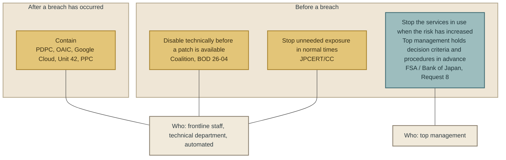

## The Japanese registry — how long the companies that stopped took

Among the 71 rows of the companion book's breach registry are companies that wrote in their public notices the time they stopped a service or system. 
Here are those for which the time from detection to stopping is known.

| Organisation | Detection / awareness | Stop / cut-off | Elapsed |
|---|---|---|---|
| and ST HD | 2026-10-22 around 10:00 (servers isolated) | Cut off at 17:00 the same day | 7 hours (isolation at the same time as detection) |
| Seicomart | 2026-09-28 shortly after 17:00 | Connection stopped at 20:00 the same day | About 3 hours |
| Crypton Future Media | 2026-10-17 around 20:00 | Servers stopped at 23:39 the same day | About 3 hours 40 minutes |
| Treasure Factory | 2026-10-20 small hours to morning (confirmed by an access log investigation on the same day) | External access stopped at 10:30 the same day; application form stopped at 11:05 | A few hours |
| coconala | 2026-10-08 detected at 2:05; traces of data being taken out confirmed around 15:00 | Cut off at 15:44; vulnerability fixed at 21:27 | About 14 hours from detection; 44 minutes from confirming the traces |
| Trustbank | 2026-10-19 anomaly identified | Service stopped at 15:50 the same day | Same day |
| Helpfeel | 2026-09-11 detected at night | Cut off by the small hours of 12 September | A few hours |
| Times Mobility | 2026-09-25 detected at 9:07 | Cut off by 7:25 on 26 September | About 22 hours |
| NTT Solmare | — | 2026-10-15 service stopped at 11:35. The leak was confirmed the next day, 16 October | **Stopped before confirming** |
| Lindt & Sprüngli Japan | 2026-10-19 report from the vendor | Online shop stopped at 16:00 on 21 October | 2 days |
| White Essence | 2026-08-05 unauthorised access confirmed | System temporarily stopped on 12 August | 7 days |

Three things can be read from this table.

**First, many companies stop within a few hours.** 
Of the 71 rows, among the companies that wrote the time they stopped or cut off, many stopped within a few hours of detection. 
The decision to stop is fast.

**Second, there are cases where stopping came before confirmation.** 
NTT Solmare stopped its service on 15 October and confirmed the leak the next day. 
It stopped first, then checked. 
This is close to the form of the decision “when the risk has increased” in sentence 2 of Request 8.

**Third, who decided is written nowhere in the notices.** 
Of the 71 notices, within what this book read, there is none that states who made the decision to stop (management, the IT department, or the vendor). 
For the companies that stopped fast, it is not known whether top management held criteria in advance or frontline staff decided on the spot. 
What Request 8 asks for is the former, not the latter.

### The time after stopping

Stopping comes with the time spent stopped.

- Seicomart stopped the app's connection on 28 September and, in a notice on 15 October, said that “resumption is planned for late October”. That is about one month. The same notice wrote that it was “moving to a system in which personal information cannot be viewed from the app, website, etc.”. While stopped, it is making a design change close to Chapter 7's “hold less”.
- Lawson stopped its reservation function on 8 October and resumed it on 19 October. That is 11 days.
- On 20 October, Monogatari Corporation announced that it would renew “a total of 11 official apps” in the first half of 2027, and that “we will not retain personal information such as names and telephone numbers”. The redesign after stopping is set more than half a year away.

The criteria for the decision to stop include the revenue lost while stopped and the conditions for resuming. 
This time is why sentence 2 of Request 8 says to review “the effectiveness of the business continuity plan (BCP)” and the “procedures for responding to customers and other stakeholders”.

### Cases where a third party stopped

For sentence 4 of Request 8, a stoppage by a third party, there are large examples in the registry.

- From around 3:40 on 7 October 2026, a ransomware attack on IDC Frontier stopped the services of “495 companies and local governments”. JR East, Viewcard and JR Kyushu, although their own systems were not breached, notified the individuals behind a total of about 7.39 million records, through a chain of the vendor's stoppage and the possibility of a leak (Chapter 9).
- A vendor of NEC was attacked in late September, leaving “a state in which various systems could not be used because files on the servers had been encrypted”. At Osaka University, information on 77,851 people leaked from files that NEC had been sharing without a contractual basis.
- On 22 October 2026, following the disclosure of a PHP vulnerability, LIXIL carried out a “temporary suspension of our web systems and emergency maintenance”, and announced that “no unauthorised access to our systems or leak of customer information related to this matter has been confirmed”. This is a case of a company stopping its own services in response to the disclosure of a vulnerability, not after a breach. In the 71 rows of the registry, LIXIL appears for a separate incident (its vendor Commune).

LIXIL's stoppage on 22 October is, within what this book read, the public notice closest to sentence 2 of Request 8, “actively shutting down … when the risk of cyber attack has increased”. 
Who decided is not written.

---

## Can it be carried over outside finance?

Request 8 is addressed to “each financial institution, etc.”. 
Here the parts specific to finance are separated from the parts that apply to any industry.

| Element | Specific to finance? |
|---|---|
| Give top priority to “externally facing IT systems that support critical operations such as internet banking” (Request 2) | Specific. But “externally facing” and “critical operations” can be translated into any industry |
| Take as a premise that defence may fail (sentence 1) | Not specific. The speed asymmetry of Chapter 1 does not depend on industry |
| Top management holds the option to stop (sentence 1) | Not specific |
| Make the decision criteria and procedures clear in advance (sentence 2) | Not specific |
| Review the BCP, customer response procedures and communication arrangements (sentence 2) | Not specific |
| Prepare for stoppages by third parties (sentence 4) | Not specific. The vendor chains in the registry occurred in retail, railways, universities and local government |

What is specific to finance is only the example of which services to prioritise. 
The structure of the decision to stop does not depend on industry.

The industries in the 71 rows of the registry span retail, railways, publishing, games, human resources, mail order, universities, local government and central government ministries. 
Finance accounts for 5 rows — Dai-ichi Life Insurance (employee information), Daiwa Securities (via a vendor), Iwai Cosmo Securities (via a vendor), Viewcard (via a vendor) and Nomura Securities (via a vendor) — and 4 of these are vendor incidents. 
Rows in which a financial institution itself was pressed to decide whether to stop are almost absent from the registry. 
It was companies outside finance that were pressed to decide whether to stop. 
The request was written for finance, but it is every industry that needs it.

---

## Objections and limits

### Objection 1: Stopping wipes out revenue

That is true. 
Seicomart's about one month and Lawson's 11 days are periods when the service could not be used. 
This book does not know the amount of that loss.

Request 8 does not say to stop. 
It says to “consider in advance, as an option” cases where stopping is unavoidable, and to “make clear” the “decision criteria and procedures”. 
Having criteria and stopping are different things. 
A company without criteria will, in the middle of the incident, make one of two decisions: fail to stop when it should stop, or stop when it need not.

### Objection 2: Escalating the decision to stop to management slows it down

As the table in the section “The Japanese registry — how long the companies that stopped took” shows, many companies stop within a few hours. 
That speed may have come from frontline staff doing the stopping. 
The objection that waiting for top management's sign-off would turn hours into days holds.

Request 8 does not say that top management should decide during the incident. 
It says to make clear the “decision criteria and procedures” “in advance”. 
If the criteria exist in advance, frontline staff can stop in line with them. 
What management decides is the criteria, not each individual stop. 
This is the same structure as Chapter 8's “management decides the retention period; the frontline carries out the review”.

### Objection 3: The criteria for stopping differ by industry and system

That is true. 
From the stage of the design table, this book decided not to write “specific thresholds for stopping”. 
The criteria for stopping differ between internet banking, a retail membership app and a university research support site. 
What this book writes is that criteria should exist, not what they contain.

### Objection 4: Stopping causes other failures

Sentence 3 of Request 8 says exactly this. 
Rushing patches increases failures from insufficient testing. 
Stopping can cause failures on resumption, data integrity problems and effects on connected parties. 
This book does not deny this. 
The criteria need to include the recovery procedures after stopping and the conditions for resuming.

### Objection 5: Isn't “only in Japan” a limit of this book's collection?

It may be. 
This book's ledger has 263 rows and is based on sources in English and Japanese, and some in French and Korean. 
It does not cover every country's financial supervisory guidelines or industry bodies' business continuity guidelines. 
That is why the claim was limited to “within this book's collection”. 
If one is found, this chapter's thesis will change from “only in Japan” to “Japan wrote it first” or “Japan also wrote it”. 
The second half of the thesis, that it can be carried over to every industry, does not change.

### Limit: The registry cannot show who stopped

As written in the section “The Japanese registry — how long the companies that stopped took”, the notices do not state who made the decision to stop. 
There is no way to confirm from the notices whether Request 8 has been implemented. 
The first half of this chapter's thesis (the content and position of the request) can be confirmed in the original, but the second half (that it can be carried over) is the author's judgement.

---

## Implementation in Japanese companies — tools

Here sentence 2 of Request 8 is put into the language of companies outside finance.

### Tool 1: A list of what to stop

Identify, in your own company, the “services/IT systems to be handled with priority” of Request 2. The columns are: service name; whether it is externally facing; the operations that stop when it stops; the impact per day of stopping (revenue, number of customers); the technical means of stopping; and the time needed to resume. 
This can be kept in the same document as Chapter 7's inventory of data held.

### Tool 2: Criteria for stopping

Define “when the risk of cyber attack has increased” in your company's own words. 
Examples: when a serious vulnerability is disclosed in software you use and a patch cannot be applied within [N] hours (the form of LIXIL on 22 October); when you receive a report of a breach from a vendor (the form of Lindt); when you confirm traces of unauthorised access yourself (the form of many companies). 
For each, write whether to stop or not, and who decides.

### Tool 3: Authority to stop

Decide who may stop when a situation meeting the criteria arises. 
With top management's prior sign-off, frontline staff can stop in line with the criteria. 
Also write who decides in management's place when management cannot be reached late at night or on holidays. 
Apply to your own authority what Request 5 asked of vendor contracts, “including nights, holidays and the like”.

### Tool 4: Procedures after stopping

A template for explaining to customers (the same skeleton as the first notice in Chapter 9), the conditions for resuming, and who decides to resume. 
As in Seicomart's notice, show customers the planned time of resumption.

### Tool 5: Preparing for stoppages by third parties

For each vendor and software-as-a-service (SaaS) provider, list what in your company stops when that service stops. 
The 495 organisations stopped by the IDC Frontier chain, and Osaka University, whose data leaked through the chain from NEC's vendor, did not have their own systems breached. 
Manage this in the same list as Chapter 11's vendor contracts.

Tools 1–5 are the author's breakdown of the wording of Request 8. They are not a format that the request prescribes.

---

## What this chapter does not assert

- **It does not say “stop”.** Request 8 does not say so either. What it says is to hold criteria and procedures in advance.
- **It does not write thresholds for stopping.** They differ by industry and system.
- **It does not write that the companies that stopped within a few hours had criteria in advance.** The notices do not state who made the decision.
- **It does not write that stopping reduced the damage.** No comparison with not stopping is possible.
- **It does not write that no similar proposal exists anywhere in the world.** The statement is made within this book's collection.
- **It does not write whether Request 8 has been implemented at financial institutions.** This book has not looked inside financial institutions.

---

## To the next chapter

Sentence 4 of Request 8 and the vendor chains in the registry point to the same thing. 
Even if your company has not stopped, when a vendor stops, your company stops; when data leaks from a vendor, your company does the notifying. 
As seen in Chapter 4, vendor management is a proposal agreed around the world. 
But what Japanese supervisory cases show is the reality that comes before the proposals: the contract itself does not exist, and the division of responsibility is unclear. 
The next chapter deals with that.

 

---

### References

1. FSA / Bank of Japan (joint), “Short-term responses by financial institutions and others in light of changes in threats posed by frontier AI (Requests 1–8. The original PDF was opened on 30 October 2026 and all four sentences of Request 8 were checked)” (2026-05-22) https://www.fsa.go.jp/news/r7/sonota/20260522-5/01.pdf
2. Singapore Personal Data Protection Commission (PDPC), “Managing Data Breaches 2.0” (2019) https://www.pdpc.gov.sg/-/media/files/pdpc/pdf-files/other-guides/data-breach-management/
3. Office of the Australian Information Commissioner (OAIC), “Data breach preparation and response” (Updated 2025-02) https://www.oaic.gov.au/privacy/notifiable-data-breaches/preventing-preparing-for-and-responding-to-data-breaches/
4. Google Cloud, “Mitigating ransomware attacks” https://docs.cloud.google.com/docs/security/mitigating-ransomware-attacks
5. Palo Alto Networks Unit 42, “Global Incident Response Report 2026” (2026) https://start.paloaltonetworks.com/rs/531-OCS-018/images/Unit42-Global-Incident-Response-Report.pdf
6. Personal Information Protection Commission, “FAQ 1-10-7” (Updated 2025-07) https://www.ppc.go.jp/all_faq_index/faq1-q10-7/
7. Coalition Security Labs, “Boundary Devices and Plugins Prompt Timely Remediation” (2026-03-19) https://www.coalitioninc.com/blog/security-labs/boundary-devices-and-plugins-prompt-timely-remediation
8. Qualys (commentary on CISA BOD 26-04), “Blog” (2026-07-09) https://blog.qualys.com/product-tech/2026/07/09/
9. JPCERT/CC, “JPCERT-AT-2026-0030” (2026-10-08 (updated 10-23)) https://www.jpcert.or.jp/at/2026/at260030.html
10. Seicomart, “Notice of the planned resumption of member services” (2026-10-15) https://www.secoma.co.jp/images/top/20261015.pdf
11. LIXIL, “On the temporary suspension of our web systems and emergency maintenance” (2026-10-22) https://newsroom.lixil.com/ja/20261022_notice
12. Monogatari Corporation, “On future measures to strengthen security and personal information protection in the “Yakiniku King” official app” (2026-10-20) https://www.monogatari.co.jp/news/261020_news/
13. The author, “The Japan Breach Registry 2026, edition 3 (the times in the section “The Japanese registry — how long the companies that stopped took” are taken from each row's “intrusion date / confirmation date” and “notes” columns)” (2026-10-26) https://github.com/Leading-AI-IO/the-japan-breach-registry-2026

**How this was verified.** 
The four sentences of Request 8 were checked by opening the original PDF on 30 October 2026. The other eight rows of the table in the section “How it differs from the world's proposals — many say “stop”, none say “decide”” are based on primary sources the author opened when building the ledger (T1), or on sources confirmed from summaries (T2). 
The URLs in the Google Cloud, Unit 42 and OAIC rows are as recorded in the ledger, and were not reopened when this chapter was written. 
The times in the section “The Japanese registry — how long the companies that stopped took” were transcribed by the companion book's registry from each company's public notices.

 

---

# Chapter 11: Vendors and the Reality of “No Contract” — Where in the Contract Are Your Decisions Written?

## Where this chapter sits in Part 4

The three things decided in Part 3 (what to hold, when to notice, how to tell), and the criteria for stopping in Chapter 10, are not complete inside the company alone. 
Data also sits with vendors. 
Records remain in vendors' systems. 
The starting point for telling is a report from a vendor. 
And what stops is often a vendor's service. 
Of the 71 rows of the registry for Japan, 16 have a vendor as the intrusion route.

The only means of making what you decided reach your vendors as well is the contract. 
This chapter uses supervision cases to confirm that, in Japan, you cannot assume such a contract “exists”. 
It then shows where in the contract the content of Chapters 7 to 10 should be written.

## This chapter's thesis

**Vendor management is a proposal the world agrees on. 
But the cases Japan's supervisory authority reported in 2026 show a reality that sits before the proposals: no contract at all, unclear responsibility, and no grasp of how the vendor handles the data. 
Without a contract, what was decided in Part 3 does not reach the vendor. 
What to write in the contract is exactly what was decided in Chapters 7 to 10.**

---

## Japan's supervision cases — the original text

At its meeting on 2 September 2026, the Personal Information Protection Commission (PPC) reported on the “Status of the Exercise of Monitoring and Supervisory Powers in the First Quarter of Fiscal Reiwa 8 (2026)”. 
It is a breakdown of guidance and advice given from April to June 2026: 98 cases for private businesses and 43 for administrative bodies and others, 141 cases in total. 
By cause, the counts for private businesses were: prevention of unauthorised access and the like from outside, 21; identification and authentication of those accessing, 14; **supervision of vendors, 12**; prevention of leaks and the like arising from the use of information systems, 3.

I quote the descriptions of the cases on the supervision of vendors as they appear in the original.

> In the business operator's case, it had entrusted the handling of personal data to a vendor as part of work that included responding to vulnerabilities in VPN devices and the like, but had not concluded a contract, … (author's translation)

> As for the business operator, it was found that, in entrusting the handling of personal data to the business concerned, it had not concluded a contract, and that there were problems with its grasp of how the business concerned was handling the personal data, among other things; its supervision of the vendor was insufficient.

> The business operator had left the location of responsibility for vulnerability response unclear between itself and the vendor, and therefore …

> As for the business operator that was the client organisation, what had been agreed in the contract regarding security control measures was insufficient, and …

> When the business operator sub-contracted the entrusted work to another business, it opened ports on a VPN router, and then …

Statements to the same effect (“had not concluded a contract”, “there were problems with its grasp of how … was handling”) are repeated in at least 4 places in this document. 
They appear not as one case but as a pattern.

There is something to note here. 
These are not cases where “vendor management was lax”. 
They are cases where **there was no contract**. 
Before you can discuss whether management was good or bad, the document that would be the basis for management did not exist. 
When the world's proposals say “build requirements into contracts”, the existence of a contract is assumed. 
Japan's supervision cases show that companies for which that assumption does not hold are being given guidance at a rate of 12 in a quarter.

The document itself notes that “the figures are as of the time of publication”, so this book does not treat these numbers as final either.

---

## The world's consensus — “write it into the contract” is thick

Chapter 5 treated the proposals on vendors as Conflict 4. Here I lay out the parts on which they agree, by addressee.

### Proposals addressed to the client organisation

| Issuer | Proposal (original text) | Tier |
|---|---|---|
| US National Institute of Standards and Technology (NIST) Cybersecurity Framework 2.0 | “Incorporate requirements into contracts.” | T1 |
| EU NIS2 Directive, Article 21(2)(d) | “supply chain security, including security-related aspects concerning the relationships between each entity and its direct suppliers or service providers” | T1 |
| National Cybersecurity Office, Cabinet Secretariat (NCO) (2026-10-09) | “Confirm the vendor's information security policy and management structure, and the allocation of roles and division of responsibility with the vendor” “Grasp the state of management, including sub-contractors” “Check continuously, not only when the contract is concluded” | T2 |
| Same | “Clearly define how information is to be handled” “Require access-rights management and log management to be carried out” “Stipulate an obligation to report if unauthorised access or a leak occurs” | T2 |
| Same | “Keep the personal information and business information provided to the vendor to the necessary minimum” “Make sure data is deleted at the vendor after the work ends” | T2 |
| Same | “Identify important business partners and vendors” “Visualise the flow of information assets, including the supply chain” “Carry out risk assessments regularly” | T2 |
| Verizon 2026 Data Breach Investigations Report (DBIR) | Lists “clear visibility into assets and third parties” as one of the basics | T1 |
| Palo Alto Networks Unit 42 | “reduce exposure … third-party dependencies and integrations” | T1 |
| New Zealand National Cyber Security Centre (NCSC) | “Review the vulnerability management policies of your software and system supply chains including whether and how AI is being used for finding vulnerabilities.” | T1 |

### Proposals addressed to vendors

| Issuer | Proposal (original text) | Tier |
|---|---|---|
| Singapore Personal Data Protection Commission (PDPC) | “report data breaches to the main organisation without undue delay (no later than 24 hours)” | T2 |
| European Data Protection Board (EDPB) | “they have an obligation to notify you in a prompt way” | T2 |
| The UK Cyber Security and Resilience Bill | “requirements for data centres, RMSPs and RDSPs to inform customers of cyber breaches that have likely affected them” | T2 |

There are 9 rows of proposals addressed to the client organisation and 3 rows addressed to vendors, and both point the same way: “write it into the contract” and “notify”. 
This is a consensus that meets the Chapter 4 criterion (3 or more types of issuer pointing the same way).

The limits of the consensus are also written on the proposals' side. 
The World Economic Forum's 2026 report names as an issue that the second and third tiers of the supply chain cannot be verified. 
A commentary on NIS2 (DLA Piper) writes: “NIS2 contains no further guidance on how the security of a supply chain is to be ensured”. 
There is consensus up to “write it into the contract”. 
How to check after it is written is a gap.

---

## Japan's registry — the structure of the 16 vendor rows

Of the 71 rows of the registry in the companion book, I group the 16 rows whose intrusion route was a vendor by the vendor where it started.

| Starting point (vendor) | Client organisations it cascaded to (registry rows) | Event at the vendor | Client organisation's notice |
|---|---|---|---|
| IDC Frontier (cloud) | JR East, Viewcard, JR Kyushu | 2026-10-07 ransomware | 10-09 |
| Commune (community platform) | WingArc1st, Sansan, LIXIL | 10-06 notification | 10-08, 10-09, 10-09 |
| Scala Communications (FAQ platform) | Daiwa Securities | 10-02–03 unauthorised access; 10-03 contact | 10-05 |
| Rakus Light Cloud (email delivery) | Tokyo Metropolitan Government, Cells Co. | 10-21 emergency shutdown | 10-23, 10-23 |
| Yumirlink (email delivery) | Nomura Securities | 10-16 confirmed; 10-22 exfiltration confirmed | 10-23 |
| NEC Corporation | Osaka University | Late September attack | 10-21 |
| Studio Inc. (web production platform) | Digital Agency | 10-16 report | 10-22 |
| Nippon Columbia group | Daiichikosho | 10-01–02 device infection; 10-05 report | 10-08 |
| Tradeworks (securities system) | Iwai Cosmo Securities | 10-14 unauthorised access | 10-16 |
| FutureShop (e-commerce platform) | Lindt & Sprüngli Japan | 10-17–18 intrusion; 10-19 report | 10-23 |
| Hakuhodo (secretariat) | Ministry of Land, Infrastructure, Transport and Tourism (MLIT) | — | 10-20 |

Three things can be read from this table.

**First, one vendor cascades to several client organisations.** 
IDC Frontier to 3 companies, Commune to 3, Rakus Light Cloud to 2 (counting only the client organisations whose primary notices the registry could read; news reports put it higher). 
The structure in which a client organisation writes “our own systems were not compromised” while still notifying individuals was seen in Chapter 9 with the about 7.39 million records.

**Second, from receiving the vendor's report to publishing a notice took 2 to 7 days.** 
Sansan: vendor's report 6 October, preliminary report received 7 October, notice 9 October. 
Daiwa Securities: contact 3 October, notice 5 October. 
Lindt: report 19 October, notice 23 October. 
Nomura Securities: vendor's confirmation 16 October, exfiltration confirmed 22 October, notice 23 October. 
Whether Singapore's proposal, “report to the main organisation within 24 hours”, was kept is not known, because the notices do not give the times on the vendor's side.

**Third, there is a case that happened outside the contract.** 
Osaka University's notice wrote: “It was confirmed that NEC, not on the basis of its contract with the University, had been sharing files containing the University's personal information on cloud storage in order to share information with the partner company concerned.” 
There was a contract. 
But the data had been placed outside it. 
If the supervision cases in the section “Japan's supervision cases — the original text” are “no contract”, this is a case of “there is a contract, but the data is not within its scope”.

### What the client organisations could not decide

The client organisations in the 16 rows could not decide the three things of Part 3 for themselves.

- **What to hold.** The scope of the data handed to the vendor is fixed by the judgement made when the work was entrusted. JR East's about 2.06 million records and Viewcard's about 4.03 million records are email addresses that had been placed with the vendor for email delivery.
- **When to notice.** The one who noticed was the vendor; the client organisation received a report. The records are at the vendor. This is why Chapter 8 wrote “confirm the retention period for each vendor and SaaS in the contract”.
- **How to tell.** The client organisation chose whether to wait for the vendor's investigation results or to notify at the ceiling without waiting. The 3 companies of IDC Frontier did not wait, and 6 days later received a report of “no leak” (Chapter 9).

All the client organisation can decide is what to write in the contract.

---

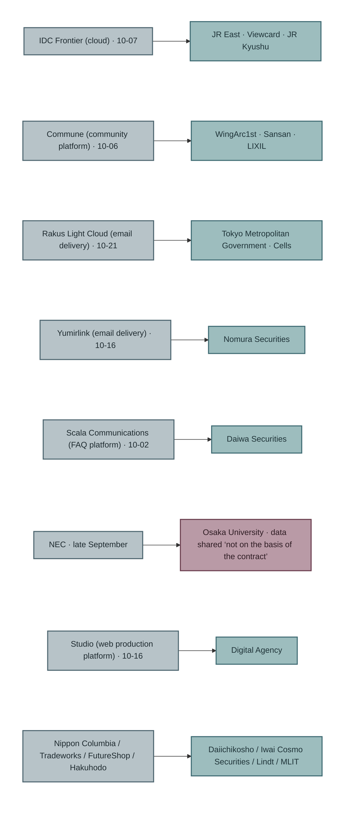

## What to write in the contract — the content of Chapters 7 to 10

This book does not invent new contract clauses. 
It shows where in the contract the content decided in Chapters 7 to 10 is written.

| Chapter of this book | What was decided | Item to write in the contract | Corresponding proposal |
|---|---|---|---|
| Chapter 7 Hold less | The data items and record counts handed over, the default retention period, deletion | List the data items handed to the vendor. Deletion after the work ends, and how deletion is confirmed. Whether the data may be passed on again to sub-contractors | NCO “the necessary minimum” “data deleted at the vendor after the work ends” |
| Chapter 8 Notice | Log retention period and review cycle | The types of logs the vendor keeps, and for how long. The obligation to provide them when the client organisation asks. Notification when log collection stops | Same, “Require access-rights management and log management to be carried out”. Information-technology Promotion Agency, Japan (IPA) “log retention periods differ from service to service” |
| Chapter 9 Tell | The speed and scope of reporting | The time from the vendor learning of a compromise to reporting it to the client organisation (for example, 24 hours). What the report includes (separating the confirmed scope from the scope of the risk of having leaked). The deadline for follow-up reports | PDPC “within 24 hours”. EDPB “notify in a prompt way”. NCO “Stipulate an obligation to report” |
| Chapter 10 Stop | Criteria and procedure for stopping | Advance notice when the vendor stops a service. The conditions under which the client organisation can, on its own judgement, have the vendor's service stopped. The conditions for restarting | Financial Services Agency (FSA) and Bank of Japan, Request 8, fourth sentence (preparing for a third party to stop) |
| Chapter 5 and this chapter | Where responsibility lies | The division of responsibility for vulnerability response (who applies the patch and who checks it). Whether sub-contracting is allowed, and applying the same conditions to sub-contractors | NCO “Confirm … the allocation of roles and division of responsibility” “Grasp the state of management, including sub-contractors”. Supervision case “had left the location of responsibility … unclear” |

Every item in the right-hand column of this table is a proposal that Japanese public bodies have already written. 
All this book added is the left-hand column: which decision of Part 3 each item corresponds to.

### When there is no contract

What the supervision cases in the section “Japan's supervision cases — the original text” show are companies at the stage before writing this table. 
To a vendor with no contract, this book can say one thing. 
Having no contract is a separate problem from insufficient vendor management, and one that comes before it, and the supervisory authority made it a subject of guidance in 2026. Concluding a contract is not a technical judgement. 
It is a judgement for management and legal.

---

## Objections and limits

### Objection 1: Writing it into the contract does not mean the vendor will keep to it

That is true. 
The Osaka University case shows that, even with a contract, data was placed outside it. 
A contract is a document that shows where responsibility lies when it is not kept to. 
It is not a mechanism that makes people keep to it. 
The mechanism for making them keep to it (regular checks, audits) is written by the NCO: “Check continuously, not only when the contract is concluded.” 
This book does not write the frequency or method of checks.

### Objection 2: The client organisation cannot supervise multiple layers of sub-contractors

Just as the World Economic Forum's report names the impossibility of verifying the second and third tiers, this book does not write that “the client organisation can fully supervise multiple layers of sub-contractors”. 
That was decided from the design stage. 
What this book writes goes as far as writing, in the contract with the direct vendor, that the same conditions apply to sub-contractors. 
This book cannot show how the client organisation can check whether that is kept to at the second tier and below.

### Objection 3: Small and medium client organisations cannot make large vendors write in conditions

That is true. 
Cloud platforms and email delivery services are often standard-terms services whose contract conditions the client organisation cannot change. 
IDC Frontier, Rakus Light Cloud, Yumirlink and Studio are all of this kind. 
When the terms cannot be changed, what the client organisation can do is the Chapter 7 judgement: what to hand to that service. 
Read the log retention period, the reporting deadline and the notice of stopping written in the terms, and if they are not enough, reduce the data you hand over. 
If you cannot write the contract, hold less.

### Objection 4: The registry cannot show whether there was a contract

It cannot. 
The notices in the 16 rows say nothing about whether there was a contract with the vendor, or what it contained. 
In this chapter, the section “Japan's supervision cases — the original text” is written from supervision cases and the section “Japan's registry — the structure of the 16 vendor rows” from public notices, and the two sources do not refer to the same companies. 
This book does not write that “the client organisations in the 16 rows of the registry had no contract”.

### Limit: The counts in the supervision cases are not final

As the document itself notes, the figures are as of the time of publication. 
“12 in a quarter” may change in the annual report.

---

## What this chapter does not assert

- **It does not write that vendor management in Japan is worse than in the rest of the world.** This book has not checked whether supervisory authorities in other countries publish similar tallies.
- **It does not write that the client organisations in the 16 rows of the registry had no contract.** The notices do not say.
- **It does not write that writing it into the contract means it will be kept to.** There is the Osaka University case.
- **It does not write that the client organisation can supervise multiple layers of sub-contractors.**
- **It does not write that the vendors' reports were late.** The notices do not give the time at which the vendor learned of it.
- **It does not present the table in the section “What to write in the contract — the content of Chapters 7 to 10” as a template for contract clauses.** It is a table of correspondences between items, not clauses that have been through legal review.

---

## To the next chapter

Chapters 7 to 11 showed what the company decides, and where to write it (board papers, contracts). 
The question that remains is whether it gets through inside the company. 
Making a list of the data you hold, extending log retention periods, and concluding new contracts with vendors all need budget, sign-off and explanation. 
Chapter 12 looks at whether these three proposals are in a form that gets through ringi, fits insurers' underwriting conditions, and answers the board's questions.

 

---

### References

1. Personal Information Protection Commission, “Status of the Exercise of Monitoring and Supervisory Powers in the First Quarter of Fiscal Reiwa 8 (2026) (Material 3-1; original PDF opened and checked on 30 October 2026)” (2026-09-02) https://www.ppc.go.jp/files/pdf/260902_shiryou-3-1.pdf
2. National Cybersecurity Office, Cabinet Secretariat, “Response in light of cases of leaks and the like caused by unauthorised access (original PDF opened on 30 October 2026 and the vendor-management bullet points checked)” (2026-10-09) https://www.cyber.go.jp/pdf/press/taiou.pdf
3. NIST, “Cybersecurity Framework 2.0 overview (SP 1299)” (2024) https://nvlpubs.nist.gov/nistpubs/SpecialPublications/NIST.SP.1299.pdf
4. EU / DLA Piper, “NIS2 Article 21(2)(d); DLA Piper commentary” (2025-12) https://www.dlapiper.com/en-us/insights/publications/2025/12/nis2-directive-explained-part-3-supply-chain-secu
5. Verizon, “2026 Data Breach Investigations Report” (2026) https://www.verizon.com/business/resources/T343/reports/2026-dbir-data-breach-investigations-report.pdf
6. Palo Alto Networks Unit 42, “Global Incident Response Report 2026” (2026) https://start.paloaltonetworks.com/rs/531-OCS-018/images/Unit42-Global-Incident-Response-Report.pdf
7. New Zealand NCSC, “The implications of Frontier AI models for cyber defence” (Date not confirmed) https://www.ncsc.govt.nz/protect-your-organisation/the-implications-of-frontier-ai-models-for-cyber-defence/
8. World Economic Forum / Accenture, “Global Cybersecurity Outlook 2026” (2026-01-12) https://www.weforum.org/publications/global-cybersecurity-outlook-2026/
9. Singapore Personal Data Protection Commission, “Managing Data Breaches 2.0” (2019) https://www.pdpc.gov.sg/-/media/files/pdpc/pdf-files/other-guides/data-breach-management/
10. European Data Protection Board (EDPB), “Guidelines at a glance: data breaches” (2026-10) https://www.edpb.europa.eu/system/files/2026-10/edpb_guidelines-at-a-glance_data_breaches_en_1.pdf
11. UK Department for Science, Innovation and Technology (DSIT) / Department for Culture, Media and Sport (DCMS), “Cyber Security and Resilience Bill factsheet” (2025-11-12 (updated 2026-06-30)) https://www.gov.uk/government/publications/cyber-security-and-resilience-network-and-information-systems-bill-
12. IPA, “Measures that should be implemented promptly in light of cases of leaks and the like caused by unauthorised access” (2026-10-09) https://www.ipa.go.jp/security/security-alert/2026/alert20261009.html
13. Osaka University, “Notice concerning its vendor NEC” (2026-10-21) — Primary URL in registry row 058
14. The author, “*The Japan Breach Registry 2026*, 3rd edition (the 16 vendor rows)” (2026-10-26) https://github.com/Leading-AI-IO/the-japan-breach-registry-2026

**How this was verified.** 
For the PPC's Material 3-1 and the NCO's document, the original PDFs were opened on 30 October 2026 and the quotations checked. 
The original text of NIS2 Article 21 was not opened; it is cited via the DLA Piper commentary (as recorded in row H-020 of the proposal ledger). 
The dates in the section “Japan's registry — the structure of the 16 vendor rows” were transcribed by the companion book's registry from each company's public notice.

 

---

# Chapter 12: Insurance, Ringi and the Board — Where Do Your Decisions Get Through?

## Where this chapter sits in Part 4

Chapters 7 to 11 showed what the company decides, and where to write it (board papers, contracts). 
This chapter deals with whether it gets through inside the company. 
Making a list of the data you hold. 
Extending log retention periods. 
Deciding the default for the first notice. 
Signing off the criteria for stopping. 
Concluding new contracts with vendors. 
Every one of these needs budget, sign-off and explanation.

This chapter looks at three places. 
Ringi (the circulated approval document through which Japanese companies approve budgets): the place where budgets get through. 
Insurance: the place where conditions come from outside. 
The board: the place where management is questioned.

## This chapter's thesis

**The three decisions of Part 3 are management judgements, not technology investments. 
Put them up for ringi as technology investments and they stall on “show the effect”. 
As seen in Chapter 3, no one can show the effect. 
The three decisions get through when the evidence is not the effect but the company's own numbers (how many records it holds, how many days it keeps, how widely it would notify). 
The controls insurers look at in underwriting, and the questions the board should ask, are already on the side of those numbers.**

---

## Ringi — why it stalls

### It stalls on “show the effect”

The reason a security budget stalls in ringi is similar to the reason a new-business budget stalls. 
In both, the side drafting the proposal can now produce documents faster, while the evidence the reviewing side asks for has not changed. 
Ringi is not a contest in writing persuasive text. 
It is a contest in assembling evidence on which a decision can be made.

The evidence asked for in a security ringi is usually “how much will this investment lower the probability of a compromise?” 
As seen in Chapter 3, this evidence does not exist. 
Proposals with effect measured are 14 out of 211, and those 14 are conditional correlations. 
The insurance broker Marsh McLennan matched its own self-assessment questionnaires against claims and wrote: “simply deploying key cybersecurity controls is no longer enough”. 
Coalition wrote: “More security tools and increased spending isn't making businesses any safer.” 
Both sell insurance, and their position includes that of a seller. 
But that effects cannot be put forward as evidence is written by the sellers of insurance themselves.

A ringi that asks for effects as evidence is asking a question that has no answer. 
That is why it stalls.

### Change the evidence from effects to numbers

At the start of Chapter 7, this book wrote the criteria by which it chose the three decisions: not whether they work, but that they still matter if the attack succeeds, and that the company can decide them alone. 
These criteria also change the form of the evidence for ringi.

| Decision | Evidence ringi tends to ask for | Evidence this book offers |
|---|---|---|
| Hold less (Chapter 7) | Grounds that deleting reduces compromises | The number of records the company holds, and the grounds for holding them (statutory retention period, date of last use). The number of records that can be deleted. The fact that the registry's 18 notices “disclosed at the ceiling” notified every record held |
| Notice (Chapter 8) | Grounds that extending logs makes detection faster | The current retention period of each of the company's logs (most still at the default). Mandiant's finding that 90 days is not enough to see it. The fact that, in the registry, Helpfeel and Charm wrote in their notices that “there are no records” |
| Tell (Chapter 9) | Grounds that preparing the first notice reduces reputational damage | If the company had an incident today, how many people it would notify (= the number of records it holds). The fact that the registry's about 7.39 million records went to zero 6 days later |
| Stop (Chapter 10) | Grounds that stopping reduces the damage | The sales and number of customers lost for each day of stopping. The time needed to restart. The original text of Request 8 from the Financial Services Agency (FSA) and the Bank of Japan |
| Contracts (Chapter 11) | Grounds that concluding a contract means the vendor will keep to it | For each vendor, whether there is a contract, and whether the items in the Chapter 11 table are written in it. Supervision case: “had not concluded a contract” (author's translation) |

There is no effect in the right-hand column. 
There are only the company's current numbers and the facts written in other companies' public notices. 
This evidence can be assembled if you collect it. 
Evidence of effects cannot be assembled however much you collect.

What happens when a new-business plan gets through a management meeting is this: it shows, by logic, that it fits the management strategy, and then shows something that works. 
In a security ringi, what corresponds to “something that works” is the company's list of the data it holds, and the public notices in the registry. 
Not a prototype but the company's own numbers move the discussion from “does it work?” to “do we hold it?”

### Split the investment into small pieces

In new business, you make review easier to pass by splitting the investment into small pieces before the formal review and changing the decision criteria at each stage. 
The three decisions are already split into small pieces. 
Making a list of the data you hold needs almost no budget. 
The cost of extending retention periods is the cost of storage capacity, and it can be estimated. 
Deciding the default for the first notice means writing one document. 
A large investment comes after the three are decided, if it is needed.

---

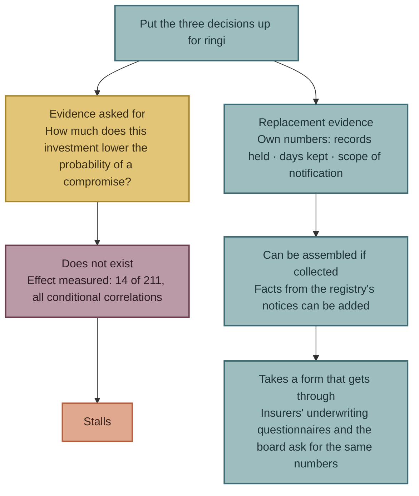

## Insurance — conditions from outside

### What do insurers look at?

Insurers must decide whether to underwrite without being able to measure effects. 
So they look at the relationship between controls and claims in their own data. 
I lay out what this book was able to confirm.

| Issuer | Content (original text) | Data basis | Tier |
|---|---|---|---|
| Marsh McLennan (insurance broker, 2025-08-27) | The top 5 controls that lower the probability of a breach claim: network hardening, endpoint detection and response (EDR), **logging and monitoring**, awareness training and phishing testing, and an **incident response plan**. Organisations that run tabletop exercises regularly are “13% less likely to experience a material cyber event”. Phishing-resistant multi-factor authentication (MFA) is 9% lower than standard MFA | Matching of its own self-assessment questionnaires against claims. Number of organisations not stated. Correlation | T1 |
| At-Bay (2026-04-22) | “The only businesses that avoided full ransomware encryption had their EDR backed by 24/7 monitoring via Managed Detection & Response (MDR)” | Claims data from over 100,000 policy years. At-Bay itself sells MDR. Denominator not disclosed | T1 |
| Coalition (2026-03-05) | 58% of claims in 2025 were business email compromise and funds transfer fraud. “The sooner policyholders report suspicious activity, the more likely Coalition is to recover” | Over 100,000 policyholders (US, Canada, UK, Australia, Germany) | T1 |
| Coalition (2026-08-31) | “Calling the claims hotline early can serve two purposes: Satisfy reporting requirements … Unlock pre-claim legal and forensics practitioners” | Includes explanation of its own products | T1 |

Of Marsh's top 5, “logging and monitoring” corresponds to Chapter 8, and “incident response plan” to Chapters 9 and 10. The controls insurers and insurance brokers picked out from claims data and the decisions this book chose on the criterion “the company can decide them alone” partly overlap. 
This is not evidence that this book's proposals work. 
It means they overlap with items that the sellers of insurance look at as underwriting conditions, without asking about effects.

### Is insurance a condition in Japan?

This book has not checked whether, in Japan's cyber insurance market, insurers require controls as underwriting conditions and screen out companies that do not meet them. 
The published materials of US insurers are written from the position of selling products that combine insurance and controls, such as Active Insurance (Coalition) and InsurSec (At-Bay). 
Whether the same is happening in Japan was decided as “not to be written” from the design-table stage.

The reason this chapter includes insurance is not whether there is screening. 
It is that an insurer's underwriting questionnaire is one of the few outside occasions on which a company must answer about its own controls in numbers. 
When answering the questionnaire, the company writes how many days it keeps logs, whether it has a response plan, and how it manages vendors. 
The items it cannot answer are the things it has not decided in Part 3.

---

## The board — the questions to ask

### Management's responsibility is agreed on the proposals' side

That management is responsible is thick in the world's proposals.

| Issuer | Content (original text) | Tier |
|---|---|---|
| US National Institute of Standards and Technology (NIST) Cybersecurity Framework 2.0 (2024-02-26) | “leadership is responsible and accountable for cybersecurity risk”. Adds Govern as a new function | T1 |
| US Securities and Exchange Commission (SEC) (2023-07-26) | “disclose material cybersecurity incidents”. Risk management and governance described in annual reports | T1 |
| National Cybersecurity Office, Cabinet Secretariat (NCO) (2026-10-09) | “We ask that you position cybersecurity measures as a management issue and strengthen measures, including the necessary investment and the building of human resources structures.” | T2 |
| FSA and Bank of Japan (2026-05-22) | “Top management needs to treat it as a company-wide management issue”. Under Request 8, top management holds the option to stop | T1 |

“Position it as a management issue” is a consensus. 
But the same structure as the gap in Chapter 6 is here too. 
The proposals do not write what the board should ask once it has been positioned as a management issue.

### Turn the three decisions into questions

This book turns the content of Chapters 7 to 11 into questions to ask at the board. 
Every answer comes back as a number or as whether a document exists.

| Chapter | Board question | Form of the answer |
|---|---|---|
| Chapter 7 | How many records of personal data do we hold? How many of them are past the statutory retention period? How many have not been used for 1 year or more since last use? | A number of records |
| Chapter 7 | If every record leaked today, how many people would we have to notify? | A number of records (the same as the answer above) |
| Chapter 8 | How many days are the authentication, access, operation and communication logs each kept for now? Who decided those numbers of days? | A number of days, and the name of the person who signed it off (“the default” if no one decided) |
| Chapter 8 | When logs stop being produced, who notices, and within how many days? | A number of days, and the person responsible |
| Chapter 9 | If an incident happened today, would the first notice go out at the ceiling, or after narrowing? Who decided that? | The default, and the record of sign-off |
| Chapter 10 | What are the criteria for a situation in which we have no choice but to stop? Who has the authority to stop in the middle of the night? | Whether a document exists, and who holds the authority |
| Chapter 11 | How many vendors do we hand personal data to? Of those, how many have the items in the Chapter 11 table written into their contract? | A number of companies |

None of the 7 questions asks about effects. 
For each, you know on the spot whether it can be answered or not. 
The questions that cannot be answered are the things not yet decided.

### The order of the questions

The questions are asked in order, starting from Chapter 7. If you do not know how many records you hold, the scope of notification cannot be decided either. 
If the number of days logs are kept has not been decided, you cannot know whether you can narrow either. 
The chain seen in Part 3 (ceiling → can you narrow → speed and scope) is also the order of the questions.

---

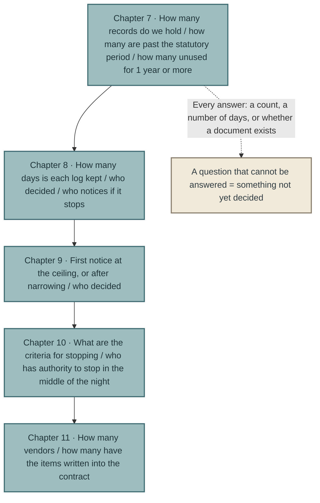

## Objections and limits

### Objection 1: Getting through ringi does not mean it will be carried out

That is true. 
This chapter only shows a form that gets through; it does not guarantee that it is carried out. 
Whether it was carried out can be known by asking the questions in the section “The board — the questions to ask” again at the next board meeting. 
If the numbers in the answers have not changed, it has not been carried out.

### Objection 2: The numbers of insurers and insurance brokers are sellers' numbers

That is true. 
Marsh, At-Bay and Coalition are all in the position of selling controls and insurance together. 
This book stated that in each row. 
The reason this chapter uses the numbers of insurers and insurance brokers is not as evidence of effects, but as a record of what the parties look at when they are forced to make underwriting judgements without being able to measure effects.

### Objection 3: A company that can answer the board's questions is a company that has already decided

That is true. 
This chapter's questions are unnecessary for a company that has decided, and cannot be answered by a company that has not. 
Finding out that they cannot be answered is the purpose of this chapter's questions. 
The number of questions that come back with “we don't know” becomes the number of agenda items the board takes up next.

### Objection 4: A new-business ringi and a security ringi are different

There are differences. 
In new business, the return on investment can be measured as sales. 
In security, the return is “incidents that did not happen”, and it cannot be measured. 
But the structure that makes them stall is the same. 
The drafting side cannot produce the evidence the reviewing side asks for. 
In new business it is evidence that “customers really have the problem”; in security it is evidence that “it works”. 
This book's answer is to stop asking for evidence that cannot be produced, and to move the evidence to numbers that can be.

### Limit: This book has no actual cases of ringi or board meetings

This book's registry consists of public notices and proposals. 
It has no record of how the three decisions were handled in any company's ringi or board meetings. the section “Ringi — why it stalls” and the section “The board — the questions to ask” are the author's design. 
If actual cases are gathered, this chapter will be rewritten.

---

## What this chapter does not assert

- **It does not write that the three decisions reduce compromises.** As in each chapter of Part 3, effects have not been measured.
- **It does not write that insurance forces controls.** The screening function of Japan's insurance market has not been confirmed.
- **It does not present insurers' and insurance brokers' ranking of controls as a ranking of effects.** It is correlation, and sellers' numbers.
- **It does not write that the board's questions meet the governance requirements that supervisory authorities ask for.** This book has not been through legal review.
- **It does not write that the way to get ringi through is the same in every company.** It is the author's design.

---

## Summary of Part 4

Part 4 looked at whether the three things decided in Part 3 get through three places inside the company.

- **The decision to stop (Chapter 10)**: Take the only decision that has to be made in the middle of an incident, and return it to management sign-off as criteria set in advance. If there are criteria, the front line can stop by the criteria.
- **Contracts (Chapter 11)**: The only document that makes what you decided reach your vendors. In Japan, companies with no contract at all are subject to supervision.
- **Ringi, insurance and the board (this chapter)**: Use the company's own numbers as evidence, not effects. The items insurers look at in underwriting, and the questions the board should ask, are already on the side of those numbers.

In these three places, no new decisions were added. 
What was added is only a form in which what was decided gets through. 
In the Conclusion, I rebuild this book's claims using only the facts confirmed in Parts 1 to 4.

 

---

### References

1. Marsh McLennan Cyber Risk Intelligence Center, “Cybersecurity signals: Connecting controls and incident outcomes (press release; checked on 30 October 2026)” (2025-08-27) https://www.marsh.com/en/corp/about/news/marsh-mclennan-cyber-risk-intelligence-center-report.html
2. At-Bay, “2026 InsurSec Report (press release)” (2026-04-22) https://www.at-bay.com/press_releases/2026-insursec-report-ransomware-vpn-sonicwall-attacks/
3. Coalition, “2026 Cyber Claims Report (announcement; checked on 30 October 2026)” (2026-03-05) https://www.coalitioninc.com/announcements/2026-cyber-claims-report
4. Coalition, “2026 Cyber Claims Report (blog; source of “More security tools…”)” (2026-03-05) https://www.coalitioninc.com/blog/cyber-insurance/2026-cyber-claims-report
5. Coalition (Daniel Woods), “Dispelling the Myth: Cyber Insurance Doesn't Pay Claims” (2026-08-31) https://www.coalitioninc.com/blog/cyber-insurance/dispelling-myth-cyber-insurance-doesnt-pay-claims
6. NIST, “Cybersecurity Framework 2.0” (2024-02-26) https://csrc.nist.gov/pubs/cswp/29/the-nist-cybersecurity-framework-csf-20/final
7. US SEC, “Cybersecurity disclosure rules (press release)” (2023-07-26) https://www.sec.gov/newsroom/press-releases/2023-139
8. National Cybersecurity Office, Cabinet Secretariat, “Response in light of cases of leaks and the like caused by unauthorised access” (2026-10-09) https://www.cyber.go.jp/pdf/press/taiou.pdf
9. FSA and Bank of Japan, “Short-term responses by financial institutions and others in light of changes in threats posed by frontier AI” (2026-05-22) https://www.fsa.go.jp/news/r7/sonota/20260522-5/01.pdf
10. The author, “*The Japan Breach Registry 2026*, 3rd edition” (2026-10-26) https://github.com/Leading-AI-IO/the-japan-breach-registry-2026

**How this was verified.** 
Marsh's press release and Coalition's announcement were opened in the original and checked on 30 October 2026. Marsh's press release uses the word correlation, but has no explicit note that it is not causation. 
This book treats it as correlation. 
For Coalition's “More security tools and increased spending isn't making businesses any safer.”, this book relies on the record in row E-010 of the proposal ledger (the blog version), and confirmed that the same wording does not appear on the announcement page. 
The description of the structure of ringi in the section “Ringi — why it stalls” summarises what the author has written separately about ringi for new business; this book does not treat it as a primary source.

 

---

# Conclusion: What to Count Again in the Next Edition

## Rebuilding the claim from verified facts alone

This book's claim is one sentence.

> The race to prevent intrusion is being lost to the attackers on speed. The only things a company can decide for itself are three: what to hold, when to notice and how to tell. And these three are the thinnest part of the world's proposals.

I will rewrite this sentence once, using only the facts confirmed in Parts 1 to 4.

**The race to prevent intrusion is being lost to the attackers on speed.** 
The fastest attackers move in seconds and minutes. 
The defenders' median time to remediation is measured in days (Chapter 1). 
The issuers of the proposals themselves wrote that the content of their proposals is the same as before AI (Chapter 2). 
The measures for the period when remediation cannot be made in time were written into US and Japanese rules without any source that measured their effect (Chapter 3).

**The only things a company can decide for itself are three.** 
Of the 211 proposals, 14 measured their effect, and every one of those is a correlation with conditions (Chapter 6). 
When we do not know what works, and we look for things that can be decided whether or not they work, two conditions remain. 
They must still matter if the attack succeeds. 
And the company must be able to decide them without anyone else's cooperation (the opening of Chapter 7). 
What meets these conditions is what to hold, when to notice and how to tell.

**The three are linked.** 
The amount you hold sets the maximum that can leak (Chapter 7). 
Whether you have records decides whether you can narrow the actual leak to within that maximum (Chapter 8). 
Whether you can narrow it decides your options: tell quickly at the ceiling, or tell after narrowing (Chapter 9). 
Japan's 71 public notices divided into 18 that disclosed at the ceiling, 24 that narrowed by records, 14 that could not state a count, and 15 that could be read either way.

**These three are the thinnest part of the world's proposals.** 
Data minimisation has 13 proposals, the fewest of the nine categories, and only government bodies and one insurer write about it (Chapter 6). 
Only one proposal, from India, sets the log retention period in days (Chapter 8). 
No rule within the range this book opened sets how many to notify in the first notice (Chapter 9).

**What you decide passes through three places inside the company.** 
On the decision to stop, Japan's financial authorities asked top management for criteria set in advance. 
Within the range of this book's collection, this proposal has no parallel, and it can be carried over to every industry (Chapter 10). 
Vendors can be reached only through contracts, and in Japan companies that have no such contract at all are subject to supervision (Chapter 11). 
What gets through ringi, insurance and the board is not evidence of effect but the company's own numbers (Chapter 12).

That is this book.

## What this book does not predict

This book does not write what will happen next.

The claim is an observation of proposals and public notices as of October 2026. I could write “proposals on data minimisation will increase” or “more companies will separate the ceiling from what was confirmed in their public notices”. 
But that would mean this book betting on something it has not said. 
In Chapter 3, this book called making rules without measuring their effect “institutionalisation without evidence”. 
This book will not make predictions without measuring.

There is a separate place for recording predictions. 
The author runs a registry, [the-ai-forecast-registry](https://github.com/Leading-AI-IO/the-ai-forecast-registry), that records predictions about AI and their outcomes in the form of the prediction, its basis, the date of checking and the result. 
If a prediction on this book's subject can be made, it will be placed there, not in this book.

Instead, this book sets out indicators to count again in the next edition. 
They are markers. 
When the edition changes, they show readers where to look to check whether this book's claim has become stronger or weaker.

## Indicators to count again in the next edition

| # | Indicator | Edition 1 (30 October 2026) | Chapter | How to count |
|---|---|---|---|---|
| 1 | Number of T1 and T2 proposals in the proposal ledger | 211 | Chapter 4 | `tier` column of `data/proposals.csv` |
| 2 | Number of proposals with effect measured | 14 | Chapter 6 | `status` column of the same file |
| 3 | Number of data minimisation (K5) proposals (including secondary category) | 13 (9 as primary category) | Chapters 6 and 7 | `k` column of the same file |
| 4 | Number of issuer types that wrote K5 | 2 types (A government and public bodies, E insurers) | Chapter 6 | `type` column of the same file |
| 5 | Number of proposals that set the log retention period in days | 1 (India's Indian Computer Emergency Response Team (CERT-In), 180 days) | Chapter 8 | Checked in the text |
| 6 | Number of proposals that ask management to hold criteria for stopping in advance | 1 (Financial Services Agency (FSA) and Bank of Japan, Request 8) | Chapter 10 | Checked in the text |
| 7 | Number of primary sources from individual experts in Japan | 1 | Chapter 6 | `type` column of the same file (G) and country of issue |
| 8 | Total number of Japanese breach notices | 71 | Companion book | Companion book's `data/registry.csv` |
| 9 | Of these, public notices that do not state the intrusion route | 35 | Chapters 6 and 9 | `経路` (route) column of the same file |
| 10 | Of these, public notices that disclosed at the ceiling (A) | 18 | Chapter 9 | Classification in Appendix B, “Chapter 9's classification — the scope of notification (the 71 rows of the registry, 30 October 2026)” |
| 11 | Of these, public notices that narrowed by records (B) | 24 | Chapter 9 | Classification in Appendix B, “Chapter 9's classification — the scope of notification (the 71 rows of the registry, 30 October 2026)” |
| 12 | Of these, public notices that could not state a count (C) | 14 | Chapter 9 | Classification in Appendix B, “Chapter 9's classification — the scope of notification (the 71 rows of the registry, 30 October 2026)” |
| 13 | Public notices that state, in the first notice, whether a count is the “ceiling” or “confirmed” | Not counted in edition 1 | Chapter 9 | To be counted in the next edition |
| 14 | Public notices that state who decided to stop | 0 | Chapter 10 | Checked in the text |
| 15 | Number of Personal Information Protection Commission (PPC) guidance cases on “supervision of vendors” | 12 (April–June 2026, private-sector businesses) | Chapter 11 | PPC report on the exercise of its monitoring and supervisory powers |
| 16 | Number of figures in Appendix B with the state “Source unknown” or “Denied by the issuer” | Source unknown: 1; Denied by the issuer: 1 | Appendix B | Appendix B, “Figures we track (as of edition 1, 30 October 2026)” |

Whether the indicators rise or fall, they do not directly show whether this book's claim is right or wrong. 
For example, if indicator 3 rises, the “thinness” of the three proposals fades, but whether the proposals were right is a separate question. 
The indicators measure the environment of the claim, not the claim. 
Even so, if readers cannot check that the environment has changed, an updated (living) book has no reason to go through editions.

## Where updates go

Updates to this book are limited to three places.

1. **The proposal ledger** `data/proposals.csv`. Adding rows, upgrading tiers, changing categories.
2. **Appendix B, the verification record**. Changes in the state of figures, and all rows of the classification.
3. **The indicator table in the Conclusion**. Values for each edition, set side by side by adding columns.

Numbers in the text are referenced from the “As of edition N” box at the start of each chapter and from this indicator table. 
When the wording of the text itself is rewritten, “(Added on D Month YYYY)” or “(Corrected on D Month YYYY)” is placed just before the changed passage.

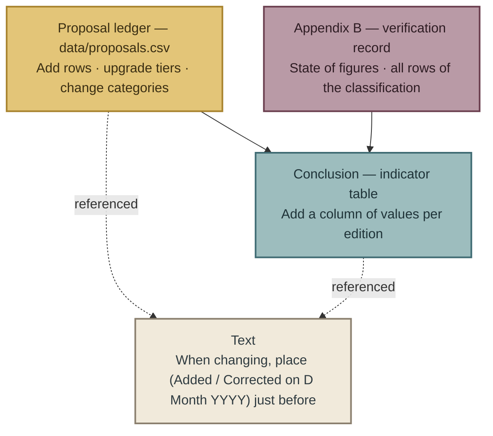

## Finally

This book does not tell companies to buy anything or to introduce anything. 
What it wrote is to count, to keep records, and to tell in separate parts. 
None of these is a technology. 
Each is a decision.

The 71 public notices are a record of what companies that had not decided were able to write after an incident. 
This book tried to show, in the words of the registry's public notices themselves, how those notices would have differed if the decisions had been made before the incident. 
Whether it succeeded is for the reader to judge. 
This book will count again in the next edition.

 

---

### References

1. The author, “Proposal ledger `data/proposals.csv`, edition 1” (2026-10-30) — This repository
2. The author, “The Japan Breach Registry 2026, edition 3” (2026-10-26) https://github.com/Leading-AI-IO/the-japan-breach-registry-2026
3. Personal Information Protection Commission, “Status of the exercise of monitoring and supervisory powers in the first quarter of fiscal year 2026 (Reiwa 8)” (2026-09-02) https://www.ppc.go.jp/files/pdf/260902_shiryou-3-1.pdf

 

---

# Appendix A: Method — How We Collected, Verified and Counted

This appendix records how this book's proposal ledger, `data/proposals.csv`, was built. 
It sets out only what readers need in order to count this book's figures again for themselves. 
The definitions of issuer types A–H and tiers T1–T3 are in Chapter 4. The definitions of proposal categories K1–K9 are in Chapter 6. The classification of intrusion routes in the Japanese registry is in the companion book. 
They are not repeated here.

## How the collection was done

Proposals were collected in three rounds.

| Round | Date | Method | Result |
|---|---|---|---|
| 1 | 11 October 2026 | An attempt to collect the world's proposals with several AI research tools | There was no prospect of confirming the basis of the proposals in primary sources, so writing this book was put off once (the opening of Chapter 1) |
| 2 | 18 October 2026 | The same question was given to three AI research tools (Claude, ChatGPT, Perplexity), and proposals were collected in table form | Three research reports. The Perplexity report had 22 rows |
| 3 | 30 October 2026 | The question was widened and given again to two AI research tools (Claude, ChatGPT). Perplexity was used separately as a list of candidates (leads) | Two research reports |

The author merged the five research reports into one ledger (`ledger_src/merge_ledger.py`). 
After merging there were 263 rows. 
Of these, 13 rows were judged to be the same proposal as another row and were merged. 
The remaining 250 rows are candidates for inclusion.

One thing should be recorded about the choice of research tools. 
Both of the Gemini research reports were excluded in full. 
The reason is given in Appendix B, “Figures we track (as of edition 1, 30 October 2026)”, #6. 
Of the 13 URLs reported as primary sources from Japanese experts, three were opened, and none of the pages existed (the domains exist; the article paths do not). 
Without opening the remaining 10, the author judged that the reliability of those research reports did not reach this book's standard. 
This exclusion is not an assessment of Gemini's ability. 
It is a record that the judgement was made on three URLs, before this book's open-and-check procedure had been applied to all 13.

## The ledger's columns

The columns of `data/proposals.csv` are as follows.

| Column | Content |
|---|---|
| `new_id` | This book's serial number. The issuer type letter (A–H) and a three-digit number |
| `src`, `src_id` | The research report it came from, and its number within that report |
| `type` | Issuer type (A–H, Chapter 4) |
| `proposal` | The wording of the proposal. A quotation from the original is preferred, with a Japanese translation or summary added |
| `issuer` | Issuer, source title, date, and the record of opening |
| `medium` | Type of medium |
| `tier` | Tier (T1–T3, Chapter 4) |
| `target`, `industry` | Who the proposal is addressed to, and the industry |
| `k` | Proposal category (K1–K9, Chapter 6). The primary category is written first, followed by secondary categories separated by “/”, “・” or “,” |
| `evidence` | Whether there is a basis, and what it is |
| `status` | Implementation status (proposal only, institutionalised, effect measured, and so on) |
| `limits` | Limits and criticisms written by the issuer itself or by third parties |
| `route` | Correspondence with the intrusion routes in the Japanese registry |
| `urls` | URLs of the primary sources |
| `merged_into` | The `new_id` it was merged into (merged rows only) |
| `also_in` | Other research reports that contain the same proposal |

## Verification steps

Tiers were judged by the following steps.

1. The author opens the URLs in the `urls` column. If they cannot be opened, the row stays at T3.
2. If they open, check whether the wording in the `proposal` column is in the text. If the wording is not there, note in the `issuer` column that it was a summary from the research report, and replace it with the wording in the text.
3. If the basis of the wording (the source of the data, the sample size, the method) is written in the same source, the row is T1. If it is not, the row is T2.
4. Leave the record of opening (the date, whether the full text or an excerpt was read, whether it was opened by a sub-agent) in the `issuer` column.

While edition 1 was being written, the tiers of the following four rows were changed.

| Row | Change | Date | Basis |
|---|---|---|---|
| E-002, E-003 | T2→T1 | 2026-10-30 | Coalition's article of 2026-08-31 checked in full |
| A-063 | T3→T1 | 2026-10-30 | The Financial Services Agency (FSA) request of 2026-10-09 checked against the original. The wording is “take action as promptly as possible, without waiting for the effective date” (author's translation). The word 前倒し (“bringing forward”) is not in the original, and the summary was replaced |
| H-004 | T3→T1 | 2026-10-30 | The Indian Computer Emergency Response Team (CERT-In) directions of 2022-04-28 checked in the original PDF. Log retention of 180 days, storage within India |

These four row changes moved the figures counted in Part 2 (T1 and T2) from 209 to 211, prescriptions for undisclosed routes from 37 to 38, K3 from 36 to 37, K5 from 12 to 13, and K9 from 64 to 66. The figures in the text were aligned to the values after the change.

## How we counted

The figures in the text were counted by the following rules.

- **What is counted is the non-merged T1 and T2 rows** (rows where `merged_into` is empty). In edition 1, 211.
- **Category (K) counts include secondary categories.** One proposal can be counted in more than one category. Only where the text says “primary category” is the count based on the first category in the `k` column.
- **Consensus** (Chapter 4) means proposals pointing in the same direction written by three or more issuer types (A–H). The direction was judged by the author.
- **Effect measured** (Chapter 6) means rows whose `status` column contains “効果測定あり” (effect measured). This includes correlations and does not require causation.
- **Correspondence with intrusion routes** (Chapter 6) is the `route` column. Where one proposal corresponds to more than one route, it is counted under each route.
- **The classification of Japanese public notices** (Chapter 9) was judged by the author from the scale, status and notes columns of the companion book's `data/registry.csv`, by the form of the first notice. All rows are in Appendix B, “Chapter 9's classification — the scope of notification (the 71 rows of the registry, 30 October 2026)”.

There are four places where the counting involves discretion: the direction of consensus, the assignment of categories, the correspondence with routes, and the classification of public notices. 
All are the author's judgements. 
By looking at the ledger's columns, readers can make a different judgement.

## What we did not use

- **The 39 T3 rows.** They are not used in the text. Before they are used, the primary source must be opened and the row upgraded to T1 or T2.
- **The two Gemini research reports.** For the reason given in the section “How the collection was done”.
- **Figures that did not reach a primary source.** They are recorded, with their state, in Appendix B, “Figures we track (as of edition 1, 30 October 2026)”.
- **Summaries of the cases in the companion book's registry.** This book does not reproduce the registry's rows. It cites only the row IDs and the wording of the public notices.

## Update rules

- New proposals are added to the ledger as rows. The figures in the text are updated in the “As of edition N” box at the start of each chapter and in the indicator table in the Conclusion.
- A change of tier is recorded in the `issuer` column, with the date and the basis.
- When the wording of the text is changed, “(Added on D Month YYYY)” or “(Corrected on D Month YYYY)” is placed just before the changed passage.
- Rows are not deleted. When rows are merged, the row they are merged into is written in `merged_into`.

## Work remaining in edition 1

This section records what the author had not fully verified as of edition 1.

| # | Item | Chapters affected |
|---|---|---|
| 1 | Opening the text of the US Cybersecurity and Infrastructure Security Agency (CISA) Binding Operational Directive (BOD) 26-04 (A-087. At present this relies on CISA's announcement, the primary source from the Federal Risk and Authorization Management Program (FedRAMP), and third-party commentary) | Chapter 3 |
| 2 | Opening the full Mandiant M-Trends 2026 report (at present this relies on the announcement article) | Chapters 1 and 8 |
| 3 | Checking the text of Article 23 of the EU NIS2 Directive on EUR-Lex (edition 1 checked only recital 102 on EUR-Lex) | Chapter 9 |
| 4 | Collecting primary sources from individual experts in Japan directly | Chapter 6 |
| 5 | Deciding whether to upgrade or set aside the 39 T3 rows | Part 2 |
| 6 | Re-judging the borderline rows in Chapter 9's classification of public notices (A–D) | Chapter 9, Appendix B, “Chapter 9's classification — the scope of notification (the 71 rows of the registry, 30 October 2026)” |
| 7 | Re-checking the 14 “effect measured” proposals against the ledger's `status` column (because of some rows, a mechanical count comes to 13) | Chapter 6 |

 

---

# Appendix B: Verification Record — Numbers We Could and Could Not Confirm

This appendix records the figures this book used in the text, did not use, or could not use, where the result of checking did not end in “found”. 
With each edition, the “State” of each row is updated.

Under this book's method (Appendix A), the only figures behind proposals that are counted as T1 or T2 are those for which the author opened the primary source's URL and confirmed the relevant passage in the text. 
This appendix is the place for figures where that procedure stopped part-way.

## Figures we track (as of edition 1, 30 October 2026)

| # | Figure | Attributed to | How this was verified | State | Treatment in the text |
|---|---|---|---|---|---|
| 1 | “82% of denied claims had not implemented multi-factor authentication (MFA)” | Coalition | Coalition itself denied it on 2026-08-31: “factually incorrect”, “we've never published data on claims denials”. The author checked the full text on 2026-10-30 | **Denied by the issuer** | Chapter 6, “Next to the gaps — numbers that are wrong” |
| 2 | “44% of claims are denied” | Advisen | The same Coalition article states that Advisen and its parent company Zywave have not published it (it says it checked with the company's editor) | **Not published by the attributed source (per Coalition's check)** | Chapter 6, “Next to the gaps — numbers that are wrong” |
| 3 | “More than 40% of claims are denied” | Fitch Ratings | The same Coalition article states that it is not in Fitch's 2024 or 2025 reports (it says it checked with a Fitch executive) | **Not published by the attributed source (per Coalition's check)** | Chapter 6, “Next to the gaps — numbers that are wrong” |
| 4 | “Insurance covered only 32%” | NetDiligence | The figure exists. In the original report, 11% of claims were unresolved. Coalition says it is “out of context” | **Context lost** | Chapter 6, “Next to the gaps — numbers that are wrong” |
| 5 | “Companies that fixed high-severity vulnerabilities within 7 days had half the incident rate” | Coalition | Not found in Coalition's public materials in two independent searches, on 2026-10-18 and 2026-10-30. The 10-30 search opened a Security Labs article (2026-03, on remediation deadlines), but the figure was not there | **Source unknown** | Not used. Not entered in the ledger |
| 6 | 13 primary-source URLs for statements by 13 Japanese experts | Each expert's contributed articles and lecture records | Reported by two research reports from an AI research tool (Gemini). Three were picked out and opened, and none existed (the domains exist; the article paths do not). Without opening the remaining 10, both research reports were excluded in full | **Non-existent primary source** | Not used. “One primary source from an individual expert in Japan” in Chapter 6, “Gap 4 — Primary sources from individual experts in Japan” is the count after this exclusion |
| 7 | “The average time to exploitation of a vulnerability is minus 7 days relative to patch release” | Mandiant (Google Cloud) M-Trends 2026 | One of the searches on 2026-10-30 did not reach the text and reported “could not confirm”. Another search on the same day confirmed it. Conditions: the reference point is the “patch release date”, and the value is an estimate | **Confirmed (with conditions)** | Chapter 1. The conditions are stated in the text |
| 8 | Numbers of vulnerabilities found, disclosed and fixed in Project Glasswing | Anthropic | One of the searches on 2026-10-30 reported “the figures cannot be verified and are not adopted”. Another confirmed them in Anthropic's primary source | **Confirmed** | Chapters 1 and 5 |
| 9 | “More security tools and increased spending isn't making businesses any safer.” | Coalition 2026 Cyber Claims Report | Ledger row E-010 records the URL of the blog version. On 2026-10-30 the announcement page (announcements) was opened, but the same wording was not there. The blog version has not been opened | **Confirmed (with conditions)** | Chapter 12. The source is stated as the blog version |
| 10 | Marsh McLennan's relationship between controls and claims (tabletop exercises 13%; endpoint detection and response (EDR) 10% for every 25%; phishing-resistant MFA 9%) | Marsh McLennan Cyber Risk Intelligence Center (CRIC) | The press release was checked on 2026-10-30. The number of organisations is not stated. It uses the word “correlation”, but there is no explicit note that this is not causation | **Confirmed (with conditions)** | Chapter 12. Treated as a correlation |
| 11 | Bookoff's second notice: “6,383,279 persons in scope” and “212,371 former members” | Bookoff Group Holdings | The author could not reach the primary PDF (the HTML version is images only). Press-based | **Source not reached (press-based)** | Chapter 9. Stated as press-based |

## Definitions of the states

| State | Meaning | Used in the text? |
|---|---|---|
| Denied by the issuer | The issuer to which the figure is attributed has itself stated that it did not publish it or that it is wrong | Not used. Only the fact of the denial is written |
| Not published by the attributed source (per a third party's check) | There is no statement from the attributed source itself, but a third party's primary source says it checked with the attributed source | Not used. “Per a third party's check” is stated |
| Context lost | The figure exists, but it circulates without the conditions of the original source | Can be used if the conditions are restored |
| Source unknown | Several searches have not reached a primary source. It cannot be called wrong | Not used. If it is found, the state is updated |
| Non-existent primary source | There is no page at the URL given | Not used. It lowers the reliability of the whole research report it came from |
| Source not reached (press-based) | The primary source exists, but the author could not reach the text and uses the figure reported in the press | Used, stated as press-based. When the source is reached, the state is updated |
| Confirmed (with conditions) | Confirmed in the primary source, but with conditions that the circulating form does not mention | Used, with the conditions stated |
| Confirmed | Confirmed in the primary source, and the conditions also match | Used |

## What this record shows

- **“Could not confirm” and “wrong” are different.** #7 and #8 were reported as “could not confirm” in the first search and were confirmed in the second. #5 was not reached either time, but it may still be reached a third time. This book keeps the state “Source unknown” for that possibility.
- **Confirming means knowing which conditions are attached, not knowing that the figure is right.** For #7, “the patch release date is the reference point” and “estimate” only came to light in the process of checking.
- **AI research tools return real media names, plausible article titles and non-existent URLs with the same confidence.** They cannot be told apart until they are opened. All 211 of this book's T1 and T2 proposals are ones whose URLs the author opened, so that there is no repeat of #6.
- **There are at least three ways for a figure to be wrong.** Fabrication or hallucination (#1), wrong attribution (#2 and #3), and lost context (#4). The third is the same type as what the Japanese breach registry (a separate factual registry from this book) has been recording as a problem of units.

## Update rules

- When a newly denied figure appears, or a figure for which this book's searches did not reach a primary source, a row is added.
- When a state changes, the date of the change and its basis are added to “How this was verified”. Rows are not deleted.
- Additions are marked “(Added on D Month YYYY)”.

## Chapter 9's classification — the scope of notification (the 71 rows of the registry, 30 October 2026)

The table in Chapter 9 is the author's classification of the 71 rows of the companion book's registry, based on what the public notices say about scale, status and supplementary details. 
Rows are shown by their registry IDs. 
Borderline rows are described in Chapter 9, “Objections and limits”.

| Form | Notices | Registry IDs |
|---|---|---|
| A Disclosed at the ceiling | 18 | 005, 010, 014, 018, 020, 021, 022, 027, 032, 036, 042, 043, 051, 052, 054, 060, 061, 071 |
| B Narrowed by records | 24 | 001, 007, 011, 013, 017, 019, 025, 028, 029, 030, 037, 038, 039, 040, 044, 045, 046, 048, 055, 058, 064, 066, 068, 070 |
| C Could not state a count | 14 | 004, 006, 023, 024, 031, 034, 035, 047, 049, 050, 057, 059, 062, 065 |
| D “Possible” plus a count | 15 | 002, 003, 008, 009, 012, 015, 016, 026, 033, 041, 053, 056, 063, 067, 069 |

Classification rules: classify by the form of the first notice (Helpfeel 005 is A because its first notice covered all records). 
If any of “maximum”, “all records held at the time”, “all registered users” or “handled by treating them as leaked” appears, it is A. Notices that separated what was confirmed from what was at risk of having leaked, that fixed the count, or that showed how many of the total included what, are B. Notices with no count, still under investigation, or not disclosed, are C. Notices that give only “possible” and a count, where it cannot be read whether the count is the ceiling, are D.

 

---

### References

1. Coalition (Daniel Woods), “Dispelling the Myth: Cyber Insurance Doesn't Pay Claims” (2026-08-31) https://www.coalitioninc.com/blog/cyber-insurance/dispelling-myth-cyber-insurance-doesnt-pay-claims
2. Coalition Security Labs, “Boundary Devices and Plugins Prompt Timely Remediation (the source opened while looking for the origin of #5; the figure is not in it)” (2026-03) https://www.coalitioninc.com/blog/security-labs/boundary-devices-and-plugins-prompt-timely-remediation
3. Mandiant (Google Cloud), “M-Trends 2026 (#7)” (2026) — Sources table in Chapter 1
4. Anthropic, “Project Glasswing (#8)” (2026) — Sources table in Chapter 1

 

---

**© 2026 Satoshi Yamauchi / Leading.AI — Licensed under CC BY 4.0**
