# パッチの向こう側 ── AI時代のエンタープライズ・セキュリティを、世界の提言から読む

> **"The race to prevent intrusion is being lost to the attackers on speed. The only things a company can decide for itself are three: what to hold, when to notice and how to tell. And these three are the thinnest part of the world's proposals."**  
> （侵入を防ぐ競争は、速度で攻撃側に負けている。会社が自分で決められるのは「何を持つか」「いつ気づくか」「どう伝えるか」の三つだけであり、この三つは世界の提言の中で最も薄い）

 

---

# 序章: 問い ── 公表文を並べ終えたあとに残ったもの

## 71通のあと

2026年の秋、日本で個人情報の漏えいが立て続けに公表された。 
私はそれを、公表文の原文のまま1通ずつ台帳に並べ、『The Japan Breach Registry 2026』として公開した。 
第3版で71通になった。

並べ終えて分かったことは、台帳に書いた。 
公表文の半分が侵入経路を書いていないこと、件数の単位が会社ごとに違うこと、侵入から判明まで2時間半から1年超まで開きがあること。 
それは事実の記録であり、本書はそれを再掲しない。 
台帳はリポジトリ [the-japan-breach-registry-2026](https://github.com/Leading-AI-IO/the-japan-breach-registry-2026) にある。

台帳を閉じたあとに、1つの問いが残った。

**では、会社は何を決めるのか。**

公表文を書いた71の組織は、どれも対策をしていた。 
多要素認証、パッチ、委託先の管理。 
世界の提言が言うことは、やっていた。 
それでも漏れた。 
漏れたあと、会社が書けたのは「不正アクセスを受けた」「漏えいした可能性を否定できない」だった。 
何を決めていれば、公表文は違う文になっていたのか。

## 本書がしたこと

問いに答えるために、世界の提言を集めた。 
政府・公的機関、標準団体、AI企業、セキュリティ企業、保険会社、学術、個人の有識者、規制当局の8種類の発行元が、2025年から2026年にかけて書いた提言を、一次資料のURLを開いて本文で確かめたものだけ、台帳にした。 
第1版で211件である（付録A）。

集めた提言を、3つの問いで読んだ。 
どこで一致しているか（第4章）。 
どこで食い違っているか（第5章）。 
どこが空白か（第6章）。

答えは、空白にあった。 
提言が厚いのは、攻撃を防ぐ側である。 
脆弱性の修正、多要素認証、検知の製品。 
薄いのは、攻撃が成功したあとに意味を持つ側である。 
何を持っているか、何を記録しているか、誰に何件知らせるか。 
この3つは、会社が他者の協力なしに、自分で決められる。 
そして世界の提言の中で、最も薄い。

本書の主張は、この1文に尽きる。

> 侵入を防ぐ競争は、速度で攻撃側に負けている。会社が自分で決められるのは「何を持つか」「いつ気づくか」「どう伝えるか」の三つだけであり、この三つは世界の提言の中で最も薄い。

## 本書の構成

本書は4部12章と、終章、付録からなる。

**第1部 なぜ防げないのか（第1〜3章）。** 
攻撃側が分で動き、防御側が日で動いていること（第1章）。 
世界の提言の中身はAI以前と同じだと、提言の発行元自身が書いていること（第2章）。 
修正が間に合わない期間の手当てが、効果の実証なしに制度になったこと（第3章）。 
この3つは台帳にない事実である。

**第2部 世界の提言の地図（第4〜6章）。** 
211件の提言の、合意・対立・空白。 
第2部までは断定しない。 
一次資料が言っていることと、言っていないことを分けて書く。

**第3部 会社が決められる三つ（第7〜9章）。** 
ここから著者の主張である。 
何を持つか、いつ気づくか、どう伝えるか。 
三つは独立ではなく、持たなければ上限が下がり、記録があれば絞れ、絞れれば速さと範囲を選べる、という連鎖である。 
各章は同じ型で書く。 
提言を1文で置き、根拠を示し、世界の提言の中での位置を示し、反論と限界を書き、日本企業の実装を書き、最後に、その章が断定しないことを書く。

**第4部 会社の中で通す（第10〜12章）。** 
事故の前に決めたことが、事故の最中と後にどう使われるか。 
止める判断、委託先との契約、稟議・保険・取締役会。 
第4部で新しい決定は増えない。

**終章。** 
本書の主張を、第1部から第4部で確かめた事実だけで組み直す。 
予測はしない。 
次の版で数え直す指標を置く。

**付録A** は方法、**付録B** は確認できなかった数字と、本文の分類の全行である。

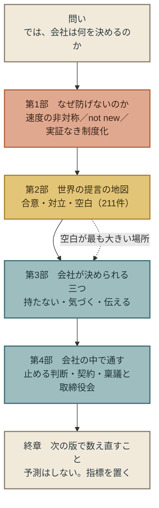

## 本書が断定しないこと

本書は、各章の末尾に「この章が断定しないこと」を置く。 
全体に通じるものを、ここに先に書く。

- **どの対策が攻撃を防ぐかを、本書は書かない。** 測った資料がない（第3章、第6章）。本書の三つの提言は、効くかどうかを問わずに決められることだけを選んだ（第7章冒頭）。
- **「修正できない期間は、代替の防御で攻撃を防げる」を、本書のどの提言の前提にも置かない。** 第3章で、この前提が実証なしに制度化されたことを扱う。
- **AIが漏えいの原因だとは書かない。** 日本の公的機関が攻撃者のAI利用を確認したこと（第1章）と、提言の中身がAI以前と同じであること（第2章）を、分けて書く。
- **日本が世界より遅れているとは書かない。** 日本発の提言で、本書の収集の範囲で世界に類例のないものがある（第10章）。
- **公表文を書いた組織を評価しない。** 台帳と同じく、公表文に書かれたことと書かれなかったことを記録する。

## 本書は更新される

攻撃の速さも、提言の件数も、公表文の数も、1年で変わる。 
本書の数字は、各章の冒頭に「第1版時点」として置き、版ごとに更新する。 
更新の場所は3つに限る。 
提言の台帳 `data/proposals.csv`、付録Bの検証記録、終章の指標表。 
更新時は、変更箇所の直前に「（YYYY年M月D日追記／訂正）」を置く。 
姉妹書と同じ規律である。

本書は、更新されることを前提に書かれている。 
だから、第1版で言い切れないことは、言い切らない。

## 私について

私はセキュリティの専門家ではない。 
AIが事業と組織をどう変えるかを書いてきたAIストラテジストである。 
本書を書いた理由と、専門家でないことの弱点と意味は、第1章の冒頭に書いた。

 

---

### 参考文献

1. 著者「The Japan Breach Registry 2026 第3版」（2026-10-26） https://github.com/Leading-AI-IO/the-japan-breach-registry-2026
2. 著者「提言台帳 `data/proposals.csv` 第1版」（2026-10-30）※本リポジトリ

 

---

# 第1部　なぜ防げないのか

---

# 第1章: 速度の非対称 ── 29分と43日

## なぜ、いま私がこれを書くのか

私はセキュリティの専門家ではない。 
AIストラテジストとして、AIが事業と組織をどう変えるかを書いてきた人間である。 
その私がこの本を書く理由は、2026年の秋に、3つのことが同時に起きたからだ。

1つ目は、日本で個人情報の漏えいが立て続けに公表されたことである。 
私はそれを1通ずつ原文のまま台帳に並べ、『The Japan Breach Registry 2026』として公開した。 
並べ終えて分かったのは、公表文の多くが「どこから入られたか」を書いていないこと、そして攻撃側のAIについて触れた公表文が1通もないことだった。 
台帳は事実を記録する本であり、そこから先は書かなかった。

2つ目は、10月15日にJPCERT/CCが、攻撃者のAI利用を一次資料で「確認しました」と書いたことである。 
それまで「AIが悪用されているのではないか」は推測だった。 
公的機関の確認が出たことで、問いは「AIが使われたか」から「では会社は何を決めるのか」へ移った。

3つ目は、その問いに答えようとして、世界の提言を集めたことである。 
私は10月11日に一度、この本を書くことを見送っている。 
提言の根拠を一次資料で確かめられなければ書かない、と自分で決めていたからだ。 
その後、政府・標準団体・AI企業・セキュリティ企業・保険会社・学術・個人・規制当局の提言を250件、一次資料にさかのぼって集めた。 
集めて分かったのは、提言の中身が揃ってAI以前のものであること、効果を測った提言が1件もないこと、そして、会社がどの個人データをどれだけ保有するかという論点、つまり守る対象そのものを減らすという最も手前の論点が、最も薄いことだった。

経営者の机には、報道の見出しと、ベンダーの提案書と、監督官庁の注意喚起が積み上がっている。 
その中に、「世界は何を提言していて、どこまで根拠があり、どこが空白か」を1冊にしたものがなかった。 
私がセキュリティの専門家でないことは、この本の弱点であると同時に、専門家が自分の専門の内側から書けないものを書ける理由でもある。 
本書は技術の本ではなく、経営判断の本である。

だから、いま書く。 
攻撃の速さは1年で桁が変わっており（この章で示す）、来年の秋には、本書の数字も、提言の地図も、変わっているはずだからだ。 
本書を更新型にしたのは、そのためである。

---

2026年10月15日、JPCERT/CC（一般社団法人JPCERTコーディネーションセンター）は、日本で相次いだ不正アクセス事案の攻撃手法についての調査を公表し、次の一文を書いた。

「その過程で、攻撃者がAIを利用して、既知の脆弱性のスキャンやAPI経由での攻撃などを実施していたことを確認しました。」

本書が確認した範囲では、日本の公的機関が攻撃者のAI利用を一次資料で「確認しました」と書いたのは、これが初めてである。 
この秋に日本で公表された漏えいの一覧と、それぞれの公表文が何を書き何を書かなかったかは、姉妹書『The Japan Breach Registry 2026』（[the-japan-breach-registry-2026](https://github.com/Leading-AI-IO/the-japan-breach-registry-2026)）に記録してある。 
本書はその記録を繰り返さない。

本章が扱うのは、漏えいの原因がAIかどうかではない。 
攻撃する側と守る側が、それぞれどの単位の時計で動いているかである。

## この章が拠って立つ数字

本書は更新型である。 
攻撃の速さも修正の速さも、各社が毎年測り直すため、本文に書いた数字は翌年の報告で入れ替わる。 
そこで各章の冒頭に、その章の議論を支えている数字を、いつ・どの一次資料で確認したかとともに表で置く。 
本文で論じるのは数字そのものではなく、数字が示す単位と向きである。 
数字が更新されたときは、この表を差し替え、本文の論旨が変わる場合だけ「（追記）」を付けて本文を直す。

**第1版時点（2026年10月30日に一次資料で確認）**

| 数字 | 発行元・資料 | 対象期間 | 次の更新 |
|---|---|---|---|
| 侵入から横展開まで平均29分、最速27秒 | CrowdStrike 2026 Global Threat Report | 2025年 | 2027年版 |
| 最速の25%は72分で持ち出しに到達（前年285分） | Unit 42 Global Incident Response Report 2026 | 2024年10月〜2025年9月 | 2027年版 |
| 重大な脆弱性の完全修正は26%（前年38%）、完全解決の中央値43日（前年32日） | Verizon 2026 Data Breach Investigations Report | 2024年11月〜2025年10月 | 2027年版 |
| 悪用までの平均は推定でパッチ公開の7日前 | Mandiant M-Trends 2026 | 2025年 | 2027年版 |

表の「次の更新」は、発行元の次回の年次報告を指す。

## 攻撃側の時計は、分で刻む

CrowdStrikeは、2026年2月24日に公表した年次報告で、2025年の攻撃者について次のように書いた。

「The average eCrime breakout time fell to just 29 minutes in 2025」（金銭目的の攻撃者のブレイクアウト時間は、2025年に平均わずか29分まで短くなった）

ブレイクアウト時間とは、攻撃者が最初の1台に侵入してから、同じネットワーク内の別の機器へ広がり始めるまでの時間である。 
最速の例は「27 seconds」、27秒だった。

侵入の後、個人データが外へ持ち出されるまでの時間はどうか。 
Palo Alto NetworksのUnit 42は、2024年10月1日から2025年9月30日までに対応した750件超の事案を集計し、次のように書いた。

「The fastest 25% of intrusions reached exfiltration in 72 minutes, down from 285 minutes the calendar year prior.」（最も速い25%の侵入は72分で持ち出しに到達した。前年は285分だった）

最も速い4分の1の攻撃では、侵入から1時間あまりで、データが組織の外に出ている。 
そして、その時間は1年で約4分の1に縮んだ。

攻撃側の時計は、分で刻まれている。

## 防御側の時計は、日で刻む

守る側の時計を測ったのは、Verizonである。 
2026年版のData Breach Investigations Reportは、145か国、3万1,000件超のインシデントと、そのうち2万2,000件超の確定した漏えいを集計している（対象期間は2024年11月1日〜2025年10月31日）。

この報告は、まず侵入の入り口が変わったことを書いた。

「Exploitation of vulnerabilities is now the most common initial access vector for breaches.」（脆弱性の悪用が、いまや漏えいで最も多い初期侵入の経路である）

その割合は31%で、前年まで首位だった認証情報の悪用（13%）を上回った。 
脆弱性が最大の入り口になったのなら、守る側の問いは「どれだけ速く脆弱性を直せるか」になる。 
その答えも、同じ報告にある。

「Only 26% of critical vulnerabilities」「were fully remediated by organizations in 2025, a drop from the previous year's 38%.」（2025年に組織が完全に修正できた重大な脆弱性は26%にとどまり、前年の38%から下がった）

「The median time for full resolution went up to 43 days, almost two weeks more than the previous year's 32 days.」（完全な解決までの中央値は43日に延び、前年の32日から2週間近く長くなった）

修正できた割合は下がり、修正にかかる日数は延びた。 
Cloud Security Allianceは2026年4月25日の報告書で、さらに長い時間軸の数字を引いている。 
「Approximately 45% of enterprise vulnerabilities remain unpatched after twelve months」、企業の脆弱性のおよそ45%は、12か月たっても修正されていない。 
これは同報告書が第三者のデータを引用したものである。

防御側の時計は、日で刻まれている。 
そして、その一部は年単位で止まっている。

## 修正より先に来る攻撃

ここまでの比較は、「脆弱性が公表され、修正が出て、組織が当てる」という順番を前提にしていた。 
この前提そのものが崩れていることを、3つの資料が別々の物差しで示している。

| 発行元 | 書かれた数字 | 基準の日 | 何を数えたか |
|---|---|---|---|
| Mandiant M-Trends 2026（2026年3月23日発表） | 悪用までの平均は「an estimated -7 days」 | パッチの公開日 | Mandiantが2025年に調査した悪用 |
| CrowdStrike 2026 Global Threat Report | 「42% of vulnerabilities were exploited before public disclosure」 | 脆弱性の公表日 | 悪用された脆弱性 |
| VulnCheck（Cloud Security Allianceの報告書が引用） | 「32.1% of newly tracked exploits appeared on or before the CVE's public disclosure date」 | CVE（脆弱性の共通識別番号）の公表日 | 新たに追跡された悪用 |

3つの数字は、基準の日も、数えた対象も違う。 
マイナス7日はパッチ公開日が基準の推定値であり、公表日が基準の42%や32.1%と同じ尺度ではない。 
本書はこの3つを足したり、平均したりしない。

それでも、3つは同じ向きを指している。 
悪用のかなりの部分は、修正が世に出る前、あるいは脆弱性が公表される前に始まっている。 
Mandiantはこれを「exploitation is routinely occurring before a patch is even released」、パッチが出る前に悪用が日常的に起きている、と書いた。

修正の速さを競う防御は、修正がまだ存在しない時間に対しては、答えを持たない。 
その時間に組織が何をすべきかについて、世界の提言が何を言い、どこまで根拠があるかは、第3章で扱う。

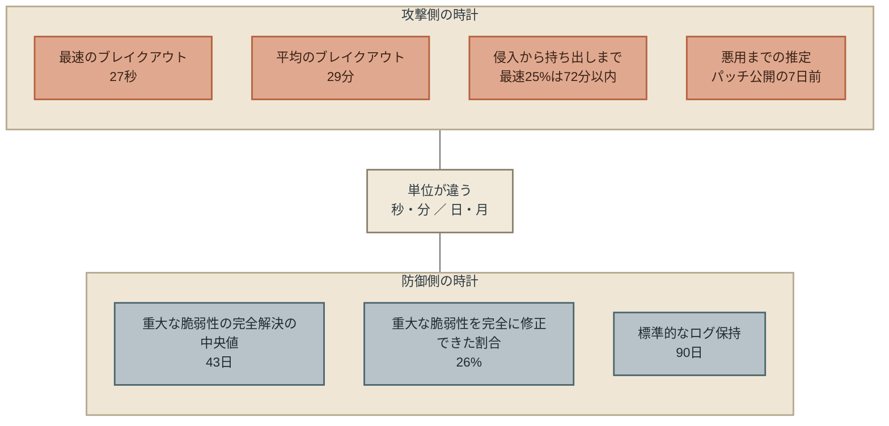

## 29分と43日を、並べてよい理由と、よくない理由

章題の「29分」と「43日」は、同じ物差しで測った数字ではない。 
29分はCrowdStrikeが観測した攻撃者の行動で、43日はVerizonが集計した組織の修正である。 
対象の母集団も、集計の期間も違う。 
「43日のあいだに29分の攻撃が何回起きうるか」という計算は、意味を持たない。

それでも並べる理由は2つある。

1つ目は、単位である。 
攻撃側の主要な数字は分（29分、72分、27秒）で書かれ、防御側の主要な数字は日（43日、32日）や年（12か月）で書かれている。 
どちらの側の資料も、自分の時計の単位で書いている。 
その単位が、2桁から3桁違う。

2つ目は、向きである。

| 側 | 指標 | 前年 | 今年 | 向き |
|---|---|---|---|---|
| 攻撃 | 最速25%の持ち出しまで（Unit 42） | 285分 | 72分 | 速くなった |
| 防御 | 重大な脆弱性の完全修正率（Verizon） | 38% | 26% | 下がった |
| 防御 | 完全解決の中央値（Verizon） | 32日 | 43日 | 遅くなった |

攻撃側の時間は縮み、防御側の時間は延びた。 
母集団の違う資料どうしでも、向きが逆であることは読み取れる。 
本書が「速度の非対称」と呼ぶのは、この単位の差と向きの差である。

## AIは何を広げたか

この非対称は、AIが生んだものではない。 
脆弱性の公表から修正までに日数がかかり、その間に攻撃が来るという構造は、AI以前から存在した。 
では、AIはこの構造の何を変えたのか。 
一次資料で確認できることは3つある。

**攻撃の手数が増えた。** 
CrowdStrikeは「AI-enabled adversaries increased operations by 89% year-over-year」、AIを使う攻撃者の活動が前年比89%増えたと書いた。 
冒頭のJPCERT/CCは、攻撃者がAIで既知の脆弱性をスキャンし、Android向けアプリを解析して見つけたAPIへの攻撃を行っていたことを確認している。 
どちらも、人間の攻撃者が一つずつ手で行っていた作業を、AIが大量に、速く行っていることを示す。

**脆弱性を見つける速さが、直す速さを追い越した。** 
これは攻撃側だけの話ではない。 
防御のためにAIで脆弱性を探しているAnthropicのProject Glasswingでは、約50のパートナーが高・重大の深刻度の脆弱性を「more than ten thousand」、1万件以上見つけた。 
一方、Anthropicが報告した高・重大の530件のうち、修正されたのは75件である（同社の更新報告、2026年5月22日公開・9月28日更新）。 
Cloud Security Allianceは、2026年5月22日時点でオープンソースの保守者に開示された1,596件のうち、修正が確認されたのは97件だったと集計し、この差を「the discovery-to-remediation gap as a primary — and previously underappreciated — systemic security risk」、発見から修正までの差は主要な、そしてこれまで過小評価されてきたシステミック・リスクだと書いた。

AIは、見つける側を速くした。 
直す側は、まだ人間の速さで動いている。 
この差は、防御する側の内部にも生まれている。

**ただし、侵害の直接の原因をAIとする資料はない。** 
Mandiantは、2025年について「we do not consider 2025 to be the year where breaches were the direct result of AI」、2025年はAIが侵害の直接の原因となった年ではないと書いた。 
Unit 42は、90%を超える事案で設定の誤りや防御の抜けが侵入を「materially enabled」、実質的に可能にしたとし、ほぼ90%の調査でID（アカウントと認証）の弱さが重要な役割を果たしたと書いている。 
侵入の多くは、いまも人と組織の側の穴から入っている。

AIが広げたのは、攻撃の手数と、脆弱性を見つける速さである。 
攻撃と防御の時間差がこの1年で開いたことのうち、どこまでがAIによるものかを切り分けた資料は、本書が確認した範囲には存在しない。

## この章が断定しないこと

- **日本の2026年秋の漏えいが、AIを使った攻撃によるものだとは書かない。** JPCERT/CCも、どの企業の事案がその攻撃によるものかは書いていない。各公表文が攻撃側のAIについて何を書いたかは、姉妹書の台帳に原文のまま記録してある。
- **速く直せば防げる、とは書かない。** 悪用の一部は修正より先に来ている（本章「修正より先に来る攻撃」）。
- **修正できない期間を別の防御で埋められる、とも書かない。** それを示す効果測定を、本書は見つけていない（第3章）。
- **29分と43日を算術で比べない。** 比べるのは単位と向きだけである（本章「29分と43日を、並べてよい理由と、よくない理由」）。

## 次の章へ

攻撃は分で動き、修正は日で動く。 
修正が出る前に来る攻撃もある。 
この非対称を前に、世界の政府、標準団体、AI企業、セキュリティ企業、保険会社は何を提言したのか。

次章では、その提言の中身を開く。 
そこで見えるのは、提言を出した側自身が「新しくはない」と書いていた、という事実である。

 

---

### 参考文献

1. JPCERT/CC「JPCERT/CC Eyes「連続不正アクセス事案の攻撃手法に関する調査」」（2026-10-15）※本文 https://blogs.jpcert.or.jp/ja/2026/10/web_api_attacks.html
2. CrowdStrike「2026 CrowdStrike Global Threat Report（プレスリリース）」（2026-02-24）※プレスリリース本文（報告書本体は未開封） https://www.crowdstrike.com/en-us/press-releases/2026-crowdstrike-global-threat-report/
3. Palo Alto Networks Unit 42「Global Incident Response Report 2026」（2026）※報告書PDF https://start.paloaltonetworks.com/rs/531-OCS-018/images/Unit42-Global-Incident-Response-Report.pdf
4. Verizon「2026 Data Breach Investigations Report」（2026）※報告書PDF（該当箇所） https://www.verizon.com/business/resources/T343/reports/2026-dbir-data-breach-investigations-report.pdf
5. Google Cloud／Mandiant「Announcing M-Trends 2026」（2026-03-23）※発表記事（報告書PDFは未開封） https://security.googlecloudcommunity.com/google-threat-intelligence-3/announcing-m-trends-2026-data-insights-and-strategies-from-the-frontlines-7123
6. Cloud Security Alliance「The Collapsing Exploit Window」（2026-04-25）※本文 https://labs.cloudsecurityalliance.org/research/csa-whitepaper-collapsing-exploit-window-ai-speed-vulnerabil/
7. Cloud Security Alliance「Project Glasswing: AI Discovery Outpaces Open-Source Patching Capacity」（2026-06-07）※本文 https://cloudsecurityalliance.org/artifacts/project-glasswing-ai-discovery-outpaces-open-source-patching-capacity
8. Anthropic「Project Glasswing: An initial update」（2026-05-22（2026-09-28更新））※本文 https://www.anthropic.com/news/glasswing-initial-update

 

---

# 第2章: 「not new」と書いた三つの一次資料 ── AIが変えなかったこと

## この章が拠って立つ資料

第1章は数字の章だったが、この章は文章の章である。 
拠って立つのは、提言を出した側が自分の提言について書いた、次の3つの文である。 
いずれも2026年10月30日に原文で確認した。

**第1版時点（2026年10月30日に一次資料で確認）**

| 発行元 | 資料 | 日付 | 自分の提言について書いた文 |
|---|---|---|---|
| Five Eyes 5か国のサイバーセキュリティ機関（米CISA・NSA、英NCSC、豪ASD、加CCCS、NZ NCSC） | 共同声明「The AI shift in cyber risk: why leaders must act now」 | 2026-06-22 | "These actions are not new, but are now urgent" |
| Anthropic | 「Project Glasswing: An initial update」 | 2026-05-22（09-28更新） | "The advice below is not new" |
| Verizon | 2026 Data Breach Investigations Report | 2026 | "Refinement, not revolution." |

これに、日本の2つの公的文書を重ねる。 
JPCERT/CCの調査報告（2026-10-15）と、内閣官房国家サイバー統括室の注意喚起（2026-10-09）である。 
どちらも、攻撃者のAI利用を前提にした文書でありながら、対策の中身は従来のものである。

---

## 三つの「新しくない」

2026年6月22日、米国・英国・オーストラリア・カナダ・ニュージーランドのサイバーセキュリティ機関の長6名が、連名で声明を出した。 
題は「The AI shift in cyber risk: why leaders must act now」（サイバーリスクにおけるAIの転換 ── なぜリーダーはいま動かねばならないか）である。 
声明は「The timeline is not years, it is months.」（時間軸は年ではなく、月である）と書き、5つの行動を求めた。

1. 「Reduce your attack surface」（攻撃対象面を減らせ）── 不要なシステムアクセスと外部接続を制限する
2. 「Accelerate patching processes」（パッチ適用を速めよ）── AIが脆弱性の発見から悪用までの時間を縮めている
3. 「Address legacy systems」（レガシーシステムに対処せよ）── サポート切れのシステムは格好の標的である
4. 「Review and strengthen identity and access controls」（IDとアクセス制御を見直し強化せよ）── 重要システムに触れる人を限る
5. 「Prepare for incidents before they happen」（事故の前に備えよ）── 対応計画を試験し、侵害は起きるものと想定する

そして、5つを列挙した直後に、こう書いた。

「These actions are not new, but are now urgent」（これらの行動は新しいものではない。しかし、いまや緊急である）

5か国の政府機関が、自分たちの提言を「新しくない」と明記した。

1か月前の2026年5月22日、AnthropicはProject Glasswingの更新報告を公開した。 
AIモデルで脆弱性を見つけ、オープンソースの保守者に開示する取り組みである。 
報告の後半には、ソフトウェア開発者と防御側への助言が並ぶ。 
パッチの周期を短くすること、修正の試験と展開の期間を縮めること、既知の脆弱性を抱えたまま使い続ける利用者に粘り強く更新を促すこと。 
その助言の前に、Anthropicは一文を置いた。

「The advice below is not new」（以下の助言は新しいものではない）

同じ年、Verizonは145か国・3万1,000件超のインシデントを集計した年次報告の結論に、3語の見出しを立てた。

「Refinement, not revolution.」（革命ではなく、洗練である）

脆弱性の悪用が侵入経路の首位になったことについて、同じ報告は「underlines the ongoing importance of getting the basics right」（基本を正しく行うことの変わらぬ重要性を示している）と書いている。

政府機関、AI開発企業、通信事業者の年次報告。 
立場の違う3者が、同じ年に、同じことを自分の言葉で書いた。 
本書はこの3つの文を、AI時代のエンタープライズ・セキュリティを読むための出発点に置く。 
提言を出した側が「新しくない」と言うなら、何が変わって、何が変わっていないのかを、本人たちの文書から確かめる必要がある。

## 日本の文書も、同じ構造をしている

第1章の冒頭で引いたJPCERT/CCの調査報告（2026年10月15日）は、攻撃者がAIを使って既知の脆弱性をスキャンし、Androidアプリを解析して見つけたAPIを攻撃していたことを確認した文書である。 
この文書が示した対策の見出しは4つある。

- 「秘密情報の保護」── APIの認証に使う秘密鍵や、有効期間の長い認証情報をアプリケーションに埋め込まない
- 「サーバー側での認証・認可」── アプリ側の署名処理や難読化だけに頼らず、サーバー側で利用者を認証し、認可する
- 「APIの不正利用対策」── レート制限と異常なリクエストの監視を行い、正規アプリ以外からのアクセスも想定する
- 「SSRF対策」── 外部URLの内容を取得するAPIでは、アクセス先を制限し、リダイレクト後の宛先も検証する

4つとも、ウェブアプリケーションの設計原則として、AI以前から書かれてきたものである。 
攻撃者がAIを使ったことを確認した文書が、対策としてAIに固有のものを1つも挙げていない。

その6日前の2026年10月9日、内閣官房国家サイバー統括室は「不正アクセスによる漏えい等の事案を踏まえた対応について」を公表した。 
経営層に向けた文書で、「AI の悪用を含むサイバー攻撃の手法が高度化・巧妙化する中、経営層の皆様におかれましては、サイバーセキュリティ対策を経営課題と位置づけ、必要な投資や人的体制整備を含む対策の強化をお願いいたします」と結ぶ。 
対策は3部構成で、「ウェブシステム等の適切な管理」「サプライチェーンを通じた侵害への対策」「データの適切な管理」の下に、合わせて50項目近くが並ぶ。 
パッチの速やかな適用、サポート終了製品の不使用、多要素認証、不要アカウントの無効化、ログの取得と保管、委託先の継続的な確認、保有情報の最小化、保存データの暗号化。

この文書にAIという語が出てくるのは、上に引いた結びの一文だけである。 
50項目の対策に、AIを前提にしたものはない。

本書はこれを批判として書いているのではない。 
日本の2つの公的機関は、世界の3者と同じ判断をしている。 
AIが攻撃に使われたと確認したうえで、対策は従来のものでよい、と。 
問うべきは、その判断の根拠である。

## なぜ「新しくない」のか ── 入り口が変わっていない

対策が変わらない理由は、侵入の入り口が変わっていないことにある。

Verizonの2026年版報告では、初期侵入の経路の首位は脆弱性の悪用（31%）、次が認証情報の悪用（13%）だった。 
Unit 42は、2025年に対応した750件超の事案のうち、90%超で「misconfigurations or lapses in security coverage materially enabled the intrusion」（設定の誤りや防御の抜けが侵入を実質的に可能にした）とし、ほぼ90%でIDの弱さが重要な役割を果たしたと書いた。 
JPCERT/CCが日本で確認した経路は、アプリに埋め込まれた認証情報と、認可のないAPIだった。

脆弱性、認証情報、設定の誤り、認可の欠落。 
攻撃者がAIを使っても、入ってくる穴は同じである。 
AIは穴を新しく作ったのではなく、既にある穴を見つける速さと、同時に叩ける穴の数を増やした。 
穴が同じなら、穴を塞ぐ対策も同じになる。 
「not new」と書いた3者は、このことを自分の観測データから知っている。

金融庁と日本銀行が2026年5月22日に金融機関へ出した要請は、この点をもう一歩踏み込んで書いている。 
要請は英国のAI安全性評価機関（AISI）の報告書を引き、「現時点ではフロンティア AI は、十分に防御された IT システムに対しては、攻撃を達成できるとは言えないと報告されている」とした。 
AIが変えたのは、防御されていないシステムが見つかり、攻撃されるまでの時間である。 
防御されているシステムの守り方ではない。

## では、何が変わったのか

「新しくない」と書いた文書は、同時に「いまや緊急である」とも書いた。 
変わったものを、同じ文書群から拾う。

**第一に、時間である。** 
Five Eyesは「AI is shortening the time between vulnerability discovery and exploitation.」（AIが脆弱性の発見から悪用までの時間を縮めている）と書き、「cyber risk assumptions can become outdated in months, not years」（サイバーリスクの前提は、年ではなく月の単位で古くなりうる）とした。 
第1章で見た数字が、この文の中身である。

**第二に、量である。** 
金融庁・日銀の要請は、9項目の短期的対応のうち2つを、時間ではなく量に充てている。 
「④ パッチ適用に係る人的リソースを追加する」と「⑤ ベンダーとの維持保守契約の内容を確認する」である。 
AIによって見つかる脆弱性が増え、修正プログラムが一度に大量に出ることを見越して、当てる側の人手と、委託先の対応能力を先に確保せよという要請である。 
対策の中身は「パッチを当てる」のままだが、それを行う体制の規模が変わった。

**第三に、時間切れの前提である。** 
同じ要請は、パッチが間に合わない場合の手当てを3項目置いた。 
「③ 特定した資産の技術負債を解消しておく」「⑦ パッチ適用以外の対策も強化する」「⑧ 優先サービス／IT システムの停止に備える」である。 
そして、これらについて「ただし、これらはあくまでも応急的措置であり、中長期的には脆弱性対応の自動化等への移行に取り組むことが必要である」と書いた。 
修正が間に合わないことを前提に置いた公的文書は、AI以前にはなかった。 
第3章で扱う「実証なき制度化」は、ここから始まる。

変わったのは、対策の中身ではなく、対策を回す速さと規模、そして「間に合わない」という前提である。

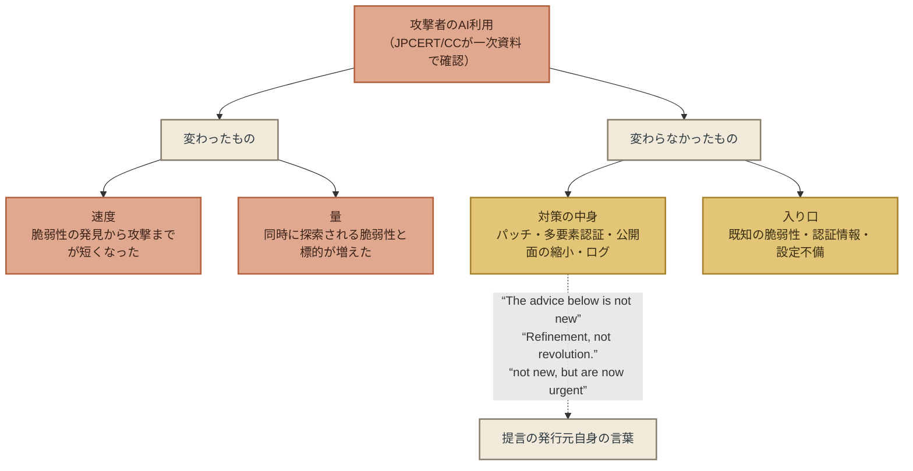

## 「新しくない」が意味すること

ここまでをまとめると、AI時代のエンタープライズ・セキュリティについて、2026年の一次資料が揃って語っていることは次の2つになる。

1. 対策の中身は、AI以前と同じである。発行元自身がそう書いている。
2. 対策を行う時間は短くなり、必要な規模は大きくなった。「間に合わない」場合の手当てが、公的文書に書き込まれ始めた。

この2つから、経営者にとっての含意が1つ出る。 
「AI時代の新しい対策」を探すことは、問いの立て方として誤っている。 
探すべきは新しい対策ではなく、既にある対策を、短くなった時間と大きくなった規模の中で、どこまで実行できているかである。 
Five Eyesの声明の原文は「not new, but are now urgent」であり、「新しいことをせよ」ではなく「古いことを、いますぐせよ」と読める。

そして、もう1つの問いが残る。 
「古いこと」が間に合わないとき、組織は何をするのか。 
金融庁・日銀は「応急的措置」として代替の防御と停止を挙げた。 
それがどこまで根拠を持つかを、次章で確かめる。

## この章が断定しないこと

- **AIが脅威を変えていない、とは書かない。** 変わったのは時間と量である（本章「では、何が変わったのか」）。変わらなかったのは対策の中身である（本章「三つの「新しくない」」から「なぜ「新しくない」のか ── 入り口が変わっていない」）。この2つを混ぜない。
- **従来の対策で十分だ、とは書かない。** 「not new」と書いた3者は、同時に「urgent」とも書いている。十分かどうかは、実行の速さと規模で決まり、本書はそれを測った資料を持っていない。
- **日本の公的機関の対策が不十分だ、とも書かない。** JPCERT/CCと国家サイバー統括室の対策は、世界の3者と同じ判断に立っている。
- **AI固有の対策が存在しない、とは書かない。** AIエージェントの権限管理やプロンプトインジェクション対策など、AIシステム自体を守る提言は別に存在する。本章が扱ったのは、個人情報を持つ企業システムを守る提言である。前者は第4章で触れる。

## 次の章へ

対策は新しくない。 
だが、時間は足りない。 
足りない時間に何をするかについて、米国の連邦政府と日本の金融当局は、2026年に同じ答えを制度に書き込んだ。 
「修正できない間は、別の方法で防いでよい」。

次章では、その答えがどのような根拠の上に立っているかを調べる。 
結論を先に書けば、根拠となる効果測定は、本書が探した範囲には1件もなかった。

 

---

### 参考文献

1. Five Eyes 5か国6機関「The AI shift in cyber risk: why leaders must act now（英NCSC掲載）」（2026-06-22）※本文 https://www.ncsc.gov.uk/news/the-ai-shift-in-cyber-risk-why-leaders-must-act-now
2. Anthropic「Project Glasswing: An initial update」（2026-05-22（2026-09-28更新））※本文 https://www.anthropic.com/news/glasswing-initial-update
3. Verizon「2026 Data Breach Investigations Report」（2026）※報告書PDF（該当箇所） https://www.verizon.com/business/resources/T343/reports/2026-dbir-data-breach-investigations-report.pdf
4. Palo Alto Networks Unit 42「Global Incident Response Report 2026」（2026）※報告書PDF https://start.paloaltonetworks.com/rs/531-OCS-018/images/Unit42-Global-Incident-Response-Report.pdf
5. JPCERT/CC「JPCERT/CC Eyes「連続不正アクセス事案の攻撃手法に関する調査」」（2026-10-15）※本文 https://blogs.jpcert.or.jp/ja/2026/10/web_api_attacks.html
6. 内閣官房国家サイバー統括室「不正アクセスによる漏えい等の事案を踏まえた対応について」（2026-10-09）※本文 https://www.cyber.go.jp/pdf/press/taiou.pdf
7. 金融庁・日本銀行「「フロンティア AI による脅威変化を踏まえた金融機関等の短期的な対応」に係る要請について」（2026-05-22）※本文（別添・脚注を含む） https://www.fsa.go.jp/news/r7/sonota/20260522-5/01.pdf

 

---

# 第3章: 実証なき制度化 ── 「緩和で代替してよい」が法になった経緯

## この章が拠って立つ資料

前章の末尾で、金融庁・日本銀行の要請が「パッチが間に合わない場合」の手当てを置いたことを見た。 
この章は、同じ2026年に米国と日本の公的文書が書き込んだ1つの考え方を追う。** 
修正プログラムを当てられない間は、別の防御で代替してよい**、という考え方である。 
本書はこれを「代替防御」と呼ぶ。

この章が調べるのは2つのことである。 
この考え方がどの文書に、どう書かれたか。 
そして、代替防御が実際に攻撃を防ぐことを測った資料が、どこかにあるか。

**第1版時点（2026年10月30日に一次資料で確認）**

| 区分 | 発行元・資料 | 日付 | 確認した範囲 |
|---|---|---|---|
| 制度 | 米CISA 拘束的運用指令 BOD 26-04「Prioritizing Security Updates Based on Risk」 | 2026-06-10 | CISAの公式告知（指令本文はcisa.govが開けず未開封。本文の細部は第三者の解説に依拠し、その旨を明記する） |
| 制度 | 米FedRAMP「FedRAMP Response to CISA BOD 26-04」（NTC-0014） | 2026-06-16 | 本文 |
| 制度 | 金融庁・日本銀行「フロンティア AI による脅威変化を踏まえた金融機関等の短期的な対応」要請⑦・脚注6 | 2026-05-22 | 本文・脚注 |
| 実証（肯定側） | Pizziほか「VirtualPatch」Computers & Security vol.157 | 2025 | 要旨 |
| 実証（肯定側） | At-Bay「2026 InsurSec Report」 | 2026-04-22 | プレスリリース |
| 実証（否定側） | Akhavaniほか「WAFFLED」ACSAC 2025 | 2025（v4は2026-03） | 要旨 |
| 実証（否定側） | 米CISA レッドチーム評価報告 AA24-326A | 2024-11 | 本文 |
| 実証（空白） | Huffほか「I Can't Patch My OT Systems!」arXiv 2510.06951 | 2025-10-08 | 要旨 |

---

## 米国 ── 「修正」の定義が変わった

2026年6月10日、米国のサイバーセキュリティ・インフラセキュリティ庁（CISA）は、連邦政府機関を拘束する運用指令 BOD 26-04「Prioritizing Security Updates Based on Risk」（リスクに基づく修正の優先順位付け）を出した。 
CISA自身の告知は、この指令を次のように説明している。 
脆弱性ごとに「asset exposure, KEV status, exploit automation, and post-exploitation technical impact」（資産の公開状況、既知の悪用脆弱性カタログへの掲載、悪用の自動化可能性、侵害後の技術的影響）の4つの要素で優先度を決め、高リスクのものに期限を課し、「deferring action for lower-risk vulnerabilities」（低リスクのものは対応を先送りする）。 
従来の指令 BOD 19-02（2019年、インターネットに面したシステムの修正期限）と BOD 22-01（2021年、既知の悪用脆弱性カタログ）を「Harmonizing and improving」（調和させ、改善する）ものだとしている。

本書は、cisa.govに置かれた指令の本文を開くことができなかった。 
以下の細部は、CISA自身の告知と、第三者（セキュリティ企業Qualys、法律事務所Covington、Cloud Security Alliance）の解説に依拠している。 
それらによれば、期限は最短3日、次いで14日、60日、そして「次回のシステム更改時まで先送り」の段階に分かれる。 
そして、指令における「修正（remediation）」は、パッチの適用だけを指さない。 
Qualysは「BOD 26-04 explicitly defines remediation as any action that eliminates the vulnerability, including asset isolation, mitigation, or uninstall」（BOD 26-04は、資産の隔離・緩和・アンインストールを含め、脆弱性を除去するあらゆる措置を修正と明示的に定義している）と書いた。 
Cloud Security Allianceの研究ノート（2026年8月20日）も、公開面を除くファイアウォール規則や分離といった補完的な緩和策を、期限を満たすうえでパッチと同等に扱う指令だと要約している。

指令の本文を読めていない以上、本書はこの定義を指令の原文として引用しない。 
ただし、指令を受けた側の一次資料が、同じことを自分の言葉で書いている。

連邦政府のクラウド調達認証制度FedRAMPは、2026年6月16日に指令への対応方針を公表し、クラウド事業者について次のように書いた。

「cloud service providers may mitigate a vulnerability until it no longer is automatable or internet-reachable」（クラウド事業者は、脆弱性が自動悪用不能またはインターネット到達不能になるまで緩和すればよい）

そのうえで、その状態になった脆弱性は完全な修正を要しない、とした。 
期限は「By August 7, 2026, agency policies must support ongoing vulnerability remediation.」（2026年8月7日までに、各機関の方針は継続的な脆弱性修正を支えるものでなければならない）である。

米国の連邦政府では、2026年の夏に、「修正」の定義の中に「緩和」が入った。

## 日本 ── 「応急的措置」と「リスク受容手続」

日本では、米国より3週間早く、金融当局が同じ考え方を書いている。 
金融庁・日本銀行が2026年5月22日に出した要請の⑦「パッチ適用以外の対策も強化する」は、次のように始まる。

「②で特定した優先的に対応すべきサービス／IT システムにおいて、パッチ適用そのものが困難である場合や、パッチ適用に要する期間の短縮が困難である場合には、早期に効果が期待できるクラウド型のウェブアプリケーション防御機能（WAF：Web Application Firewall）等を用いた仮想パッチの適用やボット対策の導入等、多層防御の強化を図る必要がある。」

続けて、ネットワーク分離、特権IDへの多要素認証、端末の不正検知・対応機能（EDR）、内部侵入後の横展開への対策を挙げる。 
米国の指令が「修正」の定義を広げたのに対し、日本の要請は「パッチ適用以外の対策」という別の棚を作り、そこに同じ中身を置いた。

ここで注目すべきは、要請がこの棚に付けた3つの注記である。

第一に、脚注6は仮想パッチを「ソフトウェアベンダーが提供する本来のセキュリティパッチをサーバー等に早急に適用することが難しい場合の暫定的なソリューションである」と定義したうえで、こう書いた。

「これが設置されたネットワーク経路からの攻撃しか防御できないことや、攻撃コードの亜種が出た際に仮想パッチが追い付かないリスクがあること等、恒久的な対応ではないことに留意すべきである。」

第二に、本文は「なお、これらの対策はあくまでもリスク低減策であることから、パッチが適用できないことによる残存リスクを評価した上で、パッチ適用に要する期間を踏まえた適切なリスク受容手続を講じる必要がある」と書いた。 
代替防御は、リスクを消すものではなく減らすものであり、残ったリスクは経営が受け入れる手続きを踏め、という指示である。

第三に、要請全体を「ただし、これらはあくまでも応急的措置であり、中長期的には脆弱性対応の自動化等への移行に取り組むことが必要である」と締めた。

日本の要請は、代替防御を認めると同時に、それが効かない場合があること、効果に限りがあること、残るリスクは経営判断で引き受けることを、同じ文書の中に書いている。 
米国の指令は「修正」の中に「緩和」を入れ、日本の要請は「緩和」に「恒久的ではない」「リスク低減策である」と注記を付けた。 
書き方は違うが、どちらも、代替防御がどれだけ攻撃を防ぐかの数字は示していない。

## 根拠を探す ── 肯定する側の資料

代替防御がどれだけ防ぐかを測った資料を、本書は探した。 
見つかったものを、肯定する側から順に置く。

**VirtualPatch（Computers & Security、2025年）。** 
パドヴァ大学の研究チームは、Androidの25件の脆弱性（CVE）について、それぞれ攻撃コードと「仮想セキュリティパッチ」を作り、後者が前者を防ぐことを実験で確かめた。 
要旨は「successfully implemented security patches for all the 25 Android CVEs」（25件すべてのCVEについてセキュリティパッチの実装に成功した）とし、Samsungが本来のパッチを統合するまでの中央値が35日であることも測っている。 
「本来のパッチが届かない期間を、別の仕組みで埋める」という問いに正面から答えた、本書が見つけた唯一の対照実験である。 
ただし、対象はAndroidアプリの仮想化であり、企業ネットワークのWAFや分離にそのまま当てはめることはできない。

**At-Bay 2026 InsurSec Report（2026年4月22日）。** 
サイバー保険会社At-Bayは、10万契約年超の請求データから、ランサムウェア集団Akiraの被害企業の60%が主要なEDR製品を導入していたこと、そして「The only businesses that avoided full ransomware encryption had their EDR backed by 24/7 monitoring via Managed Detection & Response (MDR)」（完全な暗号化を免れた企業はすべて、EDRを24時間365日のMDR監視で補っていた）と書いた。 
これは、侵入された後に別の統制が被害の進行を止めうることを、実データで示している。 
ただし、同じ未修正の脆弱性を持つ資産を、MDRの有無で比べた研究ではない。 
MDRを買った企業と買わなかった企業は、他の点でも違う。 
そしてAt-Bay自身がMDRを販売している。

**Marsh McLennan「Cybersecurity signals」（2025年8月27日）。** 
保険ブローカーMarsh McLennanは、統制の導入状況と保険請求の結果の相関を公表した。 
EDRの展開率が25%上がるごとに侵害確率が10%下がる、耐フィッシングの多要素認証は侵害確率9%減、机上演習の実施は13%減、という数字である。 
統制が結果と結びつくことを大規模データで示した資料だが、相関であって因果ではなく、「未修正の期間」に絞った分析でもない。 
報告書の本体は登録制で、本書は公表された要約までしか確認していない。

この3つは、「代替の統制は特定の条件で攻撃や被害の進行を止めうる」ことを示している。 
「修正できない期間を、代替防御で一般に防げる」ことまでは示していない。

## 根拠を探す ── 否定する側の資料

反対の向きの資料もある。

**WAFFLED（ACSAC 2025）。** 
米ノースイースタン大学などの研究チームは、WAFが通信をどう解釈するかの食い違い（parsing discrepancies）を突く手法で、「identified and confirmed 1207 bypasses across 5 well-known WAFs, AWS, Azure, Cloud Armor, Cloudflare, and ModSecurity」（AWS、Azure、Cloud Armor、Cloudflare、ModSecurityの主要5製品で1,207件のバイパスを特定し確認した）。 
金融庁・日銀の要請がまず挙げたクラウド型WAFは、研究環境では系統的に迂回できることが示されている。

**CISAレッドチーム評価（AA24-326A、2024年11月）。** 
CISAが米国の重要インフラ組織に対して行った模擬攻撃の報告は、その組織がWAFを補完的な統制として導入していながら「they configured the WAF to be only in monitoring mode」（WAFを監視モードだけに設定していた）ために、既知の脆弱性が緩和されなかったことを記録している。 
代替防御は、置くだけでは効かない。 
設定と運用が結果を分ける。

この2つは、代替防御が「効かない場合がある」ことの事例である。 
金融庁・日銀の脚注6が書いた「攻撃コードの亜種が出た際に仮想パッチが追い付かない」は、WAFFLEDが示したことと同じである。

## 空白 ── 代替策そのものが書かれていない

肯定と否定の間に、もう1つの事実がある。 
代替防御の効果を測る以前に、多くの脆弱性には「何で代替するか」の情報がない。

Huffほかの研究（arXiv、2025年10月8日）は、CISAの既知の悪用脆弱性カタログの全項目を2025年7月まで調べ、産業制御システム（OT）に関わるものについて、ベンダーの勧告のうち「only 13% include vendor workarounds or mitigations as alternatives to patching」（パッチの代替となる回避策や緩和策を含むものは13%にとどまる）とした。 
論文の題は「I Can't Patch My OT Systems!」（私のOTシステムにはパッチを当てられない）である。 
パッチを当てられない現場が、代替策を探しても、9割近くの勧告にはそれが書かれていない。

## まとめ ── 制度が先に動いた

ここまでを並べる。

| | 米国 BOD 26-04／FedRAMP | 日本 金融庁・日銀要請⑦ |
|---|---|---|
| 書いたこと | 「修正」に隔離・緩和を含める。自動悪用不能・到達不能になるまで緩和すればよい | パッチが困難なら仮想パッチ・分離・MFA・EDRで多層防御を強化する |
| 付けた注記 | 本書が確認した範囲では、効果の限界についての注記はない | 恒久的な対応ではない。リスク低減策である。残存リスクはリスク受容手続を踏む。応急的措置である |
| 効果の数字 | なし | なし |

そして、本書が探した実証の側は次のとおりである。

- 「未修正の資産を、代替防御の有無で分け、攻撃の成否を比べた」研究は、企業環境については見つからなかった
- 条件を絞った肯定の証拠（Androidの25件、MDR顧客の請求ゼロ、統制と請求の相関）はある
- 条件を絞った否定の証拠（WAFの1,207件のバイパス、監視モードのWAF）もある
- 代替策の情報自体が、OTの脆弱性の約9割にない

代替防御が効くかどうかは、分かっていない。 
分かっていないまま、2026年に米国は「修正」の定義を変え、日本は「応急的措置」として認めた。 
本書はこれを「実証なき制度化」と呼ぶ。

批判として書いているのではない。 
第1章で見たように、修正は間に合っておらず、悪用の一部は修正より先に来る。 
制度が「修正できない期間に何もするな」と書くわけにはいかない。 
効果が分からなくても、何かを書かねばならなかった。 
金融庁・日銀の要請が「恒久的な対応ではない」「リスク受容手続を講じる必要がある」と注記したのは、分からないことを分からないまま制度にするときの、誠実な書き方である。

問題は制度の側にではなく、制度を読む側に生まれる。 
「緩和で代替してよい」と制度に書かれたとき、組織は「緩和すれば守れる」と読みがちである。 
制度が言っているのは、「緩和は期限を満たす」ということであって、「緩和は攻撃を防ぐ」ということではない。 
この2つを混ぜないことが、第3部で三つの提言を立てるときの前提になる。

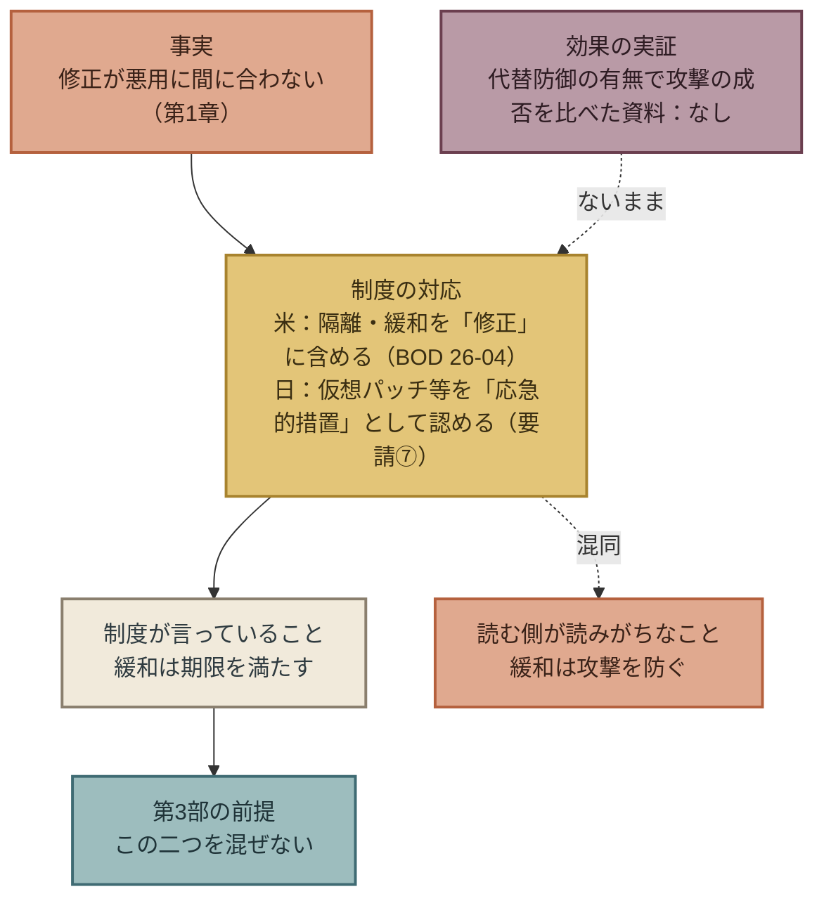

## この章が断定しないこと

- **代替防御は効かない、とは書かない。** 効く事例も、効かない事例も、条件つきで存在する（本章「根拠を探す ── 肯定する側の資料」、「根拠を探す ── 否定する側の資料」）。
- **代替防御は効く、とも書かない。** 一般命題として効果を測った資料はない（本章「まとめ ── 制度が先に動いた」）。
- **BOD 26-04の本文の文言を引用しない。** 本書は指令本文を開けていない。「修正」の定義については、CISAの告知、FedRAMPの一次資料、第三者の解説に依拠していることを明記した（本章「米国 ── 「修正」の定義が変わった」）。本文を確認できた時点で、この章を改訂する。
- **米国と日本の制度を優劣で比べない。** 書き方の違いを並べただけである（本章「まとめ ── 制度が先に動いた」）。

## 次の章へ

第1部で見たのは、攻撃が分で動き修正が日で動くこと（第1章）、対策の中身はAI以前と同じだと提言者自身が書いていること（第2章）、そして間に合わない期間の手当てが、効果の実証なしに制度化されたこと（第3章）である。

第2部では、本書が集めた世界の提言を開く。 
政府、標準団体、AI企業、セキュリティ企業、保険会社、学術、個人、規制当局の8種類の発行元が、2025年から2026年にかけて何を提言し、どこで一致し、どこで対立し、どこが空白かを、一次資料で確かめた範囲で並べる。

効くかどうかが測られていないなら、効くかどうかを問わずに決められることは何か。 
第3部は、その問いへの答えである。

 

---

### 参考文献

1. 米CISA「CISA Releases Binding Operational Directive 26-04 on Prioritizing Security Updates Based on Risk（公式告知）」（2026-06-10）※告知本文。指令本文（cisa.gov）は未開封 https://content.govdelivery.com/accounts/USDHSCISA/bulletins/41b445a
2. 米FedRAMP「FedRAMP Response to CISA BOD 26-04（NTC-0014）」（2026-06-16）※本文 https://www.fedramp.gov/notices/0014/
3. Qualys「CISA BOD 26-04: 3-Day Remediation SLA（ブログ）」（2026-07-09）※本文（指令の解説として引用） https://blog.qualys.com/product-tech/2026/07/09/cisa-bod-26-04-3-day-remediation-sla
4. Cloud Security Alliance「CSA Research Note: CISA's BOD 26-04」（2026-08-20）※本文（指令の解説として引用） https://labs.cloudsecurityalliance.org/research/csa-research-note-cisa-bod-26-04-risk-based-vulnerability-re/
5. Covington & Burling「CISA Releases Binding Operational Directive on Prioritizing Security Updates Based on Risk」（2026-06-17）※本文（指令の解説として引用） https://www.insideprivacy.com/cybersecurity-2/cisa-releases-binding-operational-directive-on-prioritizing-security-updates-based-on-risk/
6. 金融庁・日本銀行「「フロンティア AI による脅威変化を踏まえた金融機関等の短期的な対応」に係る要請について」（2026-05-22）※本文（要請⑦・脚注6） https://www.fsa.go.jp/news/r7/sonota/20260522-5/01.pdf
7. Pizzi, Doria, Miazzo, Losiouk「VirtualPatch: Distributing Android security patches through Android virtualization, Computers & Security vol.157」（2025）※要旨 https://doi.org/10.1016/j.cose.2025.104615
8. At-Bay「2026 InsurSec Report（プレスリリース）」（2026-04-22）※プレスリリース本文（報告書本体は未開封） https://www.at-bay.com/press_releases/2026-insursec-report-ransomware-vpn-sonicwall-attacks/
9. Marsh McLennan「Cybersecurity signals: Connecting controls and incident outcomes」（2025-08-27）※公表要約（報告書本体は登録制・未開封） https://www.marsh.com/en/corp/about/news/marsh-mclennan-cyber-risk-intelligence-center-report.html
10. Akhavani, Jabiyev, Kallus, Topcuoglu, Bratus, Kirda「WAFFLED: Exploiting Parsing Discrepancies to Bypass Web Application Firewalls, ACSAC 2025」（2025（v4 2026-03-13））※要旨 https://arxiv.org/abs/2503.10846
11. 米CISA「Enhancing Cyber Resilience: Insights from CISA Red Team Assessment of a US Critical Infrastructure Sector Organization（AA24-326A）」（2024-11）※本文 https://www.cisa.gov/news-events/cybersecurity-advisories/aa24-326a
12. Huff, Gandu, Novák「I Can't Patch My OT Systems! A Look at CISA's KEVC Workarounds & Mitigations for OT」（2025-10-08）※要旨 https://arxiv.org/abs/2510.06951

 

---

# 第2部　世界の提言の地図

---

# 第4章: 合意 ── 8種類の発行元が一致した提言は、すべてAI以前の対策

## 第2部の読み方

第1部は、本書が集めた資料の中から3つの事実を取り出して書いた。 
第2部は、集めた資料そのものを開く。

本書は、2025年1月から2026年10月30日までに公表された、個人情報漏えいの防止策と対応策に関する提言を、一次資料にさかのぼって集めた。 
発行元は8種類に分けた。

| 記号 | 発行元の種類 | 例 |
|---|---|---|
| A | 政府・公的機関 | 米CISA、英NCSC、EU ENISA、日本の個人情報保護委員会・国家サイバー統括室・JPCERT/CC・金融庁 |
| B | 標準・枠組み団体 | NIST、ISO/IEC、CIS、OWASP、Cloud Security Alliance |
| C | AI開発企業 | OpenAI、Anthropic、Google、Microsoft |
| D | セキュリティ企業 | CrowdStrike、Mandiant、Palo Alto Networks Unit 42、Verizon |
| E | 保険・金融・監査 | At-Bay、Coalition、Marsh McLennan |
| F | 学術 | 査読論文、arXiv |
| G | 個人の有識者 | 本人名義の寄稿・講演 |
| H | 政策・規制・経営団体 | EU NIS2、米SEC、英国の法案、世界経済フォーラム |

提言は1件ずつ、原文の引用、発行元と日付、一次資料の所在、根拠の有無、日本の漏えい台帳の侵入経路との対応を付けて記録した。 
記録の全体はリポジトリの `data/proposals.csv` にあり、本文では提言を新ID（A-001 のような形）で参照する。 
一覧表は本文に載せない。

根拠の階層は3段階である。** 
T1**は一次資料を開き、提言だけでなくその根拠（データの出所・母数・方法）まで確認できたもの。** 
T2**は一次資料を開いたが根拠が示されていないか、抜粋までしか到達できなかったもの。** 
T3**は報道や解説を経由してしか確認できていないもの。 
第2部の集計はT1とT2だけで行い、T3は数えない。

**第1版時点（2026年10月30日）の収録件数**

| 区分 | 件数 |
|---|---|
| 収録候補の総数 | 250件 |
| うちT1・T2（第2部の集計対象） | 211件 |
| うちT3（集計対象外） | 39件 |

この数字は版ごとに動く。 
本章以降の「○件」は、すべてこの211件に対する数である。 
第1版の執筆中（2026年10月30日）に、金融庁2026-10-09要請（A-063）とインドCERT-In指令（H-004）の原文を開いてT3からT1に格上げしたため、同日午前の209件から2件増えた。

---

## 「合意」の定義

本書が「合意」と呼ぶのは、**同じ方向の提言を、3種類以上の発行元が、それぞれ自分の一次資料で書いている**場合である。 
同じ発行元の種類の中で何件あっても、1種類と数える。 
政府機関が10か国で同じことを書いても、政府・標準・企業の3者が書いた1件ずつには及ばない、という数え方である。

立場の違う者が同じことを書くなら、その提言は特定の利害から出たものではない可能性が高い。 
保険会社が「MFAを入れろ」と書くのは引受の都合かもしれないが、政府と標準団体と学術が同じことを書けば、都合だけでは説明できない。 
本書が合意を重く見るのはそのためである。

211件を、提言の内容で分類した。 
分類は著者が行い、判断の境界にある提言は複数の群に数えた。 
結果、3種類以上の発行元が一致した群は7つあった。

## 七つの合意

| 群 | 内容 | 件数 | 発行元の種類 | 代表的な提言 |
|---|---|---|---|---|
| 合意1 | 外部公開面の縮小 | 9 | A・B・D・E | Five Eyes「Reduce your attack surface」（A-091）、国家サイバー統括室「不要なポート、プロトコル、サービス等を無効化する」（A-041）、Coalition「Admin panels and RDP should not be accessible from the open internet」（E-008） |
| 合意2 | リスクに基づく速い修正 | 31 | A・B・C・D・E・F・G | 金融庁・日銀 要請⑥（A-084）、国家サイバー統括室「修正プログラムの適用を後回しにせず…計画的かつ迅速に対応する」（A-040）、Anthropic「Software developers should shorten their patch cycles」（C-001）、Cloud Security Alliance「30日の修正前提はもはや擁護できない」（B-012） |
| 合意3 | 強い認証・多要素認証 | 12 | A・B・C・D・E・G | 国家サイバー統括室「多要素認証（MFA）を導入する」（A-042）、CIS Controls「Require MFA for Externally-Exposed Applications」（B-005）、Mandiant「Enforce FIDO2-compliant multi-factor authentication」（D-016） |
| 合意4 | 人が監視する検知・ログ | 25 | A・B・D・E・F・G・H | 個人情報保護委員会「ログの保存期間を定め、定期的に分析する」（A-030）、Mandiant「Treat log health like a vital sign」（D-018）、At-Bay（E-011） |
| 合意5 | 経営の直接関与 | 8 | A・B・C・G・H | 金融庁・日銀 要請①（A-082）、NIST CSF 2.0 Govern（B-013）、OpenAI主導の公開書簡「Make cyber defense an immediate leadership priority」（C-013）、EU NIS2「経営上層の説明責任」（H-026） |
| 合意6 | 委託先・サプライチェーンの管理 | 15 | A・B・D・E・F・H | 国家サイバー統括室「再委託先を含む管理状況を把握する」（A-044）、NIST CSF 2.0「Incorporate requirements into contracts」（B-014）、Verizon（D-007）、NIS2 第21条（H-020） |
| 合意7 | 情報が揃わなくても初報を出し、後で補う | 38 | A・C・E・F・G・H | EDPB「If only limited information is available, an initial notification should be performed」（A-012）、英ICO（A-073）、仏CNIL（A-075）、NIS2 24時間／72時間（H-019）、日本の共有・公表ガイダンス「段階的に情報を開示」（A-005） |

7つの群で、発行元の種類が最も広いのは合意2（修正）と合意4（検知）で、8種類のうち7種類が書いている。 
最も狭い合意1でも4種類ある。

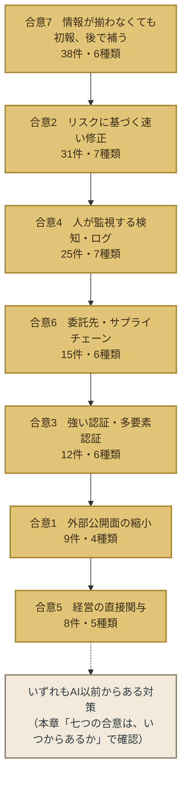

## 七つの合意は、いつからあるか

合意された7つについて、それぞれの中身が最初に標準や制度に書かれたのはいつかを確かめた。 
本書が集めた提言の発行日ではなく、その提言の中身の出所である。

| 群 | 中身の出所（本書が確認した範囲で最も早いもの） | 年 |
|---|---|---|
| 合意1 外部公開面の縮小 | 米CISA BOD 19-02（インターネットに面したシステムの脆弱性修正期限）、BOD 23-02（管理インターフェースの公開禁止） | 2019／2023 |
| 合意2 リスクに基づく速い修正 | 米CISA BOD 22-01（既知の悪用脆弱性カタログに基づく期限） | 2021 |
| 合意3 多要素認証 | CIS Controls（多要素認証を含む基本統制の体系）、NIST SP 800-63（電子認証ガイドライン） | 2000年代〜 |
| 合意4 検知・ログ | NIST SP 800-61（インシデント対応ガイド初版）、同 Rev.3は2025年 | 2004〜 |
| 合意5 経営の関与 | NIST Cybersecurity Framework 1.0、2.0で「Govern」機能を追加 | 2014／2024 |
| 合意6 委託先管理 | ISO/IEC 27036（供給者関係の情報セキュリティ）、NIST SP 800-161（サプライチェーンリスク管理） | 2013〜／2015〜 |
| 合意7 初報と続報 | EU一般データ保護規則（GDPR）第33条の72時間通知 | 2016年採択・2018年施行 |

7つとも、生成AIが企業システムへの攻撃に使われるようになる前から、標準または制度として存在していた。 
最も新しい合意1のBOD 23-02（2023年6月）でも、攻撃者のAI利用を前提にした文書ではない。

第2章で見た3者の「not new」は、この表の中身である。 
Five Eyesが「These actions are not new」と書いた5つの行動は、合意1・2・3・4と、合意7に含まれる事故への備えに対応する。 
Anthropicの「The advice below is not new」は合意2である。 
Verizonの「Refinement, not revolution」は、合意2・3・6に対応する。

## 合意の中で、AIに触れた提言

合意された7群の中にも、AIという語を含む提言はある。 
それがどのように含まれているかを見ると、2つの型に分かれる。

**第一の型は、理由としてのAI。** 
Five Eyesの「Accelerate patching processes: AI is shortening the time between vulnerability discovery and exploitation.」（パッチ適用を速めよ。AIが脆弱性の発見から悪用までの時間を縮めている）は、対策はパッチ適用のまま、急ぐ理由としてAIを挙げている。 
金融庁・日銀の要請は全体が「フロンティアAIによる脅威変化を踏まえた」ものだが、9項目の対策はパッチ・分離・MFA・EDR・ベンダー契約・経営関与である。 
国家サイバー統括室の文書でAIが出てくるのは、結びの一文だけだった（第2章）。

**第二の型は、規模としてのAI。** 
金融庁・日銀の要請④「パッチ適用に係る人的リソースを追加する」と⑤「ベンダーとの維持保守契約の内容を確認する」は、AIで脆弱性の発見が増え、修正プログラムが一度に大量に出ることを見越して、当てる側の人手と委託先の能力を先に確保せよという提言である。 
対策の中身は変わらないが、必要な規模が変わった。

どちらの型でも、AIは「なぜ」と「どれだけ」にかかっており、「何を」にはかかっていない。 
合意された対策の「何を」は、AI以前のままである。

## 合意の外にあるAI固有の提言

本書が集めた211件の中には、AIそのものに固有の提言もある。 
AIエージェントに人間と同じようにIDと最小権限を与えること（Microsoft、OWASP、シンガポールCSA）、プロンプトインジェクションを脅威モデルに含めること（英国のAI Cyber Security Code of Practice、OWASP）、サイバー能力の高いAIモデルへのアクセスを審査制にすること（OpenAI、Anthropic）、AIが生成した大量の脆弱性報告を開発者がさばく手順（Anthropic Glasswing）などである。

これらは、3種類以上の発行元が一致しているものもある（AIエージェントの権限管理は標準団体・AI企業・政府の3種類）。 
しかし、守る対象が違う。 
合意1〜7が「個人情報を持つ企業システム」を守る提言であるのに対し、これらは「企業が使うAIシステム」を守る提言である。 
本書の主題は前者なので、後者は第6章で、空白の輪郭を描くときに触れるにとどめる。

AI時代のエンタープライズ・セキュリティについて、新しい提言は確かに生まれている。 
ただしそれは、AIを守る提言であって、AIから守る提言ではない。 
AIを使った攻撃から個人情報を守るための提言は、2026年10月の時点で、AI以前の対策の再掲である。

## この章が断定しないこと

- **合意された対策が正しい、とは書かない。** 合意は「古い」ことと「利害で説明しにくい」ことを示すが、効くことを示すわけではない。効果の測定は第6章で扱う。
- **合意された対策で十分だ、とも書かない。** 第1章で見たとおり、合意2（速い修正）は修正が存在しない時間には答えを持たない。
- **分類は著者のものである。** 211件を7群に分けたのは著者で、境界の判断には裁量が入っている。分類の基準と各提言の割り当ては `data/proposals.csv` で確認できる。収録件数が変われば群の件数も変わる。
- **AI固有の提言を軽んじない。** 本章「合意の外にあるAI固有の提言」の提言は、企業がAIを導入するなら必要なものである。本書の主題から外れるだけである。

## 次の章へ

7つの合意は、立場の違う者が同じことを書いたという意味で、強い。 
だが、211件のすべてが一致しているわけではない。 
合意2「速く直せ」の内側には、「3日で直せ」と「直せない前提で動け」という、向きの違う提言が同居している。

次章では、提言どうしが食い違っている論点を取り出す。 
どちらが正しいかを判定するためではない。 
どちらの側にも効果を比べた測定がない、という事実を確かめるためである。

 

---

### 参考文献

本章の集計は `data/proposals.csv`（第1版、2026年10月30日時点）に基づく。 
表中の提言IDは同ファイルの新IDである。 
個々の提言の一次資料URLと確認範囲は同ファイルに記録してあり、本章では再掲しない。

中身の出所（本章「七つの合意は、いつからあるか」）として挙げた標準・制度は次のとおり。

| 標準・制度 | 発行元 | 初出年 |
|---|---|---|
| BOD 19-02 Vulnerability Remediation Requirements for Internet-Accessible Systems | 米CISA | 2019 |
| BOD 22-01 Reducing the Significant Risk of Known Exploited Vulnerabilities | 米CISA | 2021 |
| BOD 23-02 Mitigating the Risk from Internet-Exposed Management Interfaces | 米CISA | 2023 |
| CIS Critical Security Controls | Center for Internet Security | 2008（前身を含む） |
| NIST SP 800-63 Digital Identity Guidelines | 米NIST | 2004（初版） |
| NIST SP 800-61 Computer Security Incident Handling Guide | 米NIST | 2004（初版）、Rev.3 2025 |
| NIST Cybersecurity Framework | 米NIST | 1.0 2014、2.0 2024 |
| ISO/IEC 27036 Information security for supplier relationships | ISO/IEC | 2013〜 |
| NIST SP 800-161 Cybersecurity Supply Chain Risk Management | 米NIST | 2015、Rev.1 2022 |
| 一般データ保護規則（GDPR）第33条 | EU | 2016採択、2018施行 |

 

---

# 第5章: 対立 ── 速く直せ vs 直せない前提で動け

## この章が拠って立つ資料

前章の7つの合意は、211件の提言のうち約7割を覆う。 
残りには、提言どうしが向きを異にしている論点がある。 
この章はそれを取り出す。

対立を取り出す目的は、どちらが正しいかを決めることではない。 
両側の根拠を並べ、どちらの側に効果を比べた測定があるかを確かめることである。 
先に結論を書けば、本章で扱う4つの対立のいずれにも、両側を同じ条件で比べた測定はない。

**第1版時点（2026年10月30日に一次資料で確認）**

| 対立 | 一方 | 他方 |
|---|---|---|
| 1 修正の期限 | 米CISA BOD 26-04（最短3日）、Action1「72時間でも長い」、Schneier「即時」 | Schneier「見つけても確実に直せない」、金融庁・日銀「応急的措置」、FedRAMP「緩和でよい」 |
| 2 修正の速さと安定 | 金融庁・日銀 要請⑥「テスト実施内容の合理的な縮小」 | 同 要請⑧「テスト不足等による IT システム障害の発生頻度が増加し得る」、Schneier「patching often requires more holistic testing」 |
| 3 検知製品は効くか | Marsh McLennan「EDR展開率25%増ごとに侵害確率10%減」 | At-Bay「Akira被害企業の60%はEDR導入済み」 |
| 4 委託先を監督できるか | 日本の個人情報保護委員会、国家サイバー統括室、EU NIS2、NIST CSF 2.0 | 世界経済フォーラム「40%超の組織がTier-2・3の供給者を検証できない」 |

---

## 対立1 ── 期限を縮めて直せ、それとも直せない前提で動け

これは第3章で見た制度化の、提言の側での姿である。

**縮めて直せ、の側。** 
米CISAのBOD 26-04は、最もリスクの高い脆弱性に最短3日の期限を置いた（第3章）。 
パッチ管理製品を販売するAction1は2026年8月26日の記事で、自社の調査として「28.3% of vulnerabilities with publicly available exploits were attacked within 24 hours of disclosure」（公開された攻撃コードを持つ脆弱性の28.3%は、公表から24時間以内に攻撃された）とし、72時間の期限では「up to two full days」（最大まる2日）無防備になると書いた。 
Bruce Schneierは2026年9月14日、Microsoftが9月に約972件の脆弱性を修正したという報道を引いて、「And Microsoft is right: The window to patch has shrunk to “immediately.”」（Microsoftは正しい。パッチを当てる猶予は「即時」にまで縮んだ）と書いた。

**直せない前提で動け、の側。** 
同じSchneierは、その5か月前の2026年4月7日、CSO誌への寄稿でこう書いている。

「I'm not as confident that AI systems will be able to patch vulnerabilities as easily as they can find them」（AIシステムが、見つけるのと同じくらい容易に脆弱性を直せるとは、私は確信していない）

「If the defense can find, but can't reliably patch, flaws in legacy software」（防御側が、レガシーソフトウェアの欠陥を見つけられても確実には直せないなら）、攻撃者はそこに集中する、と続け、「Any solutions here are the realm of policy, not tech.」（ここでの解決は技術ではなく政策の領域にある）とした。 
同じ人物が、「即時に直せ」と「直せないことを前提にせよ」の両方を書いている。 
矛盾ではない。 
直せるものは即時に直し、直せないものがあることを認めよ、と読める。

制度の側では、金融庁・日銀の要請⑦と脚注6（第3章）、米FedRAMPの「緩和すればよい」が、この側に立つ。

**根拠の比較。** 
「縮めて直せ」側の根拠は、悪用までの時間が短くなったという観測である（第1章の数字、Action1の28.3%）。 
ただし、期限を3日にした組織と30日の組織で侵害率を比べた資料はない。 
「直せない前提」側の根拠は、修正が間に合っていないという観測（Verizonの26%・43日）と、代替防御が被害の進行を止めた事例（At-Bay）である。 
ただし、第3章で見たとおり、代替防御の一般的な効果を測った資料はない。

どちらの側も、自分の提言を採った場合と採らなかった場合の結果を比べていない。

## 対立2 ── 速く直すために試験を減らすか、安定を守るか

この対立は、1つの文書の中にある。 
金融庁・日銀の要請（2026年5月22日）である。

要請⑥「パッチ適用プロセスをリスクベースにする」は、「CVSS スコアが高くない脆弱性であっても実際の攻撃に利用されている実態があり」と書いたうえで、パッチ適用前の試験について「テスト実施内容の合理的な縮小等の対応についても検討することが望ましい」とした。 
速く当てるために、当てる前の試験を減らす余地を認めている。

同じ要請の⑧「優先サービス／IT システムの停止に備える」は、「テスト不足等による IT システム障害の発生頻度が増加し得る」と書いた。 
試験を減らせば、パッチそのものがシステムを止める事故が増える。 
だから、止まった場合に備えよ、という構成である。

Schneierの2026年4月の寄稿も、同じ緊張を別の角度から書いている。 
「patching often requires more holistic testing and understanding」（修正にはしばしば、より全体的な試験と理解が必要になる）。 
AIが脆弱性を見つける速さで直せない理由の1つが、試験である。

**根拠の比較。** 
試験を減らした場合に障害がどれだけ増え、侵害がどれだけ減るかを測った資料は、どちらの側にもない。 
金融庁・日銀の要請は、この対立を解かずに、両側を1つの文書に書き、判断を各金融機関の経営に委ねた。 
要請①「フロンティア AI への対応を経営課題として扱う」は、この判断を経営が引き受けよという意味を持つ。

## 対立3 ── 検知製品は効くか

合意4（人が監視する検知・ログ）の内側に、効くかどうかの対立がある。 
保険会社2社のデータが、逆の向きに見える。

**効く、の側。** 
Marsh McLennanは2025年8月27日、統制の導入状況と保険請求の結果を突き合わせた分析を公表し、「each jump of 25% in EDR deployment across workstations and laptops was correlated with an additional 10% decrease in breach likelihood」（端末へのEDR展開率が25%上がるごとに、侵害確率がさらに10%下がる相関があった）とした。 
耐フィッシングの多要素認証は侵害確率9%減、机上演習の実施は13%減である。

**効かない、の側。** 
At-Bayは2026年4月22日、2025年の請求データから「More than half (60%) of Akira's victims had a leading Endpoint Detection & Response (EDR) solution in place and were still compromised.」（Akiraの被害企業の60%超は主要なEDR製品を導入していたが、それでも侵害された）と書いた。

**対立の解消。** 
2つの数字は、実は同じことを言っている。 
At-Bayは続けて、暗号化を免れた企業はすべてEDRを「24/7 monitoring via Managed Detection & Response (MDR)」（MDRによる24時間365日の監視）で補っていたと書き、「Having endpoint security isn't enough.」（エンドポイント対策だけでは足りない）とした。 
Marshの相関は「展開率」、つまりどれだけ広く入れたかである。 
At-Bayの反例は「入れたが監視していなかった」企業である。 
製品の有無ではなく、展開の範囲と運用の有無が結果を分ける、という点で2社は一致する。 
CISAのレッドチーム報告が「監視モードだけのWAF」を記録したこと（第3章）も、同じ型である。

**根拠の比較。** 
Marshは相関であって因果ではなく、報告書の本体は登録制で本書は要約しか確認していない。 
At-Bayは自社の請求データで、MDR顧客の母数は非公開であり、同社自身がMDRを販売している。 
どちらも「導入した企業」と「しなかった企業」の他の違いを除いていない。

## 対立4 ── 委託元は委託先を監督できるか

合意6（委託先管理）は、6種類の発行元が一致した。 
だが、その合意に対して「できない」と書く資料がある。

**監督せよ、の側。** 
日本の個人情報保護委員会は、2026年9月2日の監視・監督権限の行使状況で、委託先との契約自体がない、脆弱性対応の責任分界が曖昧、取扱状況を把握していない、という事例を挙げた。 
国家サイバー統括室は「再委託先を含む管理状況を把握する」「契約締結時だけでなく、継続的に確認を行う」と書いた。 
EU NIS2 第21条は供給者との関係のセキュリティを義務の中に置き、NIST CSF 2.0は「Incorporate requirements into contracts.」（要求事項を契約に組み込め）と書く。

**できない、の側。** 
世界経済フォーラムのGlobal Cybersecurity Outlook 2026は、経営層への調査として、40%を超える組織が第2層・第3層の供給者のサイバーレジリエンスを検証できないと報告した。 
保険会社At-Bayの2025年版報告は、委託先起因の損失を「自社の統制だけでは防げない集中リスク」として扱っている。

**対立の解消。** 
これも、正面からの対立ではない。 
「監督せよ」側は直接の委託先（第1層）を主に想定し、「できない」側は多段の下請け（第2層以下）を問題にしている。 
日本の監督事例が示すのは、第1層の契約さえない組織があるという現実であり、第2層以下の検証可能性はその先の問題である。 
合意6は「第1層については監督できるし、せよ」という範囲では成り立ち、「サプライチェーン全体を監督できる」という範囲では成り立たない。

**根拠の比較。** 
世界経済フォーラムの数字は意識調査であり、検証できないと答えた組織と、できると答えた組織の侵害率を比べたものではない。 
「監督せよ」側にも、契約に要件を入れた組織とそうでない組織の結果を比べた資料はない。

## 四つの対立に共通すること

4つの対立を並べると、3つのことが見える。

**第一に、対立の多くは解消できる。** 
対立3は「製品の有無」と「運用の有無」を分ければ消える。 
対立4は「第1層」と「第2層以下」を分ければ消える。 
対立1は、Schneier自身が示したように「直せるもの」と「直せないもの」を分ければ、両立する。 
残るのは対立2だけで、これは速さと安定の交換であり、解消ではなく選択の問題である。

**第二に、解消した後に残る問いは、すべて「どこまでやるか」である。** 
どこまで速く直すか、どこまで試験を減らすか、どこまで監視に人を置くか、どこまで下請けを見るか。 
「何をするか」は合意されている（第4章）。 
対立しているのは程度であり、程度は組織ごとに決めるしかない。

**第三に、程度を決めるための測定が、どの対立にもない。** 
4つの対立の8つの側のうち、自分の提言を採った組織と採らなかった組織の結果を比べた資料を持つ側は、1つもなかった。 
最も近いのはMarshの相関とAt-Bayの記述統計で、どちらも保険会社の請求データであり、どちらも因果ではない。

程度を決める材料がないまま、程度を決めなければならない。 
これが、提言を読む経営者が置かれている位置である。

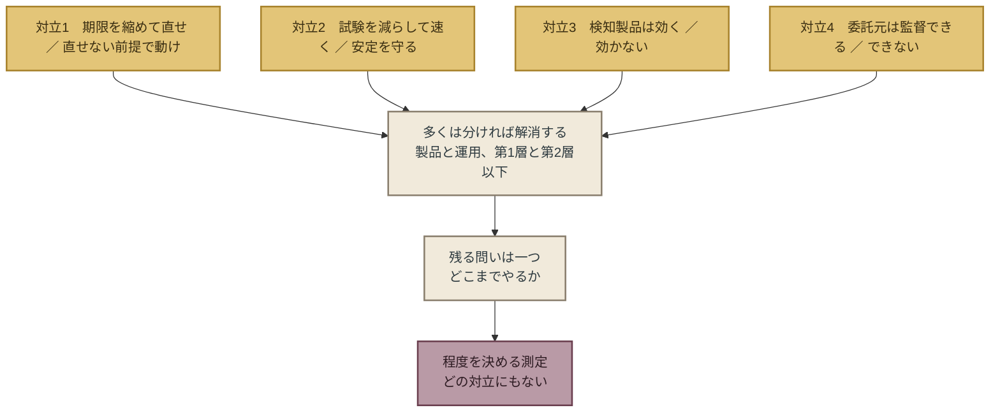

## この章が断定しないこと

- **どちらの側が正しいかを書かない。** 4つの対立のいずれも、両側を同じ条件で比べた測定がない（本章「四つの対立に共通すること」）。
- **対立を「解消できる」と書いたことは、「どちらでもよい」という意味ではない。** 分けた後に残る「どこまで」の問いに、答えはまだない。
- **保険会社2社の数字を、因果として読まない。** Marshは相関、At-Bayは記述統計である（本章「対立3 ── 検知製品は効くか」）。
- **世界経済フォーラムの40%を、実測として読まない。** 意識調査である（本章「対立4 ── 委託元は委託先を監督できるか」）。

## 次の章へ

対立の両側に測定がないことは、対立に限った話ではない。 
次章では、211件の提言全体について、「効果を測った提言は何件あるか」を数える。 
そして、提言の種類ごとの件数を並べ、どこが厚く、どこが薄いかを見る。 
最も薄いところに、本書の第3部が立つ。

 

---

### 参考文献

1. Bruce Schneier「Cybersecurity in the Age of Instant Software（初出 CSO）」（2026-04-07）※本文 https://www.schneier.com/blog/archives/2026/04/cybersecurity-in-the-age-of-instant-software.html
2. Bruce Schneier「Microsoft's Patching」（2026-09-14）※本文（脆弱性件数はArs Technicaからの引用） https://www.schneier.com/blog/archives/2026/09/microsofts-patching.html
3. Action1「CISA BOD 26-04: Why the 72-Hour Patching Window May Be Too Long」（2026-08-26）※本文（28.3%は同社の自社調査。方法は未開示） https://www.action1.com/blog/cisa-bod-26-04-why-the-72-hour-patching-window-may-be-too-long/
4. 金融庁・日本銀行「「フロンティア AI による脅威変化を踏まえた金融機関等の短期的な対応」に係る要請について」（2026-05-22）※本文（要請①⑥⑦⑧・脚注6） https://www.fsa.go.jp/news/r7/sonota/20260522-5/01.pdf
5. Marsh McLennan「Cybersecurity signals: Connecting controls and incident outcomes」（2025-08-27）※公表要約（報告書本体は登録制・未開封） https://www.marsh.com/en/corp/about/news/marsh-mclennan-cyber-risk-intelligence-center-report.html
6. At-Bay「2026 InsurSec Report（プレスリリース）」（2026-04-22）※プレスリリース本文 https://www.at-bay.com/press_releases/2026-insursec-report-ransomware-vpn-sonicwall-attacks/
7. At-Bay「2025 InsurSec Report」（2025-04）※本文 https://www.at-bay.com/wp-content/uploads/2025/04/At-Bay-2025-InsurSec-Report.pdf
8. 個人情報保護委員会「令和8年度第1四半期における監視・監督権限の行使状況」（2026-09-02）※本文 https://www.ppc.go.jp/files/pdf/260902_shiryou-3-1.pdf
9. 内閣官房国家サイバー統括室「不正アクセスによる漏えい等の事案を踏まえた対応について」（2026-10-09）※本文 https://www.cyber.go.jp/pdf/press/taiou.pdf
10. EU「NIS2指令（2022/2555）第21条」（2022）※条文 https://eur-lex.europa.eu/
11. 米NIST「Cybersecurity Framework 2.0 Quick Start Guide（SP 1299）」（2024）※本文 https://nvlpubs.nist.gov/nistpubs/SpecialPublications/NIST.SP.1299.pdf
12. 世界経済フォーラム「Global Cybersecurity Outlook 2026」（2026-01）※要約 https://www.weforum.org/publications/global-cybersecurity-outlook-2026/
13. 米CISA「Red Team Assessment AA24-326A」（2024-11）※本文 https://www.cisa.gov/news-events/cybersecurity-advisories/aa24-326a

 

---

# 第6章: 空白 ── 効果測定ゼロ、データ最小化13件

## この章が拠って立つ数字

第4章は提言が重なっているところを、第5章は食い違っているところを見た。 
この章は、提言が**ない**ところを見る。 
空白は3つの軸で測る。 
提言の種類ごとの厚さ、根拠の有無、そして日本の漏えい台帳の侵入経路との対応である。

本書は提言を9種類に分けて記録した。

| 記号 | 提言の種類 | 含むもの |
|---|---|---|
| K1 | 脆弱性の発見と修正 | パッチの期限、優先順位付け、AIによる脆弱性発見 |
| K2 | 修正できない期間の防御 | 仮想パッチ、WAF、分離、公開面の縮小、多要素認証、EDR |
| K3 | 攻撃の予期と検知 | 脅威情報、攻撃面の監視、MDR、ログ |
| K4 | 委託先・サプライチェーン | 契約、監査、多段下請け |
| K5 | データの最小化と構造 | 不保持、保存期間、消去、暗号化、権限の分離 |
| K6 | ガバナンスと経営 | 経営責任、取締役会、リスク受容 |
| K7 | AIモデル固有 | AIエージェントの権限、プロンプトインジェクション、モデルへのアクセス制御 |
| K8 | 制度・規制・国際協調 | 開示義務、罰則、保険、情報共有 |
| K9 | インシデント対応・公表・復旧 | 封じ込め、当局報告、本人通知、公表文、復旧 |

**第1版時点（2026年10月30日、T1・T2の211件。同日中に金融庁2026-10-09要請（A-063）とインドCERT-In指令（H-004）の原文を開いてT3からT1に格上げしたため、同日午前の集計209件から2件増えている）**

| 種類 | 主分類での件数 | 副分類を含む件数 |
|---|---|---|
| K9 対応・公表・復旧 | 47 | 66 |
| K1 発見と修正 | 37 | 40 |
| K2 修正できない期間の防御 | 32 | 43 |
| K3 予期と検知 | 23 | 37 |
| K7 AIモデル固有 | 20 | 37 |
| K6 経営 | 16 | 26 |
| K4 委託先 | 14 | 25 |
| K8 制度 | 13 | 34 |
| **K5 データの最小化と構造** | **9** | **13** |

---

## 空白1 ── 効果を測った提言は、0件

本書は、提言ごとに「実装状況」を記録した。 
提言どまり、制度化済み、導入事例あり、効果測定あり、の4区分である。 
「効果測定あり」は、実データまたは実験で、対策の有無による結果の差を測ったものに限った。 
導入件数や専門家の推定、「効くはずだ」という記述は含めない。

211件のうち、記録上「効果測定あり」とされたものは14件あった。 
その14件を、何を測ったかで分けると次のようになる。

| 測ったもの | 件数 | 例 |
|---|---|---|
| 実験環境での、特定の防御の動作 | 4 | VirtualPatch（Androidの25件のCVE）、機械学習WAFの検知精度（F1値93.13%）、プロンプトインジェクション防御（StruQ）、AIによる自律修正（PatchWeaver） |
| 実環境での、統制の導入と結果の相関・記述統計 | 3 | Marsh McLennan（EDR展開率と侵害確率の相関）、At-Bay 2026（MDR顧客のAkira請求ゼロ）、At-Bay 2025 |
| 防御の効果ではない何か | 5 | EPSSの予測性能、規制期限とパッチ速度の関係、OTの代替策の提示率（13%）、早期通報と資金回収率、MFAが不正アクセス試行を防ぐ割合（自社テレメトリ、方法未確認） |
| 防御の失敗 | 2 | 適応的攻撃が12の防御を90%超の成功率で突破（The Attacker Moves Second）、WAFの1,207件のバイパス |

ここから、本書が最初に設定した基準、つまり「**企業の実環境で、同じ条件の資産を対策の有無で分け、侵害の結果を比べた**」測定に該当するものを数えると、**0件**である。

実験環境の4件は、条件が狭い。 
Androidアプリの仮想化、注入攻撃の実験データ、研究室のプロンプトインジェクションである。 
企業システムへの一般化はできない。 
実環境の3件は、保険会社の請求データであり、相関か記述統計である。 
MDRを買った企業と買わなかった企業は、他の点でも違う。 
Marshの分析はEDRの「展開率」と侵害確率の関係であり、未修正の期間に絞ったものではない。

この0件は、本書が集めた資料の範囲に限った数字である。 
企業が社内で測った結果は公開されないことが多く、本書は公開された一次資料しか数えていない。 
それでも、政府・標準団体・AI企業・セキュリティ企業・保険・学術・個人・規制の8種類が2年間に出した211件の提言のうち、効果を実環境で比べたものが1件もないという事実は、提言を読む側が知っておくべきことである。

## 空白2 ── データの最小化は、13件

9種類の提言のうち、最も件数が少ないのがK5「データの最小化と構造」である。 
主分類で9件、副分類を含めて13件。 
最多のK9（66件）の5分の1、K2（43件）の3分の1以下である。

13件の内訳は、発行元の種類で見ると偏っている。

| 発行元の種類 | K5の件数 | 内容 |
|---|---|---|
| A 政府・公的機関 | 12 | 国家サイバー統括室（6件：保有情報の最小化、保存期間、棚卸し、委託先への提供最小化、権限分離、平文保存の禁止）、個人情報保護委員会（不要データの消去）、IPA（「不要な情報は持たない、という基本原則」）、金融庁（本人確認書類の画像を受け取らない方式への「可及的速やかな対応」）、豪OAIC（必要最小限の収集・保持）、韓国PIPC（個人情報の最小化）、EDPB、仏CNIL |
| E 保険 | 1 | At-Bay 2025 |
| B 標準、C AI企業、D セキュリティ企業、F 学術、G 個人、H 規制 | 0 | ── |

K5は、政府機関が12件、保険が1件で、ほぼ政府機関だけが書いている。 
標準団体も、AI企業も、セキュリティ企業も、学術も、個人の有識者も、本書が集めた範囲では1件も書いていない。 
第4章の「合意」の定義（3種類以上の発行元）に、K5は届かない。

なぜ薄いのか。 
本書は理由を確定できないが、1つの構造は指摘できる。 
K1からK3までの提言（発見・修正・防御・検知）は、製品とサービスの市場を持っている。 
パッチ管理、WAF、EDR、MDRは売り物である。 
K5は、売り物にならない。 
データを減らすことは、何かを買うことではなく、何かをやめることである。 
提言を出す側の多くは、何かを売る側か、売る側の情報を集める側である。

K5の13件のうち、効果を測ったものは0件である。 
これは本章「空白1 ── 効果を測った提言は、0件」の0件の内数である。 
「保有する情報が少なければ被害の拡大を抑えることが可能」（国家サイバー統括室）は、論理としては自明に近いが、測った資料はない。

本書の第3部は、この最も薄いところに最初の提言を立てる。 
測った資料がないことを承知のうえで、である。

## 空白3 ── 日本の台帳の侵入経路と、提言の対応

姉妹書『The Japan Breach Registry 2026』は、日本の公表文が記した侵入経路を、脆弱性、VPN、委託先、不正ログイン、設定不備、そして「経路非開示」に分類している。 
本書は211件の提言それぞれに、どの経路に対応するかを付けた。

| 台帳の侵入経路 | 対応する提言の件数 | 所見 |
|---|---|---|
| 脆弱性 | 52 | 最も厚い。K1・K2の大半 |
| 経路非開示への処方 | 38 | 公表文に経路を書かない組織に対する提言。当局・本人への報告と通知の制度が過半、公衆向けの公表と、ログ・調査の提言が残り（第9章で扱う。内訳は第9章「世界での位置 ── 合意された手順と、決められていない範囲」） |
| 不正ログイン | 35 | 多要素認証、認証情報の保護 |
| 設定不備 | 29 | APIのアクセス制御、公開設定の確認。JPCERT/CCの4対策はここ |
| 委託先 | 26 | 第5章 対立4 |
| VPN | 16 | 境界機器の露出。At-Bay「2025年のランサムウェアの73%はVPN経由」 |
| 内部不正 | 2 | ほぼ空白 |
| 横断（特定の経路に対応しない） | 50 | 経営、制度、情報共有 |

台帳で件数の多い「委託先」は26件の提言があるが、第5章で見たとおり、第1層の契約の有無という手前の問題に対する提言は日本の公的機関のものに限られる。 
「内部不正」は2件で、ほぼ空白である。 
台帳では内部不正を経路とする公表文は少ないが、韓国のクーパン事案（元従業員による認証鍵の悪用）のような事例は、この経路の提言が薄いことを示す。

もう1つの空白は、台帳の側にある。 
海外の保険データで最大の侵入経路とされるVPN（At-Bayは2025年のランサムウェアの73%）は、日本の公表文では1通しか記していない。 
海外で最大の損失経路であるビジネスメール詐欺（Coalitionは請求の58%）は、個人情報保護法の報告対象から外れるため、台帳の分類に現れない。 
提言は海外の経路分布を前提に書かれ、日本の公表文は別の分布を示している。 
どちらが実態に近いかは、公表文が経路を書かない限り、分からない。

## 空白4 ── 日本の個人の有識者の一次資料

発行元の種類Gは「個人の有識者」であり、本人名義の寄稿・講演録・議会証言を一次資料とする。 
本書が集めた211件のうちGは11件で、そのうち日本の有識者の本人名義の一次資料に到達できたのは、セキュリティインシデントの調査者piyokango氏のブログ記事（2026年10月11日）1件である。

日本には、徳丸浩氏、辻伸弘氏、名和利男氏、上原哲太郎氏をはじめ、この分野で長く発言してきた専門家がいる。 
本書は3回の調査でこれらの方々の2025年以降の発言を探したが、確認できたのは報道による要約と講演の告知だけで、本人が書いた原文や講演録には届かなかった。 
これは本書の調査方法（公開されたウェブ上の一次資料）の限界であり、発言が存在しないという意味ではない。

日本語の一次資料の薄さは、日本の経営者がこの主題について読めるものが、海外の報告書の翻訳か、国内の公的機関の注意喚起か、報道に限られることを意味する。 
本書は、この空白を埋めるものではなく、空白があることを記録する。

## 空白5 ── 地域と業界

本書の収集は、英語・日本語・韓国語・仏語を中心に行った。 
結果として、政府機関の提言（A）は米・英・豪・NZ・EU・仏・日・韓・シンガポールに偏り、独・蘭・北欧・台湾・インド・イスラエル・中東からの一次資料は、インドCERT-Inの指令（T1）を除いてない。

業界別では、金融（金融庁・日銀の要請、EUのDORA）と重要インフラに提言が集中し、日本の台帳で件数の多い小売・EC、物流、教育、自治体、医療に向けた専用の提言は、仏CNILの教育分野ガイド（見出しのみ確認）と、豪OAICの医療分野の通知件数のほかには見つからなかった。

## 空白の隣にあるもの ── 間違っている数字

空白とは別に、提言の地図に書き込んでおくべきものが1つある。 
提言そのものではなく、提言の根拠として流通している数字のうち、発行元に否定されたものである。

本書が集めた保険データの提言（E）の中で、最も広く引用されている数字の1つに、「保険金の支払いを拒絶された事案の82%は、多要素認証（MFA）を導入していなかった」がある。 
多要素認証を導入せよという提言の根拠として、この数字は使いやすい。 
導入しなければ保険が下りない、という損得に直結するからである。

2026年8月31日、保険会社Coalitionのリサーチ責任者Daniel Woods氏は、同社のブログに「サイバー保険は保険金を払わない、という神話を正す」と題する記事を書いた。 
記事は、この82%について次のように記す。

> This statistic is not only factually incorrect, but also we've never published data on claims denials.
> （この統計は事実として誤りであるだけでなく、当社は請求の拒絶に関するデータを公表したことがない。）

記事は、この数字が「複数の第三者のブログで、Coalitionに直接帰属されている」とも書く。 
Coalitionが出していない数字が、Coalitionの名前で流通していた。 
誰が最初に書いたかは、記事も特定していない。 
本書も特定しない。 
記録するのは、数字と、否定した一次資料だけである。

同じ記事は、ほかに3つの数字を扱っている。 
間違い方はそれぞれ違う。

| 流通している数字 | 帰属されている先 | Coalitionの記事の記述 | 間違いの型 |
|---|---|---|---|
| 「拒絶された請求の82%はMFA未導入」 | Coalition | 事実として誤り。拒絶のデータを公表したことがない | 捏造または幻覚 |
| 「請求の44%が拒絶される」 | 調査会社Advisen | Advisenと親会社Zywaveは請求拒絶の報告書を公表したことがない（同社の編集者に確認したとする） | 帰属の誤り |
| 「請求の40%以上が拒絶される」 | 格付会社Fitch Ratings | Fitchの2024年・2025年の報告書にこの数字はない（同社の幹部に確認したとする） | 帰属の誤り |
| 「保険が補償したのは32%だけ」 | 調査会社NetDiligence | 数字は実在する。ただし元の報告では請求の11%が未決着で、「文脈を外れている」 | 文脈の喪失 |

44%と40%については、否定したのはAdvisenやFitch自身ではなく、Coalitionが「確認した」と書いている。 
本書はこの区別を残し、「帰属先が未公表（Coalitionの確認による）」と記録する。

この4件が経営者に関わるのは、どれも経営の判断に直接使われる数字だからである。 
多要素認証に投資するか、サイバー保険に入るか。 
「44%が拒絶される」なら保険に入る理由は弱くなり、「82%はMFA未導入」なら多要素認証の投資は保険のためにも正当化される。 
判断の材料にされる数字が、発行元に否定されている。

ここから先は構造の観察であり、断定ではない。 
第4章で見たとおり、多要素認証は5種類以上の発行元が同じ方向を向く、合意の提言である。 
合意された提言の根拠として差し出された数字は、読み手がすでに信じていることに合うため、確かめられにくい。 
82%が流通したのは、信じにくかったからではなく、信じやすかったからである。 
本章「空白1 ── 効果を測った提言は、0件」で見た「効果を測った提言は0件」と、この節の「否定された根拠が流通している」は、同じことの表と裏である。 
測った数字がないところに、測っていない数字が入る。

Coalitionの記事が自社の読者に向けて書いた確認は3つである。 
統計を引用するとき、出所、方法、文脈を確かめる。 
本書が第1部と第3部で使う数字は、すべてこの3つを通し、一次資料のURLを著者が開いたものに限った。 
通らなかった数字がどう扱われたかは、付録の検証記録に書く。

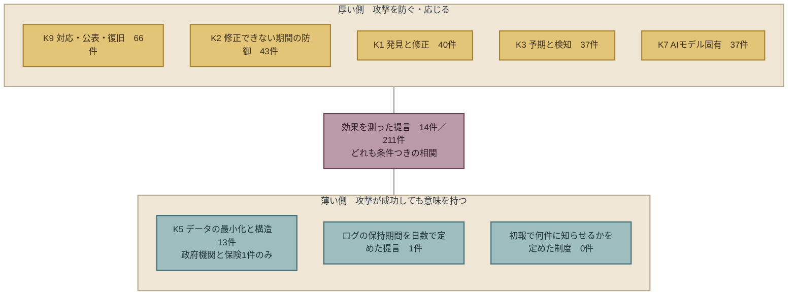

## 五つの空白が示すこと

5つの空白を並べる。

1. 効果を測った提言は0件（本章「空白1 ── 効果を測った提言は、0件」）
2. データの最小化は13件、政府機関と保険1件（本章「空白2 ── データの最小化は、13件」）
3. 内部不正への提言は2件、海外と日本で侵入経路の分布が食い違う（本章「空白3 ── 日本の台帳の侵入経路と、提言の対応」）
4. 日本の有識者の一次資料は1件（本章「空白4 ── 日本の個人の有識者の一次資料」）
5. 地域と業界に大きな偏り（本章「空白5 ── 地域と業界」）

このうち1と2は、本書の第3部を形づくる。 
効果を測った提言がないなら、経営者は「効くと分かっているから採る」という判断ができない。 
できるのは、「攻撃の成否と無関係に、会社の意思だけで今日決められること」を選ぶ判断である。 
データの最小化は、その条件に合う数少ない提言であり、かつ最も薄い。

3は、第8章と第9章の前提になる。 
日本の公表文が経路を書かないことは、提言の側から見れば「どの提言が効いたか、効かなかったかを、日本の事案から学べない」ことを意味する。

4と5は、本書の限界である。 
更新型にした理由の1つは、この2つを版を重ねて埋めるためである。

## この章が断定しないこと

- **効果を測った提言が世界に存在しない、とは書かない。** 本書が集めた公開一次資料の範囲で0件である（本章「空白1 ── 効果を測った提言は、0件」）。
- **データの最小化が最も効く、とは書かない。** 最も薄い、とだけ書く。効くかどうかの主張は第7章で、著者の主張として行う（本章「空白2 ── データの最小化は、13件」）。
- **日本の有識者が発言していない、とは書かない。** 本人名義の一次資料に本書が到達できなかった、である（本章「空白4 ── 日本の個人の有識者の一次資料」）。
- **K5が薄い理由を、提言者の利害と断定しない。** 1つの構造として指摘した（本章「空白2 ── データの最小化は、13件」）。
- **「82%」を最初に書いた者を特定しない。** Coalitionの記事も特定していない（本章「空白の隣にあるもの ── 間違っている数字」）。
- **AdvisenとFitchが数字を否定した、とは書かない。** 否定を確認したと書いているのはCoalitionであり、本書はそれを「Coalitionの確認による」と記す（本章「空白の隣にあるもの ── 間違っている数字」）。

## 次の章へ

第1部は、攻撃が修正より速いこと、そしてそれに対する助言が「新しくない」ことを見た。 
第2部は、世界の提言が重なるところ、食い違うところ、ないところを見た。

ここまでで、経営者が置かれている状況は、こう要約できる。 
防ぐ競争は速度で負けている。 
助言は出そろっているが、どれが効くかは測られていない。 
最も薄い提言は、データを持たないことである。 
そして、判断の材料にされる数字の一部は、発行元に否定されている。

第3部は、この状況で、会社が自分の意思だけで決められることを3つ書く。 
何を持つか、いつ気づくか、どう伝えるか。 
ここからは、著者の主張である。

 

---

### 参考文献

本章の集計は `data/proposals.csv`（第1版、2026年10月30日時点、T1・T2の211件）に基づく。 
「効果測定あり」の14件、K5の13件、侵入経路別の件数は、同ファイルの `status`・`k`・`route` 列から集計した。 
個々の提言の一次資料は同ファイルに記録してあり、本章で名前を挙げた資料のうち本文で初出のものは次のとおり。

1. 豪OAIC「Large-scale data breaches on the rise, latest OAIC statistics reveal」（2026-10-26） https://www.oaic.gov.au/news/media-centre/large-scale-data-breaches-on-the-rise%2C-latest-oaic-statistics-reveal
2. 韓国 個人情報保護委員会「API経由の大量漏えい防止勧告」（2026-07-09）※pipc.go.kr（`data/proposals.csv` A-105）
3. IPA「不正アクセスによる漏えい等の事案を踏まえ、速やかに実施すべき対策等について」（2026-10-09） https://www.ipa.go.jp/security/security-alert/2026/alert20261009.html
4. 個人情報保護委員会「個人データの適正な取扱いに関する注意喚起」（2026-10-07） https://www.ppc.go.jp/files/pdf/261007_houdou.pdf
5. piyokango「piyolog（2026年10月の不正アクセス事案のまとめ）」（2026-10-11） https://piyolog.hatenadiary.jp/entry/2026/10/11/004353
6. Coalition「Cyber Threat Index 2025」（2025-03） https://www.coalitioninc.com/announcements/cyber-threat-index-2025
7. At-Bay「2026 InsurSec Report（プレスリリース）」（2026-04-22） https://www.at-bay.com/press_releases/2026-insursec-report-ransomware-vpn-sonicwall-attacks/
8. Coalition（Daniel Woods）「Dispelling the Myth: Cyber Insurance Doesn't Pay Claims（本章「空白の隣にあるもの ── 間違っている数字」。2026年10月30日に著者が全文を確認。台帳のE-002・E-003はこの確認によりT2からT1に改めた）」（2026-08-31） https://www.coalitioninc.com/blog/cyber-insurance/dispelling-myth-cyber-insurance-doesnt-pay-claims

 

---

# 第3部　会社が決められる三つ

---

# 第7章: 持たない ── 侵入の成否と無関係に、被害を減らせる唯一の手段

## 第3部の読み方

第1部と第2部は、一次資料が言っていることと、言っていないことを分けて書いた。 
断定を避け、構造を指摘するにとどめた。 
第3部は違う。 
ここからは著者の主張である。

主張の根拠は、第1部・第2部で確かめた事実に限る。 
新しい事実は持ち込まない。 
各章は同じ型で書く。 
提言を1文で置き、根拠を示し、世界の提言の中でその提言がどこに位置するかを第4章から第6章の集計で示し、反論と限界を書き、日本企業がどう実装するかを書き、最後に、この章が断定しないことを書く。

3つの章の主題は、第1章の冒頭で書いた問いへの答えである。 
攻撃が修正より速く、助言は出そろっているが効くかどうかは測られていない状況で、会社が自分の意思だけで決められることは何か。 
本書の答えは3つある。 
何を持つか（第7章）、いつ気づくか（第8章）、どう伝えるか（第9章）。

三つを選んだ基準は、効くかどうかではない。 
第3章で見たとおり、どの対策が攻撃を防ぐかは測られていない。 
本書も測れない。 
そこで本書は、効果の実証を待たなくても決められる種類の決定だけを選んだ。 
選ぶ条件は二つである。 
攻撃が成功しても意味を持つこと、そして会社が他者の協力なしに単独で決められること。 
何を持つかは、侵入されたときの最大値を決める。 
いつ気づくかは、侵入された後に確かめられる範囲を決める。 
どう伝えるかは、確かめた結果を誰に何件知らせるかを決める。 
三つとも、防げたかどうかに左右されない。 
第3章の批判と第3部の提言は矛盾しない。 
効くかどうかを問わない決定だけを、本書は提言している。

---

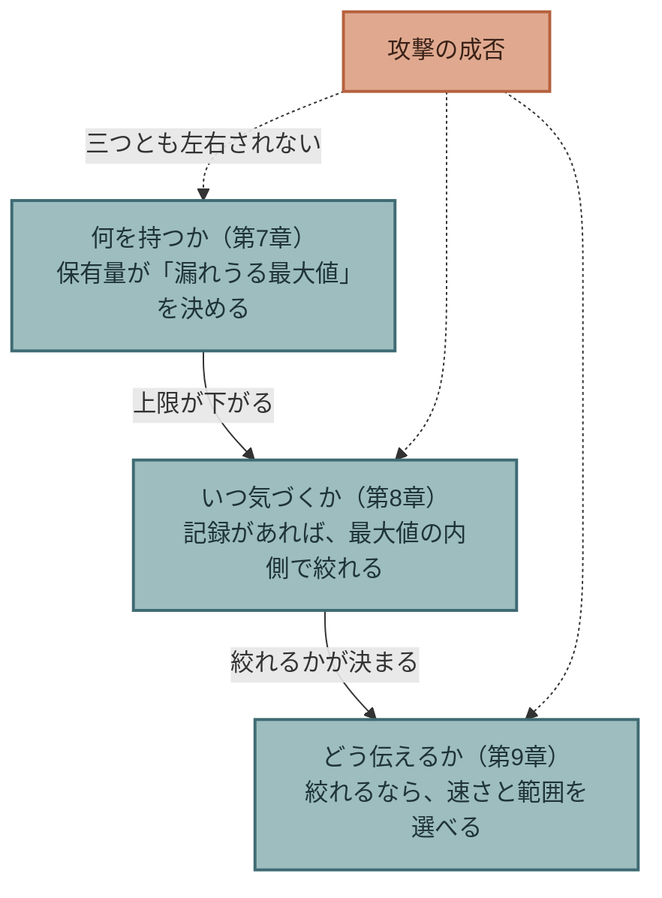

## この章の提言

**保有する個人データの棚卸しと消去を、セキュリティ投資の第一項目に置く。 
侵入の成否に関係なく被害を減らせる、唯一の手段だからである。**

「持たない」は、3つの行動からなる。

1. **数える。** 会社がどの個人データを、何件、どの根拠で、いつまで持っているかを、一覧にする。
2. **消す。** 利用する必要がなくなったデータと、法令の保存期間を過ぎたデータを消す。
3. **渡さない。** 委託先に渡すデータの項目と件数を必要最小限にし、業務が終わったら委託先でも消させる。

この3つは、ファイアウォールの更新やパッチの適用より先に置く。 
理由を次節で書く。

---

## なぜ、第一項目か ── 三つの理由

### 理由1：攻撃の成否と無関係に効く

第1章で見たとおり、攻撃側は分で動き、防御側の修正は日で動く。 
Mandiantの推定では、脆弱性が悪用されるまでの時間は、パッチの公開日に対してマイナス7日である。 
修正が存在しない時間が、構造として生まれている。

その時間に、会社が侵入を防げるかどうかは、確率の問題である。 
多要素認証を入れれば確率は下がる。 
EDRを入れれば下がる。 
しかし0にはならず、第6章で見たとおり、どれだけ下がるかを実環境で測った資料は、本書の収集の範囲で0件である。

保有するデータの量は、確率ではない。 
確定値である。 
100万件を持っていれば、漏れうる最大は100万件であり、10万件しか持っていなければ、どれだけ巧妙な攻撃を受けても、漏れうる最大は10万件である。 
これは防御の効果ではなく、算術である。

豪州のプライバシー・コミッショナーCarly Kind氏は、2026年10月26日の発表でこれを一文で言った。

> Organisations can't lose personal information they don't hold.
> （組織は、持っていない個人情報を失うことはできない。）

日本の内閣官房国家サイバー統括室は、2026年10月9日の文書で同じことを書いた。

> 万が一情報漏えいが発生した場合でも、保有する情報が少なければ被害の拡大を抑えることが可能です。

「万が一」とは、侵入を防げなかった場合である。 
この一文は、防御が失敗することを前提に書かれている。 
本書が「持たない」を第一項目に置く理由は、この前提にある。 
第1部で見た状況は、防御が失敗する時間が構造として存在する、というものだった。 
その時間に効くのは、防御ではなく、守る対象の量である。

### 理由2：効果が測れないことの影響を受けない

第6章は、211件の提言のうち効果を測ったものが0件であることを示した。 
これは経営者にとって、「どの対策が効くか分からないまま、予算を配る」ことを意味する。

「持たない」は、この問題の外にある。 
消去の効果を測った資料がないことは、第6章で見たとおりである。 
しかし「持たない」の効果は、測らなくても分かる。 
漏れた件数は、持っていた件数を超えない。 
これは測定の結果ではなく、定義である。

経営者が「効くと分かっているから採る」判断をできる対策は、本書の収集の範囲では、これだけである。

### 理由3：会社が単独で決められる

多要素認証の導入には、従業員の協力がいる。 
パッチの適用には、ベンダーが修正を出すことと、業務を止める時間がいる。 
委託先の管理には、委託先の協力がいる。 
攻撃を検知するには、攻撃者が痕跡を残すことがいる。

何を持つかは、会社が1社で決められる。 
取締役会が「このデータは来期までに消す」と決めれば、消える。 
他社の修正を待つ必要も、攻撃者の出方を見る必要もない。

第3部の3つの提言に共通する条件は、「会社の意思だけで今日決められること」である。 
「持たない」は、その条件を最も純粋に満たす。

---

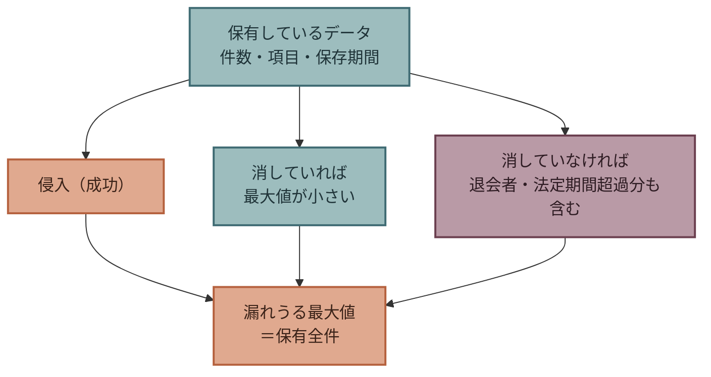

## 根拠 ── 世界の提言が書いたこと

本書の台帳で、データの最小化と構造（K5）に分類した提言のうち、本文を開いて確認したものを示す。

| 発行元 | 日付 | 提言（原文） | 階層 |
|---|---|---|---|
| 内閣官房国家サイバー統括室 | 2026-10-09 | 「万が一情報漏えいが発生した場合でも、保有する情報が少なければ被害の拡大を抑えることが可能です。」「定期的に情報資産の棚卸しを実施する」「利用目的や保存期間を明確にする」「法令上の保存期間を経過した情報は適切に廃棄する」 | T2 |
| 同 | 同 | 「委託先へ提供する個人情報や業務情報を必要最小限とする」「業務終了後の委託先でのデータ削除を徹底する」 | T2 |
| 個人情報保護委員会 | 2026-10-07 | 法第22条を引いて「利用する必要がなくなったときは、当該個人データを遅滞なく消去するよう努めなければならない。」、「保管している個人データの必要性についてその法令等の根拠とともに確認を適切に行うことを含めて、改めて注意喚起します。」 | T2 |
| 同 | 同 | 「こうした対応が徹底されず、漏えい等事案がより深刻化するといった事例にも接していますので、」 | T2 |
| IPA | 2026-10-09 | 「不要な情報は持たない、という基本原則」 | T2 |
| 豪 OAIC（Carly Kind） | 2026-10-26 | 「only collecting and retaining the minimum personal information necessary」「Organisations can't lose personal information they don't hold.」 | T1 |
| 韓国 個人情報保護委員会 | 2026-07-09 | 「개인정보 최소화」（個人情報の最小化）、APIで不要な個人情報を提供しない、権限を最小化する | T1 |
| 金融庁 | 2026-10-09 | 本人確認書類の画像を受け取る方法を廃し「ＩＣチップ情報の読取に原則一本化される」改正規則について、「施行日を待たず、可及的速やかな対応を図ること。」 | T1 |

8行のうち、根拠にデータが付くのは2行である。 
豪OAICは、2026年上半期の通知667件と、100万人超の事案が4件から11件に増えたという自国の統計の上で、この提言を置いた。 
韓国PIPCは、2025年の漏えい報告447件、2026年上半期432件の上に置いた。 
他の6行は、提言だけである。

個人情報保護委員会の「漏えい等事案がより深刻化するといった事例にも接しています」は、本書が確認した範囲で、日本の公的機関が「不要なデータを持っていたことで被害が大きくなった事案がある」と一次資料に書いた最初の例である。 
ただし、どの事案かは書かれていない。

最後の行、金融庁の要請は、他の7行と性質が違う。 
「消せ」ではなく、「最初から受け取らない仕組みに変えよ」である。 
本人確認のために免許証の画像を受け取れば、会社はその画像を持つことになる。 
ICチップの読み取りに一本化すれば、画像は会社に残らない。 
これは「持たない」を、運用ではなく、業務の設計で実現する例である。 
金融庁は改正規則の施行日（2027年4月1日）を待たずに対応するよう求めた。 
本書は、この要請が10月の漏えい事案と直接結びつくとは書かない。 
金融庁の文書は「現下の情勢を踏まえた」と書くにとどまる。

---

## 日本の台帳が示したこと

姉妹書の漏えい台帳（第3版、71行）から、「持っていたこと」が被害の大きさを決めた行を3つだけ引く。 
台帳の内容は繰り返さない。 
本章の主張に必要な部分だけである。

**Helpfeel（Gyazo）、2026年9月16日。** 
公表文は、流出したデータ「約2,362万件」のうち、約1,801万件（約76%）がメールアドレスの登録がない匿名ユーザーのものであると書いた。 
さらに第二報で、「削除済み画像のメタデータ約1.74億件」が流出したと追加した。 
利用者が削除した画像の情報が、会社の側に残っていた。

**タイムズモビリティ、2026年9月25日〜10月23日。** 
第5報で、「6,628,007件」のアカウントのうち、本人確認書類の画像に外部送信の痕跡があるものが「1,464,800件」と確定した。 
カーシェアの本人確認のために受け取った免許証などの画像が、約146万件、会社の側に保管されていた。 
金融庁がICチップへの一本化を急がせた10月9日は、この事案の第3報（9月29日）の10日後である。

**大起水産、2026年10月5日。** 
対象「174,933人」は、「2024-11-01〜2026-09-15の登録者・退会者含む」と公表文が書いた。 
退会した人のデータが、退会後も保有されていた。

3行に共通するのは、侵入経路でも、攻撃の手法でもない。 
漏れた件数の中に、「利用する必要がなくなった」データが含まれていたことである。 
削除済みの画像の情報、本人確認が済んだ後の画像、退会した人の登録情報。 
個人情報保護委員会が「深刻化するといった事例」と書いたのが、このような行を指すかどうかは分からない。 
本書は、台帳の3行が示す構造として書く。

---

## 世界の提言での位置

第6章の集計を再掲する。 
T1・T2の211件のうち、K5「データの最小化と構造」は副分類を含めて13件、主分類では9件で、9種類の中で最も少ない。 
13件のうち12件が政府機関（A）、1件が保険会社（E）であり、標準団体、AI企業、セキュリティ企業、学術、個人、規制当局の提言には1件もない。

本書は第6章で、この薄さの理由を断定しなかった。 
ここでは著者の主張として書く。

「持たない」は、誰の売り物にもならない。 
脆弱性の発見・修正（K1）、修正できない期間の防御（K2）、攻撃の予期と検知（K3）には、製品とサービスの市場がある。 
提言の発行元のうち、セキュリティ企業と保険会社は、その市場の売り手である。 
AI企業は、自社のAIを防御に使う提言を出す。 
「データを消せ」と提言して利益を得る発行元は、本書の集めた8種類の中に、政府機関のほかにない。

提言の薄さは、効果の薄さを意味しない。 
提言の厚さは、提言する側の利害の分布を映す。 
第4章で見た「合意」が利害の薄い対策に集まっていたことと、第6章で見た「空白」が利害のない対策に生まれていたことは、同じ構造の両面である。

本書が「持たない」を第3部の最初に置くのは、第2部の地図で最も薄いところが、第1部の構造で最も効くところと重なっているからである。

---

## 反論と限界

著者の主張に対して、成立する反論を5つ書く。

**反論1：法令で保存期間が定められたデータは、消せない。** 
そのとおりである。 
個人情報保護委員会の注意喚起も「法令の定めにより保存期間等が定められている場合は、この限りではありません」と書く。 
帳簿、取引記録、雇用関係の書類には法定の保存期間がある。 
本章の提言は、法定期間を超えて持っているデータと、法令の根拠なく持っているデータを対象にする。 
本章「根拠 ── 世界の提言が書いたこと」の国家サイバー統括室の「法令上の保存期間を経過した情報は適切に廃棄する」は、この区別の上に立つ。

**反論2：データには事業上の価値がある。** 
そのとおりである。 
退会者のデータは再入会の分析に使える。 
過去の購買履歴はAIの学習に使える。 
本章は、この価値を否定しない。 
本章が求めるのは、その価値と、保有によって増える被害の最大値とを、同じ表の上で比べることである。 
比べた上で持つと決めたデータは、持ってよい。 
問題は、比べずに持っているデータである。 
本章「日本の台帳が示したこと」の3行は、いずれも、比べた形跡が公表文に書かれていない。

**反論3：消去の効果を測った資料はない。** 
そのとおりである。 
第6章で確認した。 
ただし本章「なぜ、第一項目か ── 三つの理由」で書いたように、「持たない」の効果は測定ではなく定義で決まる。 
測定が必要なのは、「消去にかかる費用と、消去で減る被害の期待値のどちらが大きいか」であり、これは会社ごとに違う。 
本書は、その比較を会社が自分で行えるように、本章「日本企業の実装」で表の形を示す。

**反論4：消したつもりでも、残る。** 
これは最も重い反論である。 
Helpfeelの「削除済み画像のメタデータ約1.74億件」は、利用者が削除した後も会社の側に情報が残っていたことを示す。 
個人情報保護委員会の注意喚起（2024年12月版、2026年10月改訂）は、「組織として管理されていない個人データの中には、本来は消去すべき古いデータ等が含まれているケースがあり、漏えい被害の範囲が大きくなってしまった」と書く。 
バックアップ、ログ、従業員の個人領域、委託先のサーバー。 
消去は、本番のデータベースから消すだけでは終わらない。 
本章の「数える」が「消す」の前に置かれているのは、どこに何があるかを知らずに消すことはできないからである。

**反論5：委託先に渡したデータは、自社で消せない。** 
そのとおりである。 
第5章・第6章で見た委託先の連鎖（1つの委託先の侵害から複数の委託元が公表する構造）は、委託元が「持っていないつもりのデータ」が委託先にあったことで起きた。 
本章の「渡さない」は、この限界への対応である。 
渡す項目を減らし、渡した後の削除を契約に書く。 
ただし、契約に書いても、委託先が守るかどうかは委託元には見えない。 
この限界は、第11章で扱う。

---

## 日本企業の実装

本章の提言を、日本企業の経営の道具に変える。 
3つの道具を示す。

### 道具1：保有データ一覧を、取締役会の資料にする

セキュリティの報告は、通常、「何をしたか」を書く。 
パッチを当てた、訓練をした、監査を受けた。 
本章が求める報告は、「何を持っているか」である。

| 列 | 内容 | 例 |
|---|---|---|
| データの種類 | 項目の束 | 会員の氏名・住所・電話番号 |
| 件数 | 現在の保有件数 | 1,250,000件 |
| 保有の根拠 | 法令の条文、または事業上の理由 | 「再入会分析のため」 |
| 法定保存期間 | あれば | なし |
| 最終利用日 | そのデータが最後に業務で使われた日 | 2024-03 |
| 保管場所 | 本番・バックアップ・ログ・委託先 | 本番、バックアップ、委託先A |
| 消去予定 | いつ、誰の判断で | 2027-03、取締役会決議 |

この表の価値は、セキュリティの担当者ではなく、取締役が読める点にある。 
「保有の根拠」の列に「不明」と書かれた行は、そのまま取締役会の議題になる。 
「最終利用日」が2年以上前で「法定保存期間」が「なし」の行も、同じである。

件数の合計は、会社が持つ「漏れうる最大値」である。 
この数字を四半期ごとに報告し、前期より減っているかを見る。 
本書が確認した範囲で、セキュリティの指標のうち、確定値として前期と比べられるのは、この数字だけである。 
侵入の件数も、検知までの時間も、攻撃者の出方に左右される。 
保有件数は、会社の意思だけで動く。

### 道具2：保存期間の既定値を「法定期間」に置く

多くの会社では、データの保存期間の既定値は「無期限」である。 
消すには、誰かが消すと決めなければならない。 
本章は、この既定値を逆にすることを求める。

法定の保存期間があるデータは、その期間で消える。 
法定の保存期間がないデータは、利用目的が終わった時点で消える。 
持ち続けるには、誰かが「持つ」と決め、その理由を道具1の表に書く。

これは技術ではなく、規程の変更である。 
情報システムの改修より先に、個人情報保護規程と文書管理規程の既定値を書き換える。

### 道具3：委託先へ渡すデータの項目を、契約に列挙する

委託契約の多くは、「個人情報を適切に管理する」と書く。 
何を渡すかは書かない。 
本章は、渡す項目と件数の上限、業務終了後の削除期限と削除の証明方法を、契約の本文に書くことを求める。

国家サイバー統括室の「委託先へ提供する個人情報や業務情報を必要最小限とする」「業務終了後の委託先でのデータ削除を徹底する」は、この契約条項の根拠になる。 
委託先が「削除した」と報告する義務を契約に置けば、第6章で見た連鎖のうち、「委託元が持っていないつもりのデータが委託先にあった」型は、少なくとも契約上は見えるようになる。

### 3つの道具に共通すること

どれも、新しい製品を買わない。 
どれも、セキュリティの部門ではなく、経営企画・法務・総務の仕事である。 
どれも、今期の取締役会で決められる。 
本章が「セキュリティ投資の第一項目」と書いたのは、金額が最大だからではない。 
順序が最初だからである。 
何を持っているかを知らずに、何を守るかは決められない。

---

## この章が断定しないこと

- **「持たなければ漏れない」とは書かない。** 持っているデータは漏れうる。本章が言うのは、漏れたときの件数が、持っていた件数を超えないことである。
- **データの最小化が、他の対策より効く、とは書かない。** 他の対策の効果が測られていない以上、比較はできない。本章が言うのは、最小化の効果だけが測定なしに分かる、ということである。
- **本章「日本の台帳が示したこと」の3行で、不要なデータの保有が原因だった、とは書かない。** 3行の侵入経路は、脆弱性1行と経路未公表2行である。保有は被害の大きさを決めた要素であり、侵入の原因ではない。
- **金融庁のICチップ一本化の要請が、特定の漏えい事案を受けたものだ、とは書かない。** 金融庁の文書は「現下の情勢を踏まえた」と書く。報道は事案と結びつけているが、本書は文書の記述にとどめる。
- **K5の提言が薄い理由を、提言者の利害と断定した。** これは第2部では避けた断定であり、第3部で著者の主張として行った。反証があれば、版で改める。

---

## 次の章へ

「持たない」は、漏れたときの件数の上限を決める。 
しかし、上限の内側で実際に何件漏れるかは、侵入からどれだけ早く気づいたかで決まる。 
第1章で見た29分は、攻撃者が侵入から横展開に移るまでの時間であり、その時間の内側で気づけば、被害は侵入した1台で止まる。

次章は、「いつ気づくか」を扱う。 
検知の提言は、第6章の集計では37件あり、薄くはない。 
問題は、その37件のほぼすべてが、気づくための製品とサービスの提言であり、「気づいたことを、誰が、いつ、経営に上げるか」という会社の内側の設計を書いたものが、ほとんどないことである。

 

---

### 参考文献

1. 内閣官房国家サイバー統括室「不正アクセスによる漏えい等の事案を踏まえた対応について」（2026-10-09） https://www.cyber.go.jp/pdf/press/taiou.pdf
2. 個人情報保護委員会「大規模な漏えい等事案を踏まえた対応について（注意喚起）」（2026-10-07） https://www.ppc.go.jp/files/pdf/261007_houdou.pdf
3. 個人情報保護委員会「不正アクセスによる個人データ漏えい防止のための注意喚起（2024-12-11、2026-10-07改訂。本章「反論と限界」の「本来は消去すべき古いデータ」の出典）」（2026-10-07） https://www.ppc.go.jp/files/pdf/261007_warning.pdf
4. IPA「不正アクセスによる漏えい等の事案を踏まえ、速やかに実施すべき対策等について」（2026-10-09） https://www.ipa.go.jp/security/security-alert/2026/alert20261009.html
5. 豪 OAIC「Large-scale data breaches on the rise, latest OAIC statistics reveal」（2026-10-26） https://www.oaic.gov.au/news/media-centre/large-scale-data-breaches-on-the-rise%2C-latest-oaic-statistics-reveal
6. 韓国 個人情報保護委員会「API経由の大量漏えい防止勧告（`data/proposals.csv` A-105）」（2026-07-09）※pipc.go.kr
7. 金融庁「現下の情勢を踏まえたサイバーセキュリティ対策の強化と各種取引申込等における対応について」（2026-10-09） https://www.fsa.go.jp/news/r8/sonota/20261009/20261009.html
8. 著者「The Japan Breach Registry 2026 第3版（行005・007・020）」（2026-10-26） https://github.com/Leading-AI-IO/the-japan-breach-registry-2026

**台帳の更新。** 
金融庁の要請（`data/proposals.csv` A-063）は、第1版の作成時点では報道経由のT3だったが、2026年10月30日に金融庁の原文を開いて確認したため、T1に改める。 
提言文も要約から原文（「施行日を待たず、可及的速やかな対応を図ること」）に差し替える。

 

---

# 第8章: 気づく ── ログの保持期間を、誰が決めているか

## この章の提言

**ログの保持期間と点検周期を、情報システム部門ではなく経営が数字で決める。 
保持期間が決まっていなければ、侵入経路は永久に「調査中」のままになり、漏えいの範囲は「おそれ」のまま最大値に張り付くからである。**

「気づく」には、2つの意味がある。

1. **侵入に気づく。** 攻撃者が入ってきたことを、できるだけ早く知る。
2. **何が起きたかに気づく。** どこから入られ、何を取られ、どこまで広がったかを、後から確かめる。

セキュリティの提言は、ほぼすべてが1を扱う。 
本章の提言は、2に重心を置く。 
理由は、第1部・第2部で見た事実にある。 
日本の漏えい公表文の半分は侵入経路を書いておらず（第6章）、その理由の1つが、確かめるための記録が残っていないことだからである。

---

## なぜ、経営が決めるのか ── 三つの理由

### 理由1：保持期間は、技術ではなく、会社がどこまで知りたいかの表明である

ログを何日残すかは、ディスクの容量の問題として、情報システム部門が決めてきた。 
本書はこれを、経営の判断に移すことを求める。

理由は、保持期間が決めるのは容量ではなく、「侵入から何日以内に気づけば、何が起きたかを確かめられるか」だからである。 
Mandiantは、2026年3月のM-Trends 2026の発表でこう書いた。

> standard 90-day log retention policies leave organizations completely blind to the initial access vector
> （標準的な90日のログ保持方針では、組織は最初の侵入経路をまったく見ることができない）

同じ発表は、中国系とされる攻撃グループの活動BRICKSTORMについて、「dwell times of nearly 400 days」（約400日の滞留時間）と書いた。 
400日いた攻撃者の侵入経路を、90日分のログで確かめることはできない。

これは技術の限界ではない。 
会社が「90日より前のことは知らなくてよい」と決めた結果である。 
決めた自覚がないまま決まっている会社が多いこと、それが本章の出発点である。

### 理由2：ログがなければ、漏えいの範囲は最大値になる

第7章は、保有するデータの量が「漏れうる最大値」を決める、と書いた。 
本章はその続きである。 
実際に漏れた件数が最大値のどこに収まるかは、何が起きたかを確かめられるかどうかで決まる。

確かめられなければ、会社は「漏えいした可能性を否定できない」と書き、保有する全件を対象に通知する。 
姉妹書の漏えい台帳で、公表文が「おそれ」「可能性」と書いた行は、確かめられなかったことの記録である。 
IPAは2026年9月のランサムウェア被害組織へのインタビューをもとに、「『漏えいなし』の証明は困難」と書き、ログとバックアップの整合性を確保することを対策に挙げた。

ログがない会社では、第7章の「持たない」で下げた上限に、実際の漏えい件数が張り付く。 
持たないことと、気づくことは、この点でつながっている。

### 理由3：日本の公的機関が、原因として書いた

個人情報保護委員会は、2026年10月7日に改訂した注意喚起の事例3（不正ログインの事例）で、原因の1つを次のように書いた。

> ログの保存・監視についてのルールがなかったため、不正アクセスの検知が遅れた。

対策例は「ログの保存期間を定め、定期的に分析する。」である。

本書が確認した範囲で、日本の公的機関が「ログのルールがなかったこと」を漏えい事案の原因として一次資料に書いたのは、この文書である。 
注目すべきは、原因が「ログがなかった」ではなく「ルールがなかった」と書かれていることである。 
ログは、多くのシステムで自動的に出ている。 
なかったのは、何日残し、誰がいつ見るかを決めた人である。

---

## 根拠 ── 世界の提言が書いたこと

ログに関する提言のうち、本文を開いて確認したものを示す。 
数字を含むものを上に置く。

| 発行元 | 日付 | 提言（原文） | 数字 | 階層 |
|---|---|---|---|---|
| インド CERT-In | 2022-04-28 | 「shall mandatorily enable logs of all their ICT systems and maintain them securely for a rolling period of 180 days」「the same shall be maintained within the Indian jurisdiction」 | **180日** | T1 |
| Mandiant（Google Cloud） | 2026-03-23 | 「standard 90-day log retention policies leave organizations completely blind to the initial access vector」 | **90日では見えない**。滞留約400日 | T2 |
| Mandiant Consulting | 2026-01-24 | 「Treat log health like a vital sign: Regularly check ingestion」。調査担当者がVPNログを必要としたとき、SIEMへの接続が数か月前に切れていた事例 | ランサムウェアの滞留中央値 **6日**（M-Trends 2025） | T1 |
| IPA | 2026-10-09 | 「直近１ヵ月、その後３ヵ月といったように、段階的に対象範囲を広げて確認してください。」 | 点検範囲 **1か月→3か月** | T2 |
| IPA | 同 | 「サービス単位でログの保有期間はそれぞれ異なることが想定されますので、その整理も必要です。」 | — | T2 |
| 個人情報保護委員会 | 2026-10-07 | 「ログの保存期間を定め、定期的に分析する。」原因として「ログの保存・監視についてのルールがなかったため、不正アクセスの検知が遅れた。」 | **日数の記載なし** | T2 |
| 同（別紙） | 同 | 「ログ（例えば、認証ログ、アクセスログ、操作ログ、通信ログ等）等を一定の期間保管する。」「当該ログ等の定期的な分析により、不正アクセス等の発生又は兆候を早期に検知する。」 | 「一定の期間」 | T2 |
| 内閣官房国家サイバー統括室 | 2026-10-09 | 委託先に「アクセス権管理やログ管理の実施を求める」 | — | T2 |
| IPA | 2026-09-08 | 「『漏えいなし』の証明は困難」。ログ・バックアップの整合性 | — | T1 |
| piyokango | 2026-10-11 | 「推奨策(1) 直近1カ月のログから点検を始める」（9機関の注意喚起の集約） | 1か月 | T2 |

10行を並べると、構造が見える。** 
保持期間を日数で定めた提言は、本書の収集の範囲で、インドの1件だけである。** 
日本の公的機関は「一定の期間」「保存期間を定め」と書き、日数を書かない。 
Mandiantは「90日では足りない」と書くが、何日なら足りるかは書かない。 
IPAの「1か月、その後3か月」は保持期間ではなく、点検するときにさかのぼる範囲である。

日数を書かないことには理由がある。 
システムごと、会社ごとに適切な期間が違う、という理由である。 
本書はその理由を否定しない。 
しかし、日数を書かない提言を受け取った会社で、誰かが日数を決めなければ、既定値のまま動く。 
多くの製品の既定値は、Mandiantが「完全に見えない」と書いた90日か、それより短い。

### 日本の台帳の時間

姉妹書の漏えい台帳（第3版、71行）のうち、侵入日と判明日の両方を公表文が書いた15行で、侵入から判明までの時間は、2時間30分（アンドエスティ）から1年超（デジタルアーツ、2025年7月頃の痕跡を2026年10月の総点検で発見）まで広がっている。 
グリーンモンスターは4月末の取得を10月17日まで検知できず、約5か月半だった。

この15行は、侵入日が分かった行である。 
71行のうち残る56行は、侵入日を書いていないか、判明日しか書いていない。 
侵入日が書けない理由は公表文にないが、侵入の時点までさかのぼる記録がなければ、侵入日は書けない。 
本書は、56行の侵入日が書かれていない理由をログの不在と断定しない。 
しかし、5か月半や1年超の滞留が実際に起きた国で、90日の保持期間を既定値のまま置くことの意味は、この表が示している。

---

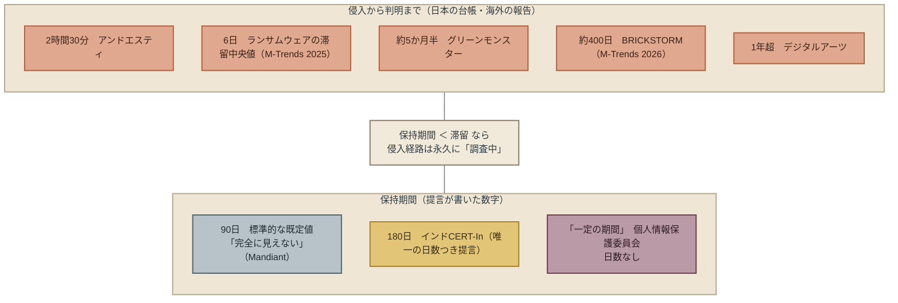

## 世界の提言での位置

第6章の集計では、攻撃の予期と検知（K3）は副分類を含めて37件で、9種類の中で4番目に多い。 
薄くはない。 
第4章では、ログの保持と監視は、政府機関・標準団体・セキュリティ企業・保険会社・個人の5種類以上が同じ方向を向く合意の提言（合意④）に入っている。

厚い提言の中に、本章が見る空白がある。 
37件のほぼすべてが、「何を」「どう」検知するかを書く。 
製品（EDR、SIEM、MDR）と手法（ログの相関分析、脅威情報との突合）の提言である。 
「何日残すか」を数字で書いたものが1件、「誰が決め、誰がいつ見て、誰に上げるか」を書いたものは、個人情報保護委員会の「ルールがなかった」という原因の記述を除いて、ない。

この偏りは、第7章で見たものと同じ構造を持つ。 
検知の製品とサービスには市場があり、提言の発行元のうちセキュリティ企業と保険会社はその売り手である。 
At-Bayは2026年4月の報告で「完全な暗号化を免れた企業は、EDRを24時間365日のMDR監視で補っていた企業だけだった」と書いたが、At-Bay自身がMDRを販売しており、MDR顧客の母数は開示していない。 
売り手が書く提言は、買うものの提言になる。 
保持期間を決めることと、点検の担当を置くことは、買うものではない。 
だから提言が薄い。

本書が「気づく」を第3部の2番目に置くのは、提言が最も厚い領域の中に、会社の意思だけで決められるのに誰も提言していない変数があるからである。

---

## 反論と限界

**反論1：ログの保持にはコストがかかる。** 
そのとおりである。 
保持期間を90日から180日に延ばせば、保管の容量はおよそ2倍になる。 
ただし、本章が求めるのは「延ばせ」ではなく「決めろ」である。 
90日と決めた会社は、90日より前の侵入経路を確かめないと決めた会社である。 
その判断を経営が自覚して行ったなら、本章の提言は満たされている。 
コストを理由に短くすることと、コストを考えずに既定値のまま置くことは、違う。

**反論2：ログ自体が個人データである。** 
そのとおりである。 
アクセスログには誰がいつ何を見たかが記録され、それは個人データになりうる。 
第7章の「持たない」と、本章の「残す」は、この点で衝突するように見える。 
衝突ではない。 
第7章が求めたのは、持つデータを「比べずに持つ」のではなく「比べて決める」ことだった。 
ログも同じである。 
保持期間を決め、根拠を第7章の表（保有データ一覧）に書き、期間が来たら消す。 
決めて持つログは、第7章の原則の内側にある。

**反論3：ログがあっても、見る人がいなければ気づけない。** 
これは最も重い反論である。 
At-Bayの「EDRだけでは不十分、監視が要る」という指摘は、売り手の数字であることを割り引いても、構造としては正しい。 
ログは記録であり、記録は読まれなければ記録にすぎない。 
本章の提言に「点検周期」が入っているのは、このためである。 
誰が、何日ごとに、何を見るかを決めなければ、保持期間だけ決めても、気づく時間は縮まらない。 
ただし、見る人がいない会社でも、ログが残っていれば、事後に何が起きたかは確かめられる。 
本章が2つの意味のうち2番目に重心を置いた理由は、ここにもある。

**反論4：ログは止まる。** 
Mandiant Consultingは、調査でVPNのログが必要になったとき、ログを集める仕組み（SIEM）への接続が数か月前に切れていた事例を挙げ、「ログの健全性をバイタルサイン（生命徴候）として扱え」と書いた。 
保持期間を決めても、ログが出ていなければ意味がない。 
本章の実装（本章「日本企業の実装」の道具4）は、この反論への対応である。

**反論5：気づいても、止める権限がなければ止まらない。** 
そのとおりである。 
2時間30分で検知したアンドエスティは、同日中に遮断し、翌日に公表した。 
検知の速さが被害を止めたのは、検知した人が止める判断をできたからである。 
気づいた後に誰が止めるかは、本章の範囲を超える。 
第10章で扱う。

---

## 日本企業の実装

### 道具1：4種類のログの保持期間を、取締役会が決裁する

個人情報保護委員会の別紙が挙げた4種類、認証ログ、アクセスログ、操作ログ、通信ログについて、それぞれの保持期間を数字で決め、決裁する。

| ログの種類 | 何が分かるか | 現在の保持期間 | 決裁する保持期間 | 根拠 |
|---|---|---|---|---|
| 認証ログ | 誰がいつログインしたか、失敗したか | （既定値） | | |
| アクセスログ | 誰がどのデータを見たか | | | |
| 操作ログ | 誰が何を変更・取得したか | | | |
| 通信ログ | どこと通信したか | | | |

「現在の保持期間」の列を埋める作業が、最初の一歩になる。 
多くの会社で、この列は空欄か、「不明」になる。 
それ自体が取締役会への報告事項である。

本書は、何日が正しいかを書かない。 
書くのは、2つの数字である。 
Mandiantが「完全に見えない」と書いた90日と、インドが法令で定めた180日。 
自社の数字をこの2つの間に置かないなら、その理由を経営が答える。 
400日の滞留が観測され、日本の台帳で5か月半と1年超の滞留が公表された年に、90日のまま置く判断は、ありうる。 
ただし、それは「知らないと決めた」判断である。

### 道具2：点検周期と担当を決め、取締役会に報告する

保持期間と対になる数字が、点検周期である。 
何日ごとに、誰が、どのログを見て、異常があれば誰に上げるか。 
IPAの「直近1か月、その後3か月」は、事案が起きた後にさかのぼる範囲だが、平時の点検周期の目安にもなる。

報告の形は、第7章の保有データ一覧と同じで、「何をしたか」ではなく「何を見たか」である。 
「今期、認証ログを週1回点検し、異常候補が3件、うち誤検知3件」という報告は、取締役が読める。

### 道具3：委託先・SaaSごとの保持期間を、契約で確認する

IPAは「サービス単位でログの保有期間はそれぞれ異なる」と書いた。 
自社のサーバーのログを180日残しても、使っているSaaSが30日しか残していなければ、そのSaaS経由の侵入は30日で見えなくなる。 
第5章・第6章で見た委託先の連鎖は、委託先のログを委託元が見られないことで、原因の特定が遅れた構造でもある。

国家サイバー統括室が委託先に「ログ管理の実施を求める」と書いたことを根拠に、委託契約とSaaSの利用規約で、ログの保持期間と、事案発生時に委託元がログを受け取れるかを確認する。 
第7章の道具3（委託契約に項目を列挙する）と同じ契約の中に、この項目を置く。

### 道具4：ログが出ていることを、監視する

Mandiant Consultingの「バイタルサイン」の提言を、そのまま採る。 
ログの収集が止まっていないかを、人の目ではなく自動の報告で確かめる。 
月に1回、「4種類のログがそれぞれ何件収集されたか」を数字で報告させる。 
0件の月があれば、その月の侵入は確かめられない。

### 4つの道具に共通すること

どれも、検知の製品を買う前に決められる。 
どれも、数字で書ける。 
どれも、取締役会の資料になる。 
本章が「経営が決める」と書いたのは、経営がログを読むからではない。 
何日前まで知りたいか、何日ごとに見るか、誰が見るかは、会社がどこまで知ることを引き受けるかの表明であり、それは経営の判断だからである。

---

## この章が断定しないこと

- **何日が正しいか、を断定しない。** 90日（Mandiantが「見えない」と書いた数字）、180日（インドの法令）、400日（観測された滞留）、6日（ランサムウェアの滞留中央値）を並べ、自社で決める変数として示した。
- **日本の公表文が侵入日を書けない理由を、ログの不在と断定しない。** 公表文は理由を書いていない。本書は、侵入時点までの記録がなければ侵入日は書けない、という構造を書いた。
- **ログを残せば検知が速くなる、とは書かない。** 残したログが読まれなければ、検知の時間は変わらない。残したログで変わるのは、事後に何が起きたかを確かめられるかどうかである。
- **At-Bayの「MDR監視のある企業だけが暗号化を免れた」を、効果の証拠として使わない。** 売り手の数字であり、母数が開示されていない。構造の指摘にだけ使った。

---

## 次の章へ

持たないことで、漏れうる最大値が決まる。 
気づくことで、最大値の内側のどこに実際の漏えいが収まるかが分かる。 
残るのは、分かったことを、誰に、いつ、どう伝えるかである。

公表文の数字は、その答えである。 
日本の漏えい公表文71通のうち18通は、「最大」「保有全件」と書いて、確かめる前に知らせた。 
24通は、記録で範囲を絞ってから知らせた。 
どちらを選ぶかを決めた法律はない。 
次章は、会社が自分の意思で決められる3つ目のこと、「どう伝えるか」を、何件の本人に知らせるかという決定として扱う。

 

---

### 参考文献

1. インド CERT-In「Directions under sub-section (6) of section 70B of the IT Act, 2000（2026年10月30日に原文を開いて確認。台帳H-004をT3からT1に改める）」（2022-04-28） https://www.cert-in.org.in/PDF/CERT-In_Directions_70B_28.04.2022.pdf
2. Mandiant（Google Cloud）「Announcing M-Trends 2026: Data, Insights, and Strategies from the Frontlines」（2026-03-23） https://security.googlecloudcommunity.com/google-threat-intelligence-3/announcing-m-trends-2026-data-insights-and-strategies-from-the-frontlines-7123
3. Mandiant Consulting（Ryan Fried, José Toledo）「5 critical gaps in incident response planning and how to fix them」（2026-01-24） https://cloud.google.com/transform/5-critical-gaps-incident-response-planning-and-how-to-fix-them
4. IPA「不正アクセスによる漏えい等の事案を踏まえ、速やかに実施すべき対策等について」（2026-10-09） https://www.ipa.go.jp/security/security-alert/2026/alert20261009.html
5. IPA「ランサムウェア被害組織へのインタビューから得た教訓」（2026-09-08（10-16更新）） https://www.ipa.go.jp/security/todokede/crack-virus/ransomware_lessons_learned.html
6. 個人情報保護委員会「不正アクセスによる個人データ漏えい防止のための注意喚起（事例3）および別紙」（2026-10-07改訂） https://www.ppc.go.jp/files/pdf/261007_warning.pdf
7. 内閣官房国家サイバー統括室「不正アクセスによる漏えい等の事案を踏まえた対応について」（2026-10-09） https://www.cyber.go.jp/pdf/press/taiou.pdf
8. At-Bay「2026 InsurSec Report（プレスリリース）」（2026-04-22） https://www.at-bay.com/press_releases/2026-insursec-report-ransomware-vpn-sonicwall-attacks/
9. piyokango「piyolog」（2026-10-11） https://piyolog.hatenadiary.jp/entry/2026/10/11/004353
10. 著者「The Japan Breach Registry 2026 第3版（第2章「時間の構造」）」（2026-10-26） https://github.com/Leading-AI-IO/the-japan-breach-registry-2026

**台帳の更新。** 
インドCERT-Inの指令（`data/proposals.csv` H-004）は、第1版の作成時点では検索結果の断片によるT3だったが、2026年10月30日に原文PDFを開いて確認したため、T1に改める。 
提言文は要約から原文に差し替える。

 

---

# 第9章: 伝える ── 何件に知らせるかを、誰が決めているか

## この章の提言

**何件の本人に知らせるかは、法律ではなく会社が決めている。 
記録がなければ、速く・保有全件に知らせる以外の選択肢はない。 
記録があれば、速さと引き換えに範囲を絞れる。 
速さと範囲のどちらを先に取るかを、事故の前に経営が決めておく。**

第7章は、保有するデータの量が「漏れうる最大値」を決めると書いた。 
第8章は、記録がなければ、実際の漏えいがその最大値に張り付くと書いた。 
本章は、その最大値が、公表文の数字としてどう現れるかを見る。

公表文の数字は、会社が「何件の本人に知らせるか」を決めた結果である。 
姉妹書『The Japan Breach Registry 2026』第3版の71通を1通ずつ読むと、この決定は4つの形に分かれる。

| 形 | 通数 | 公表文の書き方 |
|---|---|---|
| A 上限で出した | 18 | 「最大」「○月○日時点の保有全件」「取得されたものとみなして対応」 |
| B 記録で絞った | 24 | 確認とおそれを分けて書いた。件数を確定した。全体のうち何件に何が含まれるかを示した |
| C 件数を書けない | 14 | 「記載なし」「調査中」「精査中」 |
| D 「可能性」と件数 | 15 | 「約○万件が漏えいした可能性」。その数字が上限なのか、絞った数なのかは、公表文から読めない |

この分類は著者の判断である。 
境界にある行は後述する。

本章が問うのは、AとBの違いがどこから来るか、そして、会社がAとBのどちらを選ぶかを、いつ決めているかである。

---

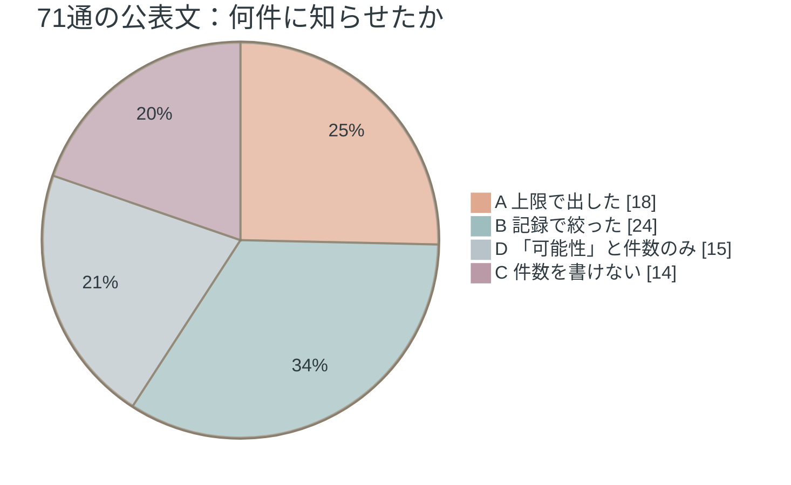

## なぜ、経営が事前に決めるのか ── 三つの理由

### 理由1：上限で出した数字は、後から動く。上にも、下にも

Aの18通のうち、続報で数字が動いた例を並べる。

| 組織 | 初報 | 続報 | 日数 | 方向 |
|---|---|---|---|---|
| GMOリサーチ＆AI | 「最大94万8,498件」（10月5日時点の保有全件） | 「89万4,082件」に確定。「外部に持ち出されていなかったもの」4万5,348件 | 9日 | 下 |
| クリプトン・フューチャー・メディア | 「最大約42万件」 | 会員登録情報「362,137件」ほか | 3日 | 下 |
| JR東日本 | えきねっと「約167万件」、大人の休日倶楽部「約39万件」（いずれも最大） | 委託先から「漏えいがなかったと判断したとの報告」 | 6日 | ゼロ |
| ビューカード | 「約403万件」 | 同上 | 6日 | ゼロ |
| JR九州 | 「約130万件」（最大） | 同上「漏えいの事実は確認されませんでした」 | 6日 | ゼロ |
| Helpfeel（Gyazo） | ユーザーに関するデータ「約2,362万件」 | 最終報告で、閲覧・取得が判明した画像は「432件」（「133名」が所有） | 35日 | 下 |
| チャーム | 「約23万件」 | 第3報で確認「約37万件」＋おそれ「約2万件」 | 19日 | 上 |

上にも下にも動く。 
この表が示すのは、上限で出した数字が間違いだということではない。 
上限で出すとは、「確かめる前に知らせる」と決めたということであり、その決定には、後で数字が動くという帰結がついてくる、ということである。

JR東日本・ビューカード・JR九州の3通は、同じ委託先（IDCフロンティア）の事案の連鎖で、合わせて約739万件の本人に「漏えいした可能性を否定できない」と知らせ、6日後に委託先が「漏えいなし」と判断した。 
3社の判断が誤りだったとは、本書は書かない。 
委託先の調査を待たずに知らせると決めた結果である。 
待てば、知らせる範囲はゼロだった。 
待たなければ、6日早かった。** 
この二つのどちらを取るかは、3社がそれぞれ決めたことであり、法律が決めたことではない。**

### 理由2：Bの会社は、記録があったから絞れた

Bの24通には、絞れた理由が書かれているものがある。

- トレジャー・ファクトリーは、不正アクセスの「同日アクセスログ調査で確認」し、対象「746,277件」のうち「氏名・住所を含むもの」は「11件」と、同じ公表文に書いた。
- イープラスは、不正アクセスの時刻を「2026-09-11 19:58〜09-12 2:44」と分単位で示し、件数「1,463件」の内訳を支払い方法別に書いた。
- リンツ＆シュプルングリージャパンは、「侵入時点の会員、退会済み除く」と、何を数えたかを書いた。
- Sansanは、確認「1325名」と可能性「8687名」を分けた。

逆に、Aの側には、絞れなかった理由を書いた公表文がある。

> 送信された通信の内容そのものを記録したログは存在しないため、外部へ送信されたデータの項目や件数を直接確認することはできず（Helpfeel 最終報告）

> 確認できる記録が限られている一部のデータについては、漏えいの有無を確認できないため、漏えいのおそれがあるものとして取り扱っております（チャーム 第4報）

第8章の主張が、公表文の中に書かれている。 
記録があれば絞れる。 
なければ、上限で知らせるほかない。** 
AかBかは、事故が起きてから選べるものではない。 
事故の前に、何を記録していたかで、選べる幅が決まっている。**

### 理由3：上限には、消していないデータが含まれている

Aの上限には、本来そこになくてもよかった本人が含まれている。

- GMOリサーチ＆AIの確定値との差分のうち「9,068件」は、「退会から2か月以上が経過し、プライバシーステートメントに基づき個人情報をすでに削除していた会員さまの記録」だった。持ち出されたが、個人情報を含まない。
- 大起水産の「174,933人」は、「登録者・退会者含む」。
- ブックオフグループホールディングスの第2報には、「退会会員212,371人」が含まれる（報道ベース）。
- チャームの第4報は、「退会済みのお客様に関する情報約2.5万件」を対象に加えた。

第7章の「持たない」が、ここで知らせる人数に直結する。 
退会した本人に知らせるのは、退会後もその本人のデータを持っていたからである。

---

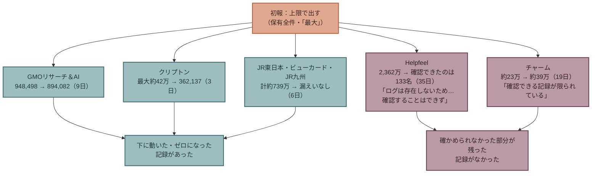

## 根拠 ── 制度は、範囲ではなく期限を決めている

### 日本の制度

個人情報保護委員会は、当局への報告の期限を書いている。

> 速報（新規）発覚日から、3〜5日以内
> 確報（続報）発覚日から、30日以内
> 不正な目的で行われたおそれがある場合は、発覚日から、60日以内

本人への通知は、報告対象事態では義務である。 
ただし時期は「状況に応じて速やかに」であり、内閣官房国家サイバー統括室の法令Q&Aは、事案がほとんど判明しておらず通知が混乱を招く場合は、その時点では通知しなくてもよいとする整理を示している。 
公衆への公表は、個人情報保護法ガイドライン（通則編3-5-2(5)）で「速やかに公表することが望ましい」である。 
義務ではない。

つまり、**当局への期限はあるが、本人に何件知らせるかの基準はない。** 
上限で知らせても、絞ってから知らせても、どちらも制度に違反しない。 
範囲は、会社が決める。

### 世界の制度

| 発行元 | 内容（原文） | 定めているもの | 階層 |
|---|---|---|---|
| 欧州データ保護会議（EDPB） | 「If only limited information is available, an initial notification should be performed within this timeframe」（情報が限られていても、この期限内に初報する） | 期限（72時間）。情報が足りなくても出す | T2 |
| EDPB | 「the organisation may delay informing affected individuals … if it could interfere with an investigation」（捜査の妨げになる場合は本人通知を遅らせうる） | 本人通知を遅らせてよい条件 | T2 |
| 英国 ICO | 「notify the ICO … within 72 hours」。「give specific and clear advice」（本人に具体的で明確な助言を） | 期限と、本人通知の内容 | T2 |
| フランス CNIL | 「une initiale, dans les 72h, puis une complémentaire」（初報を72時間以内、その後に補完） | 期限と二段構え | T2 |
| EU NIS2 前文102 | 「an early warning … within 24 hours」「an incident notification … within 72 hours」「A final report … not later than one month」 | 期限の三段構え | T2 |
| シンガポール PDPC | 本人通知に書く事項：「Specific facts on the data breach • Actions individuals can take • Organisation's contact details」 | 本人通知の内容 | T2 |
| 米国 SEC Form 8-K 第1.05項 | 「material aspects of the nature, scope, and timing of the incident」。重要性の判断後4営業日 | 投資家向け開示の内容と期限 | T1 |
| 日本 共有・公表ガイダンス | 「初報、第２報・・・のように、適切なタイミングに分けて、段階的に情報を開示していくという方法も有効です。」 | 二段構え | T2 |

世界の制度は、期限と、知らせる内容と、二段構えを定めている。 
第4章で見たとおり、二段構えは合意である。 
しかし、**初報で何件に知らせるか、上限で出すか絞るかを定めた制度は、本書が開いた範囲にない。** 
二段構えの制度は、初報を速く・広く出し、確報で絞ることを許している。 
許しているが、求めてはいない。 
選ぶのは会社である。

---

## 世界での位置 ── 合意された手順と、決められていない範囲

第4章の合意（二段公表）と第6章の空白（経路の公衆公表）の間に、もう1つ空白がある。 
本人通知の範囲である。

世界の提言は、通知の速さを求める。 
EDPBは情報が足りなくても72時間以内と書き、NIS2は24時間で早期警告を求める。 
速さの提言は厚い。 
しかし、速く出した初報の範囲が広すぎたとき、つまり、知らせた本人の多くが実際には影響を受けていなかったとき、何が起きるかを扱った提言は、本書の収集にない。 
JR東日本ら3社の約739万件は、その例である。

日本の提言には、範囲に触れたものが1つある。 
IPAは「『漏えいなし』の証明は困難」と書き、ログとバックアップの整合性を確保することを対策に挙げた（第8章）。 
これは範囲を絞るための前提を書いたものであり、範囲そのものの決め方ではない。

### 「経路非開示への処方」の宛先（第6章・第8章の訂正）

第6章「空白3 ── 日本の台帳の侵入経路と、提言の対応」と第8章「次の章へ」は、「経路非開示への処方」に分類した提言について、「ほぼすべてが当局への報告と本人通知の制度」と書いていた。 
本章を書く中で、台帳の行を1つずつ読み直した結果、この記述は不正確だと分かった。 
台帳の現行版でT1・T2の38行を宛先で分けると、当局・本人への報告・通知が22行、公衆への公表の内容・時期が8行（日本の共有・公表ガイダンスと法令Q&A6行、米国SEC2行）、ログ・調査・その他が8行である（著者の分類）。 
第6章と第8章の該当箇所は、この分類に合わせて改めた。

---

## 反論と限界

### 反論1：速く・広く知らせるほうが、本人のためになる

本人が早く知れば、パスワードを変え、不審な連絡に備えられる。 
本書はこれを否定しない。 
EDPBもICOも、情報が足りなくても期限内に出すことを求めている。

ただし、速さの利益は、知らせた本人が実際に影響を受けていたときに生じる。 
ビューカードが知らせた約403万件の本人は、6日後に「漏えいしていなかった」と判断された。 
この約403万人が受けた利益と、受けた負担を、本書は測れていない。 
測れていないから、速く・広くが正しいとも、誤りだとも書かない。** 
書くのは、この選択を、事故の最中に初めて行うか、事故の前に決めておくかの違いだけである。**

### 反論2：絞ってから知らせれば、遅れる

そのとおりである。 
クリプトン・フューチャー・メディアの3日、GMOリサーチ＆AIの9日は、絞るのにかかった時間である。 
ただし両社は、初報を上限で出し、続報で絞った。 
二段構えは、速さと範囲の両方を取る手順として使える。 
問題は、初報が上限であることを、初報に書くかどうかである。 
GMOリサーチ＆AIは「10月5日時点の保有全件」と書いた。 
書いた会社と書かなかった会社では、続報で数字が減ったときの読まれ方が違う。 
これは著者の判断であり、測定ではない。

### 反論3：Dの15通は、Aに入るのではないか

入る可能性がある。 
第一生命保険の「約12万名」は従業員約5万名と退職者約7万名の合計であり、人事システムの全件と読める。 
アンドエスティHDの「約250万件」は侵入から1日で公表されており、絞る時間はなかったはずである。 
しかし公表文は「最大」とも「全件」とも書いていないので、本書はDに置いた。** 
Dが15通あること自体が、本章の指摘の一部である。** 
数字が上限なのか絞った値なのかを、公表文が書いていない。

### 反論4：分類は著者の判断であり、別の分け方もある

そのとおりである。 
カプコンの「11,774,247件（全世界合計）」は件数を確定しているのでBに置いたが、アカウントの全件である可能性があり、Aとも読める。 
ホワイトエッセンスは「持ち出されていたことが判明」と書くが、対象は「8月5日時点で登録されていた」全員なのでAに置いた。 
Helpfeelは全件を初報で出し、最終報告で確認できた部分を示したので、A（初報）とB（最終報告）の両方の性格を持つ。 
本書は初報の形で分類した。 
分類の全行は付録B「第9章の分類 ── 通知の範囲（台帳71行、2026年10月30日）」に置く。

### 反論5：知らせる人数が多いことの損失を、本書は示していない

示していない。 
通知の実費、問い合わせ窓口の規模、信頼への影響を、台帳は記録していない。 
本書が示せるのは、知らせた人数と、後で動いた人数だけである。

---

## 日本企業の実装 ── 道具

### 道具1：速さと範囲の既定値を、事故の前に決めておく

事故の最中に初めて議論しないために、次のどちらかを既定値として決め、文書にしておく。

| 既定値 | 内容 | 前提 |
|---|---|---|
| 上限で速く | 発覚から○日以内に、保有全件を対象として初報。初報に「上限であること」「何を数えたか」「次回更新日」を書く | 記録の有無を問わない |
| 絞ってから | 記録で範囲を確定してから初報。確定できる見込みがない場合は、○日で上限に切り替える | 第8章の記録が、必要な期間残っていること |

どちらが正しいかを本書は書かない。 
決めていない会社は、事故の最中に、個人情報保護委員会の速報期限（3〜5日）に押されて決めることになる。

### 道具2：初報に、数字の種類を書く

初報の数字に、次の3つのどれかを必ず添える。

- 「上限」：○月○日時点の保有全件。実際の人数ではない。
- 「確認」：記録で確認した件数。
- 「確認」＋「おそれ」：両方を分けて書く（チャーム第3報、Sansanの形）。

GMOリサーチ＆AIの「10月5日時点の保有全件」、ブックオフグループホールディングスの「会員番号の件数であり、対象となる方の実際の人数ではありません」は、この書き方の例である。

### 道具3：絞れなかったときは、理由を書く

「確認できる記録が限られている」（チャーム）、「通信の内容を記録したログは存在しない」（Helpfeel）のように、絞れなかった理由を書く。 
理由を書くことは、第8章の記録の判断が、公表文で検証可能になることを意味する。 
本人にとっては、自分が「確認された」側か「確認できなかった」側かが分かる。

### 道具4：退会者・削除予定のデータを、上限から外せる状態にしておく

第7章の道具である保有データ一覧と保存期間の既定値が、ここで効く。 
退会後に消していれば、上限にその本人は含まれない。 
消していなければ、知らせる相手に含まれる。 
GMOリサーチ＆AIの9,068件は、削除済みだったから「個人情報を含まない」と分けられた。

---

## この章が断定しないこと

- **上限で速く知らせることが、誤りだとは書かない。** JR東日本ら3社の判断を、本書は評価しない。評価する材料（本人が受けた利益と負担）がない。
- **絞ってから知らせることが、正しいとも書かない。** 絞るのにかかる時間の間に本人が受ける不利益を、本書は測っていない。
- **Dの15通が上限だとは書かない。** 公表文が書いていない。
- **分類が唯一だとは書かない。** 境界の行を本章「反論と限界」に示した。
- **知らせる人数が多いことの損失額を書かない。** 台帳にない。
- **経路の公衆公表を求めない。** 本書が収めた範囲で、公衆への経路の公表を義務づけた制度は見つからなかった。公表するかどうかは、事故の前に決めておくことの1つである。

---

## 次の章へ

第3部は、会社が単独で決められる3つのことを見てきた。 
何を持つか（上限）、いつ気づくか（絞れるか）、どう伝えるか（速さと範囲）。 
3つは別々の決定ではなく、前の決定が次の決定の選択肢を決めている。 
持たなければ上限が下がり、記録があれば絞れ、絞れれば速さと範囲を選べる。

この3つは、事故の前に決めておけることである。 
第4部は、事故の最中に決めることを扱う。 
止めるか、止めないか。 
金融庁と日本銀行は、2026年5月22日の連名の要請「フロンティアAIによる脅威変化を踏まえた金融機関等の短期的な対応」の⑧で、「能動的に停止させざるを得ない場合についても経営トップはあらかじめ選択肢として検討しておくべきである」と書いた。 
次章は、この要請⑧を、金融以外の全業種に移す提言である。

 

---

### 参考文献

1. 著者「The Japan Breach Registry 2026 第3版（71行。本章の分類は `data/registry.csv` の規模・状態・補足の列に基づく）」（2026-10-26） https://github.com/Leading-AI-IO/the-japan-breach-registry-2026
2. GMOリサーチ＆AI「第1報・第2報」（2026-10-05、2026-10-14） https://gmo-research.ai/pressroom/notice/notice-20261014
3. クリプトン・フューチャー・メディア「SONICWIRE／D2R 不正アクセスのお知らせ」（2026-10-20（10-22更新）） https://www.crypton.co.jp/cfm/news/2026/10/20info
4. JR東日本「えきねっと・大人の休日倶楽部（10月15日更新）」（2026-10-09）※台帳027の一次URL
5. ビューカード「VIEW's NET（10月15日更新版）」（2026-10-09） https://www.jreast.co.jp/card/news/pdf/20261015.pdf
6. JR九州「JR九州Web会員（続報）」（2026-10-15） https://www.jrkyushu.co.jp/common/inc/news/newtopics/__icsFiles/afieldfile/2026/10/15/202691015_mail_address_access.pdf
7. Helpfeel「第三報・最終報告」（2026-10-21） https://corp.helpfeel.com/news/news-20261021
8. チャーム「第3報・第4報」（2026-09-01、2026-10-07） https://www.charm.co.jp/honten/info/notice/20260901.html 、 https://www.charm.co.jp/honten/info/notice/20261007.html
9. トレジャー・ファクトリー「お知らせ」（2026-10-23）※台帳068の一次URL
10. 個人情報保護委員会「漏えい等の対応とお役立ち資料（2026年10月30日に原文ページで確認）」（日付未確認） https://www.ppc.go.jp/personalinfo/legal/leakAction/
11. 内閣官房国家サイバー統括室「法令Q&A（ガイドライン通則編3-5-2(5)の引用。2026年10月30日に確認）」 https://security-portal.cyber.go.jp/guidance/law-handbook/v2-03.html
12. 共有・公表ガイダンス検討会（事務局：警察庁・総務省・経済産業省・内閣サイバーセキュリティセンター・JPCERT/CC）「サイバーインシデントに関する情報共有の促進及び公表に関するガイダンス」（2023-03-08） https://www.soumu.go.jp/main_content/000867112.pdf
13. 欧州データ保護会議（EDPB）「Guidelines at a glance: data breaches」（2026-10） https://www.edpb.europa.eu/system/files/2026-10/edpb_guidelines-at-a-glance_data_breaches_en_1.pdf
14. 英国 ICO「Personal data breaches: a guide」（現行） https://ico.org.uk/for-organisations/report-a-breach/personal-data-breach/personal-data-breaches-a-guide/
15. フランス CNIL「Sécurité : gérer les incidents et les violations」（現行） https://www.cnil.fr/fr/securite-gerer-les-incidents-et-les-violations
16. EU「Directive (EU) 2022/2555（NIS2）前文102（EUR-Lexで確認）」（2022-12-14） https://eur-lex.europa.eu/legal-content/EN/TXT/HTML/?uri=CELEX:32022L2555
17. シンガポール PDPC「データ侵害の管理ガイド」 https://www.pdpc.gov.sg/-/media/files/pdpc/pdf-files/other-guides/data-breach-management/
18. 米国 SEC「Form 8-K 第1.05項（2026年10月30日に確認）」 https://www.sec.gov/files/form8-k.pdf
19. 金融庁・日本銀行「フロンティアAIによる脅威変化を踏まえた金融機関等の短期的な対応（要請⑧）」（2026-05-22） https://www.fsa.go.jp/news/r7/sonota/20260522-5/01.pdf

**確認の経緯。** 
台帳の続報（GMOリサーチ＆AI第2報、クリプトン10月22日更新、IDCフロンティア連鎖3社の10月15日更新、Helpfeel最終報告、チャーム第4報）は、姉妹書の第3版（2026年10月26日）の追記時に著者が一次資料を開いたものである。 
ブックオフグループホールディングスの第2報は著者が到達できず、報道ベースの値であることを本文に明記した。 
NIS2は前文102のみEUR-Lexで確認し、第23条本文は本章では使っていない。

 

---

# 第4部　会社の中で通す

---

# 第10章: 能動的に止める判断 ── 誰が、いつ、決めているか

## 第4部の読み方

第3部は、会社が事故の前に、単独で決めておける3つのことを扱った。 
第4部は、事故の前に決めたことが、事故の最中と後にどう使われるかを扱う。 
決めたことは、会社の中の3つの場所を通る。 
事故の最中に止める判断（本章）、委託先との契約（第11章）、保険・稟議・取締役会（第12章）である。 
第4部で新しい決定は増えない。 
第3部の3つが、この3つの場所で通る形になっているかを見る。

第4部も著者の主張である。 
ただし第3部と違い、本章の提言は著者が考えたものではない。 
日本の金融当局が、金融機関に向けて書いたものである。 
本章がすることは、その提言を原文で読み、世界の提言の中に置き、金融以外の会社に移せるかを検討することである。

## この章の命題

**「サイバー攻撃のリスクが高まった場合に、自分のサービスを能動的に止める判断基準と手順を、経営トップが事故の前に持っておく」。 
これは金融庁と日本銀行が2026年5月に金融機関に要請した、本書の収集の範囲で日本にしかない提言であり、金融以外の全業種に移せる。**

---

## 要請⑧とは何か ── 原文

2026年5月22日、金融庁と日本銀行は連名で「フロンティアAIによる脅威変化を踏まえた金融機関等の短期的な対応」を関係事業者に要請した。 
背景には「従来は発見が困難であった脆弱性が短期間に大量に発見され得る」「脆弱性の発見から攻撃に至るまでの期間が大幅に短縮され得る」という認識がある。 
第1章で見た速度の非対称が、公的文書の前提に置かれている。

要請は8項目で、第2章と第5章で①〜⑦を扱った。 
本章が扱う⑧「優先サービス／ITシステムの停止に備える」は、4つの文からなる。

> 各種対策を徹底してもサイバー攻撃を防御できない可能性を前提に、サイバー攻撃によりITシステムが停止する場合を想定するとともに、②で特定した優先的に対応すべきサービス／ITシステムを能動的に停止させざるを得ない場合についても経営トップはあらかじめ選択肢として検討しておくべきである。

> こうした事態に備えて、事業継続計画（BCP）の有効性や、顧客等ステークホルダへの対応手順の十分性、緊急時の連絡体制等を点検するとともに、サイバー攻撃のリスクが高まった場合の能動的なサービス／ITシステム停止の判断基準及び手順についても自組織内で明確にしておくことが重要である。

> また、⑥のとおりテスト実施内容を縮小してパッチ適用に要する期間を短縮する等した場合に、テスト不足等によるITシステム障害の発生頻度が増加し得ることについても経営トップは認識しておくべきである。

> 更には、自組織が開発し維持保守するITシステムに限らず、サードパーティが提供するソフトウェアやサービスにおいて深刻な脆弱性が発見された場合、当該ソフトウェアの利用停止やサービス停止が生じ得ることにも備えておくべきである。

4つの文は、4つの別のことを言っている。

| 文 | 言っていること | 止める主体 |
|---|---|---|
| 第1文 | 防御できない可能性を前提に、**自分で止める**ことを経営トップが選択肢として持つ | 自社（能動的） |
| 第2文 | **止める判断基準と手順**を、リスクが高まった時点で使えるように事前に明確にする | 自社（能動的） |
| 第3文 | パッチを急げば、**パッチが止める**事故が増えることを経営トップが認識する | パッチ（受動的） |
| 第4文 | **サードパーティが止める**、または止めさせる場合に備える | 他社（受動的） |

本章が主題にするのは、第1文と第2文である。 
攻撃者に止められるのでも、パッチに止められるのでもなく、会社が自分の判断で止める。 
その判断を、事故の最中ではなく、「リスクが高まった場合」の基準として事前に持つ。

なお、要請の全体は「あくまでも応急的措置であり、中長期的には脆弱性対応の自動化等への移行に取り組むことが必要である」と自ら書いている。 
⑧も応急的措置の1つである。 
本章は、その位置づけを変えない。

---

## 世界の提言との違い ── 「止める」は多いが、「決める」はない

「止める」「隔離する」「遮断する」に触れた提言を、台帳から集めた。

| 発行元 | 提言（原文） | 止める時点 | 止める主体 | 階層 |
|---|---|---|---|---|
| シンガポール個人データ保護委員会（PDPC） | 「Act swiftly to contain the breach」（速やかに侵害を封じ込める） | 侵害が起きた後 | 現場 | T2 |
| 豪州情報コミッショナー事務局（OAIC） | 「contain, assess, notify and review」（封じ込め、評価、通知、レビュー） | 侵害が起きた後 | 現場 | T2 |
| Google Cloud（ランサムウェア対応ガイド） | 「Quarantining infected systems.」（感染したシステムを隔離する） | 感染が分かった後 | 現場 | T2 |
| Palo Alto Networks Unit 42 | 「detect and contain threats at machine speed」（機械の速度で脅威を検知し封じ込める） | 検知と同時 | 自動 | T1 |
| 個人情報保護委員会（日本） | 「被害を最小化する仕組み（ネットワークの遮断等）」 | 侵害時 | 仕組み | T2 |
| Coalition Security Labs | 「putting the system behind a firewall or disabling affected services」（パッチがないときは、システムをファイアウォールの背後に置くか、影響を受ける機能を無効にする） | パッチが出る前 | 技術部門 | T1 |
| 米国CISA BOD 26-04（Qualysの解説経由） | 「remediation as any action that eliminates the vulnerability, including asset isolation, mitigation, or uninstall」（資産の隔離・緩和・アンインストールを含むあらゆる措置を修正と定義） | パッチが出る前 | 技術部門 | T2 |
| JPCERT/CC（日本） | 「業務上必要のないサービスや機能（管理機能など）がインターネットに公開されている場合、公開を停止する」 | 平時 | 技術部門 | T2 |
| **金融庁・日本銀行 要請⑧** | 「能動的なサービス／ITシステム停止の判断基準及び手順についても自組織内で明確にしておく」 | **リスクが高まった時点（攻撃の前）** | **経営トップ** | **T1** |

9行を並べると、2つの軸で金融庁・日本銀行の要請だけが別の場所にある。

**第一に、止める時点。** 
他の8行は、侵害が起きた後に封じ込める（PDPC、OAIC、Google Cloud、Unit 42、個人情報保護委員会）か、パッチが出る前に技術的に無効化する（Coalition、BOD 26-04）か、平時に不要なものを閉じる（JPCERT/CC）かである。 
要請⑧だけが、「サイバー攻撃のリスクが高まった場合」、つまり攻撃を受けたと分かる前の時点で、使っているサービスそのものを止める判断を置いている。

**第二に、止める主体。** 
他の8行は、現場、技術部門、または自動化された仕組みが止める。 
要請⑧だけが、「経営トップ」を主体に名指しし、判断基準と手順を「自組織内で明確にしておく」ことを求めている。

封じ込めの提言が多いことは、本章の命題を否定しない。 
封じ込めは、侵害が起きた後に、技術部門が行う。 
要請⑧は、その前の時点で、経営が行う。 
2つは別の決定である。

本書の収集の範囲で、事前に経営が止める基準を持つことを求めた提言は、この1件である。 
この判断は、台帳263行（T1・T2は211行）を著者が読んだ範囲に基づく。 
見つかれば更新する。

---

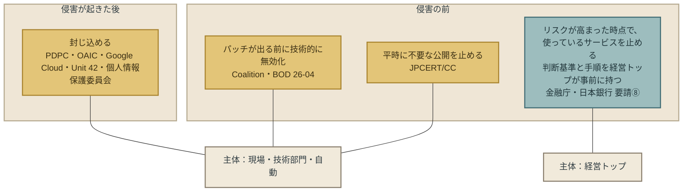

## 日本の台帳 ── 止めた会社の時間

姉妹書の漏えい台帳71行には、サービスやシステムを止めた時刻を公表文に書いた会社がある。 
検知から停止までの時間が分かるものを並べる。

| 組織 | 検知・把握 | 停止・遮断 | 経過 |
|---|---|---|---|
| アンドエスティHD | 2026-10-22 10:00頃（サーバー隔離） | 同日17:00 遮断 | 7時間（隔離は検知と同時） |
| セイコーマート | 2026-09-28 17時過ぎ | 同日20時 接続停止 | 約3時間 |
| クリプトン・フューチャー・メディア | 2026-10-17 20時頃 | 同日23:39 サーバー停止 | 約3時間40分 |
| トレジャー・ファクトリー | 2026-10-20 未明〜朝（同日アクセスログ調査で確認） | 同日10:30 外部アクセス停止、11:05 申込フォーム停止 | 数時間 |
| ココナラ | 2026-10-08 2:05 検知、15:00頃 持ち出し形跡確認 | 15:44 遮断、21:27 脆弱性修正 | 検知から約14時間、形跡確認から44分 |
| トラストバンク | 2026-10-19 異常把握 | 同日15:50 サービス停止 | 同日 |
| Helpfeel | 2026-09-11 夜 検知 | 9月12日未明までに遮断 | 数時間 |
| タイムズモビリティ | 2026-09-25 9:07 検知 | 9月26日7:25までに遮断 | 約22時間 |
| NTTソルマーレ | — | 2026-10-15 11:35 サービス停止。流出の確認は翌10月16日 | **停止が確認より先** |
| リンツ＆シュプルングリージャパン | 2026-10-19 委託先から報告 | 10月21日16:00 オンラインショップ停止 | 2日 |
| ホワイトエッセンス | 2026-08-05 不正アクセス確認 | 8月12日 システム一時停止 | 7日 |

この表から、3つのことが読める。

**第一に、多くの会社は数時間で止めている。** 
71行のうち、停止・遮断の時刻を書いた会社は、検知から数時間以内に止めたものが多い。 
止める判断は、速い。

**第二に、止めるのが確認より先の例がある。** 
NTTソルマーレは10月15日にサービスを止め、流出を確認したのは翌日である。 
止めてから確かめた。 
これは要請⑧の第2文「リスクが高まった場合」の判断に近い形である。

**第三に、誰が決めたかは、公表文のどこにも書かれていない。** 
71通のうち、停止の判断を誰が行ったか（経営か、情報システム部門か、委託先か）を書いた公表文は、本書が読んだ範囲でない。 
速く止めた会社で、経営トップが事前に基準を持っていたのか、現場がその場で判断したのかは、分からない。 
要請⑧が求めるのは後者ではなく前者である。

### 止めた後の時間

止めることには、止めている時間がついてくる。

- セイコーマートは、9月28日にアプリの接続を止め、10月15日の告知で「10月下旬の再開を予定」とした。約1か月である。同じ告知は「個人情報をアプリ・WEBサイト等から閲覧できない仕組みへ移行し」と書いた。止めている間に、第7章の「持たない」に近い設計変更を行っている。
- ローソンは、10月8日に予約機能を止め、10月19日に再開した。11日である。
- 物語コーポレーションは、10月20日に「計11の公式アプリ」を2027年上半期に刷新し「氏名、電話番号の個人情報は保持いたしません」と公表した。止めた後の再設計が、半年以上先に置かれている。

止める判断の基準には、止めている時間の売上と、再開の条件が含まれる。 
要請⑧の第2文が「事業継続計画（BCP）の有効性」「顧客等ステークホルダへの対応手順」を点検せよと書くのは、この時間のためである。

### サードパーティが止めた例

要請⑧の第4文、サードパーティの停止は、台帳に大きな例がある。

- IDCフロンティアは2026年10月7日3:40頃からランサムウェア攻撃で「495の企業や自治体」のサービスが止まった。JR東日本、ビューカード、JR九州は、自社のシステムは侵害されていないのに、委託先の停止と漏えいの可能性の連鎖で、合計約739万件の本人に知らせた（第9章）。
- NECの委託先が9月下旬に攻撃を受け、「サーバ内のファイルが暗号化されたことにより、各種システムが利用できない状態」になった。大阪大学は、NECが契約に基づかず共有していたファイルから77,851人の情報が漏えいした。
- LIXILは2026年10月22日、PHPの脆弱性の公表を受けて「当社Webシステムの一時停止および緊急メンテナンス」を行い、「本件に関連した当社システムへの不正アクセスやお客様情報の漏えいは確認されておりません」と公表した。これは侵害の後ではなく、脆弱性の公表を受けて自社のサービスを止めた例である。台帳71行には、別件（委託先コミューン）で収載されている。

LIXILの10月22日の停止は、本書が読んだ範囲で、要請⑧第2文の「サイバー攻撃のリスクが高まった場合の能動的な…停止」に最も近い公表文である。 
誰が判断したかは書かれていない。

---

## 金融以外に移せるか

要請⑧は「各金融機関等」に宛てたものである。 
金融に固有の部分と、どの業種にも当てはまる部分を分ける。

| 要素 | 金融に固有か |
|---|---|
| 「インターネットバンキング等の重要業務を支える外部公開ITシステム」を最優先にする（要請②） | 固有。ただし「外部公開」「重要業務」は全業種に置き換えられる |
| 防御できない可能性を前提にする（第1文） | 固有ではない。第1章の速度の非対称は、業種を選ばない |
| 経営トップが止める選択肢を持つ（第1文） | 固有ではない |
| 判断基準と手順を事前に明確にする（第2文） | 固有ではない |
| BCP、顧客対応手順、連絡体制の点検（第2文） | 固有ではない |
| サードパーティの停止に備える（第4文） | 固有ではない。台帳の委託先連鎖は小売・鉄道・大学・自治体で起きている |

金融に固有なのは、どのサービスを優先するかの例だけである。 
止める判断の構造は、業種を選ばない。

台帳71行の業種は、小売、鉄道、出版、ゲーム、人材、通販、大学、自治体、中央官庁にわたる。 
金融は、第一生命保険（従業員情報）、大和証券（委託先経由）、岩井コスモ証券（委託先経由）、ビューカード（委託先経由）、野村證券（委託先経由）の5行で、うち4行は委託先の事案である。 
金融機関自身が止める判断を迫られた行は、台帳にはほとんどない。 
止める判断を迫られたのは、金融以外の会社である。 
要請は金融に向けて書かれたが、必要としているのは全業種である。

---

## 反論と限界

### 反論1：止めれば、売上が消える

そのとおりである。 
セイコーマートの約1か月、ローソンの11日は、サービスが使えなかった時間である。 
本書は、その損失額を知らない。

要請⑧は、止めよとは書いていない。 
止めざるを得ない場合を「あらかじめ選択肢として検討」し、「判断基準及び手順」を「明確にしておく」と書いている。 
基準を持つことと、止めることは別である。 
基準を持たない会社は、止めるべき時に止められないか、止めなくてよい時に止めるか、どちらかの判断を事故の最中に行う。

### 反論2：止める判断を経営に上げれば、遅くなる

本章「日本の台帳 ── 止めた会社の時間」の表が示すとおり、多くの会社は数時間で止めている。 
その速さは、現場が止めたから出た可能性がある。 
経営トップの決裁を待てば、数時間が数日になる、という反論は成り立つ。

要請⑧は、経営トップが事故の最中に判断せよとは書いていない。 
「あらかじめ」「判断基準及び手順を」明確にせよと書いている。 
基準が事前にあれば、現場は基準に従って止められる。 
経営が決めるのは基準であり、個別の停止ではない。 
これは第8章の「保持期間は経営が決め、点検は現場が行う」と同じ構造である。

### 反論3：止める基準は、業種とシステムで違う

そのとおりである。 
設計表の段階から、本書は「停止の具体的な閾値」を書かないと決めている。 
インターネットバンキングと、小売の会員アプリと、大学の研究支援サイトで、止める基準は違う。 
本書が書くのは、基準を持つことであり、基準の中身ではない。

### 反論4：止めることで、別の障害が起きる

要請⑧の第3文が、まさにこれを書いている。 
パッチを急げばテスト不足の障害が増える。 
止めれば、再開時の障害、データの整合性の問題、連携先への影響が起きうる。 
本書はこれを否定しない。 
基準に、止めた後の復旧の手順と、再開の条件が含まれる必要がある。

### 反論5：日本にしかない、は本書の収集の限界では

その可能性がある。 
本書の台帳は263行で、英語・日本語・一部のフランス語・韓国語の資料に基づく。 
各国の金融当局の監督指針や、業界団体の事業継続ガイドラインを網羅していない。 
「本書の収集の範囲で」と限定した理由はここにある。 
見つかれば、本章の命題は「日本にしかない」から「日本が先に書いた」または「日本も書いた」に変わる。 
命題の後半、全業種に移せる、は変わらない。

### 限界：誰が止めたかを、台帳は示せない

本章「日本の台帳 ── 止めた会社の時間」で書いたとおり、公表文は停止の判断主体を書いていない。 
要請⑧が実装されたかどうかを、公表文から確かめる方法はない。 
本章の命題の前半（要請の内容と位置）は原文で確認できるが、後半（移せる）は著者の判断である。

---

## 日本企業の実装 ── 道具

要請⑧の第2文を、金融以外の会社の言葉に置き換える。

### 道具1：止める対象の一覧

要請②の「優先的に対応すべきサービス／ITシステム」を、自社で特定する。 
列は、サービス名、外部公開か、止めたときに止まる業務、止めたときの1日あたりの影響（売上・顧客数）、止める技術的な方法、再開に要する時間。 
第7章の保有データ一覧と、同じ資料にまとめられる。

### 道具2：止める基準

「サイバー攻撃のリスクが高まった場合」を、自社の言葉で定義する。 
例として、使っているソフトウェアに深刻な脆弱性が公表され、パッチが○時間以内に当てられない場合（LIXILの10月22日の形）。 
委託先から侵害の報告を受けた場合（リンツの形）。 
自社で不正アクセスの痕跡を確認した場合（多くの会社の形）。 
それぞれについて、止めるか、止めないか、誰が決めるかを書く。

### 道具3：止める権限

基準に当たる事態が起きたとき、誰が止めてよいかを決める。 
経営トップの事前の決裁があれば、現場は基準に従って止められる。 
深夜・休日に経営の連絡がつかない場合に、誰が代わりに決めるかも書く。 
要請⑤が「夜間・休日等も含めて」とベンダー契約に求めたことを、自社の権限にも適用する。

### 道具4：止めた後の手順

顧客への説明の雛形（第9章の初報の骨格と同じ）、再開の条件、再開の判断者。 
セイコーマートの告知のように、再開の予定時期を顧客に示す。

### 道具5：サードパーティの停止への備え

委託先・SaaSごとに、そのサービスが止まったときに自社の何が止まるかを一覧にする。 
IDCフロンティアの連鎖で止まった495組織、NECの委託先の連鎖で漏えいした大阪大学は、自社のシステムが侵害されていない。 
第11章の委託先の契約と、同じ一覧で管理する。

道具1〜5は、要請⑧の文言を著者が分解したものであり、要請が様式として定めたものではない。

---

## この章が断定しないこと

- **止めよ、とは書かない。** 要請⑧も書いていない。書いているのは、基準と手順を事前に持つことである。
- **止める閾値を書かない。** 業種とシステムで異なる。
- **数時間で止めた会社が、事前の基準を持っていたとは書かない。** 公表文は判断主体を書いていない。
- **止めたことで被害が減ったとは書かない。** 止めなかった場合との比較はできない。
- **世界のどこにも同種の提言がないとは書かない。** 本書の収集の範囲での記述である。
- **要請⑧が金融機関で実装されたかを書かない。** 本書は金融機関の内部を見ていない。

---

## 次の章へ

要請⑧の第4文と、台帳の委託先連鎖は、同じことを指している。 
自社が止めていなくても、委託先が止まれば自社が止まり、委託先から漏れれば自社が知らせる。 
第4章で見たとおり、委託先管理は世界で合意された提言である。 
しかし日本の監督事例が示すのは、提言の手前にある現実、つまり契約そのものがない、責任の分界が曖昧である、という状態である。 
次章はそこを扱う。

 

---

### 参考文献

1. 金融庁・日本銀行（連名）「フロンティアAIによる脅威変化を踏まえた金融機関等の短期的な対応（要請①〜⑧。2026年10月30日に原文PDFを開き、⑧の4文を全文確認）」（2026-05-22） https://www.fsa.go.jp/news/r7/sonota/20260522-5/01.pdf
2. シンガポール個人データ保護委員会（PDPC）「Managing Data Breaches 2.0」（2019） https://www.pdpc.gov.sg/-/media/files/pdpc/pdf-files/other-guides/data-breach-management/
3. 豪州情報コミッショナー事務局（OAIC）「Data breach preparation and response」（2025-02更新） https://www.oaic.gov.au/privacy/notifiable-data-breaches/preventing-preparing-for-and-responding-to-data-breaches/
4. Google Cloud「Mitigating ransomware attacks」 https://docs.cloud.google.com/docs/security/mitigating-ransomware-attacks
5. Palo Alto Networks Unit 42「Global Incident Response Report 2026」（2026） https://start.paloaltonetworks.com/rs/531-OCS-018/images/Unit42-Global-Incident-Response-Report.pdf
6. 個人情報保護委員会「FAQ 1-10-7」（2025-07更新） https://www.ppc.go.jp/all_faq_index/faq1-q10-7/
7. Coalition Security Labs「Boundary Devices and Plugins Prompt Timely Remediation」（2026-03-19） https://www.coalitioninc.com/blog/security-labs/boundary-devices-and-plugins-prompt-timely-remediation
8. Qualys（CISA BOD 26-04の解説）「ブログ」（2026-07-09） https://blog.qualys.com/product-tech/2026/07/09/
9. JPCERT/CC「JPCERT-AT-2026-0030」（2026-10-08（10-23更新）） https://www.jpcert.or.jp/at/2026/at260030.html
10. セイコーマート「会員向けサービス再開予定のお知らせ」（2026-10-15） https://www.secoma.co.jp/images/top/20261015.pdf
11. LIXIL「当社Webシステムの一時停止および緊急メンテナンスについて」（2026-10-22） https://newsroom.lixil.com/ja/20261022_notice
12. 物語コーポレーション「「焼肉きんぐ」公式アプリにおける今後のセキュリティおよび個人情報保護強化策について」（2026-10-20） https://www.monogatari.co.jp/news/261020_news/
13. 著者「The Japan Breach Registry 2026 第3版（本章「日本の台帳 ── 止めた会社の時間」の時刻は各行の「侵入日・確認日」「補足」列から）」（2026-10-26） https://github.com/Leading-AI-IO/the-japan-breach-registry-2026

**確認の経緯。** 
要請⑧の4文は、2026年10月30日に原文PDFを開いて確認した。 
本章「世界の提言との違い ── 「止める」は多いが、「決める」はない」の表の他の8行は、台帳作成時に著者が開いた一次資料（T1）または要約から確認した資料（T2）に基づく。 
Google Cloud、Unit 42、OAICの行のURLは台帳の記録どおりで、本章の執筆時には再度開いていない。 
本章「日本の台帳 ── 止めた会社の時間」の時刻は、姉妹書の台帳が各社の公表文から転記したものである。

 

---

# 第11章: 委託先と「契約がない」現実 ── 決めたことは、契約のどこに書かれているか

## 第4部でのこの章の位置

第3部で決めた3つ（何を持つか、いつ気づくか、どう伝えるか）と、第10章の止める基準は、自社の中だけでは完結しない。 
データは委託先にもあり、記録は委託先のシステムに残り、知らせる起点は委託先からの報告であり、止まるのは委託先のサービスであることが多い。 
日本の台帳71行のうち16行は、侵入経路が委託先である。

決めたことを委託先にも届かせる手段は、契約しかない。 
本章は、その契約が、日本では「ある」と前提できないことを監督事例で確かめ、そのうえで、第7章から第10章の中身を契約のどこに書くかを示す。

## この章の命題

**委託先の管理は、世界で合意された提言である。 
しかし日本の監督当局が2026年に報告した事例は、提言の手前にある現実、つまり契約そのものがない、責任の所在が曖昧、委託先の取扱状況を把握していない、という状態を示している。 
契約がなければ、第3部で決めたことは委託先に届かない。 
契約に書くことは、第7章から第10章で決めた内容そのものである。**

---

## 日本の監督事例 ── 原文

個人情報保護委員会は、2026年9月2日の委員会で「令和8年度第1四半期における監視・監督権限の行使状況」を報告した。 
2026年4月から6月の、民間事業者98件、行政機関等43件、合計141件の指導・助言の内訳である。 
民間事業者の原因別の件数は、外部からの不正アクセス等の防止21件、アクセス者の識別と認証14件、**委託先の監督12件**、情報システムの使用に伴う漏えい等の防止3件である。

委託先の監督に関する事例の記述を、原文のまま引く。

> 事業者においては、ＶＰＮ機器等の脆弱性対応を含めた業務に伴い個人データの取扱いを委託先に委託していたところ、契約を締結しておらず、

> 事業者については、本件事業者に対する個人データの取扱いの委託に当たり契約を締結しておらず、本件事業者における個人データの取扱状況についての把握に問題がある等、委託先の監督が不十分であることが認められた。

> 事業者は、委託先との間で脆弱性対応に関する責任の所在を曖昧にしていたため、

> 委託元である事業者については、契約における安全管理措置に関する合意内容が不十分であり、

> 事業者は、委託業務を他の事業者に再委託する際に、ＶＰＮルータのポート開放を行った上、

同じ趣旨の記述（「契約を締結しておらず」「取扱状況についての把握に問題がある」）は、この資料の中で少なくとも4か所に繰り返される。 
1つの事例ではなく、型として現れている。

ここで注意すべきことがある。 
これは「委託先の管理が甘かった」事例ではない。** 
契約がない**事例である。 
管理の良し悪しを論じる前に、管理の根拠となる文書がなかった。 
世界の提言が「契約に要求事項を組み込め」と書くとき、契約があることは前提である。 
日本の監督事例は、その前提が成り立たない会社が、四半期に12件、指導の対象になっていることを示している。

資料自身が「計数は公表時点のもの」と注記しているので、本書もこの数字を確定値として扱わない。

---

## 世界の合意 ── 「契約に書け」は厚い

委託先に関する提言は、第5章で対立4として扱った。 
合意している部分を、宛先別に並べる。

### 委託元に向けた提言

| 発行元 | 提言（原文） | 階層 |
|---|---|---|
| NIST サイバーセキュリティフレームワーク 2.0 | 「Incorporate requirements into contracts.」（要求事項を契約に組み込む） | T1 |
| EU NIS2 第21条(2)(d) | 「supply chain security, including security-related aspects concerning the relationships between each entity and its direct suppliers or service providers」（直接の供給者・サービス提供者との関係に関わるセキュリティを含む） | T1 |
| 内閣官房国家サイバー統括室（2026-10-09） | 「委託先等の情報セキュリティ方針、管理体制や委託先等との役割分担・責任分界を確認する」「再委託先を含む管理状況を把握する」「契約締結時だけでなく、継続的に確認を行う」 | T2 |
| 同 | 「情報の取扱方法を明確に定める」「アクセス権管理やログ管理の実施を求める」「不正アクセスや漏えいが発生した場合の報告義務を規定する」 | T2 |
| 同 | 「委託先へ提供する個人情報や業務情報を必要最小限とする」「業務終了後の委託先でのデータ削除を徹底する」 | T2 |
| 同 | 「重要な取引先や委託先を洗い出す」「サプライチェーンを含めた情報資産の流れを可視化する」「定期的にリスク評価を実施する」 | T2 |
| Verizon 2026 DBIR | 「clear visibility into assets and third parties」（資産と第三者の明確な可視化）を基本の1つに挙げる | T1 |
| Palo Alto Networks Unit 42 | 「reduce exposure … third-party dependencies and integrations」（第三者依存と統合を含めて露出を減らす） | T1 |
| ニュージーランド NCSC | 「Review the vulnerability management policies of your software and system supply chains including whether and how AI is being used for finding vulnerabilities.」（供給網の脆弱性管理方針を、AIを脆弱性発見に使っているかを含めて確認する） | T1 |

### 委託先に向けた提言

| 発行元 | 提言（原文） | 階層 |
|---|---|---|
| シンガポール個人データ保護委員会 | 「report data breaches to the main organisation without undue delay (no later than 24 hours)」（受託者は24時間以内に委託元へ報告） | T2 |
| 欧州データ保護会議（EDPB） | 「they have an obligation to notify you in a prompt way」（処理者は管理者へ速やかに通知する義務を負う） | T2 |
| 英国 サイバーセキュリティ・レジリエンス法案 | 「requirements for data centres, RMSPs and RDSPs to inform customers of cyber breaches that have likely affected them」（データセンター、マネージドサービス事業者に、影響を受けた顧客への通知を義務づける） | T2 |

委託元に向けた提言は9行、委託先に向けた提言は3行で、どちらも「契約に書く」「通知する」の向きで一致している。 
第4章の基準（3種類以上の発行元が同じ向き）を満たす合意である。

合意の限界も、提言の側に書かれている。 
世界経済フォーラムの2026年の報告は、供給網の第2層・第3層が検証できないことを課題に挙げ、NIS2の解説（DLA Piper）は「NIS2 contains no further guidance on how the security of a supply chain is to be ensured」（供給網のセキュリティをどう確保するかについて、NIS2にはそれ以上の指針がない）と書く。 
契約に書け、までは合意があり、書いた後どう確かめるかは空白である。

---

## 日本の台帳 ── 委託先16行の構造

姉妹書の台帳71行のうち、侵入経路が委託先の16行を、起点となった委託先ごとにまとめる。

| 起点（委託先） | 連鎖した委託元（台帳の行） | 委託先の事象 | 委託元の公表 |
|---|---|---|---|
| IDCフロンティア（クラウド） | JR東日本、ビューカード、JR九州 | 2026-10-07 ランサムウェア | 10-09 |
| コミューン（コミュニティ基盤） | ウイングアーク1st、Sansan、LIXIL | 10-06 通知 | 10-08、10-09、10-09 |
| スカラコミュニケーションズ（FAQ基盤） | 大和証券 | 10-02〜03 不正アクセス、10-03 連絡 | 10-05 |
| ラクスライトクラウド（メール配信） | 東京都、セルズ | 10-21 緊急停止 | 10-23、10-23 |
| ユミルリンク（メール配信） | 野村證券 | 10-16 確認、10-22 持ち出し確認 | 10-23 |
| NEC | 大阪大学 | 9月下旬 攻撃 | 10-21 |
| Studio（Web制作基盤） | デジタル庁 | 10-16 報告 | 10-22 |
| 日本コロムビアグループ | 第一興商 | 10-01〜02 端末感染、10-05 報告 | 10-08 |
| トレードワークス（証券システム） | 岩井コスモ証券 | 10-14 不正アクセス | 10-16 |
| フューチャーショップ（EC基盤） | リンツ＆シュプルングリージャパン | 10-17〜18 侵入、10-19 報告 | 10-23 |
| 博報堂（事務局） | 国土交通省 | — | 10-20 |

この表から、3つのことが読める。

**第一に、1つの委託先から複数の委託元に連鎖している。** 
IDCフロンティアは3社、コミューンは3社、ラクスライトクラウドは2社（台帳が一次公表文を読めた委託元のみ。報道ではさらに多い）。 
委託元が「自社のシステムは侵害されていない」と書きながら本人に知らせる構造は、第9章の約739万件で見た。

**第二に、委託先からの報告を受けてから公表までは、2日から7日である。** 
Sansanは委託先の報告10月6日、速報受領10月7日、公表10月9日。 
大和証券は連絡10月3日、公表10月5日。 
リンツは報告10月19日、公表10月23日。 
野村證券は委託先の確認10月16日、持ち出し確認10月22日、公表10月23日。 
シンガポールの提言「24時間以内に委託元へ報告」が守られたかは、委託先側の時刻が公表文にないため分からない。

**第三に、契約の外で起きた例がある。** 
大阪大学の公表文は、「NECは本学との契約に基づかず、当該協力会社との情報共有のため、本学の個人情報を含むファイルをクラウドストレージ上で共有していたことが確認されました」と書いた。 
契約はあった。 
しかし、データは契約の外に置かれていた。 
本章「日本の監督事例 ── 原文」の監督事例が「契約がない」なら、これは「契約があっても、データが契約の範囲にない」例である。

### 委託元が決められなかったこと

16行の委託元は、第3部の3つを自分で決められなかった。

- **何を持つか。** 委託先に渡したデータの範囲は、委託時の判断で決まる。JR東日本の約206万件、ビューカードの約403万件は、メール配信のために委託先に置かれていたメールアドレスである。
- **いつ気づくか。** 気づいたのは委託先であり、委託元は報告を受けた。記録は委託先にある。第8章で「委託先・SaaSごとの保持期間を契約で確認する」と書いた理由がここにある。
- **どう伝えるか。** 委託元は、委託先の調査結果を待つか、待たずに上限で知らせるかを選んだ。IDCフロンティアの3社は待たず、6日後に「漏えいなし」の報告を受けた（第9章）。

委託元が決められるのは、契約に何を書くかだけである。

---

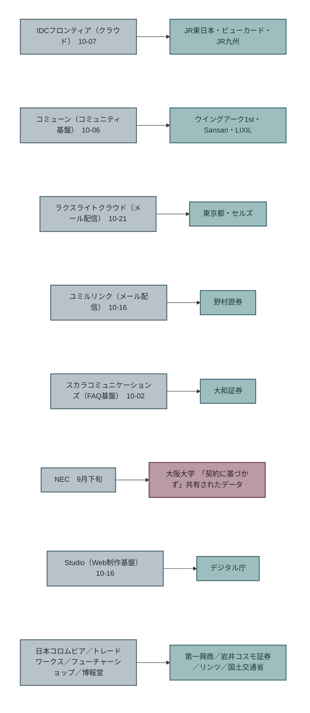

## 契約に書くこと ── 第7章から第10章の中身

本書は新しい契約条項を発明しない。 
第7章から第10章で決めた内容が、契約のどこに書かれるかを示す。

| 本書の章 | 決めたこと | 契約に書く項目 | 対応する提言 |
|---|---|---|---|
| 第7章 持たない | 渡すデータの項目と件数、保存期間の既定値、消去 | 委託先に渡すデータの項目を列挙する。業務終了後の消去と、消去の確認方法。再委託先への再提供の可否 | 国家サイバー統括室「必要最小限」「業務終了後の委託先でのデータ削除」 |
| 第8章 気づく | ログの保持期間と点検周期 | 委託先が保持するログの種類と期間。委託元が求めたときに提供する義務。ログの収集が止まったときの通知 | 同「アクセス権管理やログ管理の実施を求める」。IPA「サービス単位でログの保有期間はそれぞれ異なる」 |
| 第9章 伝える | 報告の速さと範囲 | 委託先が侵害を把握してから委託元へ報告するまでの時間（例：24時間）。報告に含める事項（確認済みの範囲と、おそれの範囲を分ける）。続報の期限 | PDPC「24時間以内」。EDPB「速やかに通知」。国家サイバー統括室「報告義務を規定する」 |
| 第10章 止める | 止める基準と手順 | 委託先がサービスを止める場合の事前通知。委託元の判断で委託先のサービスを止められる条件。再開の条件 | 金融庁・日本銀行 要請⑧第4文（サードパーティの停止に備える） |
| 第5章・本章 | 責任の所在 | 脆弱性対応の責任分界（誰がパッチを当て、誰が確認するか）。再委託の可否と、再委託先への同じ条件の適用 | 国家サイバー統括室「役割分担・責任分界を確認する」「再委託先を含む管理状況を把握する」。監督事例「責任の所在を曖昧にしていた」 |

この表の右列は、すべて日本の公的機関がすでに書いた提言である。 
本書が足したのは、左列、つまりその項目が第3部のどの決定に対応するか、だけである。

### 契約がない場合

本章「日本の監督事例 ── 原文」の監督事例が示すのは、この表を書く前の段階にある会社である。 
契約がない委託先に対して、本書が言えることは1つである。 
契約がないことは、委託先の管理が不十分であることとは別の、それより手前の問題であり、監督当局は2026年に指導の対象にしている。 
契約を結ぶことは、技術の判断ではなく、経営と法務の判断である。

---

## 反論と限界

### 反論1：契約に書いても、委託先が守るとは限らない

そのとおりである。 
大阪大学の例は、契約があっても、データが契約の外に置かれたことを示している。 
契約は、守られなかったときに責任の所在を示す文書であり、守らせる仕組みではない。 
守らせる仕組み（定期的な確認、監査）は、国家サイバー統括室の「契約締結時だけでなく、継続的に確認を行う」が書いている。 
本書は、確認の頻度や方法を書かない。

### 反論2：多段の下請けは、委託元が監督できない

世界経済フォーラムの報告が第2層・第3層の検証不能を挙げるとおり、本書も「委託元が多段下請けを完全に監督できる」とは書かない。 
設計の段階からそう決めている。 
本書が書くのは、直接の委託先との契約に、再委託先への同じ条件の適用を書くことまでである。 
それが第2層以下で守られているかを、委託元が確かめる方法を、本書は示せない。

### 反論3：中小の委託元は、大手の委託先に条件を書かせられない

そのとおりである。 
クラウド基盤やメール配信サービスは、委託元が契約条件を変えられない約款型のサービスであることが多い。 
IDCフロンティア、ラクスライトクラウド、ユミルリンク、Studioは、いずれもそうである。 
約款を変えられない場合に委託元ができるのは、第7章の判断、つまり、そのサービスに何を渡すか、である。 
約款に書かれたログの保持期間、報告の期限、停止の通知を読み、足りなければ渡すデータを減らす。 
契約を書けないなら、持たない。

### 反論4：契約の有無を、台帳は示せない

示せない。 
16行の公表文は、委託先との契約の有無も、契約の内容も書いていない。 
本章の本章「日本の監督事例 ── 原文」は監督事例から、本章「日本の台帳 ── 委託先16行の構造」は公表文から書いており、2つの資料は同じ会社を指していない。 
「台帳の16行の委託元に契約がなかった」とは、本書は書かない。

### 限界：監督事例の件数は確定値ではない

資料自身が注記するとおり、計数は公表時点のものである。 
「四半期に12件」は、年次報告で変わりうる。

---

## この章が断定しないこと

- **日本の委託先管理が世界より劣るとは書かない。** 他国の監督当局が同種の集計を公表しているかを、本書は確認していない。
- **台帳の16行の委託元に契約がなかったとは書かない。** 公表文に記載がない。
- **契約に書けば守られるとは書かない。** 大阪大学の例がある。
- **委託元が多段下請けを監督できるとは書かない。**
- **委託先からの報告が遅かったとは書かない。** 委託先側の把握時刻が公表文にない。
- **本章「契約に書くこと ── 第7章から第10章の中身」の表を、契約条項の雛形として書かない。** 項目の対応表であり、法務の確認を経た条文ではない。

---

## 次の章へ

第7章から第11章で、会社が決めることと、それを書く場所（取締役会資料、契約）を示した。 
残る問いは、それが会社の中で通るか、である。 
保有データの一覧を作り、ログの保持期間を延ばし、委託先との契約を結び直すには、予算と、決裁と、説明がいる。 
第12章は、この3つの提言が、稟議を通り、保険の引受条件に合い、取締役会の質問に答える形になっているかを見る。

 

---

### 参考文献

1. 個人情報保護委員会「令和8年度第1四半期における監視・監督権限の行使状況（資料3-1。2026年10月30日に原文PDFを開いて確認）」（2026-09-02） https://www.ppc.go.jp/files/pdf/260902_shiryou-3-1.pdf
2. 内閣官房国家サイバー統括室「不正アクセスによる漏えい等の事案を踏まえた対応について（2026年10月30日に原文PDFを開いて委託先管理の箇条書きを確認）」（2026-10-09） https://www.cyber.go.jp/pdf/press/taiou.pdf
3. NIST「Cybersecurity Framework 2.0 概要（SP 1299）」（2024） https://nvlpubs.nist.gov/nistpubs/SpecialPublications/NIST.SP.1299.pdf
4. EU／DLA Piper「NIS2 第21条(2)(d)、DLA Piper解説」（2025-12） https://www.dlapiper.com/en-us/insights/publications/2025/12/nis2-directive-explained-part-3-supply-chain-secu
5. Verizon「2026 Data Breach Investigations Report」（2026） https://www.verizon.com/business/resources/T343/reports/2026-dbir-data-breach-investigations-report.pdf
6. Palo Alto Networks Unit 42「Global Incident Response Report 2026」（2026） https://start.paloaltonetworks.com/rs/531-OCS-018/images/Unit42-Global-Incident-Response-Report.pdf
7. ニュージーランド NCSC「The implications of Frontier AI models for cyber defence」（日付未確認） https://www.ncsc.govt.nz/protect-your-organisation/the-implications-of-frontier-ai-models-for-cyber-defence/
8. World Economic Forum／Accenture「Global Cybersecurity Outlook 2026」（2026-01-12） https://www.weforum.org/publications/global-cybersecurity-outlook-2026/
9. シンガポール個人データ保護委員会「Managing Data Breaches 2.0」（2019） https://www.pdpc.gov.sg/-/media/files/pdpc/pdf-files/other-guides/data-breach-management/
10. 欧州データ保護会議（EDPB）「Guidelines at a glance: data breaches」（2026-10） https://www.edpb.europa.eu/system/files/2026-10/edpb_guidelines-at-a-glance_data_breaches_en_1.pdf
11. 英国 DSIT／DCMS「Cyber Security and Resilience Bill factsheet」（2025-11-12（2026-06-30更新）） https://www.gov.uk/government/publications/cyber-security-and-resilience-network-and-information-systems-bill-
12. IPA「不正アクセスによる漏えい等の事案を踏まえ、速やかに実施すべき対策等について」（2026-10-09） https://www.ipa.go.jp/security/security-alert/2026/alert20261009.html
13. 大阪大学「委託先NECに関する公表文」（2026-10-21）※台帳058の一次URL
14. 著者「The Japan Breach Registry 2026 第3版（委託先16行）」（2026-10-26） https://github.com/Leading-AI-IO/the-japan-breach-registry-2026

**確認の経緯。** 
個人情報保護委員会の資料3-1と国家サイバー統括室の文書は、2026年10月30日に原文PDFを開いて引用を確認した。 
NIS2第21条の原文は開いておらず、DLA Piperの解説経由である（台帳H-020の記録どおり）。 
本章「日本の台帳 ── 委託先16行の構造」の日付は、姉妹書の台帳が各社の公表文から転記したものである。

 

---

# 第12章: 保険・稟議・取締役会 ── 決めたことは、どこで通るか

## 第4部でのこの章の位置

第7章から第11章で、会社が決めることと、それを書く場所（取締役会資料、契約）を示した。 
本章は、それが会社の中で通るかを扱う。 
保有データの一覧を作る、ログの保持期間を延ばす、初報の既定値を決める、止める基準を決裁する、委託先と契約を結び直す。 
どれも、予算と、決裁と、説明がいる。

本章が見る場所は三つである。 
稟議（予算が通る場所）、保険（外から条件が来る場所）、取締役会（経営が問われる場所）。

## この章の命題

**第3部の三つの決定は、技術投資ではなく経営判断である。 
技術投資として稟議に上げると、「効果を示せ」で止まる。 
効果は、第3章で見たとおり、誰にも示せない。 
三つの決定が通るのは、効果ではなく、自社の数字（持っている件数、残している日数、知らせる範囲）を証拠にしたときである。 
保険会社が引受で見ている統制と、取締役会が問うべき質問は、すでにその数字の側にある。**

---

## 稟議 ── なぜ、止まるか

### 止まる理由は「効果を示せ」である

セキュリティの予算が稟議で止まる理由は、新規事業の予算が止まる理由と似ている。 
どちらも、起案する側が資料を速く作れるようになった一方で、審査する側が求める証拠は変わっていない。 
稟議は、説得力のある文章を書く競争ではなく、意思決定できる証拠を組み立てる競争である。

セキュリティの稟議で求められる証拠は、ふつう「この投資で、侵害の確率がどれだけ下がるか」である。 
第3章で見たとおり、この証拠は存在しない。 
効果測定ありの提言は211件中14件で、その14件も条件つきの相関である。 
保険ブローカーのMarsh McLennanは、自社の自己評価質問票と請求を突き合わせ、「simply deploying key cybersecurity controls is no longer enough」（主要な統制を導入するだけでは、もはや十分ではない）と書いた。 
Coalitionは「More security tools and increased spending isn't making businesses any safer.」（セキュリティ製品と支出を増やしても、企業は安全になっていない）と書いた。 
どちらも保険を売る側であり、売り手の立場を含む。 
しかし、効果を証拠として出せないことは、保険を売る側自身が書いている。

効果を証拠に求める稟議は、答えのない問いを立てている。 
だから止まる。

### 証拠を、効果から数字に変える

第7章の冒頭で、本書は三つの決定を選んだ基準を書いた。 
効くかどうかではなく、攻撃が成功しても意味を持ち、会社が単独で決められること。 
この基準は、稟議の証拠の形も変える。

| 決定 | 稟議で求められがちな証拠 | 本書が提示する証拠 |
|---|---|---|
| 持たない（第7章） | 消せば侵害が減る、という根拠 | 自社が持っている件数と、保有の根拠（法定保存期間、最終利用日）。消せる件数。台帳の「上限で出した18通」が、保有全件を知らせた事実 |
| 気づく（第8章） | ログを延ばせば検知が速くなる、という根拠 | 自社の各ログの現在の保持期間（多くは既定値のまま）。Mandiantの「90日では見えない」。台帳のHelpfeelとチャームが「記録がない」と公表文に書いた事実 |
| 伝える（第9章） | 初報を整えれば風評が減る、という根拠 | 自社が今日事故に遭ったとき、知らせる相手が何件になるか（＝持っている件数）。台帳の約739万件が6日後にゼロになった事実 |
| 止める（第10章） | 止めれば被害が減る、という根拠 | 止めたときに1日で止まる売上と顧客数。再開に要する時間。金融庁・日本銀行の要請⑧の原文 |
| 契約（第11章） | 契約を結べば委託先が守る、という根拠 | 委託先ごとの、契約の有無と、第11章の表の項目が書かれているか。監督事例「契約を締結しておらず」 |

右列に、効果はない。 
あるのは自社の現状の数字と、他社の公表文に書かれた事実だけである。 
この証拠は、集めればそろう。 
効果の証拠は、集めてもそろわない。

新規事業の企画が経営会議を通るときに起きていることは、経営戦略との整合性を論理で示したうえで、動くものを見せることである。 
セキュリティの稟議で「動くもの」に当たるのは、自社の保有データ一覧と、台帳の公表文である。 
試作品ではなく、自社の数字が、議論を「効くか」から「持っているか」に移す。

### 投資を小さく分ける

新規事業では、正式な審査の前に投資を小さく分け、段階ごとに判断基準を変えることで、審査を通しやすくする。 
三つの決定は、もともと小さく分かれている。 
保有データ一覧を作ることに、予算はほとんどいらない。 
保持期間を延ばすことの費用は、容量の費用で、見積もれる。 
初報の既定値を決めることは、文書を1つ作ることである。 
大きな投資は、三つを決めた後に、必要なら来る。

---

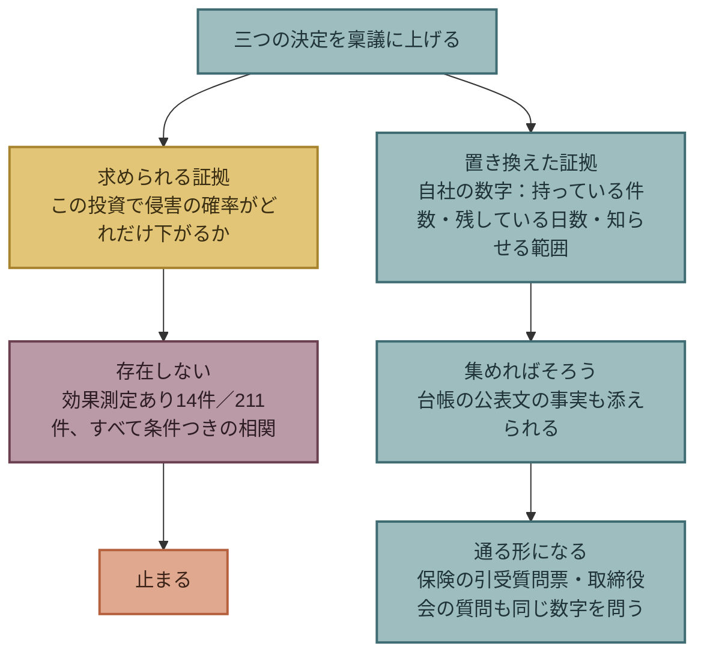

## 保険 ── 外から来る条件

### 保険会社は、何を見ているか

保険会社は、効果を測れない中で、引き受けるかどうかを決めなければならない。 
だから、統制と請求の関係を自社のデータで見ている。 
本書が確認できた範囲を並べる。

| 発行元 | 内容（原文） | データの基盤 | 階層 |
|---|---|---|---|
| Marsh McLennan（保険ブローカー、2025-08-27） | 侵害請求の確率を下げる統制の上位5つ：ネットワークの堅牢化、EDR、**ログと監視**、意識向上訓練とフィッシング試験、**インシデント対応計画**。机上演習を定期的に行う組織は「13% less likely to experience a material cyber event」。耐フィッシングMFAは通常のMFAより9%低い | 自社の自己評価質問票と請求の突合。組織数は未記載。相関 | T1 |
| At-Bay（2026-04-22） | 「The only businesses that avoided full ransomware encryption had their EDR backed by 24/7 monitoring via Managed Detection & Response (MDR)」 | 10万契約年超の請求データ。At-Bay自身がMDRを販売。母数は非開示 | T1 |
| Coalition（2026-03-05） | 2025年の請求の58%はビジネスメール詐欺と送金詐欺。「The sooner policyholders report suspicious activity, the more likely Coalition is to recover」（早く報告するほど回収できる可能性が高い） | 10万超の契約者（米・加・英・豪・独） | T1 |
| Coalition（2026-08-31） | 「Calling the claims hotline early can serve two purposes: Satisfy reporting requirements … Unlock pre-claim legal and forensics practitioners」（早期の連絡は、報告要件を満たし、法務・フォレンジックの支援を受けられる） | 自社商品の説明を含む | T1 |

Marshの上位5つのうち、「ログと監視」は第8章、「インシデント対応計画」は第9章・第10章に対応する。 
保険会社と保険ブローカーが請求データから拾った統制と、本書が「会社が単独で決められる」基準で選んだ決定は、一部が重なっている。 
これは本書の提言が効く証拠ではない。 
保険を売る側が、効果を問わずに、引受の条件として見ている項目と重なる、ということである。

### 日本で、保険が条件になっているか

本書は、日本のサイバー保険市場で、保険会社が引受条件として統制を求め、満たさない会社を選別しているかを確認していない。 
米国の保険会社の公表資料は、Active Insurance（Coalition）、InsurSec（At-Bay）のように、保険と統制を一体にする商品を売る立場から書かれている。 
日本で同じことが起きているかは、設計表の段階から「書かない」と決めている。

本章が保険を置く理由は、選別の有無ではない。 
保険の引受質問票は、会社が自社の統制を数字で答えなければならない、数少ない外からの機会だからである。 
質問票に答えるとき、会社は、ログを何日残しているか、対応計画があるか、委託先をどう管理しているかを、書く。 
答えられない項目が、第3部で決めていないことである。

---

## 取締役会 ── 問うべき質問

### 経営の責任は、提言の側で合意されている

経営が責任を持つことは、世界の提言で厚い。

| 発行元 | 内容（原文） | 階層 |
|---|---|---|
| NIST サイバーセキュリティフレームワーク 2.0（2024-02-26） | 「leadership is responsible and accountable for cybersecurity risk」（経営層がサイバーリスクに責任を負う）。統治（Govern）を新しい機能として追加 | T1 |
| 米国 SEC（2023-07-26） | 「disclose material cybersecurity incidents」（重要なサイバーインシデントを開示する）。年次報告でリスク管理と統治を記載 | T1 |
| 内閣官房国家サイバー統括室（2026-10-09） | 「サイバーセキュリティ対策を経営課題と位置づけ、必要な投資や人的体制整備を含む対策の強化をお願いいたします。」 | T2 |
| 金融庁・日本銀行（2026-05-22） | 「経営トップは全社的な経営課題として扱う必要がある」。要請⑧で経営トップが止める選択肢を持つ | T1 |

「経営課題と位置づけよ」は合意である。 
しかし、第6章の空白と同じ構造がここにもある。 
経営課題と位置づけた後、取締役会で何を問えばよいかは、提言が書いていない。

### 三つの決定を、質問の形にする

本書は、第7章から第11章の内容を、取締役会で問う質問に変える。 
答えは、すべて数字か、文書の有無で返る。

| 章 | 取締役会の質問 | 答えの形 |
|---|---|---|
| 第7章 | 当社は、個人のデータを何件持っているか。そのうち、法定保存期間を過ぎたものは何件か。最終利用から1年以上たったものは何件か | 件数 |
| 第7章 | 今日、全件が漏えいしたら、何人に知らせることになるか | 件数（上の答えと同じ） |
| 第8章 | 認証・アクセス・操作・通信の各ログは、現在何日残っているか。その日数は、誰が決めたか | 日数と、決裁者の名前（決めた人がいなければ「既定値」） |
| 第8章 | ログが出なくなったとき、何日以内に誰が気づくか | 日数と担当 |
| 第9章 | 今日事故が起きたら、初報は上限で出すのか、絞ってから出すのか。それは誰が決めたか | 既定値と決裁の記録 |
| 第10章 | 止めざるを得ない事態の基準は何か。深夜に誰が止める権限を持つか | 文書の有無と権限者 |
| 第11章 | 個人のデータを渡している委託先は何社か。そのうち、契約に第11章の表の項目が書かれているのは何社か | 社数 |

7つの質問のうち、効果を問う質問はない。 
どれも、答えられるか答えられないかが、その場で分かる。 
答えられない質問が、決めていないことである。

### 質問の順序

質問は、第7章から順に問う。 
持っている件数が分からなければ、知らせる範囲も決まらない。 
ログの日数が決まっていなければ、絞れるかどうかも分からない。 
第3部で見た連鎖（上限→絞れるか→速さと範囲）は、質問の順序でもある。

---

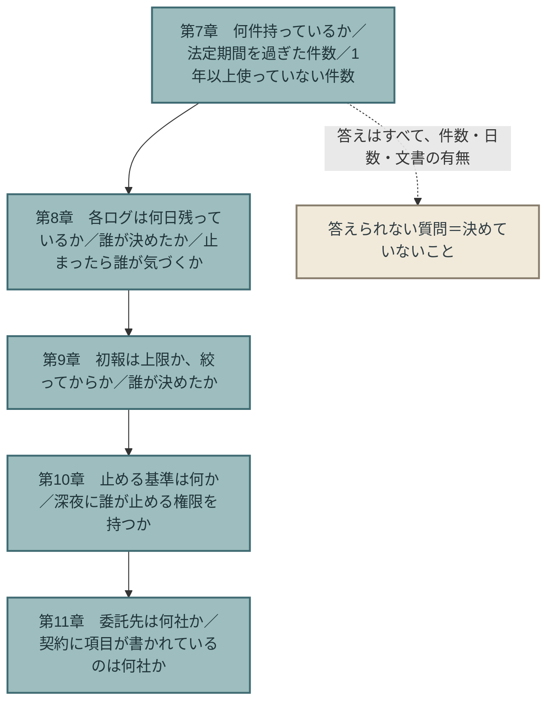

## 反論と限界

### 反論1：稟議が通っても、実行されるとは限らない

そのとおりである。 
本章は、通る形を示しただけで、実行を保証しない。 
実行されたかどうかは、本章「取締役会 ── 問うべき質問」の質問を次の取締役会でもう一度問えば分かる。 
答えの数字が変わっていなければ、実行されていない。

### 反論2：保険会社と保険ブローカーの数字は、売り手の数字である

そのとおりである。 
Marsh、At-Bay、Coalitionはいずれも、統制と保険を一体で売る立場にある。 
本書はそれを各行に明記した。 
本章が保険会社と保険ブローカーの数字を使う理由は、効果の証拠としてではなく、効果を測れない中で引受の判断を迫られている当事者が、何を見ているかの記録としてである。

### 反論3：取締役会の質問に答えられる会社は、すでに決めている会社である

そのとおりである。 
本章の質問は、決めている会社には不要で、決めていない会社には答えられない。 
答えられないことが分かること、それが本章の質問の目的である。 
答えが「分からない」で返った質問の数が、取締役会が次に扱う議題の数になる。

### 反論4：新規事業の稟議と、セキュリティの稟議は違う

違う点はある。 
新規事業は、投資の見返りが売上として測れる。 
セキュリティは、見返りが「起きなかった事故」で、測れない。 
しかし、止まる構造は同じである。 
審査側が求める証拠を、起案側が出せない。 
新規事業では「顧客が本当に困っているか」の証拠、セキュリティでは「効くか」の証拠である。 
本書の答えは、出せない証拠を求めるのをやめ、出せる数字に証拠を移すことである。

### 限界：稟議・取締役会の実例を、本書は持たない

本書の台帳は公表文と提言で、どの会社の稟議や取締役会で三つの決定がどう扱われたかの記録はない。 
本章「稟議 ── なぜ、止まるか」と「取締役会 ── 問うべき質問」は、著者の設計である。 
実例が集まれば、この章は書き直される。

---

## この章が断定しないこと

- **三つの決定が、侵害を減らすとは書かない。** 第3部の各章と同じく、効果は測っていない。
- **保険が統制を強制する、とは書かない。** 日本の保険市場の選別機能は未確認である。
- **保険会社・保険ブローカーの統制の順位を、効果の順位として書かない。** 相関であり、売り手の数字である。
- **取締役会の質問が、監督当局の求める統治の要件を満たすとは書かない。** 本書は法務の確認を経ていない。
- **稟議の通し方が、すべての会社で同じとは書かない。** 著者の設計である。

---

## 第4部のまとめ

第4部は、第3部で決めた三つが、会社の中の三つの場所を通るかを見た。

- **止める判断（第10章）**：事故の最中に迫られる唯一の判断を、事前の基準として経営の決裁に戻す。基準があれば、現場は基準で止められる。
- **契約（第11章）**：決めたことを委託先に届かせる唯一の文書。日本では契約そのものがない会社が、監督の対象になっている。
- **稟議・保険・取締役会（本章）**：効果ではなく、自社の数字を証拠にする。保険会社が引受で見る項目、取締役会が問うべき質問は、すでにその数字の側にある。

三つの場所で新しい決定は増えなかった。 
増えたのは、決めたことが通る形だけである。 
終章で、本書の主張を、第1部から第4部で確かめた事実だけで組み直す。

 

---

### 参考文献

1. Marsh McLennan Cyber Risk Intelligence Center「Cybersecurity signals: Connecting controls and incident outcomes（プレスリリース。2026年10月30日に確認）」（2025-08-27） https://www.marsh.com/en/corp/about/news/marsh-mclennan-cyber-risk-intelligence-center-report.html
2. At-Bay「2026 InsurSec Report（プレスリリース）」（2026-04-22） https://www.at-bay.com/press_releases/2026-insursec-report-ransomware-vpn-sonicwall-attacks/
3. Coalition「2026 Cyber Claims Report（発表。2026年10月30日に確認）」（2026-03-05） https://www.coalitioninc.com/announcements/2026-cyber-claims-report
4. Coalition「2026 Cyber Claims Report（ブログ。「More security tools…」の出所）」（2026-03-05） https://www.coalitioninc.com/blog/cyber-insurance/2026-cyber-claims-report
5. Coalition（Daniel Woods）「Dispelling the Myth: Cyber Insurance Doesn't Pay Claims」（2026-08-31） https://www.coalitioninc.com/blog/cyber-insurance/dispelling-myth-cyber-insurance-doesnt-pay-claims
6. NIST「Cybersecurity Framework 2.0」（2024-02-26） https://csrc.nist.gov/pubs/cswp/29/the-nist-cybersecurity-framework-csf-20/final
7. 米国 SEC「Cybersecurity disclosure rules（プレスリリース）」（2023-07-26） https://www.sec.gov/newsroom/press-releases/2023-139
8. 内閣官房国家サイバー統括室「不正アクセスによる漏えい等の事案を踏まえた対応について」（2026-10-09） https://www.cyber.go.jp/pdf/press/taiou.pdf
9. 金融庁・日本銀行「フロンティアAIによる脅威変化を踏まえた金融機関等の短期的な対応」（2026-05-22） https://www.fsa.go.jp/news/r7/sonota/20260522-5/01.pdf
10. 著者「The Japan Breach Registry 2026 第3版」（2026-10-26） https://github.com/Leading-AI-IO/the-japan-breach-registry-2026

**確認の経緯。** 
Marshのプレスリリースと Coalitionの発表は、2026年10月30日に原文を開いて確認した。 
Marshのプレスリリースは「相関」の語を使うが、因果ではないという明示の注記はない。 
本書は相関として扱う。 
Coalitionの「More security tools and increased spending isn't making businesses any safer.」は、台帳E-010の記録（ブログ版）に基づき、発表ページには同じ文言がないことを確認した。 
本章「稟議 ── なぜ、止まるか」の稟議の構造についての記述は、著者が新規事業の稟議について別に書いてきた内容を要約したもので、本書では一次資料として扱わない。

 

---

# 終章: 次の版で数え直すこと

## 主張を、確かめた事実だけで組み直す

本書の主張は1文である。

> 侵入を防ぐ競争は、速度で攻撃側に負けている。会社が自分で決められるのは「何を持つか」「いつ気づくか」「どう伝えるか」の三つだけであり、この三つは世界の提言の中で最も薄い。

この1文を、第1部から第4部で確かめた事実だけで、一度だけ書き直す。

**侵入を防ぐ競争は、速度で攻撃側に負けている。** 
攻撃側の最速は秒と分の単位で動き、防御側の修正の中央値は日の単位である（第1章）。 
提言の発行元自身が、提言の中身はAI以前と同じだと書いた（第2章）。 
修正が間に合わない期間の手当ては、効果を測った資料がないまま、米国と日本の制度に書き込まれた（第3章）。

**会社が自分で決められるのは、三つだけである。** 
211件の提言のうち、効果を測ったものは14件で、どれも条件つきの相関である（第6章）。 
効くかどうかが分からない中で、効くかどうかを問わずに決められることを探すと、条件は二つになる。 
攻撃が成功しても意味を持つこと、会社が他者の協力なしに決められること（第7章冒頭）。 
この条件を満たすのが、何を持つか、いつ気づくか、どう伝えるかである。

**三つは連鎖している。** 
持っている量が、漏れうる最大値を決める（第7章）。 
記録があるかどうかが、実際の漏えいをその最大値の内側で絞れるかを決める（第8章）。 
絞れるかどうかが、速く上限で知らせるか、絞ってから知らせるかの選択肢を決める（第9章）。 
日本の公表文71通は、上限で出した18通、記録で絞った24通、件数を書けなかった14通、どちらとも読めない15通に分かれた。

**三つは、世界の提言の中で最も薄い。** 
データの最小化は13件で9種類中最少、政府機関と保険1件だけが書いている（第6章）。 
ログの保持期間を日数で定めた提言は、インドの1件だけである（第8章）。 
初報で何件に知らせるかを定めた制度は、本書が開いた範囲にない（第9章）。

**決めたことは、会社の中の三つの場所を通る。** 
止める判断は、日本の金融当局が経営トップに事前の基準を求めた、本書の収集の範囲で類例のない提言であり、全業種に移せる（第10章）。 
委託先には契約でしか届かず、日本ではその契約自体がない会社が監督の対象になっている（第11章）。 
稟議・保険・取締役会で通るのは、効果の証拠ではなく、自社の数字である（第12章）。

以上が、本書である。

## 本書が予測しないこと

本書は、次に何が起きるかを書かない。

主張は、2026年10月時点の提言と公表文の観測である。 
「データ最小化の提言は増える」「公表文に上限と確認の区別を書く会社は増える」と書くことはできるが、それは本書が言っていないことに本書が賭けることになる。 
第3章で、効果を測らずに制度にすることを「実証なき制度化」と呼んだ本書が、測らずに予測を置くことはしない。

予測を記録する場所は、別にある。 
著者は、AIをめぐる予測とその帰結を、予測文・根拠・検証日・結果の形で記録する台帳 [the-ai-forecast-registry](https://github.com/Leading-AI-IO/the-ai-forecast-registry) を運用している。 
本書の主題に関わる予測が立てられるなら、それはそこに置かれ、本書には置かれない。

代わりに、次の版で数え直す指標を置く。 
版が変わったとき、読者がどこを見れば本書の主張が強まったか弱まったかを確かめられる、その目印である。

## 次の版で数え直す指標

| # | 指標 | 第1版（2026年10月30日） | 対応する章 | 数え方 |
|---|---|---|---|---|
| 1 | 提言台帳のT1・T2の件数 | 211件 | 第4章 | `data/proposals.csv` の `tier` 列 |
| 2 | 効果測定ありの提言の件数 | 14件 | 第6章 | 同 `status` 列 |
| 3 | データの最小化（K5）の件数（副分類を含む） | 13件（主分類9件） | 第6章・第7章 | 同 `k` 列 |
| 4 | K5を書いた発行元の種類の数 | 2種類（A 政府・公的機関、E 保険） | 第6章 | 同 `type` 列 |
| 5 | ログの保持期間を日数で定めた提言の件数 | 1件（インドCERT-In、180日） | 第8章 | 本文で確認 |
| 6 | 経営が止める基準を事前に持つことを求めた提言の件数 | 1件（金融庁・日本銀行 要請⑧） | 第10章 | 本文で確認 |
| 7 | 日本の個人の有識者の一次資料の件数 | 1件 | 第6章 | 同 `type` 列（G）と発行国 |
| 8 | 日本の漏えい公表文の総数 | 71通 | 姉妹書 | 姉妹書 `data/registry.csv` |
| 9 | うち、侵入経路を書いていない公表文 | 35通 | 第6章・第9章 | 同 `経路` 列 |
| 10 | うち、上限で知らせた公表文（A） | 18通 | 第9章 | 付録B「第9章の分類 ── 通知の範囲（台帳71行、2026年10月30日）」の分類 |
| 11 | うち、記録で絞った公表文（B） | 24通 | 第9章 | 付録B「第9章の分類 ── 通知の範囲（台帳71行、2026年10月30日）」の分類 |
| 12 | うち、件数を書けなかった公表文（C） | 14通 | 第9章 | 付録B「第9章の分類 ── 通知の範囲（台帳71行、2026年10月30日）」の分類 |
| 13 | 初報で「上限」「確認」の別を明記した公表文 | 第1版では未集計 | 第9章 | 次の版で集計 |
| 14 | 停止の判断主体を書いた公表文 | 0通 | 第10章 | 本文で確認 |
| 15 | 個人情報保護委員会の指導のうち「委託先の監督」の件数 | 12件（2026年4〜6月、民間事業者） | 第11章 | 監視・監督権限の行使状況 |
| 16 | 付録Bの「出所不明」「発行元が否定」の数字の件数 | 出所不明1件、発行元が否定1件 | 付録B | 付録B「追跡する数字（第1版時点、2026年10月30日）」 |

指標は、増えても減っても、本書の主張の正否を直接には示さない。 
たとえば指標3が増えれば、三つの提言の「薄さ」は薄れるが、提言が正しかったかどうかは別である。 
指標は主張の環境を測るものであり、主張を測るものではない。 
それでも、環境が変わったことを読者が確かめられなければ、更新型の本は版を重ねる意味を持たない。

## 更新の場所

本書の更新は、3か所に限る。

1. **提言台帳** `data/proposals.csv`。行の追加、階層の格上げ、分類の変更。
2. **付録B 検証記録**。数字の状態の変化、分類の全行。
3. **終章の指標表**。版ごとの値を、列を足して並べる。

本文の数字は、各章冒頭の「第N版時点」欄と、この指標表から参照する。 
本文の文章そのものを書き換えるときは、変更箇所の直前に「（YYYY年M月D日追記／訂正）」を置く。

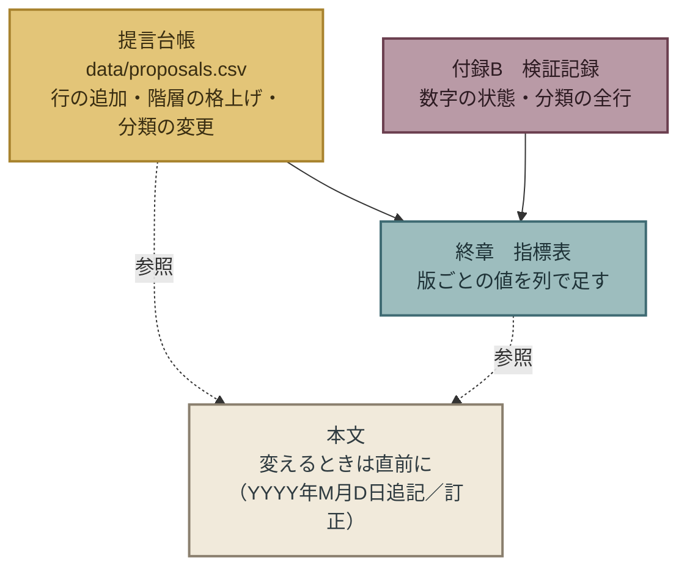

## 最後に

本書は、会社に何を買えとも、何を導入せよとも書いていない。 
書いたのは、数えること、残すこと、分けて知らせることである。 
どれも、技術ではなく、決めることである。

71通の公表文は、決めていなかった会社が、事故のあとに何を書けたかの記録である。 
本書は、事故の前に決めておけば、その公表文がどう違ったかを、台帳の公表文自身の言葉で示そうとした。 
それができたかどうかは、読者が判断する。 
本書は、次の版で数え直す。

 

---

### 参考文献

1. 著者「提言台帳 `data/proposals.csv` 第1版」（2026-10-30）※本リポジトリ
2. 著者「The Japan Breach Registry 2026 第3版」（2026-10-26） https://github.com/Leading-AI-IO/the-japan-breach-registry-2026
3. 個人情報保護委員会「令和8年度第1四半期における監視・監督権限の行使状況」（2026-09-02） https://www.ppc.go.jp/files/pdf/260902_shiryou-3-1.pdf

 

---

# 付録A: 方法 ── どう集め、どう確かめ、どう数えたか

この付録は、本書の提言台帳 `data/proposals.csv` がどう作られたかを記す。 
読者が本書の件数を自分で数え直すために必要なことだけを書く。 
発行元の種類A〜H、階層T1〜T3の定義は第4章に、提言の種類K1〜K9の定義は第6章に、日本の台帳の侵入経路の区分は姉妹書にある。 
ここでは繰り返さない。

## 収集の経緯

提言の収集は、3回に分けて行った。

| 回 | 日付 | 方法 | 結果 |
|---|---|---|---|
| 1 | 2026年10月11日 | 複数のAI調査ツールで、世界の提言を集める試み | 提言の根拠を一次資料で確かめられる見通しが立たず、本書の執筆を一度見送った（第1章冒頭） |
| 2 | 2026年10月18日 | AI調査ツール3種（Claude、ChatGPT、Perplexity）に同じ設問を与え、提言を表の形で収集 | 3本の調査結果。Perplexityの結果は22行 |
| 3 | 2026年10月30日 | AI調査ツール2種（Claude、ChatGPT）に、設問を広げて再収集。Perplexityは別途、候補の一覧（leads）として使用 | 2本の調査結果 |

5本の調査結果を、著者が1つの台帳に統合した（`ledger_src/merge_ledger.py`）。 
統合後の行数は263行、うち別の行と同じ提言と判断して統合した行が13行、残り250行が収録候補である。

調査ツールの選択について、1つ書いておくことがある。 
Geminiの調査結果は、2本とも全件を除外した。 
理由は付録B「追跡する数字（第1版時点、2026年10月30日）」の#6に記した。 
日本の有識者の一次資料として報告されたURL13件のうち3件を開き、いずれもページが存在しなかった（ドメインは実在、記事のパスが不存在）。 
残り10件を開かずに、その調査結果の信頼性が本書の基準に届かないと判断した。 
この除外は、Geminiの能力の評価ではない。 
本書が開いて確かめる手順を、13件すべてに対して行う前に、3件で判断したという記録である。

## 台帳の列

`data/proposals.csv` の列は次のとおりである。

| 列 | 内容 |
|---|---|
| `new_id` | 本書の通し番号。発行元の種類の記号（A〜H）と3桁の番号 |
| `src`, `src_id` | 出所の調査結果と、その中での番号 |
| `type` | 発行元の種類（A〜H、第4章） |
| `proposal` | 提言の文言。原文の引用を優先し、日本語訳または要約を添える |
| `issuer` | 発行元、資料名、日付、開封の記録 |
| `medium` | 媒体の種類 |
| `tier` | 階層（T1〜T3、第4章） |
| `target`, `industry` | 提言の宛先と業界 |
| `k` | 提言の種類（K1〜K9、第6章）。主分類を先に書き、副分類を「/」「・」「,」で続ける |
| `evidence` | 根拠の有無と内容 |
| `status` | 実装の状態（提言どまり、制度化済み、効果測定あり、など） |
| `limits` | 発行元自身または第三者が書いた限界・批判 |
| `route` | 日本の台帳の侵入経路との対応 |
| `urls` | 一次資料のURL |
| `merged_into` | 統合先の `new_id`（統合された行のみ） |
| `also_in` | 同じ提言を含む他の調査結果 |

## 確かめる手順

階層の判定は、次の手順で行った。

1. `urls` 列のURLを著者が開く。開けなければT3のまま置く。
2. 開けたら、`proposal` 列の文言が本文にあるかを確かめる。文言がなければ、調査結果の要約であることを `issuer` 列に記し、本文の文言に差し替える。
3. 文言の根拠（データの出所、母数、方法）が同じ資料に書かれていればT1、書かれていなければT2とする。
4. 開封の記録（日付、全文か抜粋か、サブエージェントによる開封か）を `issuer` 列に残す。

第1版の執筆中に、次の4行の階層を変えた。

| 行 | 変更 | 日付 | 根拠 |
|---|---|---|---|
| E-002、E-003 | T2→T1 | 2026-10-30 | Coalitionの2026-08-31の記事を全文確認 |
| A-063 | T3→T1 | 2026-10-30 | 金融庁2026-10-09の要請を原文で確認。文言は「施行日を待たず、可及的速やかな対応を図ること」。「前倒し」の語は原文になく、要約を差し替えた |
| H-004 | T3→T1 | 2026-10-30 | インドCERT-Inの2022-04-28の指令を原文PDFで確認。180日のログ保持、インド国内での保管 |

この4行の変更で、第2部の集計対象（T1・T2）は209件から211件に、経路非開示への処方は37件から38件に、K3は36件から37件に、K5は12件から13件に、K9は64件から66件に変わった。 
本文の件数は、変更後の値に揃えた。

## 数え方

本文の件数は、次の規則で数えた。

- **集計対象はT1・T2の非統合行**（`merged_into` が空の行）。第1版で211件。
- **種類（K）の件数は、副分類を含めて数える。** 1つの提言が複数の種類に数えられる。「主分類」と書いたときだけ、`k` 列の先頭の種類で数える。
- **合意**（第4章）は、同じ向きの提言を3種類以上の発行元（A〜H）が書いているもの。向きの判定は著者が行った。
- **効果測定あり**（第6章）は、`status` 列に「効果測定あり」を含む行。相関を含み、因果を要求しない。
- **侵入経路との対応**（第6章）は、`route` 列。1つの提言が複数の経路に対応する場合は、各経路に数える。
- **日本の公表文の分類**（第9章）は、姉妹書の `data/registry.csv` の規模・状態・補足の列から、著者が初報の形で判定した。全行は付録B「第9章の分類 ── 通知の範囲（台帳71行、2026年10月30日）」。

数え方に裁量が入る箇所は、合意の向き、種類の割り当て、経路の対応、公表文の分類の4つである。 
いずれも著者の判断であり、台帳の列を見れば読者が別の判定をすることができる。

## 使わなかったもの

- **T3の39行。** 本文で使っていない。使うときは、一次資料を開いてT1またはT2に格上げしてから使う。
- **Geminiの調査結果2本。** 本章「収集の経緯」の理由による。
- **一次資料に届かなかった数字。** 付録B「追跡する数字（第1版時点、2026年10月30日）」に、状態とともに記録した。
- **姉妹書の台帳の事案の要約。** 本書は台帳の行を再掲せず、行のIDと公表文の文言だけを引く。

## 更新の規則

- 新しい提言は、台帳に行を足す。本文の件数は、各章冒頭の「第N版時点」欄と、終章の指標表で更新する。
- 階層の変更は、`issuer` 列に日付と根拠を記す。
- 本文の文章を変えるときは、変更箇所の直前に「（YYYY年M月D日追記／訂正）」を置く。
- 行は消さない。統合する場合は `merged_into` に統合先を書く。

## 第1版で残っている作業

第1版の時点で、著者が確かめきれていないことを記す。

| # | 項目 | 影響する章 |
|---|---|---|
| 1 | CISA BOD 26-04の指令本文の開封（A-087。現在はCISAの告知、FedRAMPの一次資料、第三者の解説に依拠） | 第3章 |
| 2 | Mandiant M-Trends 2026 報告書本体の開封（現在は発表記事に依拠） | 第1章、第8章 |
| 3 | EU NIS2 第23条の本文のEUR-Lexでの確認（第1版は前文102のみEUR-Lexで確認） | 第9章 |
| 4 | 日本の個人の有識者の一次資料の直接収集 | 第6章 |
| 5 | T3の39行の格上げまたは見送りの確定 | 第2部 |
| 6 | 第9章の公表文分類（A〜D）の境界行の再判定 | 第9章、付録B「第9章の分類 ── 通知の範囲（台帳71行、2026年10月30日）」 |
| 7 | 「効果測定あり」14件の、台帳の `status` 列との再照合（機械的な集計では13件になる行がある） | 第6章 |

 

---

# 付録B: 検証記録 ── 確認できた数字、できなかった数字

この付録は、本書が本文で使った数字、使わなかった数字、使えなかった数字のうち、確認の結果が「見つかった」で終わらなかったものを記録する。 
版を重ねるごとに、各行の「状態」を更新する。

本書の方法（付録A）では、提言の根拠となる数字は、著者が一次資料のURLを開き、本文で該当の記述を確認したものだけをT1・T2として集計に使う。 
この付録は、その手順の途中で止まった数字の置き場である。

## 追跡する数字（第1版時点、2026年10月30日）

| # | 数字 | 帰属されている先 | 確認の経緯 | 状態 | 本文での扱い |
|---|---|---|---|---|---|
| 1 | 「拒絶された請求の82%はMFA未導入」 | Coalition | Coalition自身が2026-08-31に「factually incorrect」「we've never published data on claims denials」と否定。著者が2026-10-30に全文確認 | **発行元が否定** | 第6章「空白の隣にあるもの ── 間違っている数字」 |
| 2 | 「請求の44%が拒絶される」 | Advisen | Coalitionの同記事が、Advisenと親会社Zywaveは未公表と記す（同社の編集者に確認したとする） | **帰属先が未公表（Coalitionの確認による）** | 第6章「空白の隣にあるもの ── 間違っている数字」 |
| 3 | 「請求の40%以上が拒絶される」 | Fitch Ratings | Coalitionの同記事が、Fitchの2024年・2025年の報告書にないと記す（同社の幹部に確認したとする） | **帰属先が未公表（Coalitionの確認による）** | 第6章「空白の隣にあるもの ── 間違っている数字」 |
| 4 | 「保険が補償したのは32%だけ」 | NetDiligence | 数字は実在。元の報告では請求の11%が未決着。Coalitionは「文脈を外れている」と記す | **文脈の喪失** | 第6章「空白の隣にあるもの ── 間違っている数字」 |
| 5 | 「高深刻度の脆弱性を7日以内に修正した企業は、インシデント発生率が半分」 | Coalition | 2026-10-18と2026-10-30の2回の独立した調査で、Coalitionの公開資料に見つからず。10-30の調査はSecurity Labsの記事（2026-03、修正期限を扱う）を開いたが該当なし | **出所不明** | 不使用。台帳に収載せず |
| 6 | 日本の有識者13名の発言の一次資料URL 13件 | 各有識者の寄稿・講演録 | AIの調査ツール（Gemini）2本が報告。3件を抽出して開き、いずれも存在せず（ドメインは実在、記事のパスが不存在）。残り10件を開かずに、2本の調査結果を全件除外 | **存在しない一次資料** | 不使用。第6章「空白4 ── 日本の個人の有識者の一次資料」の「日本の有識者の一次資料は1件」はこの除外後の数 |
| 7 | 「脆弱性の悪用までの平均時間は、パッチ公開に対してマイナス7日」 | Mandiant（Google Cloud）M-Trends 2026 | 2026-10-30の調査の1本は本文に届かず「確認できず」。同日の別の1本が確認。条件：基準は「パッチ公開日」、値は推定 | **確認済み（条件つき）** | 第1章。条件を本文に明記 |
| 8 | Project Glasswingの脆弱性の発見・開示・修正の件数 | Anthropic | 2026-10-30の調査の1本は「数値を検証できず、採録しない」。別の1本がAnthropicの一次資料で確認 | **確認済み** | 第1章・第5章 |
| 9 | 「More security tools and increased spending isn't making businesses any safer.」 | Coalition 2026 Cyber Claims Report | 台帳E-010はブログ版のURLを記録。2026-10-30に発表ページ（announcements）を開いたが同じ文言はなく、ブログ版は未開封 | **確認済み（条件つき）** | 第12章。出所をブログ版と明記 |
| 10 | Marsh McLennanの統制と請求の関係（机上演習13%、EDR25%ごとに10%、耐フィッシングMFA9%） | Marsh McLennan CRIC | 2026-10-30にプレスリリースを確認。組織数は未記載。「相関」の語を使うが、因果でないという明示の注記はない | **確認済み（条件つき）** | 第12章。相関として扱う |
| 11 | ブックオフ第2報の「対象者6,383,279人」「退会会員212,371人」 | ブックオフグループホールディングス | 一次PDFに著者が到達できず（HTML版は画像のみ）。報道ベース | **出所に未到達（報道ベース）** | 第9章。報道ベースと明記 |

## 状態の定義

| 状態 | 意味 | 本文で使うか |
|---|---|---|
| 発行元が否定 | 帰属されている発行元自身が、公表していない・誤りだと言明した | 使わない。否定の事実だけを書く |
| 帰属先が未公表（第三者の確認による） | 帰属先自身の言明はないが、第三者の一次資料が、帰属先に確認したと記す | 使わない。「第三者の確認による」と明記する |
| 文脈の喪失 | 数字は実在するが、元の資料の条件が落ちて流通している | 条件を戻せば使える |
| 出所不明 | 複数回の調査で一次資料に届かない。誤りとは言えない | 使わない。見つかれば状態を更新する |
| 存在しない一次資料 | 示されたURLにページがない | 使わない。その調査結果全体の信頼性を下げる |
| 出所に未到達（報道ベース） | 一次資料は実在するが、著者が本文に到達できず、報道の値を使っている | 報道ベースと明記して使う。到達したら状態を更新する |
| 確認済み（条件つき） | 一次資料で確認したが、流通している形には書かれていない条件がある | 条件を明記して使う |
| 確認済み | 一次資料で確認し、条件も一致する | 使う |

## この記録から分かること

- **「確認できなかった」と「誤り」は別である。** #7・#8は、1回目の調査で「確認できず」と報告され、2回目で確認できた。#5は2回とも届かなかったが、3回目で届く可能性は残る。本書は「出所不明」の状態を、この可能性のために残す。
- **確認とは、数字が合っていると分かることではなく、どの条件が付いているかが分かることである。** #7の「パッチ公開日が基準」「推定」は、確認の過程で初めて分かった。
- **AIの調査ツールは、実在する媒体名と、ありそうな記事の題名と、存在しないURLを、同じ確からしさで返す。** 開くまで見分けはつかない。本書のT1・T2の211件がすべて著者がURLを開いたものであるのは、#6を生まないためである。
- **数字の間違い方は、少なくとも3種類ある。** 捏造または幻覚（#1）、帰属の誤り（#2・#3）、文脈の喪失（#4）。3種類目は、日本の漏えい台帳（本書とは別の事実台帳）が単位の問題として記録してきたものと同じ型である。

## 更新の規則

- 新しく否定された数字、または本書の調査で一次資料に届かなかった数字が出たら、行を足す。
- 状態が変わったら、変わった日付と根拠を「確認の経緯」に追記する。行は消さない。
- 追記には「（YYYY年M月D日追記）」を付ける。

## 第9章の分類 ── 通知の範囲（台帳71行、2026年10月30日）

第9章の表は、姉妹書の台帳71行を、公表文の規模・状態・補足の記述から著者が分類したものである。 
行は台帳のIDで示す。 
境界にある行は第9章「反論と限界」に記した。

| 形 | 通数 | 台帳ID |
|---|---|---|
| A 上限で出した | 18 | 005, 010, 014, 018, 020, 021, 022, 027, 032, 036, 042, 043, 051, 052, 054, 060, 061, 071 |
| B 記録で絞った | 24 | 001, 007, 011, 013, 017, 019, 025, 028, 029, 030, 037, 038, 039, 040, 044, 045, 046, 048, 055, 058, 064, 066, 068, 070 |
| C 件数を書けない | 14 | 004, 006, 023, 024, 031, 034, 035, 047, 049, 050, 057, 059, 062, 065 |
| D 「可能性」と件数 | 15 | 002, 003, 008, 009, 012, 015, 016, 026, 033, 041, 053, 056, 063, 067, 069 |

分類の規則：初報の形で分類する（Helpfeel 005は初報が全件のためA）。 
「最大」「時点の保有全件」「登録者全員」「みなして対応」のいずれかがあればA。 
確認とおそれを分けた、件数を確定した、または全体のうち何件に何が含まれるかを示したものはB。 
件数の記載がない、調査中、非公表はC。 
「可能性」と件数のみで、上限か否かが読めないものはD。

 

---

### 参考文献

1. Coalition（Daniel Woods）「Dispelling the Myth: Cyber Insurance Doesn't Pay Claims」（2026-08-31） https://www.coalitioninc.com/blog/cyber-insurance/dispelling-myth-cyber-insurance-doesnt-pay-claims
2. Coalition Security Labs「Boundary Devices and Plugins Prompt Timely Remediation（#5の出所を探して開いた資料。該当の数字なし）」（2026-03） https://www.coalitioninc.com/blog/security-labs/boundary-devices-and-plugins-prompt-timely-remediation
3. Mandiant（Google Cloud）「M-Trends 2026（#7）」（2026）※第1章の出典表
4. Anthropic「Project Glasswing（#8）」（2026）※第1章の出典表

 

---

**© 2026 Satoshi Yamauchi / Leading.AI — Licensed under CC BY 4.0**
